# JARKOM MODUL 5-2026-K-06

## Anggota Kelompok
|Nama|NRP|
|---|---|
|Dewa Ngakan Gede Wira Adhimukti|5027251063|
|Razana Aulia|5027251127|

### 1 - Markas Tanpa Peta
> tengah malam alarm meraung, dan Ritsuko terdiam. Markas sebesar ini dibangun tanpa peta alamat. Gendo anti pemborosan, jadi tiap subnet memakai prefix terkecil yang muat. Bagi prefix IP kelompokmu dengan VLSM untuk 17 LAN dan 16 link antar-router, urut dari kebutuhan terbesar. Tunjukkan tabel berisi network, prefix, gateway, broadcast, IP terpakai, dan sisa. Tunjukkan juga gambar pohon IP, dengan subnet jalur Dummy-Plug ke Armisael dilingkari. Di laporan, jelaskan hitungan satu subnet.

Soal meminta untuk membagi alamat IP jaringan Geofront menggunakan metode Variable Length Subnet Mask (VLSM) untuk memenuhi kebutuhan 17 LAN dan 16 link antar-router. Setiap subnet harus menggunakan prefix terkecil yang dapat memenuhi kebutuhan alamat IP agar penggunaan alamat IP menjadi efisien.

Pembagian subnet dilakukan berdasarkan kebutuhan host terbesar hingga terkecil. Apabila terdapat subnet dengan ukuran blok yang sama, LAN diprioritaskan terlebih dahulu dibandingkan link antar-router, kemudian mengikuti urutan tabel pada soal.

Hasil pembagian IP disajikan dalam bentuk tabel yang memuat Network ID, prefix, gateway, broadcast, jumlah IP terpakai, dan sisa IP. Selain itu, dibuat pohon pembagian IP dengan menandai subnet-subnet yang dilalui pada jalur komunikasi Dummy-Plug menuju Armisael.

#### 1.1 - Penentuan Network Induk

Blok alamat IP yang digunakan dalam perancangan jaringan Geofront adalah 192.214.0.0/21. Prefix /21 digunakan karena merupakan blok jaringan terkecil yang dapat menampung seluruh kebutuhan alamat IP dari 17 LAN dan 16 link antar-router.

| Keterangan | Nilai |
|---|---|
| Network ID | 192.214.0.0 |
| Prefix | /21 |
| Subnet Mask | 255.255.248.0 |
| Broadcast Address | 192.214.7.255 |
| Rentang Alamat IP | 192.214.0.0 – 192.214.7.255 |
| Total Alamat IP | 2048 |
| Jumlah LAN | 17 |
| Jumlah Link Antar-router | 16 |
| Total Subnet | 33 |

#### 1.2 - Perhitungan Kebutuhan Alamat IP

Dalam menentukan ukuran subnet LAN, jumlah alamat IP yang dibutuhkan dihitung dengan memperhitungkan jumlah host, satu alamat IP gateway, satu Network ID, dan satu Broadcast Address.

Rumus yang digunakan adalah:

$$
2^h \geq H + G + 2
$$

Keterangan:

- $h$ = jumlah bit host.
- $H$ = jumlah host yang dibutuhkan.
- $G$ = jumlah alamat IP gateway, yaitu 1.
- 2 = alamat yang digunakan untuk Network ID dan Broadcast Address.

Setelah memperoleh jumlah bit host terkecil yang memenuhi kebutuhan, prefix subnet dapat ditentukan menggunakan rumus:

$$
Prefix = 32 - h
$$

Sedangkan jumlah alamat IP usable dan sisa alamat IP dihitung menggunakan rumus:

$$
IP_{usable} = 2^h - 2
$$

$$
IP_{sisa} = IP_{usable} - (H + G)
$$

Berikut merupakan hasil perhitungan kebutuhan alamat IP setiap LAN.

| No. | LAN | Jumlah Host | Gateway | Total Kebutuhan IP | Ukuran Blok | Prefix |
|---|---|---:|---:|---:|---:|---|
| 1 | Switch-Quarters | 500 | 1 | 503 | 512 | /23 |
| 2 | Switch-Comm | 200 | 1 | 203 | 256 | /24 |
| 3 | Switch-Hangar | 100 | 1 | 103 | 128 | /25 |
| 4 | Switch-Bunker | 55 | 1 | 58 | 64 | /26 |
| 5 | Switch-Medic | 26 | 1 | 29 | 32 | /27 |
| 6 | Switch-Relay | 25 | 1 | 28 | 32 | /27 |
| 7 | Switch-Garden | 14 | 1 | 17 | 32 | /27 |
| 8 | Switch-Dock | 12 | 1 | 15 | 16 | /28 |
| 9 | Switch-Lab | 5 | 1 | 8 | 8 | /29 |
| 10 | Switch-Terminal | 3 | 1 | 6 | 8 | /29 |
| 11 | Switch-Cage | 3 | 1 | 6 | 8 | /29 |
| 12 | Switch-Dogma | 2 | 1 | 5 | 8 | /29 |
| 13 | Switch-Monolith | 2 | 1 | 5 | 8 | /29 |
| 14 | Switch-Radar | 4 | 1 | 7 | 8 | /29 |
| 15 | Switch-Archive | 1 | 1 | 4 | 4 | /30 |
| 16 | Switch-Intel | 1 | 1 | 4 | 4 | /30 |
| 17 | Switch-Cmd | 1 | 1 | 4 | 4 | /30 |

Setiap link antar-router membutuhkan dua alamat IP usable untuk kedua interface router. Dengan memperhitungkan Network ID dan Broadcast Address, setiap link membutuhkan empat alamat IP sehingga digunakan prefix /30.

Total ukuran blok yang dialokasikan adalah:

- Total alokasi 17 LAN = 1132 alamat IP.
- Total alokasi 16 link antar-router = 16 × 4 = 64 alamat IP.
- Total alokasi keseluruhan = 1196 alamat IP.

Prefix /22 hanya menyediakan 1024 alamat IP sehingga tidak dapat memenuhi seluruh kebutuhan jaringan. Oleh karena itu, digunakan prefix /21 yang menyediakan 2048 alamat IP.

#### 1.3 - Tabel Pembagian VLSM LAN

Pembagian alamat IP dilakukan secara berurutan berdasarkan ukuran blok terbesar hingga terkecil. Alamat IP usable pertama pada setiap subnet digunakan sebagai gateway.

| No. | LAN | Router Gateway | Network ID | Prefix | Gateway | Broadcast | IP Terpakai | Sisa IP |
|---|---|---|---|---|---|---|---:|---:|
| 1 | Switch-Quarters | Rei | 192.214.0.0 | /23 | 192.214.0.1 | 192.214.1.255 | 501 | 9 |
| 2 | Switch-Comm | Hikari | 192.214.2.0 | /24 | 192.214.2.1 | 192.214.2.255 | 201 | 53 |
| 3 | Switch-Hangar | Yui | 192.214.3.0 | /25 | 192.214.3.1 | 192.214.3.127 | 101 | 25 |
| 4 | Switch-Bunker | Kensuke | 192.214.3.128 | /26 | 192.214.3.129 | 192.214.3.191 | 56 | 6 |
| 5 | Switch-Medic | Maya | 192.214.3.192 | /27 | 192.214.3.193 | 192.214.3.223 | 27 | 3 |
| 6 | Switch-Relay | Kaworu | 192.214.3.224 | /27 | 192.214.3.225 | 192.214.3.255 | 26 | 4 |
| 7 | Switch-Garden | Shinji | 192.214.4.0 | /27 | 192.214.4.1 | 192.214.4.31 | 15 | 15 |
| 8 | Switch-Dock | Mari | 192.214.4.32 | /28 | 192.214.4.33 | 192.214.4.47 | 13 | 1 |
| 9 | Switch-Lab | Ritsuko | 192.214.4.48 | /29 | 192.214.4.49 | 192.214.4.55 | 6 | 0 |
| 10 | Switch-Terminal | Fuyutsuki | 192.214.4.56 | /29 | 192.214.4.57 | 192.214.4.63 | 4 | 2 |
| 11 | Switch-Cage | Misato | 192.214.4.64 | /29 | 192.214.4.65 | 192.214.4.71 | 4 | 2 |
| 12 | Switch-Dogma | Toji | 192.214.4.72 | /29 | 192.214.4.73 | 192.214.4.79 | 3 | 3 |
| 13 | Switch-Monolith | Shigeru | 192.214.4.80 | /29 | 192.214.4.81 | 192.214.4.87 | 3 | 3 |
| 14 | Switch-Radar | Makoto | 192.214.4.88 | /29 | 192.214.4.89 | 192.214.4.95 | 5 | 1 |
| 15 | Switch-Archive | Asuka | 192.214.4.96 | /30 | 192.214.4.97 | 192.214.4.99 | 2 | 0 |
| 16 | Switch-Intel | Kaji | 192.214.4.100 | /30 | 192.214.4.101 | 192.214.4.103 | 2 | 0 |
| 17 | Switch-Cmd | Gendo | 192.214.4.104 | /30 | 192.214.4.105 | 192.214.4.107 | 2 | 0 |

Keterangan:

- IP Terpakai merupakan jumlah kebutuhan alamat IP host dan gateway.
- Sisa IP merupakan jumlah alamat IP usable yang belum dialokasikan.
- Network ID dan Broadcast Address tidak termasuk alamat IP usable.

#### 1.4 - Tabel Pembagian VLSM Link Antar-router

Setiap link antar-router menggunakan prefix /30 dengan subnet mask 255.255.255.252. Alamat IP usable pertama diberikan kepada router induk, sedangkan alamat IP usable kedua diberikan kepada router cabang.

| No. | Link Antar-router | Network ID | Prefix | IP Router Induk | IP Router Cabang | Broadcast | IP Terpakai | Sisa IP |
|---|---|---|---|---|---|---|---:|---:|
| 1 | Gendo – Yui | 192.214.4.108 | /30 | 192.214.4.109 | 192.214.4.110 | 192.214.4.111 | 2 | 0 |
| 2 | Gendo – Hikari | 192.214.4.112 | /30 | 192.214.4.113 | 192.214.4.114 | 192.214.4.115 | 2 | 0 |
| 3 | Gendo – Asuka | 192.214.4.116 | /30 | 192.214.4.117 | 192.214.4.118 | 192.214.4.119 | 2 | 0 |
| 4 | Gendo – Kaji | 192.214.4.120 | /30 | 192.214.4.121 | 192.214.4.122 | 192.214.4.123 | 2 | 0 |
| 5 | Gendo – Misato | 192.214.4.124 | /30 | 192.214.4.125 | 192.214.4.126 | 192.214.4.127 | 2 | 0 |
| 6 | Gendo – Shigeru | 192.214.4.128 | /30 | 192.214.4.129 | 192.214.4.130 | 192.214.4.131 | 2 | 0 |
| 7 | Gendo – Fuyutsuki | 192.214.4.132 | /30 | 192.214.4.133 | 192.214.4.134 | 192.214.4.135 | 2 | 0 |
| 8 | Yui – Mari | 192.214.4.136 | /30 | 192.214.4.137 | 192.214.4.138 | 192.214.4.139 | 2 | 0 |
| 9 | Yui – Rei | 192.214.4.140 | /30 | 192.214.4.141 | 192.214.4.142 | 192.214.4.143 | 2 | 0 |
| 10 | Yui – Shinji | 192.214.4.144 | /30 | 192.214.4.145 | 192.214.4.146 | 192.214.4.147 | 2 | 0 |
| 11 | Hikari – Kaworu | 192.214.4.148 | /30 | 192.214.4.149 | 192.214.4.150 | 192.214.4.151 | 2 | 0 |
| 12 | Asuka – Kensuke | 192.214.4.152 | /30 | 192.214.4.153 | 192.214.4.154 | 192.214.4.155 | 2 | 0 |
| 13 | Asuka – Ritsuko | 192.214.4.156 | /30 | 192.214.4.157 | 192.214.4.158 | 192.214.4.159 | 2 | 0 |
| 14 | Shigeru – Makoto | 192.214.4.160 | /30 | 192.214.4.161 | 192.214.4.162 | 192.214.4.163 | 2 | 0 |
| 15 | Fuyutsuki – Maya | 192.214.4.164 | /30 | 192.214.4.165 | 192.214.4.166 | 192.214.4.167 | 2 | 0 |
| 16 | Fuyutsuki – Toji | 192.214.4.168 | /30 | 192.214.4.169 | 192.214.4.170 | 192.214.4.171 | 2 | 0 |

Pada subnet link antar-router, tidak terdapat gateway LAN tersendiri. Kedua alamat IP usable digunakan sebagai alamat interface masing-masing router sehingga tidak terdapat alamat IP usable yang tersisa.

#### 1.5 - Contoh Perhitungan Subnet

Sebagai contoh, dilakukan perhitungan VLSM pada Switch-Quarters yang berada di bawah router Rei.

Berdasarkan tabel kebutuhan host, Switch-Quarters membutuhkan 500 alamat IP host. Selain itu, diperlukan satu alamat IP gateway untuk router Rei, satu Network ID, dan satu Broadcast Address.

##### 1.5.1 - Menghitung Total Kebutuhan IP

$$
Total\ Kebutuhan = 500 + 1 + 2
$$

$$
Total\ Kebutuhan = 503
$$

##### 1.5.2 - Menentukan Jumlah Bit Host

Jumlah bit host ditentukan dengan mencari nilai pangkat dua terkecil yang dapat memenuhi kebutuhan 503 alamat IP.

$$
2^8 = 256 < 503
$$

$$
2^9 = 512 \geq 503
$$

Berdasarkan hasil tersebut, diperlukan 9 bit host karena 8 bit host tidak dapat memenuhi kebutuhan alamat IP.

##### 1.5.3 - Menentukan Prefix

$$
Prefix = 32 - 9
$$

$$
Prefix = /23
$$

Dengan demikian, prefix terkecil yang dapat memenuhi kebutuhan Switch-Quarters adalah /23 dengan subnet mask 255.255.254.0.

##### 1.5.4 - Menentukan Jumlah IP Usable

$$
IP_{usable} = 2^9 - 2
$$

$$
IP_{usable} = 512 - 2 = 510
$$

##### 1.5.5 - Menghitung Sisa IP

$$
IP_{sisa} = 510 - (500 + 1)
$$

$$
IP_{sisa} = 9
$$

##### 1.5.6 - Hasil Perhitungan

| Keterangan | Hasil |
|---|---|
| Network ID | 192.214.0.0 |
| Prefix | /23 |
| Subnet Mask | 255.255.254.0 |
| Total Alamat IP | 512 |
| Total IP Usable | 510 |
| Gateway | 192.214.0.1 |
| Rentang IP Usable | 192.214.0.1 – 192.214.1.254 |
| Broadcast Address | 192.214.1.255 |
| Kebutuhan Host | 500 |
| IP Usable Terpakai | 501 |
| Sisa IP Usable | 9 |

Berdasarkan perhitungan tersebut, prefix /23 merupakan prefix terkecil yang dapat memenuhi kebutuhan Switch-Quarters. Penggunaan prefix /24 tidak memungkinkan karena hanya menyediakan 254 alamat IP usable, sedangkan penggunaan prefix /22 akan mengalokasikan lebih banyak alamat IP daripada yang dibutuhkan.

#### 1.6 - Pohon Pembagian IP

Pohon pembagian IP menggambarkan proses pembagian network induk 192.214.0.0/21 menjadi subnet-subnet dengan ukuran yang berbeda menggunakan metode VLSM.

Subnet dengan kebutuhan alamat IP terbesar dialokasikan terlebih dahulu, kemudian blok alamat yang tersisa dibagi kembali hingga seluruh kebutuhan 17 LAN dan 16 link antar-router terpenuhi.


*Gambar 1. Pohon pembagian alamat IP jaringan Geofront menggunakan VLSM.*

Pada pohon pembagian IP tersebut, terdapat lima subnet yang dilingkari untuk menunjukkan subnet-subnet yang dilalui pada jalur komunikasi Dummy-Plug menuju Armisael.

#### 1.7 - Identifikasi Jalur Dummy-Plug menuju Armisael

Dummy-Plug berada pada Switch-Lab dengan router Ritsuko sebagai gateway, sedangkan Armisael berada pada Switch-Monolith dengan router Shigeru sebagai gateway.

Berdasarkan ketentuan pengalamatan node, diperoleh alamat berikut:

| Node | IP Address | Prefix | Gateway |
|---|---|---|---|
| Dummy-Plug | 192.214.4.51 | /29 | 192.214.4.49 |
| Armisael | 192.214.4.83 | /29 | 192.214.4.81 |

Jalur komunikasi berdasarkan topologi jaringan adalah sebagai berikut:

```text
Dummy-Plug
    |
Switch-Lab
    |
Ritsuko
    |
Asuka
    |
Gendo
    |
Shigeru
    |
Switch-Monolith
    |
Armisael
```

Subnet-subnet yang dilalui pada jalur tersebut adalah:

| Urutan | Segmen Jaringan | Network ID | Prefix |
|---|---|---|---|
| 1 | Switch-Lab | 192.214.4.48 | /29 |
| 2 | Ritsuko – Asuka | 192.214.4.156 | /30 |
| 3 | Asuka – Gendo | 192.214.4.116 | /30 |
| 4 | Gendo – Shigeru | 192.214.4.128 | /30 |
| 5 | Switch-Monolith | 192.214.4.80 | /29 |

Kelima subnet tersebut ditandai pada pohon pembagian IP karena merupakan segmen jaringan yang akan dilalui oleh paket dari Dummy-Plug menuju Armisael setelah konfigurasi routing dilakukan.

#### 1.8 - Hasil Pembgaian IP

Berdasarkan hasil pembagian VLSM, seluruh kebutuhan alamat IP jaringan Geofront dapat dipenuhi menggunakan network induk 192.214.0.0/21.

| Keterangan | Jumlah |
|---|---:|
| Total alamat IP network induk | 2048 |
| Total alamat IP yang dialokasikan untuk LAN | 1132 |
| Total alamat IP yang dialokasikan untuk link antar-router | 64 |
| Total alamat IP yang dialokasikan | 1196 |
| Total alamat IP yang belum dialokasikan ke subnet | 852 |
| Jumlah subnet LAN | 17 |
| Jumlah subnet link antar-router | 16 |
| Total subnet | 33 |

Persentase alokasi alamat IP terhadap kapasitas network induk adalah:

$$
Persentase\ Alokasi = \frac{1196}{2048} \times 100\%
$$

$$
Persentase\ Alokasi = 58.40\%
$$

Sebanyak 58.40% alamat IP pada network induk telah dialokasikan menjadi subnet, sedangkan 41.60% alamat IP lainnya belum dialokasikan dan dapat digunakan untuk pengembangan jaringan selanjutnya.

### 2 - Geofront Gelap Gulita
> Kabel sudah ditarik, tapi saat Misato menekan tombol daya, Geofront tetap gelap. Tidak ada alamat dan tidak ada rute. Pasang semua node di GNS3 sesuai topologi. Beri IP ke tiap interface router sesuai soal 1, lalu aktifkan IP forwarding di semua router. Hanya Gendo yang terhubung ke NAT1 dan mendapat alamat lewat DHCP. Router lain baru bisa memasang paket setelah soal 4, karena internet baru ada saat itu. Tunjukkan `ip -br` di tiap router dan ping dua ujung tiap link router ke router.

Soal meminta untuk membangung topologi jaringan Geofront pada GNS3 menggunakan Alpine Linux dengan mengikuti rancangan topologi yang telah diberikan. Setiap interface router dikonfigurasi menggunakan alamat IP berdasarkan hasil pembagian VLSM pada soal 1.

Seluruh router harus mengaktifkan IP forwarding agar dapat meneruskan paket antarjaringan. Hanya router Gendou yang terhubung langsung dengan NAT1 dan memperoleh alamat IP secara dinamis melalui DHCP.

Setelah konfigurasi dilakukan, setiap router diverifikasi menggunakan command `ip -br addr`, kemudian dilakukan pengujian ping dua arah pada seluruh 16 link antar-router untuk memastikan konektivitas jaringan.

#### 2.1 - Pembuatan Topologi Jaringan

Topologi jaringan Geofront dibangun menggunakan GNS3 dengan Alpine Linux sebagai sistem operasi pada setiap router dan container host.

Topologi terdiri dari:

- 17 router.
- 17 switch LAN.
- 25 container host.
- 16 link antar-router.
- 1 NAT yang terhubung langsung dengan router Gendou.

Gendou berperan sebagai router pusat yang menghubungkan seluruh cabang jaringan Geofront. Setiap router memiliki satu interface yang berfungsi sebagai gateway LAN dan satu atau beberapa interface yang digunakan untuk koneksi antar-router.


#### 2.2 - Konfigurasi IP Address dan IP Forwarding

Konfigurasi alamat IP dilakukan menggunakan command `ip addr add` sesuai dengan hasil pembagian VLSM pada soal 1.

Command yang digunakan untuk menambahkan alamat IP pada interface adalah:

```bash
ip addr add <IP_ADDRESS>/<PREFIX> dev <INTERFACE>
```

Selanjutnya, IP forwarding diaktifkan pada setiap router menggunakan command:

```bash
sysctl -w net.ipv4.ip_forward=1
```

Untuk melakukan verifikasi konfigurasi, digunakan command:

```bash
ip -br addr
ip route
sysctl net.ipv4.ip_forward
```

#### 2.3 - Konfigurasi Router Gendou

Gendou merupakan router pusat jaringan Geofront dan satu-satunya router yang terhubung langsung dengan NAT1.

##### 2.3.1 - Alokasi Interface

| Interface | Terhubung ke | IP Address |
|---|---|---|
| eth0 | NAT1 | DHCP |
| eth1 | Switch-Cmd | 192.214.4.105/30 |
| eth2 | Fuyutsuki | 192.214.4.133/30 |
| eth3 | Shigeru | 192.214.4.129/30 |
| eth4 | Misato | 192.214.4.125/30 |
| eth5 | Kaji | 192.214.4.121/30 |
| eth6 | Asuka | 192.214.4.117/30 |
| eth7 | Hikari | 192.214.4.113/30 |
| eth8 | Yui | 192.214.4.109/30 |

##### 2.3.2 - Konfigurasi

```bash
ip addr add 192.214.4.105/30 dev eth1
ip addr add 192.214.4.133/30 dev eth2
ip addr add 192.214.4.129/30 dev eth3
ip addr add 192.214.4.125/30 dev eth4
ip addr add 192.214.4.121/30 dev eth5
ip addr add 192.214.4.117/30 dev eth6
ip addr add 192.214.4.113/30 dev eth7
ip addr add 192.214.4.109/30 dev eth8

sysctl -w net.ipv4.ip_forward=1
```

##### 2.3.3 - Konfigurasi DHCP

Interface eth0 pada Gendou dikonfigurasi untuk memperoleh alamat IP secara dinamis dari NAT1 menggunakan DHCP client `udhcpc`.

```bash
ip link set eth0 up
udhcpc -i eth0 -n -q
```

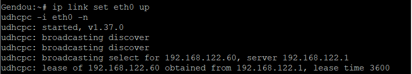

##### 2.3.4 - Verifikasi

```bash
ip -br addr
ip route
sysctl net.ipv4.ip_forward
```

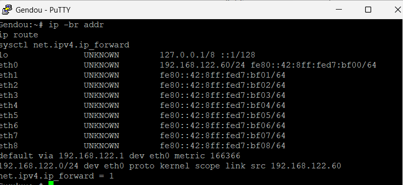

#### 2.4 - Konfigurasi Cabang Yui

Cabang Yui terdiri dari empat router, yaitu Yui, Mari, Rei, dan Shinji. Yui terhubung langsung dengan Gendou dan menjadi router induk bagi ketiga router lainnya.

##### 2.4.1 - Router Yui

| Interface | Terhubung ke | IP Address |
|---|---|---|
| eth0 | Gendou | 192.214.4.110/30 |
| eth1 | Switch-Hangar | 192.214.3.1/25 |
| eth2 | Mari | 192.214.4.137/30 |
| eth3 | Rei | 192.214.4.141/30 |
| eth4 | Shinji | 192.214.4.145/30 |

Konfigurasi:

```bash
ip addr add 192.214.4.110/30 dev eth0
ip addr add 192.214.3.1/25 dev eth1
ip addr add 192.214.4.137/30 dev eth2
ip addr add 192.214.4.141/30 dev eth3
ip addr add 192.214.4.145/30 dev eth4

sysctl -w net.ipv4.ip_forward=1
```

Verifikasi:

```bash
ip -br addr
ip route
sysctl net.ipv4.ip_forward

ping -c 4 192.214.4.109
```

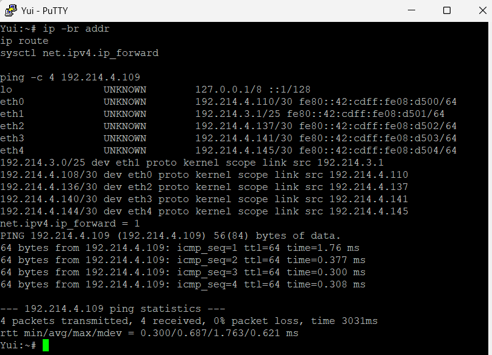

##### 2.4.2 - Router Mari

| Interface | Terhubung ke | IP Address |
|---|---|---|
| eth0 | Yui | 192.214.4.138/30 |
| eth1 | Switch-Dock | 192.214.4.33/28 |

Konfigurasi:

```bash
ip addr add 192.214.4.138/30 dev eth0
ip addr add 192.214.4.33/28 dev eth1

sysctl -w net.ipv4.ip_forward=1
```

Verifikasi:

```bash
ip -br addr
ping -c 4 192.214.4.137
```

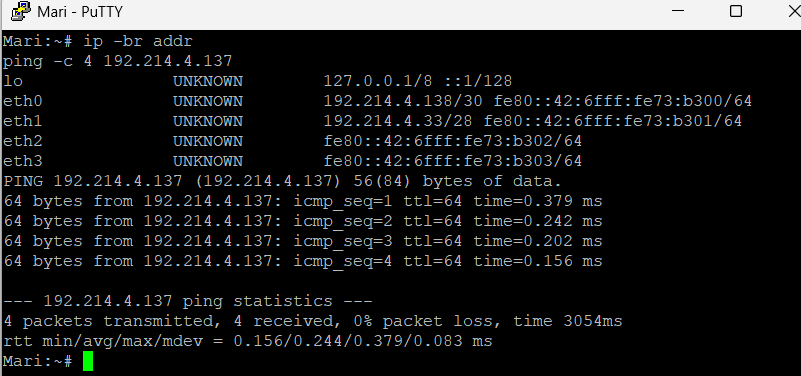

##### 2.4.3 - Router Rei

| Interface | Terhubung ke | IP Address |
|---|---|---|
| eth0 | Yui | 192.214.4.142/30 |
| eth1 | Switch-Quarters | 192.214.0.1/23 |

Konfigurasi:

```bash
ip addr add 192.214.4.142/30 dev eth0
ip addr add 192.214.0.1/23 dev eth1

sysctl -w net.ipv4.ip_forward=1
```

Verifikasi:

```bash
ip -br addr
ping -c 4 192.214.4.141
```


##### 2.4.4 - Router Shinji

| Interface | Terhubung ke | IP Address |
|---|---|---|
| eth0 | Yui | 192.214.4.146/30 |
| eth1 | Switch-Garden | 192.214.4.1/27 |

Konfigurasi:

```bash
ip addr add 192.214.4.146/30 dev eth0
ip addr add 192.214.4.1/27 dev eth1

sysctl -w net.ipv4.ip_forward=1
```

Verifikasi:

```bash
ip -br addr
ping -c 4 192.214.4.145
```


##### 2.4.5 - Pengujian Konektivitas Cabang Yui

Pengujian ping dilakukan dari Yui menuju seluruh router cabangnya untuk memastikan konektivitas dua arah.

Verifikasi di Yui:

```bash
echo "===== Yui ke Mari ====="
ping -c 4 192.214.4.138

echo "===== Yui ke Rei ====="
ping -c 4 192.214.4.142

echo "===== Yui ke Shinji ====="
ping -c 4 192.214.4.146
```


Verifikasi di Gendou:

```bash
ping -c 4 192.214.4.110
```

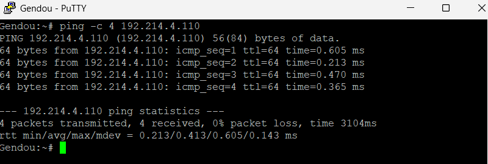

#### 2.5 - Konfigurasi Cabang Hikari

Cabang Hikari terdiri dari router Hikari dan Kaworu. Hikari terhubung langsung dengan Gendou, sedangkan Kaworu terhubung dengan Hikari.

##### 2.5.1 - Router Hikari

| Interface | Terhubung ke | IP Address |
|---|---|---|
| eth0 | Gendou | 192.214.4.114/30 |
| eth1 | Kaworu | 192.214.4.149/30 |
| eth2 | Switch-Comm | 192.214.2.1/24 |

Konfigurasi:

```bash
ip addr add 192.214.4.114/30 dev eth0
ip addr add 192.214.4.149/30 dev eth1
ip addr add 192.214.2.1/24 dev eth2

sysctl -w net.ipv4.ip_forward=1
```

Verifikasi:

```bash
ip -br addr
ip route
sysctl net.ipv4.ip_forward

ping -c 4 -W 1 192.214.4.113
```

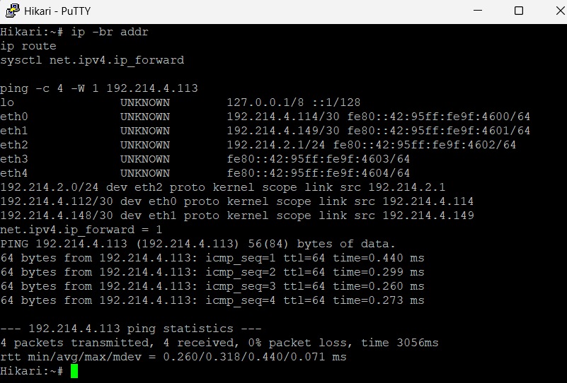

##### 2.5.2 - Router Kaworu

| Interface | Terhubung ke | IP Address |
|---|---|---|
| eth0 | Hikari | 192.214.4.150/30 |
| eth1 | Switch-Relay | 192.214.3.225/27 |

Konfigurasi:

```bash
ip addr add 192.214.4.150/30 dev eth0
ip addr add 192.214.3.225/27 dev eth1

sysctl -w net.ipv4.ip_forward=1
```

Verifikasi:

```bash
ip -br addr
ip route
sysctl net.ipv4.ip_forward

ping -c 4 -W 1 192.214.4.149
```

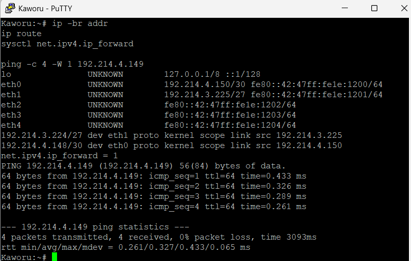

##### 2.5.3 - Pengujian Konektivitas Cabang Hikari

Pada router Gendou:

```bash
ping -c 4 -W 1 192.214.4.114
```


Pada router Hikari:

```bash
ping -c 4 -W 1 192.214.4.150
```


#### 2.6 - Konfigurasi Cabang Asuka

Cabang Asuka terdiri dari router Asuka, Kensuke, dan Ritsuko. Asuka berperan sebagai gateway Switch-Archive sekaligus router induk bagi Kensuke dan Ritsuko.

##### 2.6.1 - Router Asuka

| Interface | Terhubung ke | IP Address |
|---|---|---|
| eth0 | Gendou | 192.214.4.118/30 |
| eth1 | Switch-Archive | 192.214.4.97/30 |
| eth2 | Ritsuko | 192.214.4.157/30 |
| eth3 | Kensuke | 192.214.4.153/30 |

Konfigurasi:

```bash
ip addr add 192.214.4.118/30 dev eth0
ip addr add 192.214.4.97/30 dev eth1
ip addr add 192.214.4.157/30 dev eth2
ip addr add 192.214.4.153/30 dev eth3

sysctl -w net.ipv4.ip_forward=1
```

Verifikasi:

```bash
ip -br addr
ip route
sysctl net.ipv4.ip_forward

ping -c 4 -W 1 192.214.4.117
```


##### 2.6.2 - Router Kensuke

| Interface | Terhubung ke | IP Address |
|---|---|---|
| eth0 | Asuka | 192.214.4.154/30 |
| eth1 | Switch-Bunker | 192.214.3.129/26 |

Konfigurasi:

```bash
ip addr add 192.214.4.154/30 dev eth0
ip addr add 192.214.3.129/26 dev eth1

sysctl -w net.ipv4.ip_forward=1
```

Verifikasi:

```bash
ip -br addr
ip route

ping -c 4 -W 1 192.214.4.153
```

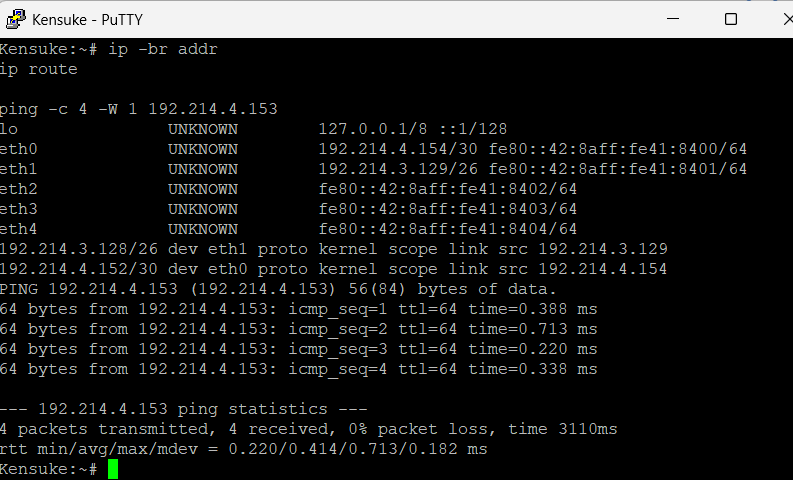

##### 2.6.3 - Router Ritsuko

| Interface | Terhubung ke | IP Address |
|---|---|---|
| eth0 | Asuka | 192.214.4.158/30 |
| eth1 | Switch-Lab | 192.214.4.49/29 |

Konfigurasi:

```bash
ip addr add 192.214.4.158/30 dev eth0
ip addr add 192.214.4.49/29 dev eth1

sysctl -w net.ipv4.ip_forward=1
```

Verifikasi:

```bash
ip -br addr
ip route

ping -c 4 -W 1 192.214.4.157
```


##### 2.6.4 - Pengujian Konektivitas Cabang Asuka

Pada router Gendou:

```bash
ping -c 4 -W 1 192.214.4.118
```


Pada router Asuka:

```bash
echo "===== Asuka ke Kensuke ====="
ping -c 4 -W 1 192.214.4.154

echo "===== Asuka ke Ritsuko ====="
ping -c 4 -W 1 192.214.4.158
```

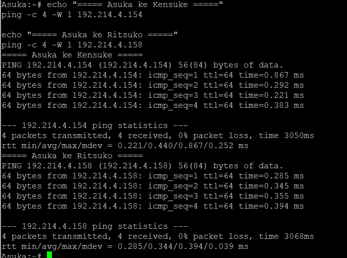

#### 2.7 - Konfigurasi Router Kaji

Kaji terhubung langsung dengan Gendou dan berperan sebagai gateway bagi Switch-Intel.

| Interface | Terhubung ke | IP Address |
|---|---|---|
| eth0 | Gendou | 192.214.4.122/30 |
| eth1 | Switch-Intel | 192.214.4.101/30 |

Konfigurasi:

```bash
ip addr add 192.214.4.122/30 dev eth0
ip addr add 192.214.4.101/30 dev eth1

sysctl -w net.ipv4.ip_forward=1
```

Verifikasi:

```bash
ip -br addr
ip route

ping -c 4 -W 1 192.214.4.121
```


Pengujian arah sebaliknya dilakukan pada router Gendou:

```bash
ping -c 4 -W 1 192.214.4.122
```


#### 2.8 - Konfigurasi Router Misato

Misato terhubung langsung dengan Gendou dan berperan sebagai gateway bagi Switch-Cage yang menaungi Unit-01, Unit-02, dan Unit-00.

| Interface | Terhubung ke | IP Address |
|---|---|---|
| eth0 | Gendou | 192.214.4.126/30 |
| eth1 | Switch-Cage | 192.214.4.65/29 |

Konfigurasi:

```bash
ip addr add 192.214.4.126/30 dev eth0
ip addr add 192.214.4.65/29 dev eth1

sysctl -w net.ipv4.ip_forward=1
```

Verifikasi:

```bash
ip -br addr
ip route

ping -c 4 -W 1 192.214.4.125
```


Pengujian arah sebaliknya dilakukan pada router Gendou:

```bash
ping -c 4 -W 1 192.214.4.126
```

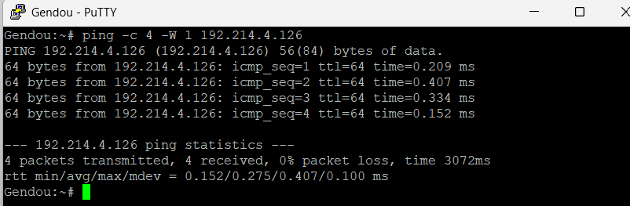

#### 2.9 - Konfigurasi Cabang Shigeru

Cabang Shigeru terdiri dari router Shigeru dan Makoto. Kedua router tersebut menaungi zona sensitif jaringan Geofront, yaitu Switch-Monolith dan Switch-Radar.

##### 2.9.1 - Router Shigeru

| Interface | Terhubung ke | IP Address |
|---|---|---|
| eth0 | Gendou | 192.214.4.130/30 |
| eth1 | Switch-Monolith | 192.214.4.81/29 |
| eth2 | Makoto | 192.214.4.161/30 |

Konfigurasi:

```bash
ip addr add 192.214.4.130/30 dev eth0
ip addr add 192.214.4.81/29 dev eth1
ip addr add 192.214.4.161/30 dev eth2

sysctl -w net.ipv4.ip_forward=1
```

Verifikasi:

```bash
ip -br addr
ip route

ping -c 4 -W 1 192.214.4.129
```


##### 2.9.2 - Router Makoto

| Interface | Terhubung ke | IP Address |
|---|---|---|
| eth0 | Shigeru | 192.214.4.162/30 |
| eth1 | Switch-Radar | 192.214.4.89/29 |

Konfigurasi:

```bash
ip addr add 192.214.4.162/30 dev eth0
ip addr add 192.214.4.89/29 dev eth1

sysctl -w net.ipv4.ip_forward=1
```

Verifikasi:

```bash
ip -br addr
ip route

ping -c 4 -W 1 192.214.4.161
```


##### 2.9.3 - Pengujian Konektivitas Cabang Shigeru

Pada router Gendou:

```bash
ping -c 4 -W 1 192.214.4.130
```


Pada router Shigeru:

```bash
ping -c 4 -W 1 192.214.4.162
```


#### 2.10 - Konfigurasi Cabang Fuyutsuki

Cabang Fuyutsuki terdiri dari router Fuyutsuki, Maya, dan Toji. Fuyutsuki merupakan gateway Switch-Terminal yang menaungi tiga perangkat MAGI sekaligus menjadi router induk bagi Maya dan Toji.

##### 2.10.1 - Router Fuyutsuki

| Interface | Terhubung ke | IP Address |
|---|---|---|
| eth0 | Gendou | 192.214.4.134/30 |
| eth1 | Switch-Terminal | 192.214.4.57/29 |
| eth2 | Maya | 192.214.4.165/30 |
| eth3 | Toji | 192.214.4.169/30 |

Konfigurasi:

```bash
ip addr add 192.214.4.134/30 dev eth0
ip addr add 192.214.4.57/29 dev eth1
ip addr add 192.214.4.165/30 dev eth2
ip addr add 192.214.4.169/30 dev eth3

sysctl -w net.ipv4.ip_forward=1
```

Verifikasi:

```bash
ip -br addr
ip route
sysctl net.ipv4.ip_forward

ping -c 4 -W 1 192.214.4.133
```

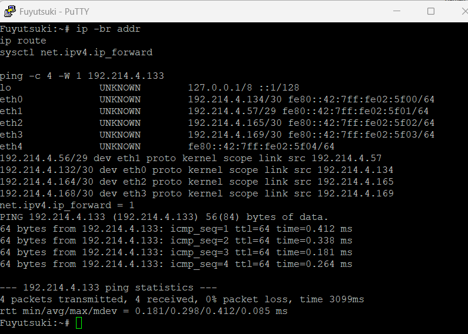

##### 2.10.2 - Router Maya

| Interface | Terhubung ke | IP Address |
|---|---|---|
| eth0 | Fuyutsuki | 192.214.4.166/30 |
| eth1 | Switch-Medic | 192.214.3.193/27 |

Konfigurasi:

```bash
ip addr add 192.214.4.166/30 dev eth0
ip addr add 192.214.3.193/27 dev eth1

sysctl -w net.ipv4.ip_forward=1
```

Verifikasi:

```bash
ip -br addr
ip route

ping -c 4 -W 1 192.214.4.165
```


##### 2.10.3 - Router Toji

| Interface | Terhubung ke | IP Address |
|---|---|---|
| eth0 | Fuyutsuki | 192.214.4.170/30 |
| eth1 | Switch-Dogma | 192.214.4.73/29 |

Konfigurasi:

```bash
ip addr add 192.214.4.170/30 dev eth0
ip addr add 192.214.4.73/29 dev eth1

sysctl -w net.ipv4.ip_forward=1
```

Verifikasi:

```bash
ip -br addr
ip route

ping -c 4 -W 1 192.214.4.169
```

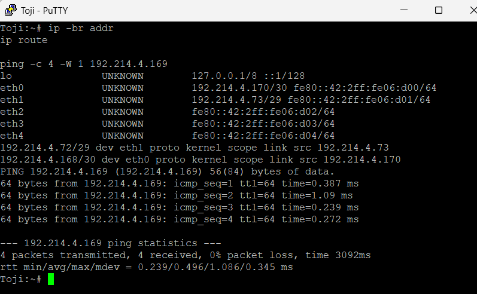

##### 2.10.4 - Pengujian Konektivitas Cabang Fuyutsuki

Pada router Gendou:

```bash
ping -c 4 -W 1 192.214.4.134
```


Pada router Fuyutsuki:

```bash
echo "===== Fuyutsuki ke Maya ====="
ping -c 4 -W 1 192.214.4.166

echo "===== Fuyutsuki ke Toji ====="
ping -c 4 -W 1 192.214.4.170
```


### 3 - Pulau Pulau yang Terpisah

> Lampu mulai menyala, tapi tiap segmen masih seperti pulau terpisah. Fuyutsuki mengingatkan: bangun jalur dari Gendo ke bawah, cabang demi cabang. Hubungkan semua subnet dengan routing statis dan jumlah rute sesedikit mungkin. Router selain Gendo cukup punya satu default route ke atas dan rute untuk subnet di bawahnya. Gendo memakai default route ke NAT1. Subnet satu cabang yang bisa digabung tepat menjadi satu CIDR harus diringkas. Untuk soal 3 sampai 5, beri IP dan gateway sementara pada node uji. IP permanen dibuat di soal 6. Buktikan Armisael bisa ping ke Lilith, Sachiel, dan Comm-Net.

Soal meminta untuk menghubungkan seluruh subnet jaringan Geofront menggunakan static routing dengan jumlah rute seminimal mungkin. Setiap router selain Gendou menggunakan satu default route menuju router induknya dan static route menuju subnet yang berada di bawahnya.

Subnet yang berada dalam satu cabang dan dapat digabungkan secara tepat harus diringkas menggunakan metode CIDR atau route summarization. Gendou sebagai router pusat menggunakan default route menuju NAT1 untuk mengakses jaringan eksternal.

Untuk membuktikan keberhasilan konfigurasi, diberikan alamat IP dan gateway sementara pada Armisael, Lilith, Sachiel, dan Comm-Net. Selanjutnya, dilakukan pengujian ping dari Armisael menuju ketiga node tujuan.

#### 3.1 - Perancangan Static Routing

Konfigurasi static routing menggunakan hasil pembagian alamat IP dengan metode VLSM pada soal 1 dan konfigurasi interface router pada soal 2.

Strategi routing yang digunakan adalah sebagai berikut:

- Gendou memiliki static route menuju seluruh subnet yang tidak terhubung secara langsung dengannya.
- Router yang memiliki cabang menggunakan satu default route menuju router induk dan static route menuju subnet di bawahnya.
- Router ujung hanya membutuhkan satu default route menuju router induknya.
- Subnet yang terhubung secara langsung tidak memerlukan konfigurasi static route karena telah dimasukkan secara otomatis ke dalam routing table.
- Subnet yang dapat digabungkan secara tepat dan memiliki next hop yang sama diringkas menggunakan route summarization.

Strategi tersebut digunakan untuk mengurangi jumlah rute yang harus dikonfigurasi pada setiap router tanpa menghilangkan konektivitas antar-subnet.

Command yang digunakan untuk menambahkan static route adalah:

```bash
ip route replace <NETWORK>/<PREFIX> via <NEXT_HOP>
```

Sedangkan untuk menambahkan default route digunakan command:

```bash
ip route replace default via <NEXT_HOP>
```

Penggunaan `ip route replace` memungkinkan penambahan atau pembaruan rute tanpa menghasilkan duplikasi apabila command dijalankan kembali.

#### 3.2 - Analisis Route Summarization

Route summarization merupakan teknik penggabungan beberapa subnet menjadi satu alamat network dengan prefix yang lebih pendek. Teknik ini digunakan untuk mengurangi jumlah entri pada routing table.

Suatu subnet dapat digabungkan apabila memiliki rentang alamat yang berurutan, memenuhi batas blok CIDR, dan dapat dijangkau melalui next hop yang sama.

Berdasarkan hasil pembagian VLSM, terdapat tiga penggabungan subnet yang dapat diterapkan pada router Gendou.

| No. | Cabang | Subnet Awal | Summary Route | Next Hop |
|---|---|---|---|---|
| 1 | Yui | 192.214.4.136/30 dan 192.214.4.140/30 | 192.214.4.136/29 | 192.214.4.110 |
| 2 | Asuka | 192.214.4.152/30 dan 192.214.4.156/30 | 192.214.4.152/29 | 192.214.4.118 |
| 3 | Shigeru | 192.214.4.80/29 dan 192.214.4.88/29 | 192.214.4.80/28 | 192.214.4.130 |

Ketiga summary route tersebut mencakup seluruh alamat dari subnet yang digabungkan tanpa mencakup subnet milik cabang lain.

##### 3.2.1 - Summarization Cabang Yui

Subnet yang dapat digabungkan adalah subnet link Yui–Mari dan Yui–Rei.

| Subnet | Network ID | Broadcast |
|---|---|---|
| Yui – Mari | 192.214.4.136/30 | 192.214.4.139 |
| Yui – Rei | 192.214.4.140/30 | 192.214.4.143 |
| Summary Route | 192.214.4.136/29 | 192.214.4.143 |

Kedua subnet memiliki total delapan alamat IP yang berurutan dan dapat direpresentasikan menggunakan satu prefix /29.

##### 3.2.2 - Summarization Cabang Asuka

Subnet yang dapat digabungkan adalah subnet link Asuka–Kensuke dan Asuka–Ritsuko.

| Subnet | Network ID | Broadcast |
|---|---|---|
| Asuka – Kensuke | 192.214.4.152/30 | 192.214.4.155 |
| Asuka – Ritsuko | 192.214.4.156/30 | 192.214.4.159 |
| Summary Route | 192.214.4.152/29 | 192.214.4.159 |

Kedua subnet memiliki total delapan alamat IP yang berurutan dan dapat direpresentasikan menggunakan satu prefix /29.

##### 3.2.3 - Summarization Cabang Shigeru

Subnet yang dapat digabungkan adalah subnet Switch-Monolith dan Switch-Radar.

| Subnet | Network ID | Broadcast |
|---|---|---|
| Switch-Monolith | 192.214.4.80/29 | 192.214.4.87 |
| Switch-Radar | 192.214.4.88/29 | 192.214.4.95 |
| Summary Route | 192.214.4.80/28 | 192.214.4.95 |

Kedua subnet memiliki total 16 alamat IP yang berurutan dan dapat direpresentasikan menggunakan satu prefix /28.

##### 3.2.4 - Contoh Perhitungan Route Summarization

Sebagai contoh, dilakukan penggabungan subnet Switch-Monolith dan Switch-Radar.

Kedua subnet menggunakan prefix /29:

- Switch-Monolith: 192.214.4.80/29.
- Switch-Radar: 192.214.4.88/29.

Representasi biner dari oktet terakhir kedua Network ID tersebut adalah:

```text
80 = 01010000
88 = 01011000
     ||||
     0101
```

Empat bit pertama pada oktet terakhir memiliki nilai yang sama. Ditambah dengan 24 bit pertama dari tiga oktet sebelumnya, diperoleh panjang prefix yang sama sebesar:

$$
Prefix = 24 + 4 = 28
$$

Dengan demikian, summary route yang dihasilkan adalah:

```text
192.214.4.80/28
```

Subnet tersebut memiliki rentang alamat 192.214.4.80 sampai 192.214.4.95, sehingga mencakup seluruh alamat dari Switch-Monolith dan Switch-Radar secara tepat.

Penggabungan ini hanya diterapkan pada routing table Gendou. Prefix asli pada interface gateway Switch-Monolith dan Switch-Radar tetap menggunakan /29.

#### 3.3 - Konfigurasi Static Routing Gendou

Gendou merupakan router pusat yang terhubung langsung dengan tujuh router cabang. Setiap router cabang digunakan sebagai next hop untuk menjangkau subnet yang berada di bawahnya.

Berikut merupakan daftar next hop yang digunakan oleh Gendou.

| Router Cabang | Next Hop | Interface Gendou |
|---|---|---|
| Yui | 192.214.4.110 | eth8 |
| Hikari | 192.214.4.114 | eth7 |
| Asuka | 192.214.4.118 | eth6 |
| Kaji | 192.214.4.122 | eth5 |
| Misato | 192.214.4.126 | eth4 |
| Shigeru | 192.214.4.130 | eth3 |
| Fuyutsuki | 192.214.4.134 | eth2 |

##### 3.3.1 - Konfigurasi Routing Cabang Yui

```bash
ip route replace 192.214.0.0/23 via 192.214.4.110
ip route replace 192.214.3.0/25 via 192.214.4.110
ip route replace 192.214.4.0/27 via 192.214.4.110
ip route replace 192.214.4.32/28 via 192.214.4.110
ip route replace 192.214.4.136/29 via 192.214.4.110
ip route replace 192.214.4.144/30 via 192.214.4.110
```

Enam rute tersebut mencakup empat subnet LAN dan tiga subnet link antar-router. Dua subnet link telah digabungkan menjadi satu summary route.

##### 3.3.2 - Konfigurasi Routing Cabang Hikari

```bash
ip route replace 192.214.2.0/24 via 192.214.4.114
ip route replace 192.214.3.224/27 via 192.214.4.114
ip route replace 192.214.4.148/30 via 192.214.4.114
```

Ketiga rute digunakan untuk menjangkau Switch-Comm, Switch-Relay, dan subnet link Hikari–Kaworu.

##### 3.3.3 - Konfigurasi Routing Cabang Asuka

```bash
ip route replace 192.214.3.128/26 via 192.214.4.118
ip route replace 192.214.4.48/29 via 192.214.4.118
ip route replace 192.214.4.96/30 via 192.214.4.118
ip route replace 192.214.4.152/29 via 192.214.4.118
```

Empat rute tersebut mencakup Switch-Bunker, Switch-Lab, Switch-Archive, serta dua subnet link antar-router yang telah diringkas.

##### 3.3.4 - Konfigurasi Routing Cabang Kaji

```bash
ip route replace 192.214.4.100/30 via 192.214.4.122
```

Rute tersebut digunakan untuk menjangkau Switch-Intel.

##### 3.3.5 - Konfigurasi Routing Cabang Misato

```bash
ip route replace 192.214.4.64/29 via 192.214.4.126
```

Rute tersebut digunakan untuk menjangkau Switch-Cage.

##### 3.3.6 - Konfigurasi Routing Cabang Shigeru

```bash
ip route replace 192.214.4.80/28 via 192.214.4.130
ip route replace 192.214.4.160/30 via 192.214.4.130
```

Summary route 192.214.4.80/28 digunakan untuk menjangkau Switch-Monolith dan Switch-Radar. Rute kedua digunakan untuk menjangkau subnet link Shigeru–Makoto.

##### 3.3.7 - Konfigurasi Routing Cabang Fuyutsuki

```bash
ip route replace 192.214.3.192/27 via 192.214.4.134
ip route replace 192.214.4.56/29 via 192.214.4.134
ip route replace 192.214.4.72/29 via 192.214.4.134
ip route replace 192.214.4.164/30 via 192.214.4.134
ip route replace 192.214.4.168/30 via 192.214.4.134
```

Kelima rute tersebut digunakan untuk menjangkau Switch-Medic, Switch-Terminal, Switch-Dogma, serta subnet link Fuyutsuki–Maya dan Fuyutsuki–Toji.

##### 3.3.8 - Verifikasi Routing Table Gendou

Setelah seluruh static route ditambahkan, dilakukan verifikasi menggunakan command:

```bash
ip route
ip route | grep ' via ' | wc -l
```

Hasil penghitungan menunjukkan bahwa terdapat 22 static route pada router Gendou.

```text
22
```

Selain static route tersebut, Gendou memiliki delapan directly connected route yang berasal dari konfigurasi interface pada soal 2.


Berikut merupakan rekapitulasi jumlah rute pada setiap cabang sebelum dan sesudah penerapan route summarization.

| Cabang | Sebelum Summarization | Setelah Summarization | Pengurangan |
|---|---:|---:|---:|
| Yui | 7 | 6 | 1 |
| Hikari | 3 | 3 | 0 |
| Asuka | 5 | 4 | 1 |
| Kaji | 1 | 1 | 0 |
| Misato | 1 | 1 | 0 |
| Shigeru | 3 | 2 | 1 |
| Fuyutsuki | 5 | 5 | 0 |
| **Total** | **25** | **22** | **3** |

Persentase pengurangan jumlah static route adalah:

$$
Efisiensi = \frac{25 - 22}{25} \times 100\%
$$

$$
Efisiensi = 12\%
$$

Penerapan route summarization berhasil mengurangi jumlah static route spesifik pada Gendou sebesar 12% tanpa mengurangi cakupan subnet jaringan internal.

##### 3.3.9 - Default Route Menuju NAT1

Gendou merupakan satu-satunya router yang terhubung langsung dengan NAT1 melalui interface eth0.

Default route menuju NAT1 direncanakan menggunakan gateway yang diperoleh melalui DHCP.

```bash
udhcpc -i eth0 -n -q
```

Setelah DHCP berhasil memberikan alamat IP dan informasi gateway, default route dapat diperiksa menggunakan:

```bash
ip route show default
```

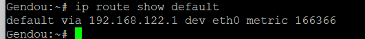

Default route yang terbentuk adalah:

```text
default via 192.168.122.1 dev eth0
```

Default route tersebut digunakan untuk meneruskan paket menuju jaringan eksternal apabila alamat IP tujuan tidak memiliki rute yang lebih spesifik pada routing table Gendou.

Penggunaan DHCP memungkinkan Gendou memperoleh dan memperbarui konfigurasi jaringan eksternal secara otomatis tanpa perlu menentukan alamat IP dan gateway secara manual.

Dengan demikian, seluruh konfigurasi static routing internal dan default route menuju NAT1 telah berhasil diterapkan.

#### 3.4 - Konfigurasi Routing Cabang Yui

Yui merupakan router induk bagi Mari, Rei, dan Shinji. Yui membutuhkan satu default route menuju Gendou dan tiga static route menuju LAN router cabangnya.

##### 3.4.1 - Router Yui

```bash
ip route replace default via 192.214.4.109

ip route replace 192.214.4.32/28 via 192.214.4.138
ip route replace 192.214.0.0/23 via 192.214.4.142
ip route replace 192.214.4.0/27 via 192.214.4.146
```

##### 3.4.2 - Router Mari

```bash
ip route replace default via 192.214.4.137
```

##### 3.4.3 - Router Rei

```bash
ip route replace default via 192.214.4.141
```

##### 3.4.4 - Router Shinji

```bash
ip route replace default via 192.214.4.145
```

Mari, Rei, dan Shinji merupakan router ujung sehingga masing-masing hanya membutuhkan satu default route menuju Yui.

#### 3.5 - Konfigurasi Routing Cabang Hikari

Hikari membutuhkan satu default route menuju Gendou dan satu static route menuju LAN Kaworu.

##### 3.5.1 - Router Hikari

```bash
ip route replace default via 192.214.4.113
ip route replace 192.214.3.224/27 via 192.214.4.150
```

##### 3.5.2 - Router Kaworu

```bash
ip route replace default via 192.214.4.149
```

Kaworu hanya membutuhkan satu default route karena tidak memiliki router cabang di bawahnya.

#### 3.6 - Konfigurasi Routing Cabang Asuka

Asuka merupakan router induk bagi Kensuke dan Ritsuko. Asuka membutuhkan satu default route menuju Gendou dan dua static route menuju LAN kedua router tersebut.

##### 3.6.1 - Router Asuka

```bash
ip route replace default via 192.214.4.117
ip route replace 192.214.3.128/26 via 192.214.4.154
ip route replace 192.214.4.48/29 via 192.214.4.158
```

##### 3.6.2 - Router Kensuke

```bash
ip route replace default via 192.214.4.153
```

##### 3.6.3 - Router Ritsuko

```bash
ip route replace default via 192.214.4.157
```

Kensuke dan Ritsuko menggunakan Asuka sebagai default gateway untuk menjangkau subnet di luar jaringan yang terhubung secara langsung.

#### 3.7 - Konfigurasi Routing Kaji dan Misato

Kaji dan Misato merupakan router ujung yang terhubung langsung dengan Gendou sehingga masing-masing hanya membutuhkan satu default route.

##### 3.7.1 - Router Kaji

```bash
ip route replace default via 192.214.4.121
```

##### 3.7.2 - Router Misato

```bash
ip route replace default via 192.214.4.125
```

#### 3.8 - Konfigurasi Routing Cabang Shigeru

Shigeru merupakan gateway Switch-Monolith sekaligus router induk bagi Makoto.

Shigeru membutuhkan satu default route menuju Gendou dan satu static route menuju Switch-Radar.

##### 3.8.1 - Router Shigeru

```bash
ip route replace default via 192.214.4.129
ip route replace 192.214.4.88/29 via 192.214.4.162
```

##### 3.8.2 - Router Makoto

```bash
ip route replace default via 192.214.4.161
```

Meskipun subnet Switch-Monolith dan Switch-Radar telah diringkas pada Gendou, Shigeru tetap menggunakan rute spesifik menuju Switch-Radar karena subnet Switch-Monolith terhubung langsung dengannya, sedangkan subnet Switch-Radar berada di bawah Makoto.

#### 3.9 - Konfigurasi Routing Cabang Fuyutsuki

Fuyutsuki merupakan gateway Switch-Terminal sekaligus router induk bagi Maya dan Toji.

Fuyutsuki membutuhkan satu default route menuju Gendou dan dua static route menuju LAN Maya dan Toji.

##### 3.9.1 - Router Fuyutsuki

```bash
ip route replace default via 192.214.4.133
ip route replace 192.214.3.192/27 via 192.214.4.166
ip route replace 192.214.4.72/29 via 192.214.4.170
```

##### 3.9.2 - Router Maya

```bash
ip route replace default via 192.214.4.165
```

##### 3.9.3 - Router Toji

```bash
ip route replace default via 192.214.4.169
```

Maya dan Toji hanya membutuhkan satu default route menuju Fuyutsuki karena tidak memiliki router cabang di bawahnya.

#### 3.10 - Verifikasi Routing Router Cabang

Setelah konfigurasi static routing selesai dilakukan, setiap router diperiksa menggunakan command:

```bash
ip route
```

Sebagai contoh, routing table Asuka setelah konfigurasi adalah sebagai berikut:

```text
default via 192.214.4.117 dev eth0
192.214.3.128/26 via 192.214.4.154 dev eth3
192.214.4.48/29 via 192.214.4.158 dev eth2
192.214.4.96/30 dev eth1 proto kernel scope link src 192.214.4.97
192.214.4.116/30 dev eth0 proto kernel scope link src 192.214.4.118
192.214.4.152/30 dev eth3 proto kernel scope link src 192.214.4.153
192.214.4.156/30 dev eth2 proto kernel scope link src 192.214.4.157
```

Routing table tersebut memperlihatkan bahwa Asuka memiliki satu default route menuju Gendou, dua static route menuju LAN router cabangnya, dan empat directly connected route.

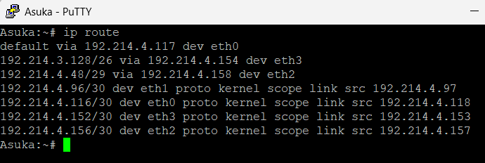

Sebagai perbandingan, router ujung seperti Kensuke memiliki routing table dengan susunan berikut:

```text
default via 192.214.4.153 dev eth0
192.214.3.128/26 dev eth1 proto kernel scope link src 192.214.3.129
192.214.4.152/30 dev eth0 proto kernel scope link src 192.214.4.154
```

Kensuke hanya memiliki satu default route dan dua directly connected route. Tidak diperlukan static route spesifik karena seluruh jaringan di luar subnet yang terhubung langsung dapat dijangkau melalui Asuka.


#### 3.11 - Konfigurasi IP Sementara pada Node Uji

Sesuai ketentuan soal, alamat IP dan gateway pada node uji dikonfigurasi secara sementara. Konfigurasi permanen akan dilakukan pada soal 6.

Empat node digunakan untuk membuktikan keberhasilan static routing, yaitu Armisael, Lilith, Sachiel, dan Comm-Net.

| Node | Switch | IP Address | Gateway |
|---|---|---|---|
| Armisael | Switch-Monolith | 192.214.4.83/29 | 192.214.4.81 |
| Lilith | Switch-Dogma | 192.214.4.74/29 | 192.214.4.73 |
| Sachiel | Switch-Bunker | 192.214.3.130/26 | 192.214.3.129 |
| Comm-Net | Switch-Comm | 192.214.2.2/24 | 192.214.2.1 |

##### 3.11.1 - Node Armisael

```bash
ip link set eth0 up
ip addr add 192.214.4.83/29 dev eth0
ip route replace default via 192.214.4.81
```

Verifikasi:

```bash
ip -br addr
ip route
ping -c 4 -W 1 192.214.4.81
```

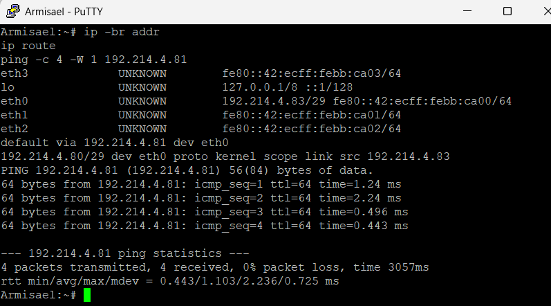

##### 3.11.2 - Node Lilith

```bash
ip link set eth0 up
ip addr add 192.214.4.74/29 dev eth0
ip route replace default via 192.214.4.73
```

Verifikasi:

```bash
ip -br addr
ip route
ping -c 4 -W 1 192.214.4.73
```

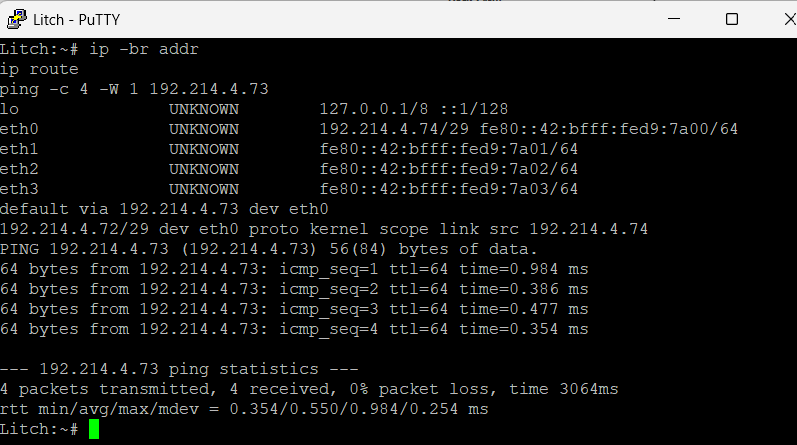

##### 3.11.3 - Node Sachiel

```bash
ip link set eth0 up
ip addr add 192.214.3.130/26 dev eth0
ip route replace default via 192.214.3.129
```

Verifikasi:

```bash
ip -br addr
ip route
ping -c 4 -W 1 192.214.3.129
```

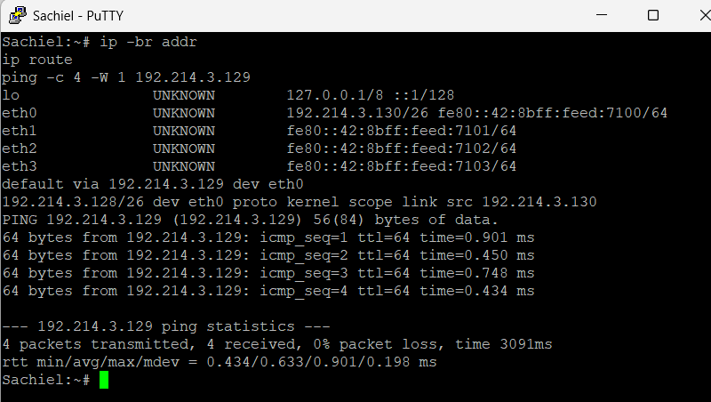

##### 3.11.4 - Node Comm-Net

```bash
ip link set eth0 up
ip addr add 192.214.2.2/24 dev eth0
ip route replace default via 192.214.2.1
```

Verifikasi:

```bash
ip -br addr
ip route
ping -c 4 -W 1 192.214.2.1
```

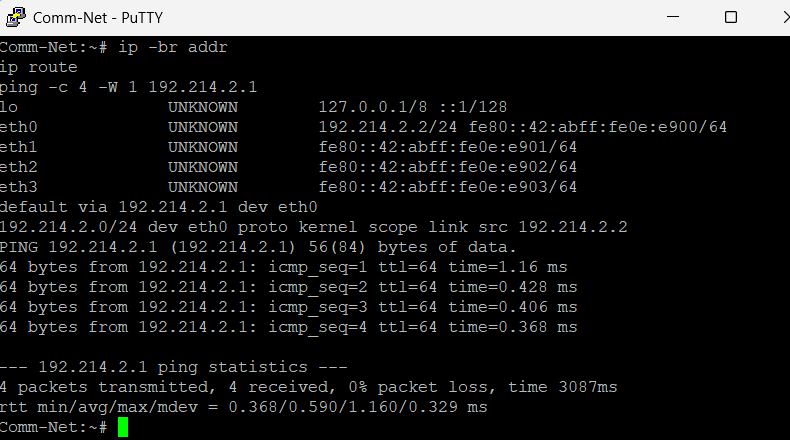

##### 3.11.5 - Hasil Pengujian Gateway

Setiap node diuji menggunakan ping menuju alamat gateway masing-masing untuk memastikan konfigurasi IP dan konektivitas LAN telah berfungsi sebelum dilakukan pengujian antar-subnet.

| Node | Gateway | Paket Dikirim | Paket Diterima | Packet Loss | RTT Rata-rata |
|---|---|---:|---:|---:|---:|
| Armisael | 192.214.4.81 | 4 | 4 | 0% | 0.338 ms |
| Lilith | 192.214.4.73 | 4 | 4 | 0% | 0.560 ms |
| Sachiel | 192.214.3.129 | 4 | 4 | 0% | 1.933 ms |
| Comm-Net | 192.214.2.1 | 4 | 4 | 0% | 0.370 ms |

Seluruh node berhasil melakukan ping menuju gateway masing-masing dengan 0% packet loss. Hal tersebut menunjukkan bahwa konfigurasi alamat IP, prefix, dan koneksi menuju gateway telah berfungsi dengan baik.

#### 3.12 - Pengujian Konektivitas Antar-subnet

Pengujian utama dilakukan dari Armisael menuju Lilith, Sachiel, dan Comm-Net. Ketiga node tujuan berada pada subnet dan cabang router yang berbeda sehingga pengujian tersebut dapat membuktikan bahwa static routing berfungsi melampaui jaringan yang terhubung secara langsung.

Command berikut dijalankan pada Armisael:

```bash
echo "===== Armisael ke Lilith ====="
ping -c 4 -W 1 192.214.4.74

echo "===== Armisael ke Sachiel ====="
ping -c 4 -W 1 192.214.3.130

echo "===== Armisael ke Comm-Net ====="
ping -c 4 -W 1 192.214.2.2
```


##### 3.12.1 - Hasil Pengujian

| No. | Sumber | Tujuan | IP Tujuan | Paket Dikirim | Paket Diterima | Packet Loss | Status |
|---|---|---|---|---:|---:|---:|---|
| 1 | Armisael | Lilith | 192.214.4.74 | 4 | 4 | 0% | Berhasil |
| 2 | Armisael | Sachiel | 192.214.3.130 | 4 | 4 | 0% | Berhasil |
| 3 | Armisael | Comm-Net | 192.214.2.2 | 4 | 4 | 0% | Berhasil |
| **Total** | | | | **12** | **12** | **0%** | **Berhasil** |

Seluruh pengujian berhasil dengan jumlah 12 paket ICMP yang dikirimkan dan 12 paket balasan yang diterima.

Hasil tersebut menunjukkan bahwa paket dapat diteruskan dari Armisael menuju subnet tujuan dan paket balasan dapat dikirimkan kembali menuju Armisael.

##### 3.12.2 - Pengujian Armisael menuju Lilith

Armisael berada pada Switch-Monolith, sedangkan Lilith berada pada Switch-Dogma.

Jalur komunikasi berdasarkan konfigurasi routing adalah:

```text
Armisael
    |
Switch-Monolith
    |
Shigeru
    |
Gendou
    |
Fuyutsuki
    |
Toji
    |
Switch-Dogma
    |
Lilith
```

Ketika Armisael mengirimkan paket menuju Lilith, paket diteruskan melalui default gateway Shigeru. Shigeru kemudian meneruskan paket menuju Gendou menggunakan default route.

Gendou memiliki static route menuju subnet Switch-Dogma melalui Fuyutsuki. Selanjutnya, Fuyutsuki meneruskan paket menuju Toji, yang memiliki koneksi langsung dengan subnet Lilith.

Hasil pengujian:

```text
4 packets transmitted, 4 received, 0% packet loss
rtt min/avg/max/mdev = 1.109/1.320/1.688/0.226 ms
```

##### 3.12.3 - Pengujian Armisael menuju Sachiel

Sachiel berada pada Switch-Bunker yang dijaga oleh router Kensuke.

Jalur komunikasi berdasarkan konfigurasi routing adalah:

```text
Armisael
    |
Switch-Monolith
    |
Shigeru
    |
Gendou
    |
Asuka
    |
Kensuke
    |
Switch-Bunker
    |
Sachiel
```

Paket dari Armisael diteruskan menuju Gendou melalui Shigeru. Gendou menggunakan static route menuju subnet Switch-Bunker melalui Asuka.

Asuka kemudian meneruskan paket menuju Kensuke yang terhubung langsung dengan subnet Sachiel.

Hasil pengujian:

```text
4 packets transmitted, 4 received, 0% packet loss
rtt min/avg/max/mdev = 1.119/1.227/1.483/0.149 ms
```

##### 3.12.4 - Pengujian Armisael menuju Comm-Net

Comm-Net berada pada Switch-Comm yang dijaga oleh router Hikari.

Jalur komunikasi berdasarkan konfigurasi routing adalah:

```text
Armisael
    |
Switch-Monolith
    |
Shigeru
    |
Gendou
    |
Hikari
    |
Switch-Comm
    |
Comm-Net
```

Paket dari Armisael diteruskan menuju Gendou melalui Shigeru. Gendou kemudian meneruskan paket menuju Hikari berdasarkan static route 192.214.2.0/24.

Hikari memiliki koneksi langsung menuju Switch-Comm sehingga paket dapat dikirimkan kepada Comm-Net.

Hasil pengujian:

```text
4 packets transmitted, 4 received, 0% packet loss
rtt min/avg/max/mdev = 0.967/1.106/1.235/0.096 ms
```

#### 3.13 - Analisis TTL dan Round Trip Time

Selain packet loss, hasil pengujian ping juga memberikan informasi mengenai Time to Live (TTL) dan Round Trip Time (RTT).

TTL merupakan nilai pada paket IP yang dikurangi setiap kali paket diteruskan oleh router. Dengan asumsi TTL awal paket balasan Alpine Linux adalah 64, jumlah router yang dilalui paket balasan dapat diperkirakan berdasarkan selisih TTL tersebut.

| Pengujian | TTL Awal (Asumsi) | TTL Balasan | Router Dilalui | RTT Rata-rata |
|---|---:|---:|---:|---:|
| Armisael – Lilith | 64 | 60 | 4 | 1.320 ms |
| Armisael – Sachiel | 64 | 60 | 4 | 1.227 ms |
| Armisael – Comm-Net | 64 | 61 | 3 | 1.106 ms |

Pada pengujian menuju Lilith dan Sachiel, TTL balasan yang diperoleh adalah 60.

$$
Jumlah\ Router = 64 - 60 = 4
$$

Sedangkan pada pengujian menuju Comm-Net, TTL balasan yang diperoleh adalah 61.

$$
Jumlah\ Router = 64 - 61 = 3
$$

Hasil tersebut konsisten dengan jumlah router pada jalur komunikasi yang dirancang.

Comm-Net juga memiliki RTT rata-rata paling rendah pada pengujian ini, yaitu 1.106 ms. Hal tersebut konsisten dengan jalur komunikasinya yang melewati lebih sedikit router dibandingkan jalur menuju Lilith dan Sachiel, meskipun RTT juga dapat dipengaruhi oleh kondisi pemrosesan paket dan jaringan.

#### 3.14 - Verifikasi Pemilihan Rute

Untuk memastikan Armisael menggunakan next hop yang benar ketika mengirimkan paket menuju subnet tujuan, dilakukan pemeriksaan menggunakan command `ip route get`.

```bash
ip route get 192.214.4.74
ip route get 192.214.3.130
ip route get 192.214.2.2
```

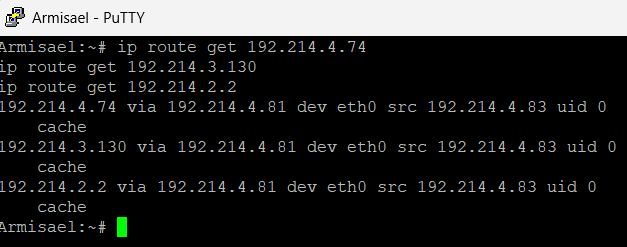

Hasil pengujian:

```text
192.214.4.74 via 192.214.4.81 dev eth0 src 192.214.4.83 uid 0
    cache

192.214.3.130 via 192.214.4.81 dev eth0 src 192.214.4.83 uid 0
    cache

192.214.2.2 via 192.214.4.81 dev eth0 src 192.214.4.83 uid 0
    cache
```

Berdasarkan hasil tersebut, seluruh paket menuju Lilith, Sachiel, dan Comm-Net menggunakan alamat 192.214.4.81 sebagai next hop melalui interface eth0.

Alamat tersebut merupakan alamat interface LAN Shigeru yang berfungsi sebagai default gateway Armisael.

### 4 - Haus Kabar dari Dunia Luar
> Maya melapor bahwa semua sistem butuh update dari luar, padahal pintu keluarnya hanya Gendo. IP dari NAT1 juga bisa berganti kapan saja. Beri seluruh jaringan akses internet lewat Gendo. Konfigurasinya tidak boleh perlu diubah saat IP NAT1 berganti. Hanya traffic dari prefix internal yang keluar lewat NAT1 yang boleh diterjemahkan alamatnya, sedangkan traffic antar-LAN harus tetap membawa alamat asli pengirimnya. Node yang nanti memasang paket juga harus bisa me-resolve nama domain. Selesaikan sebelum node lain memasang paket. Buktikan ping 8.8.8.8 dan ping deb.debian.org dari Armisael dan Lilith berhasil, dan tunjukkan counter rule NAT.

Soal meminta untuk mengonfigurasi akses internet untuk seluruh jaringan Geofront melalui Gendou sebagai satu-satunya router yang terhubung langsung dengan NAT1.

Konfigurasi NAT harus dapat menyesuaikan perubahan alamat IP eksternal Gendou tanpa memerlukan perubahan rule. Translasi alamat IP hanya dilakukan terhadap traffic yang berasal dari prefix internal dan keluar melalui interface menuju NAT1, sedangkan komunikasi antar-LAN harus tetap menggunakan alamat IP asli pengirim.

Selain itu, dilakukan konfigurasi DNS agar node dapat melakukan resolusi nama domain dan mengakses repository untuk instalasi paket.

Keberhasilan konfigurasi dibuktikan melalui pengujian ping menuju 8.8.8.8 dan deb.debian.org dari Armisael dan Lilith, serta pemeriksaan counter pada rule NAT.

#### 4.1 - Perancangan NAT

Network Address Translation (NAT) merupakan mekanisme yang digunakan untuk menerjemahkan alamat IP pada paket jaringan ketika paket melewati perangkat jaringan tertentu.

Pada jaringan Geofront, NAT digunakan agar seluruh node internal dapat mengakses internet melalui satu interface eksternal milik Gendou.

Jenis NAT yang digunakan adalah Source NAT (SNAT) dengan mekanisme MASQUERADE. Mekanisme ini menerjemahkan alamat IP sumber paket menjadi alamat IP yang digunakan oleh interface keluar secara otomatis.

Konfigurasi NAT pada Gendou dirancang berdasarkan parameter berikut:

| Parameter | Nilai |
|---|---|
| Router NAT | Gendou |
| Prefix jaringan internal | 192.214.0.0/21 |
| Interface eksternal | eth0 |
| Tujuan koneksi eksternal | NAT1 |
| Jenis translasi | Source NAT |
| Mekanisme translasi | MASQUERADE |
| Firewall framework | nftables |
| Hook | POSTROUTING |

Alur komunikasi node internal menuju internet adalah sebagai berikut:

```text
Node Internal
      |
Gateway LAN
      |
Router Cabang
      |
    Gendou
      |
NAT MASQUERADE
      |
     eth0
      |
     NAT1
      |
   Internet
```

Dengan konfigurasi tersebut, seluruh traffic menuju internet diteruskan melalui Gendou. Traffic yang memenuhi kondisi rule NAT akan mengalami translasi alamat sumber sebelum diteruskan menuju NAT1.

#### 4.2 - Konfigurasi NAT Menggunakan nftables

NAT dikonfigurasi menggunakan nftables karena telah tersedia pada Alpine Linux yang digunakan oleh Gendou.

##### 4.2.1 - Pembuatan Tabel NAT

```bash
nft add table ip nat
```

Command tersebut membuat tabel bernama `nat` dengan address family `ip`, sehingga tabel digunakan untuk memproses traffic IPv4.

##### 4.2.2 - Pembuatan Chain POSTROUTING

```bash
nft 'add chain ip nat postrouting { type nat hook postrouting priority srcnat; policy accept; }'
```

Chain POSTROUTING digunakan untuk memproses paket setelah keputusan routing dibuat dan sebelum paket keluar melalui interface jaringan.

Penggunaan hook POSTROUTING memungkinkan NAT diterapkan berdasarkan interface keluar yang telah ditentukan oleh routing table.

##### 4.2.3 - Pembuatan Rule MASQUERADE

```bash
nft add rule ip nat postrouting ip saddr 192.214.0.0/21 oifname "eth0" counter masquerade
```

Penjelasan setiap komponen rule adalah sebagai berikut:

| Komponen | Fungsi |
|---|---|
| `ip nat` | Menentukan tabel NAT untuk IPv4 |
| `postrouting` | Menentukan chain tempat rule diterapkan |
| `ip saddr 192.214.0.0/21` | Membatasi translasi pada traffic yang berasal dari prefix internal Geofront |
| `oifname "eth0"` | Membatasi translasi pada traffic yang keluar melalui interface menuju NAT1 |
| `counter` | Menghitung jumlah paket dan byte yang cocok dengan rule |
| `masquerade` | Menerjemahkan alamat IP sumber menggunakan alamat IP interface keluar |

Rule tersebut memiliki dua kondisi utama yang harus dipenuhi secara bersamaan:

1. Alamat IP sumber paket berada dalam prefix 192.214.0.0/21.
2. Paket keluar melalui interface eth0 yang terhubung dengan NAT1.

Apabila salah satu kondisi tidak terpenuhi, paket tidak akan mengalami translasi oleh rule tersebut.

##### 4.2.4 - Verifikasi Rule NAT

Konfigurasi NAT diperiksa menggunakan command berikut:

```bash
nft list ruleset
```

Struktur ruleset yang dihasilkan adalah sebagai berikut:

```text
table ip nat {
    chain postrouting {
        type nat hook postrouting priority srcnat; policy accept;
        ip saddr 192.214.0.0/21 oifname "eth0" counter masquerade
    }
}
```

Nilai counter paket dan byte akan ditampilkan pada rule tersebut dan berubah sesuai traffic yang diproses.

#### 4.3 - Konfigurasi DNS

Domain Name System (DNS) digunakan untuk menerjemahkan nama domain menjadi alamat IP agar perangkat dapat mengakses layanan menggunakan nama domain.

Akses internet berdasarkan alamat IP saja belum cukup untuk memenuhi kebutuhan instalasi paket. Package manager seperti `apk` pada Alpine Linux memerlukan resolusi nama domain untuk mengakses repository.

DNS dikonfigurasi melalui file `/etc/resolv.conf` menggunakan dua DNS resolver publik.

| DNS Server | Alamat IP |
|---|---|
| Google Public DNS | 8.8.8.8 |
| Cloudflare DNS | 1.1.1.1 |

Konfigurasi dilakukan menggunakan command berikut:

```bash
printf 'nameserver 8.8.8.8\nnameserver 1.1.1.1\n' > /etc/resolv.conf
```

Verifikasi konfigurasi:

```bash
cat /etc/resolv.conf
```

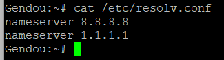

Isi file setelah konfigurasi:

```text
nameserver 8.8.8.8
nameserver 1.1.1.1
```

Konfigurasi tersebut diterapkan pada Gendou, Armisael, dan Lilith untuk kebutuhan pengujian soal 4.

Router dan node lainnya yang membutuhkan instalasi paket dapat menggunakan konfigurasi DNS yang sama setelah memiliki alamat IP dan gateway yang sesuai.

#### 4.4 - Konfigurasi dan Pengujian Node Armisael

Armisael telah memiliki konfigurasi IP dan gateway sementara yang dibuat pada soal 3 sehingga tidak diperlukan konfigurasi ulang.

| Parameter | Nilai |
|---|---|
| Node | Armisael |
| Switch | Switch-Monolith |
| IP Address | 192.214.4.83/29 |
| Default Gateway | 192.214.4.81 |
| Router Gateway | Shigeru |
| DNS Primer | 8.8.8.8 |
| DNS Sekunder | 1.1.1.1 |

Konfigurasi DNS dan pengujian dilakukan menggunakan command berikut:

```bash
printf 'nameserver 8.8.8.8\nnameserver 1.1.1.1\n' > /etc/resolv.conf

cat /etc/resolv.conf

echo "===== PING INTERNET ====="
ping -c 4 -W 2 8.8.8.8

echo "===== PING DOMAIN ====="
ping -4 -c 4 -W 2 deb.debian.org
```

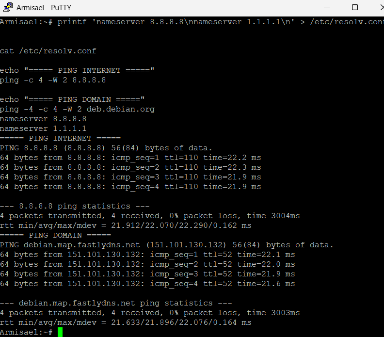

##### 4.4.1 - Jalur Komunikasi Armisael

Berdasarkan konfigurasi static routing, jalur komunikasi Armisael menuju internet adalah sebagai berikut:

```text
Armisael
192.214.4.83
      |
Switch-Monolith
      |
   Shigeru
      |
    Gendou
      |
NAT MASQUERADE
      |
     NAT1
      |
   Internet
```

Armisael meneruskan paket menuju Shigeru sebagai default gateway. Shigeru kemudian meneruskan paket menuju Gendou menggunakan default route.

Gendou meneruskan paket melalui eth0 menuju NAT1 setelah melakukan translasi alamat sumber menggunakan MASQUERADE.

Keberhasilan ping menuju 8.8.8.8 menunjukkan bahwa konektivitas IPv4 menuju internet telah berfungsi. Keberhasilan ping menuju deb.debian.org menunjukkan bahwa resolusi nama domain dan konektivitas menuju alamat hasil resolusi juga telah berfungsi.

#### 4.5 - Konfigurasi dan Pengujian Node Lilith

Lilith juga menggunakan konfigurasi IP dan gateway sementara yang telah dibuat pada soal 3.

| Parameter | Nilai |
|---|---|
| Node | Lilith |
| Switch | Switch-Dogma |
| IP Address | 192.214.4.74/29 |
| Default Gateway | 192.214.4.73 |
| Router Gateway | Toji |
| DNS Primer | 8.8.8.8 |
| DNS Sekunder | 1.1.1.1 |

Konfigurasi DNS dan pengujian dilakukan menggunakan command berikut:

```bash
printf 'nameserver 8.8.8.8\nnameserver 1.1.1.1\n' > /etc/resolv.conf

cat /etc/resolv.conf

echo "===== PING INTERNET ====="
ping -c 4 -W 2 8.8.8.8

echo "===== PING DOMAIN ====="
ping -4 -c 4 -W 2 deb.debian.org
```

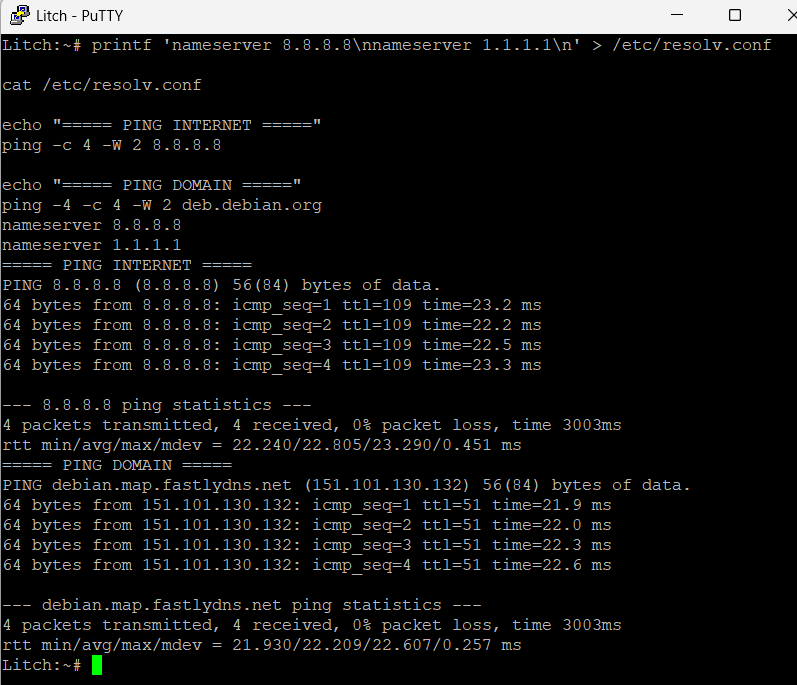

##### 4.5.1 - Jalur Komunikasi Lilith

Jalur komunikasi Lilith menuju internet adalah sebagai berikut:

```text
     Lilith
192.214.4.74
       |
 Switch-Dogma
       |
      Toji
       |
   Fuyutsuki
       |
     Gendou
       |
 NAT MASQUERADE
       |
      NAT1
       |
    Internet
```

Lilith mengirimkan paket melalui Toji sebagai default gateway. Paket kemudian diteruskan menuju Fuyutsuki dan Gendou menggunakan default route yang telah dikonfigurasi pada soal 3.

Meskipun Lilith berada pada cabang router yang berbeda dengan Armisael, kedua node menggunakan mekanisme NAT yang sama pada Gendou untuk mengakses internet.

#### 4.6 - Verifikasi Counter Rule NAT

Untuk membuktikan bahwa traffic dari jaringan internal telah diproses oleh rule MASQUERADE, dilakukan pemeriksaan counter nftables setelah pengujian akses internet.

Pada Gendou:

```bash
nft -a list chain ip nat postrouting
```

Output akan memperlihatkan rule dengan struktur berikut:

```text
ip saddr 192.214.0.0/21 oifname "eth0" counter packets <JUMLAH_PAKET> bytes <JUMLAH_BYTE> masquerade
```


Counter memiliki dua informasi utama:

| Counter | Fungsi |
|---|---|
| Packets | Jumlah paket yang cocok dengan rule NAT |
| Bytes | Jumlah byte dari paket yang cocok dengan rule NAT |

Peningkatan nilai counter menunjukkan bahwa terdapat traffic yang berasal dari prefix internal Geofront dan keluar melalui interface eth0 sehingga diproses oleh rule MASQUERADE.

Pada chain NAT, counter umumnya bertambah ketika paket awal suatu koneksi diproses. Paket berikutnya dalam koneksi yang sama menggunakan informasi translasi yang telah disimpan oleh connection tracking.

Oleh karena itu, jumlah counter NAT tidak harus sama dengan jumlah keseluruhan paket ping yang dikirimkan.

#### 4.7 - Verifikasi Komunikasi Antar-LAN Tanpa NAT

Salah satu ketentuan soal adalah memastikan bahwa traffic antar-LAN tidak mengalami translasi alamat IP.

Pembatasan tersebut diterapkan melalui kondisi berikut pada rule NAT:

```text
oifname "eth0"
```

Traffic antar-LAN menggunakan interface internal Gendou sehingga tidak memenuhi kondisi output interface pada rule MASQUERADE.

Sebagai contoh, traffic dari Armisael menuju Lilith menggunakan jalur berikut:

```text
Armisael
192.214.4.83
      |
   Shigeru
      |
    Gendou
      |
  Fuyutsuki
      |
     Toji
      |
    Lilith
192.214.4.74
```

Pada Gendou, paket diterima melalui eth3 dan diteruskan melalui eth2 menuju Fuyutsuki. Karena paket tidak keluar melalui eth0, rule MASQUERADE tidak diterapkan.

##### 4.7.1 - Pemeriksaan Counter Sebelum Pengujian

Pada Gendou, dilakukan pemeriksaan counter NAT sebelum pengujian komunikasi internal.

```bash
nft list chain ip nat postrouting
```


##### 4.7.2 - Pengujian Komunikasi Antar-LAN

Pada Armisael, dilakukan pengujian ping menuju tiga node internal yang sebelumnya telah digunakan pada soal 3.

```bash
echo "===== Armisael ke Lilith ====="
ping -c 4 -W 1 192.214.4.74

echo "===== Armisael ke Sachiel ====="
ping -c 4 -W 1 192.214.3.130

echo "===== Armisael ke Comm-Net ====="
ping -c 4 -W 1 192.214.2.2
```


##### 4.7.3 - Pemeriksaan Counter Setelah Pengujian

Setelah pengujian komunikasi internal selesai, dilakukan pemeriksaan kembali pada Gendou.

```bash
nft list chain ip nat postrouting
```

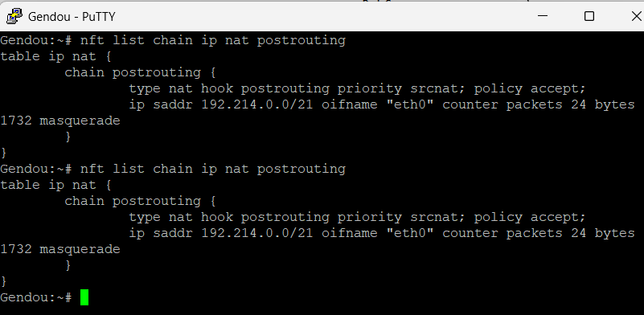

Berdasarkan pengujian, komunikasi antar-LAN tetap berhasil dan tidak menyebabkan peningkatan counter NAT selama tidak terdapat traffic eksternal lain yang berjalan secara bersamaan.

Hal tersebut konsisten dengan konfigurasi rule yang hanya menerapkan MASQUERADE terhadap paket yang keluar melalui eth0.

Perbedaan pemrosesan traffic internal dan eksternal dapat dilihat pada tabel berikut:

| Traffic | Interface Keluar Gendou | Source IP Awal | Source IP Setelah Gendou | NAT |
|---|---|---|---|---|
| Armisael menuju Internet | eth0 | 192.214.4.83 | IP eksternal Gendou | Ya |
| Lilith menuju Internet | eth0 | 192.214.4.74 | IP eksternal Gendou | Ya |
| Armisael menuju Lilith | eth2 | 192.214.4.83 | 192.214.4.83 | Tidak |
| Armisael menuju Sachiel | eth6 | 192.214.4.83 | 192.214.4.83 | Tidak |
| Armisael menuju Comm-Net | eth7 | 192.214.4.83 | 192.214.4.83 | Tidak |

Dengan demikian, konfigurasi NAT tidak mengganggu komunikasi antar-LAN yang telah dibangun menggunakan static routing pada soal 3.

### 5 - Pintu Depan Dikunci Rapat

> Kaji memperingatkan Kaworu bahwa SEELE cukup mengetuk pintu depan. Gendo mengunci NAT1: boleh keluar, tidak boleh dimasuki. Di Gendo, ubah policy INPUT dan FORWARD menjadi DROP. Lalu izinkan empat hal: (a) balasan koneksi yang sudah ada, (b) traffic dari jaringan internal ke internet, (c) traffic antar-LAN, dan (d) traffic dari jaringan internal ke Gendo sendiri. Loopback dan DHCP dari NAT1 juga harus tetap jalan. Koneksi baru dari sisi NAT1 tidak boleh masuk. Soal 2 sampai 4 harus tetap jalan, dan semuanya ditulis di gendo.sh. Tunjukkan iptables -S di Gendo, dan buktikan ping 8.8.8.8 dari Armisael masih berhasil.

Soal meminta untuk mengamankan router Gendou dari koneksi baru yang berasal dari jaringan eksternal NAT1 dengan mengubah default policy chain INPUT dan FORWARD menjadi DROP.

Firewall harus tetap mengizinkan balasan koneksi yang sudah ada, traffic jaringan internal menuju internet, komunikasi antar-LAN, serta traffic jaringan internal menuju Gendou. Komunikasi melalui loopback dan DHCP dari NAT1 juga harus tetap berfungsi.

Seluruh konfigurasi Gendou pada soal 2 sampai soal 5 disimpan dalam script `gendo.sh`.

Keberhasilan konfigurasi dibuktikan dengan menampilkan hasil `iptables -S` pada Gendou dan melakukan pengujian ping menuju 8.8.8.8 dari Armisael setelah firewall diaktifkan.

#### 5.1 - Pemeriksaan Kondisi Awal Gendou

Sebelum menerapkan firewall, dilakukan pemeriksaan terhadap konfigurasi jaringan yang telah dibuat pada soal sebelumnya. Pemeriksaan ini bertujuan memastikan bahwa pengalamatan IP, static routing, DHCP, NAT, dan konektivitas internet telah berfungsi dengan baik.

Pemeriksaan dilakukan menggunakan command berikut:

```bash
sysctl net.ipv4.ip_forward
ip route
iptables --version
iptables -S
command -v iptables-restore
nft list ruleset
ps aux | grep '[u]dhcpc'
```

Berdasarkan hasil pemeriksaan, diperoleh kondisi awal sebagai berikut:

| Komponen | Kondisi Awal |
|---|---|
| IP eksternal Gendou | 192.168.122.60/24 |
| Metode pengalamatan eksternal | DHCP |
| DHCP client | Aktif, PID 354 |
| Default gateway NAT1 | 192.168.122.1 |
| IP forwarding | 1 (aktif) |
| Connected route | 9 rute |
| Static route spesifik | 22 rute |
| Default route | 1 rute |
| Total routing table | 32 rute |
| iptables | v1.8.11 |
| Backend iptables | nf_tables |
| iptables-restore | Tersedia |
| NAT MASQUERADE | Aktif |
| Counter NAT | 24 packets, 1732 bytes |

Kondisi awal firewall Gendou adalah sebagai berikut:

```text
-P INPUT ACCEPT
-P FORWARD ACCEPT
-P OUTPUT ACCEPT
```

Kondisi tersebut menunjukkan bahwa seluruh chain utama pada tabel filter masih menggunakan default policy ACCEPT. Dengan demikian, belum terdapat pembatasan terhadap koneksi baru yang berasal dari jaringan eksternal.

Sebelum firewall diterapkan, dilakukan pengujian konektivitas sebagai baseline.

| Sumber | Tujuan | Packet Loss | RTT Rata-rata | Status |
|---|---|---:|---:|---|
| Gendou | 8.8.8.8 | 0% | 21.365 ms | Berhasil |
| Gendou | Armisael | 0% | 0.787 ms | Berhasil |
| Gendou | Lilith | 0% | 1.124 ms | Berhasil |
| Armisael | 8.8.8.8 | 0% | 22.269 ms | Berhasil |
| Armisael | deb.debian.org | 0% | 22.148 ms | Berhasil |
| Armisael | Lilith | 0% | 1.483 ms | Berhasil |

Seluruh pengujian berhasil sehingga konfigurasi firewall dapat diterapkan tanpa perlu melakukan perubahan terhadap pengalamatan dan static routing yang telah tersedia.

#### 5.2 - Perancangan Kebijakan Firewall

Firewall pada Gendou menggunakan pendekatan default deny, yaitu seluruh traffic akan ditolak secara otomatis apabila tidak memenuhi rule yang secara eksplisit mengizinkannya.

Pendekatan tersebut digunakan karena Gendou merupakan satu-satunya router yang terhubung langsung dengan jaringan eksternal NAT1 sehingga berfungsi sebagai batas antara jaringan internal Geofront dan jaringan luar.

Parameter jaringan yang digunakan dalam konfigurasi firewall adalah sebagai berikut:

| Parameter | Nilai |
|---|---|
| Router firewall | Gendou |
| Prefix internal | 192.214.0.0/21 |
| Interface eksternal | eth0 |
| Interface internal | eth1–eth8 |
| Pengalamatan eksternal | DHCP |
| Firewall | iptables |
| Mekanisme filtering | Stateful packet filtering |
| NAT | nftables MASQUERADE |

##### 5.2.1 - Default Policy

Default policy yang digunakan pada setiap chain adalah sebagai berikut:

| Chain | Policy | Fungsi |
|---|---|---|
| INPUT | DROP | Menolak paket menuju Gendou yang tidak memenuhi rule |
| FORWARD | DROP | Menolak paket yang melewati Gendou apabila tidak memenuhi rule |
| OUTPUT | ACCEPT | Mengizinkan paket yang dihasilkan oleh Gendou |

Chain INPUT digunakan untuk memproses paket yang memiliki tujuan Gendou sendiri, sedangkan chain FORWARD digunakan untuk memproses paket yang diteruskan melalui Gendou menuju perangkat lain.

Chain OUTPUT tetap menggunakan policy ACCEPT agar Gendou dapat melakukan komunikasi keluar, termasuk akses internet, permintaan DNS, dan komunikasi DHCP.

##### 5.2.2 - Kebijakan Traffic

Berdasarkan ketentuan soal, kebijakan firewall dirancang sebagai berikut:

| No. | Traffic | Chain | Aksi |
|---|---|---|---|
| 1 | Komunikasi melalui loopback | INPUT | ACCEPT |
| 2 | DHCP dari NAT1 | INPUT | ACCEPT |
| 3 | Paket dengan connection state INVALID | INPUT dan FORWARD | DROP |
| 4 | Balasan koneksi yang sudah ada | INPUT dan FORWARD | ACCEPT |
| 5 | Jaringan internal menuju Gendou | INPUT | ACCEPT |
| 6 | Jaringan internal menuju internet | FORWARD | ACCEPT |
| 7 | Komunikasi antar-LAN | FORWARD | ACCEPT |
| 8 | Koneksi baru NAT1 menuju Gendou | INPUT | DROP |
| 9 | Koneksi baru NAT1 menuju jaringan internal | FORWARD | DROP |
| 10 | Traffic yang dihasilkan Gendou | OUTPUT | ACCEPT |

Koneksi baru dari NAT1 tidak memiliki rule ACCEPT umum sehingga akan ditolak oleh default policy DROP, kecuali traffic yang memenuhi pengecualian DHCP atau merupakan bagian dari koneksi yang diizinkan.

Ilustrasi kebijakan firewall adalah sebagai berikut:

```text
                 SEELE / Internet
                         |
                        NAT1
                         |
                        eth0
                         |
          +-----------------------------+
          |           GENDOU            |
          |                             |
          | INPUT   : DROP              |
          | FORWARD : DROP              |
          | OUTPUT  : ACCEPT            |
          |                             |
          | Stateful Packet Filtering   |
          | NAT MASQUERADE               |
          +-----------------------------+
                         |
                    eth1 - eth8
                         |
                  Jaringan Internal
```

Kebijakan komunikasi:

```text
Internal --> Internet          : ACCEPT
Internet --> Internal (Reply)  : ACCEPT
Internet --> Internal (New)    : DROP

Internal --> Gendou            : ACCEPT
Gendou --> Internet            : ACCEPT
Internet --> Gendou (Reply)    : ACCEPT
Internet --> Gendou (New)      : DROP

Internal --> Internal          : ACCEPT
Loopback                       : ACCEPT
DHCP NAT1 --> Gendou            : ACCEPT
```

#### 5.3 - Stateful Packet Filtering

Stateful packet filtering merupakan mekanisme firewall yang mempertimbangkan status koneksi ketika menentukan apakah suatu paket diizinkan atau ditolak.

Berbeda dengan stateless packet filtering yang memeriksa setiap paket secara independen, stateful packet filtering menggunakan mekanisme connection tracking untuk mengetahui hubungan suatu paket dengan koneksi yang telah berlangsung.

Pada konfigurasi ini, iptables menggunakan modul `conntrack`.

| Connection State | Keterangan |
|---|---|
| NEW | Paket yang memulai koneksi baru atau belum menjadi bagian dari komunikasi dua arah |
| ESTABLISHED | Paket yang menjadi bagian dari koneksi yang telah berlangsung |
| RELATED | Paket yang berhubungan dengan koneksi lain yang sudah ada |
| INVALID | Paket yang tidak dapat dikaitkan dengan status koneksi yang valid |

Penggunaan connection tracking memungkinkan node internal memulai koneksi menuju internet dan menerima paket balasannya tanpa mengizinkan seluruh koneksi baru dari jaringan eksternal.

Sebagai contoh, ketika Armisael melakukan ping menuju 8.8.8.8, paket ICMP Echo Request diizinkan oleh rule jaringan internal menuju internet.

Ketika ICMP Echo Reply diterima melalui eth0, paket tersebut dikenali oleh connection tracking sebagai bagian dari koneksi yang telah berlangsung sehingga diizinkan oleh rule ESTABLISHED.

Mekanisme tersebut memungkinkan penerapan prinsip boleh keluar, tetapi tidak boleh dimasuki oleh koneksi baru dari jaringan eksternal.

#### 5.4 - Konfigurasi Firewall Menggunakan iptables

Firewall dikonfigurasi menggunakan iptables dengan backend nf_tables.

NAT yang sebelumnya dikonfigurasi menggunakan nftables tetap dipertahankan. iptables digunakan untuk packet filtering, sedangkan nftables digunakan untuk NAT MASQUERADE.

##### 5.4.1 - Mengizinkan Komunikasi Loopback

```bash
iptables -A INPUT -i lo -j ACCEPT
```

Rule tersebut mengizinkan seluruh traffic yang masuk melalui interface loopback.

Loopback digunakan oleh sistem untuk melakukan komunikasi lokal antara aplikasi dan layanan yang berjalan pada perangkat yang sama.

Tanpa pengecualian tersebut, default policy INPUT DROP dapat mengganggu komunikasi lokal pada Gendou.

##### 5.4.2 - Mengizinkan DHCP dari NAT1

```bash
iptables -A INPUT -i eth0 -p udp --sport 67 --dport 68 -j ACCEPT
```

Rule tersebut mengizinkan paket DHCP yang berasal dari interface eksternal eth0.

DHCP menggunakan dua port UDP utama:

| Port | Penggunaan |
|---|---|
| UDP 67 | DHCP server |
| UDP 68 | DHCP client |

Karena Gendou berperan sebagai DHCP client, paket balasan dari DHCP server menggunakan source port 67 dan destination port 68.

Pengecualian ini diperlukan agar proses memperoleh alamat IP dan memperbarui lease DHCP tetap dapat berlangsung meskipun default policy INPUT menggunakan DROP.

##### 5.4.3 - Menolak Paket INVALID

```bash
iptables -A INPUT -m conntrack --ctstate INVALID -j DROP

iptables -A FORWARD -m conntrack --ctstate INVALID -j DROP
```

Rule tersebut digunakan untuk membuang paket yang tidak dapat dikaitkan dengan status koneksi yang valid.

Rule INVALID ditempatkan sebelum rule penerimaan koneksi umum agar paket dengan status tersebut tidak diterima oleh rule internal berikutnya.

##### 5.4.4 - Mengizinkan Balasan Koneksi yang Sudah Ada

```bash
iptables -A INPUT -m conntrack --ctstate ESTABLISHED,RELATED -j ACCEPT

iptables -A FORWARD -m conntrack --ctstate ESTABLISHED,RELATED -j ACCEPT
```

Rule pada chain INPUT digunakan untuk mengizinkan paket balasan dari koneksi yang dimulai oleh Gendou.

Rule pada chain FORWARD digunakan untuk mengizinkan paket balasan dari koneksi yang dimulai oleh perangkat internal dan diteruskan melalui Gendou.

Penjelasan parameter:

| Parameter | Fungsi |
|---|---|
| `-m conntrack` | Menggunakan modul connection tracking |
| `--ctstate ESTABLISHED,RELATED` | Mencocokkan paket berdasarkan status koneksi |
| `-j ACCEPT` | Mengizinkan paket yang memenuhi kondisi |

Rule tersebut merupakan bagian utama dari mekanisme stateful firewall.

##### 5.4.5 - Mengizinkan Traffic Internal Menuju Gendou

```bash
iptables -A INPUT ! -i eth0 -s 192.214.0.0/21 -j ACCEPT
```

Rule tersebut mengizinkan perangkat internal untuk berkomunikasi dengan Gendou.

Terdapat dua kondisi yang harus dipenuhi:

1. Paket berasal dari prefix internal 192.214.0.0/21.
2. Paket tidak masuk melalui interface eksternal eth0.

Penggunaan kondisi `! -i eth0` memastikan bahwa paket dengan alamat sumber internal yang masuk melalui NAT1 tidak otomatis diizinkan oleh rule tersebut.

Dengan demikian, pembatasan traffic internal tidak hanya didasarkan pada alamat IP sumber, tetapi juga pada interface masuk.

##### 5.4.6 - Mengizinkan Traffic Internal Menuju Internet

```bash
iptables -A FORWARD ! -i eth0 -o eth0 \
    -s 192.214.0.0/21 -j ACCEPT
```

Rule tersebut mengizinkan perangkat internal mengakses internet melalui Gendou.

Penjelasan parameter:

| Parameter | Fungsi |
|---|---|
| `! -i eth0` | Paket tidak berasal dari interface eksternal |
| `-o eth0` | Paket keluar melalui interface menuju NAT1 |
| `-s 192.214.0.0/21` | Paket berasal dari prefix internal |
| `-j ACCEPT` | Mengizinkan paket diteruskan |

Setelah paket diizinkan oleh chain FORWARD, paket akan diproses oleh rule NAT MASQUERADE pada chain POSTROUTING sebelum diteruskan menuju NAT1.

##### 5.4.7 - Mengizinkan Komunikasi Antar-LAN

```bash
iptables -A FORWARD ! -i eth0 ! -o eth0 \
    -s 192.214.0.0/21 \
    -d 192.214.0.0/21 \
    -j ACCEPT
```

Rule tersebut mengizinkan komunikasi antar-subnet dalam jaringan Geofront yang melewati Gendou.

Paket harus memenuhi kondisi berikut:

- Berasal dari prefix internal.
- Memiliki tujuan pada prefix internal.
- Tidak masuk melalui interface eksternal eth0.
- Tidak keluar melalui interface eksternal eth0.

Pembatasan tersebut memastikan bahwa komunikasi antar-LAN tetap berjalan dan tidak membuka akses baru dari jaringan eksternal.

##### 5.4.8 - Menetapkan Default Policy

```bash
iptables -P INPUT DROP
iptables -P FORWARD DROP
iptables -P OUTPUT ACCEPT
```

Default policy DROP digunakan untuk membuang paket yang tidak cocok dengan rule ACCEPT yang telah ditentukan.

Pada implementasi aktual, seluruh konfigurasi tabel filter diterapkan secara bersamaan menggunakan `iptables-restore` untuk menghindari duplikasi rule dan mengurangi risiko gangguan akibat penerapan rule secara bertahap.

#### 5.5 - Pembuatan Script gendo.sh

Sesuai ketentuan soal, seluruh konfigurasi Gendou dari soal 2 sampai soal 5 disimpan dalam satu script bernama `gendo.sh`.

Script mencakup konfigurasi berikut:

| Bagian | Konfigurasi |
|---|---|
| Soal 2 | IP addressing, DHCP, dan IP forwarding |
| Soal 3 | Static routing, route summarization, dan default route |
| Soal 4 | NAT MASQUERADE dan DNS |
| Soal 5 | Stateful firewall |

Script disimpan pada lokasi:

```text
/root/gendo.sh
```

Script dirancang agar dapat dijalankan kembali tanpa menduplikasi konfigurasi alamat IP, static route, DHCP client, maupun rule firewall pada kondisi lab yang telah ditentukan.

Penggunaan script juga membantu proses pemulihan konfigurasi apabila konfigurasi runtime hilang setelah router direstart, selama file script masih tersedia.

##### 5.5.1 - Konfigurasi Lengkap gendo.sh

```bash
#!/bin/sh

set -eu

# ==========================================
# GENDOU ROUTER CONFIGURATION
# Soal 2 - 5
# ==========================================

INTERNAL="192.214.0.0/21"
WAN="eth0"

# Memastikan script dijalankan pada Gendou
case "$(hostname)" in
    Gendou|Gendo|gendou|gendo) ;;
    *)
        echo "ERROR: Script hanya untuk router Gendou."
        exit 1
        ;;
esac

# ==========================================
# SOAL 2 - IP ADDRESSING
# ==========================================

echo "===== CONFIGURING INTERFACES ====="

for iface in eth0 eth1 eth2 eth3 eth4 eth5 eth6 eth7 eth8
do
    ip link set "$iface" up
done

ip addr replace 192.214.4.105/30 dev eth1
ip addr replace 192.214.4.133/30 dev eth2
ip addr replace 192.214.4.129/30 dev eth3
ip addr replace 192.214.4.125/30 dev eth4
ip addr replace 192.214.4.121/30 dev eth5
ip addr replace 192.214.4.117/30 dev eth6
ip addr replace 192.214.4.113/30 dev eth7
ip addr replace 192.214.4.109/30 dev eth8

# Aktifkan IP forwarding
sysctl -w net.ipv4.ip_forward=1

# ==========================================
# SOAL 3 - STATIC ROUTING
# ==========================================

echo "===== CONFIGURING STATIC ROUTES ====="

# Cabang Yui
ip route replace 192.214.0.0/23 via 192.214.4.110 dev eth8
ip route replace 192.214.3.0/25 via 192.214.4.110 dev eth8
ip route replace 192.214.4.0/27 via 192.214.4.110 dev eth8
ip route replace 192.214.4.32/28 via 192.214.4.110 dev eth8
ip route replace 192.214.4.136/29 via 192.214.4.110 dev eth8
ip route replace 192.214.4.144/30 via 192.214.4.110 dev eth8

# Cabang Hikari
ip route replace 192.214.2.0/24 via 192.214.4.114 dev eth7
ip route replace 192.214.3.224/27 via 192.214.4.114 dev eth7
ip route replace 192.214.4.148/30 via 192.214.4.114 dev eth7

# Cabang Asuka
ip route replace 192.214.3.128/26 via 192.214.4.118 dev eth6
ip route replace 192.214.4.48/29 via 192.214.4.118 dev eth6
ip route replace 192.214.4.96/30 via 192.214.4.118 dev eth6
ip route replace 192.214.4.152/29 via 192.214.4.118 dev eth6

# Cabang Kaji
ip route replace 192.214.4.100/30 via 192.214.4.122 dev eth5

# Cabang Misato
ip route replace 192.214.4.64/29 via 192.214.4.126 dev eth4

# Cabang Shigeru
ip route replace 192.214.4.80/28 via 192.214.4.130 dev eth3
ip route replace 192.214.4.160/30 via 192.214.4.130 dev eth3

# Cabang Fuyutsuki
ip route replace 192.214.3.192/27 via 192.214.4.134 dev eth2
ip route replace 192.214.4.56/29 via 192.214.4.134 dev eth2
ip route replace 192.214.4.72/29 via 192.214.4.134 dev eth2
ip route replace 192.214.4.164/30 via 192.214.4.134 dev eth2
ip route replace 192.214.4.168/30 via 192.214.4.134 dev eth2

# ==========================================
# SOAL 5 - STATEFUL FIREWALL
# ==========================================

echo "===== CONFIGURING FIREWALL ====="

iptables-restore <<RULES
*filter
:INPUT DROP [0:0]
:FORWARD DROP [0:0]
:OUTPUT ACCEPT [0:0]

# Allow loopback
-A INPUT -i lo -j ACCEPT

# Allow DHCP replies from NAT1
-A INPUT -i $WAN -p udp --sport 67 --dport 68 -j ACCEPT

# Drop invalid packets
-A INPUT -m conntrack --ctstate INVALID -j DROP
-A FORWARD -m conntrack --ctstate INVALID -j DROP

# Allow established and related connections
-A INPUT -m conntrack --ctstate ESTABLISHED,RELATED -j ACCEPT
-A FORWARD -m conntrack --ctstate ESTABLISHED,RELATED -j ACCEPT

# Allow internal network to Gendou
-A INPUT ! -i $WAN -s $INTERNAL -j ACCEPT

# Allow internal network to internet
-A FORWARD ! -i $WAN -o $WAN -s $INTERNAL -j ACCEPT

# Allow inter-LAN communication
-A FORWARD ! -i $WAN ! -o $WAN -s $INTERNAL -d $INTERNAL -j ACCEPT

COMMIT
RULES

# ==========================================
# SOAL 2 - DHCP CLIENT
# SOAL 3 - DEFAULT ROUTE VIA DHCP
# ==========================================

echo "===== CHECKING DHCP ====="

if ps aux | grep '[u]dhcpc' | grep -q 'eth0'; then
    echo "DHCP client already running."
else
    udhcpc -i "$WAN" -n
fi

# Verify external address and default route
if ! ip -4 addr show dev "$WAN" scope global | grep -q 'inet '; then
    echo "ERROR: No external IPv4 address."
    exit 1
fi

if ! ip -4 route show default dev "$WAN" | grep -q '^default'; then
    echo "ERROR: No default route via NAT1."
    exit 1
fi

# ==========================================
# SOAL 4 - NAT MASQUERADE
# ==========================================

echo "===== CONFIGURING NAT ====="

# Create NAT table if it does not exist
if ! nft list table ip nat >/dev/null 2>&1; then
    nft add table ip nat
fi

# Create postrouting chain if needed
if ! nft list chain ip nat postrouting >/dev/null 2>&1; then
    nft 'add chain ip nat postrouting { type nat hook postrouting priority srcnat; policy accept; }'
fi

# Avoid duplicate masquerade rules
if ! nft list chain ip nat postrouting | grep -F "ip saddr $INTERNAL oifname \"$WAN\"" | grep -q masquerade; then
    nft add rule ip nat postrouting \
        ip saddr "$INTERNAL" \
        oifname "$WAN" \
        counter masquerade
fi

# ==========================================
# SOAL 4 - DNS CONFIGURATION
# ==========================================

echo "===== CONFIGURING DNS ====="

printf 'nameserver 8.8.8.8\nnameserver 1.1.1.1\n' > /etc/resolv.conf

# ==========================================
# VERIFICATION
# ==========================================

echo "===== INTERFACES ====="
ip -4 -br addr

echo "===== IP FORWARDING ====="
sysctl net.ipv4.ip_forward

echo "===== ROUTING TABLE ====="
ip -4 route

echo "===== IPTABLES FIREWALL ====="
iptables -S

echo "===== NAT RULESET ====="
nft list chain ip nat postrouting

echo "===== DNS CONFIGURATION ====="
cat /etc/resolv.conf

echo "===== CONFIGURATION COMPLETE ====="
```

##### 5.5.2 - Pemberian Permission dan Eksekusi Script

Agar script dapat dijalankan secara langsung, diberikan permission executable menggunakan command:

```bash
chmod +x /root/gendo.sh
```

Validasi sintaks dapat dilakukan menggunakan:

```bash
sh -n /root/gendo.sh
```

Selanjutnya, script dijalankan menggunakan:

```bash
/root/gendo.sh
```

Untuk membuktikan bahwa script telah tersedia dan memiliki sintaks yang valid, digunakan command:

```bash
ls -l /root/gendo.sh
sh -n /root/gendo.sh && echo "Script syntax: OK"
```

[SS - Keberadaan file gendo.sh dan hasil validasi sintaks script]

##### 5.5.3 - Analisis Mekanisme Script

Beberapa mekanisme yang diterapkan pada script adalah sebagai berikut:

| Mekanisme | Fungsi |
|---|---|
| `set -eu` | Menghentikan script ketika terjadi error atau terdapat variabel yang belum didefinisikan |
| Pemeriksaan hostname | Mencegah script dijalankan pada router yang salah |
| `ip addr replace` | Menambahkan atau memperbarui alamat IP yang ditentukan |
| `ip route replace` | Menambahkan atau memperbarui static route tanpa menduplikasi rute dengan prefix yang sama |
| Pemeriksaan proses DHCP | Mencegah DHCP client dijalankan ulang apabila sudah aktif |
| `iptables-restore` | Menerapkan seluruh konfigurasi tabel filter secara bersamaan |
| Pemeriksaan tabel dan rule NAT | Mencegah pembuatan rule MASQUERADE yang sama secara berulang |
| Verifikasi konfigurasi | Menampilkan kondisi jaringan setelah script dijalankan |

Penggunaan `iptables-restore` menggantikan konfigurasi tabel filter sebelumnya dengan konfigurasi yang terdapat pada script. Oleh karena itu, apabila terdapat kebijakan firewall tambahan pada soal berikutnya, konfigurasi tersebut perlu dimasukkan ke dalam script agar tidak terhapus ketika script dijalankan kembali.

Penyimpanan konfigurasi dalam `gendo.sh` belum membuat konfigurasi berjalan secara otomatis ketika Gendou dinyalakan. Mekanisme startup dan penyimpanan permanen merupakan konfigurasi tambahan yang dapat diterapkan pada tahap berikutnya.

#### 5.6 - Verifikasi Konfigurasi Firewall

Setelah script dijalankan, konfigurasi firewall diverifikasi menggunakan command:

```bash
iptables -S
```

Hasil aktual pada Gendou adalah sebagai berikut:

```text
-P INPUT DROP
-P FORWARD DROP
-P OUTPUT ACCEPT
-A INPUT -i lo -j ACCEPT
-A INPUT -i eth0 -p udp -m udp --sport 67 --dport 68 -j ACCEPT
-A INPUT -m conntrack --ctstate INVALID -j DROP
-A INPUT -m conntrack --ctstate RELATED,ESTABLISHED -j ACCEPT
-A INPUT -s 192.214.0.0/21 ! -i eth0 -j ACCEPT
-A FORWARD -m conntrack --ctstate INVALID -j DROP
-A FORWARD -m conntrack --ctstate RELATED,ESTABLISHED -j ACCEPT
-A FORWARD -s 192.214.0.0/21 ! -i eth0 -o eth0 -j ACCEPT
-A FORWARD -s 192.214.0.0/21 -d 192.214.0.0/21 ! -i eth0 ! -o eth0 -j ACCEPT
```

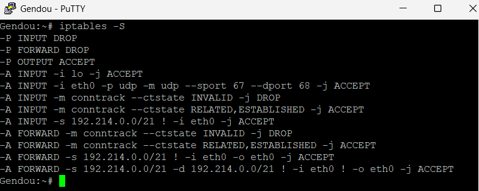

Berdasarkan hasil tersebut, seluruh rule firewall telah berhasil diterapkan.

Chain INPUT memiliki lima rule, sedangkan chain FORWARD memiliki empat rule. Chain OUTPUT tidak membutuhkan rule tambahan karena menggunakan default policy ACCEPT.

| Chain | Jumlah Rule | Default Policy |
|---|---:|---|
| INPUT | 5 | DROP |
| FORWARD | 4 | DROP |
| OUTPUT | 0 | ACCEPT |
| **Total** | **9** | |

Konfigurasi tersebut mencakup seluruh pengecualian yang diminta pada soal tanpa memerlukan rule terpisah untuk setiap subnet internal.

#### 5.7 - Hasil Pengujian Konektivitas Armisael

Setelah firewall diterapkan, dilakukan pengujian konektivitas dari Armisael menuju internet, nama domain, node pada LAN lain, dan router Gendou untuk memastikan konfigurasi sebelumnya tetap berfungsi.

Pengujian dilakukan menggunakan command berikut:

```bash
echo "===== INTERNET CONNECTIVITY ====="
ping -c 4 -W 2 8.8.8.8

echo "===== DNS CONNECTIVITY ====="
ping -4 -c 4 -W 2 deb.debian.org

echo "===== INTER-LAN CONNECTIVITY ====="
ping -c 4 -W 1 192.214.4.74

echo "===== ACCESS TO GENDOU ====="
ping -c 4 -W 1 192.214.4.129
```

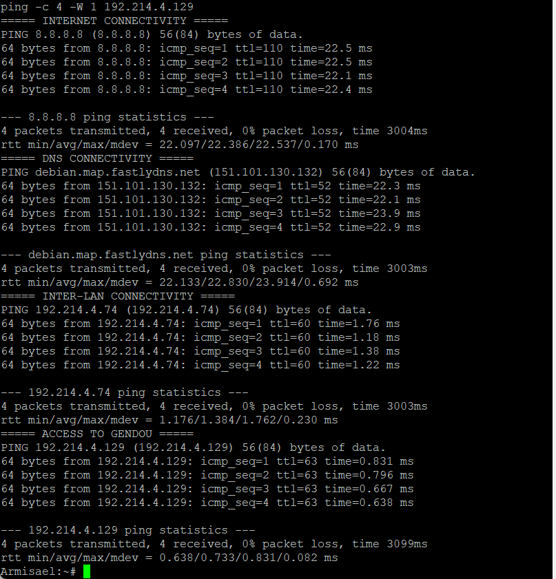

| Tujuan | IP Tujuan | Paket Dikirim | Paket Diterima | Packet Loss | RTT Rata-rata | Status |
|---|---|---:|---:|---:|---:|---|
| Internet | 8.8.8.8 | 4 | 4 | 0% | 22.477 ms | Berhasil |
| deb.debian.org | 151.101.66.132 | 4 | 4 | 0% | 22.310 ms | Berhasil |
| Lilith | 192.214.4.74 | 4 | 4 | 0% | 1.424 ms | Berhasil |
| Gendou | 192.214.4.129 | 4 | 4 | 0% | 0.558 ms | Berhasil |
| **Total** | | **16** | **16** | **0%** | | **Berhasil** |

Berdasarkan hasil pengujian, diperoleh kesimpulan sebagai berikut:

- **Akses internet:** Rule FORWARD mengizinkan traffic internal menuju internet, sedangkan rule ESTABLISHED,RELATED mengizinkan paket balasan.
- **Resolusi DNS:** Domain deb.debian.org berhasil diterjemahkan menjadi alamat IP 151.101.66.132 dan dapat dijangkau.
- **Komunikasi antar-LAN:** Armisael tetap dapat berkomunikasi dengan Lilith karena terdapat pengecualian traffic antar-subnet internal pada chain FORWARD.
- **Akses menuju Gendou:** Armisael tetap dapat mengakses Gendou karena terdapat rule INPUT yang mengizinkan traffic dari prefix internal.

Seluruh pengujian menghasilkan 0% packet loss. Dengan demikian, penerapan default policy INPUT dan FORWARD DROP tidak mengganggu konektivitas jaringan internal, static routing, NAT MASQUERADE, maupun resolusi DNS yang telah dikonfigurasi pada soal sebelumnya.

#### 5.8 - Verifikasi Layanan Gendou

Selain pengujian dari Armisael, dilakukan pemeriksaan terhadap fungsi komunikasi lokal, akses internet Gendou, serta konfigurasi DHCP.

Command yang digunakan adalah sebagai berikut:

```bash
echo "===== LOOPBACK ====="
ping -c 3 -W 1 127.0.0.1

echo "===== INTERNET ====="
ping -c 3 -W 2 8.8.8.8

echo "===== DHCP CLIENT ====="
ps aux | grep '[u]dhcpc'

echo "===== DHCP ADDRESS ====="
ip -4 -br addr show dev eth0

echo "===== DEFAULT ROUTE ====="
ip route show default
```

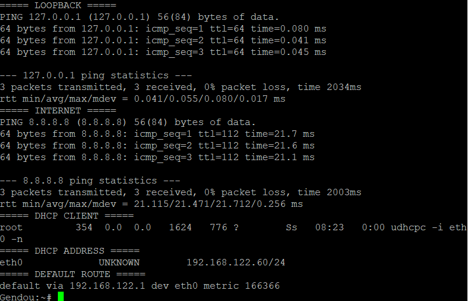

Setelah firewall diterapkan, dilakukan pengujian terhadap komunikasi loopback, akses internet, dan konfigurasi DHCP untuk memastikan fungsi utama Gendou tetap berjalan.

| Pengujian | Tujuan | Paket Dikirim | Paket Diterima | Packet Loss | RTT Rata-rata | Status |
|---|---|---:|---:|---:|---:|---|
| Loopback | 127.0.0.1 | 3 | 3 | 0% | 0.052 ms | Berhasil |
| Akses Internet | 8.8.8.8 | 3 | 3 | 0% | 21.714 ms | Berhasil |

Hasil pemeriksaan konfigurasi DHCP setelah firewall diaktifkan adalah sebagai berikut:

| Parameter | Hasil |
|---|---|
| DHCP client | Aktif |
| PID | 354 |
| Interface | eth0 |
| IP Address | 192.168.122.60/24 |
| Default Gateway | 192.168.122.1 |
| Route Metric | 166366 |

Berdasarkan hasil pengujian, diperoleh kesimpulan sebagai berikut:

- **Loopback:** Komunikasi lokal tetap berfungsi karena terdapat rule ACCEPT untuk interface lo pada chain INPUT.
- **Akses internet:** Gendou tetap dapat mengakses internet karena chain OUTPUT menggunakan policy ACCEPT dan paket balasan diizinkan melalui rule ESTABLISHED,RELATED pada chain INPUT.
- **DHCP:** DHCP client tetap aktif, serta alamat IP eksternal dan default route tetap tersedia setelah firewall diterapkan. Rule pengecualian UDP port 67 menuju port 68 juga telah tersedia, meskipun proses pembaruan lease belum diuji secara langsung.

Dengan demikian, penerapan firewall tidak mengganggu fungsi komunikasi lokal, akses internet, maupun konfigurasi jaringan eksternal Gendou yang sedang berjalan.

#### 5.9 - Verifikasi Counter Firewall

Counter firewall digunakan untuk mengetahui apakah rule yang telah dikonfigurasi benar-benar memproses traffic jaringan.

Pemeriksaan dilakukan menggunakan command berikut:

```bash
echo "===== INPUT COUNTERS ====="
iptables -L INPUT -n -v --line-numbers

echo "===== FORWARD COUNTERS ====="
iptables -L FORWARD -n -v --line-numbers

echo "===== NAT COUNTERS ====="
nft list chain ip nat postrouting
```


##### 5.9.1 - Counter Chain INPUT

Hasil aktual counter chain INPUT adalah sebagai berikut:

| No. | Rule | Packets | Bytes |
|---|---|---:|---:|
| 1 | ACCEPT loopback | 6 | 504 |
| 2 | ACCEPT DHCP | 0 | 0 |
| 3 | DROP INVALID | 0 | 0 |
| 4 | ACCEPT RELATED,ESTABLISHED | 6 | 504 |
| 5 | ACCEPT internal menuju Gendou | 1 | 84 |

Berdasarkan hasil tersebut, diperoleh beberapa informasi:

- Rule loopback telah memproses enam paket yang berasal dari pengujian komunikasi lokal.
- Rule RELATED,ESTABLISHED telah memproses paket yang menjadi bagian dari koneksi yang sudah ada.
- Rule internal menuju Gendou telah memproses paket dari jaringan internal.
- Rule DHCP belum memiliki counter karena belum terdapat paket DHCP yang tercatat oleh rule tersebut selama periode pengujian.
- Rule DROP INVALID belum memproses paket karena tidak terdapat paket dengan connection state INVALID yang cocok.

Default policy INPUT DROP juga menunjukkan counter sebesar nol paket selama periode pengujian.

Hal tersebut tidak berarti policy DROP gagal diterapkan, melainkan belum terdapat paket yang mencapai akhir chain dan harus dibuang oleh default policy selama pengujian tersebut.

##### 5.9.2 - Counter Chain FORWARD

Hasil aktual counter chain FORWARD adalah sebagai berikut:

| No. | Rule | Packets | Bytes |
|---|---|---:|---:|
| 1 | DROP INVALID | 0 | 0 |
| 2 | ACCEPT RELATED,ESTABLISHED | 30 | 3363 |
| 3 | ACCEPT internal menuju internet | 8 | 554 |
| 4 | ACCEPT komunikasi antar-LAN | 1 | 84 |

Counter menunjukkan bahwa traffic internal menuju internet dan komunikasi antar-LAN berhasil diproses oleh firewall.

Rule RELATED,ESTABLISHED memiliki jumlah paket paling banyak karena paket dari koneksi yang telah berlangsung akan cocok dengan rule tersebut terlebih dahulu.

Sebagai contoh, ketika Armisael melakukan ping sebanyak empat kali menuju Lilith, paket awal dapat cocok dengan rule antar-LAN. Paket berikutnya dapat dikenali sebagai bagian dari koneksi yang sudah berlangsung sehingga diproses oleh rule ESTABLISHED.

Oleh karena itu, counter rule antar-LAN tidak harus sama dengan jumlah keseluruhan paket ping yang dikirimkan.

#### 5.10 - Verifikasi NAT MASQUERADE

Firewall yang diterapkan pada soal 5 tidak boleh mengganggu konfigurasi NAT yang telah dibuat pada soal 4.

Untuk memastikan NAT tetap berfungsi, dilakukan pemeriksaan menggunakan:

```bash
nft list chain ip nat postrouting
```


Hasil aktual setelah penerapan firewall adalah sebagai berikut:

```text
table ip nat {
    chain postrouting {
        type nat hook postrouting priority srcnat; policy accept;
        ip saddr 192.214.0.0/21 oifname "eth0" counter packets 36 bytes 2602 masquerade
    }
}
```

Perbandingan counter NAT sebelum dan setelah firewall diterapkan adalah sebagai berikut:

| Parameter | Sebelum Firewall | Setelah Firewall | Peningkatan |
|---|---:|---:|---:|
| Packets | 24 | 36 | 12 |
| Bytes | 1732 | 2602 | 870 |

Peningkatan counter paket:

$$
36 - 24 = 12
$$

Peningkatan counter byte:

$$
2602 - 1732 = 870
$$

Peningkatan counter tersebut menunjukkan bahwa rule NAT MASQUERADE tetap memproses traffic setelah firewall diaktifkan.

Rule NAT masih menggunakan kondisi yang sama, yaitu:

```text
ip saddr 192.214.0.0/21 oifname "eth0" counter masquerade
```

Dengan demikian, translasi alamat tetap hanya dilakukan terhadap paket yang berasal dari prefix internal dan keluar melalui interface eth0 menuju NAT1.

#### 5.11 - Analisis Alur Pemrosesan Paket

##### 5.11.1 - Traffic Internal Menuju Internet

Ketika Armisael mengirimkan paket menuju 8.8.8.8, alur pemrosesan paket pada Gendou adalah sebagai berikut:

```text
Armisael
192.214.4.83
       |
       v
    Shigeru
       |
       v
Gendou - eth3
       |
       v
   PREROUTING
       |
       v
 Routing Decision
       |
       v
     FORWARD
Internal --> Internet
       ACCEPT
       |
       v
   POSTROUTING
  NAT MASQUERADE
       |
       v
Gendou - eth0
       |
       v
      NAT1
       |
       v
    Internet
```

Paket terlebih dahulu melewati proses routing dan filtering pada chain FORWARD.

Setelah diizinkan, paket diproses oleh chain POSTROUTING untuk melakukan translasi alamat sumber menggunakan MASQUERADE.

Alamat sumber paket berubah dari 192.214.4.83 menjadi alamat eksternal Gendou, yaitu 192.168.122.60.

##### 5.11.2 - Paket Balasan dari Internet

Ketika paket balasan diterima dari internet, Gendou menggunakan informasi connection tracking untuk mengembalikan alamat tujuan paket ke alamat IP asli Armisael.

```text
Internet
    |
   NAT1
    |
Gendou - eth0
    |
PREROUTING
Reverse NAT
    |
Routing Decision
    |
FORWARD
ESTABLISHED
ACCEPT
    |
Gendou - eth3
    |
 Shigeru
    |
 Armisael
```

Paket balasan diizinkan karena merupakan bagian dari koneksi yang telah dimulai oleh Armisael.

##### 5.11.3 - Koneksi Baru dari NAT1 Menuju Gendou

Apabila perangkat eksternal mengirimkan paket koneksi baru menuju Gendou melalui eth0, paket akan diproses melalui chain INPUT.

```text
Perangkat Eksternal
        |
       NAT1
        |
       eth0
        |
       INPUT
        |
Tidak memenuhi rule ACCEPT
        |
Default Policy DROP
        |
      Dibuang
```

Paket koneksi baru tersebut tidak memenuhi rule internal karena berasal dari eth0. Paket juga tidak memenuhi rule ESTABLISHED,RELATED karena bukan bagian dari koneksi yang telah ada.

Selama paket tersebut bukan bagian dari pengecualian yang diizinkan, seperti DHCP, paket akan dibuang oleh default policy INPUT DROP.

##### 5.11.4 - Koneksi Baru dari NAT1 Menuju Jaringan Internal

Apabila paket koneksi baru dari NAT1 memiliki tujuan perangkat internal dan diteruskan oleh Gendou, paket akan diproses melalui chain FORWARD.

Rule internal menuju internet dan rule antar-LAN memiliki kondisi bahwa paket tidak boleh masuk melalui eth0.

Karena koneksi baru tersebut berasal dari eth0 dan tidak memenuhi rule ESTABLISHED,RELATED, paket tidak akan cocok dengan rule ACCEPT yang tersedia.

Akibatnya, paket akan dibuang oleh default policy FORWARD DROP.

Mekanisme tersebut memenuhi prinsip pengamanan jaringan eksternal, yaitu perangkat internal diperbolehkan memulai koneksi keluar, sedangkan koneksi baru yang tidak diizinkan dari jaringan eksternal ditolak.

### 6 - Alamat Para Pilot

>Jaringan sudah hidup, tapi para pilot dan staf tidak tahu alamat mereka sendiri. Unit-01 bahkan tidak tahu siapa gateway-nya. Beri IP statis dan gateway ke semua node non-router, sesuai aturan alamat di glosarium. Simpan agar bertahan setelah restart. Tunjukkan ip -br dan ping ke gateway di Unit-01.

Soal meminta untuk memberikan alamat IP statis dan default gateway kepada seluruh node non-router sesuai aturan pengalamatan pada glosarium dan hasil pembagian VLSM pada soal 1.

Konfigurasi harus disimpan secara permanen agar alamat IP dan default gateway tetap tersedia setelah node direstart.

Keberhasilan konfigurasi dibuktikan dengan menampilkan hasil `ip -br addr` dan pengujian ping menuju gateway pada Unit-01 setelah restart.

#### 1. Perencanaan Pengalamatan IP

Pengalamatan IP pada seluruh node non-router menggunakan hasil pembagian subnet dengan metode VLSM yang telah ditentukan pada soal 1.

Alamat usable pertama pada setiap subnet digunakan sebagai alamat gateway router, sedangkan alamat usable berikutnya dialokasikan kepada node secara berurutan.

Berikut merupakan alokasi alamat IP, subnet mask, dan default gateway untuk seluruh node non-router pada jaringan Geofront.

| No. | Node | IP Address/Prefix | Subnet Mask | Default Gateway |
|---|---|---|---|---|
| 1 | Quarters | 192.214.0.2/23 | 255.255.254.0 | 192.214.0.1 |
| 2 | Comm-Net | 192.214.2.2/24 | 255.255.255.0 | 192.214.2.1 |
| 3 | Hangar-Crew | 192.214.3.2/25 | 255.255.255.128 | 192.214.3.1 |
| 4 | Sachiel | 192.214.3.130/26 | 255.255.255.192 | 192.214.3.129 |
| 5 | Pen-Pen | 192.214.3.194/27 | 255.255.255.224 | 192.214.3.193 |
| 6 | Medic-Bay | 192.214.3.195/27 | 255.255.255.224 | 192.214.3.193 |
| 7 | Relay-Node | 192.214.3.226/27 | 255.255.255.224 | 192.214.3.225 |
| 8 | Garden-Staff | 192.214.4.2/27 | 255.255.255.224 | 192.214.4.1 |
| 9 | Dock-Crew | 192.214.4.34/28 | 255.255.255.240 | 192.214.4.33 |
| 10 | Entry-Plug | 192.214.4.50/29 | 255.255.255.248 | 192.214.4.49 |
| 11 | Dummy-Plug | 192.214.4.51/29 | 255.255.255.248 | 192.214.4.49 |
| 12 | Magi-Casper | 192.214.4.58/29 | 255.255.255.248 | 192.214.4.57 |
| 13 | Magi-Balthasar | 192.214.4.59/29 | 255.255.255.248 | 192.214.4.57 |
| 14 | Magi-Melchior | 192.214.4.60/29 | 255.255.255.248 | 192.214.4.57 |
| 15 | Unit-01 | 192.214.4.66/29 | 255.255.255.248 | 192.214.4.65 |
| 16 | Unit-02 | 192.214.4.67/29 | 255.255.255.248 | 192.214.4.65 |
| 17 | Unit-00 | 192.214.4.68/29 | 255.255.255.248 | 192.214.4.65 |
| 18 | Lilith | 192.214.4.74/29 | 255.255.255.248 | 192.214.4.73 |
| 19 | Adam | 192.214.4.75/29 | 255.255.255.248 | 192.214.4.73 |
| 20 | Zeruel | 192.214.4.82/29 | 255.255.255.248 | 192.214.4.81 |
| 21 | Armisael | 192.214.4.83/29 | 255.255.255.248 | 192.214.4.81 |
| 22 | Radar-Array | 192.214.4.90/29 | 255.255.255.248 | 192.214.4.89 |
| 23 | Archive-Vault | 192.214.4.98/30 | 255.255.255.252 | 192.214.4.97 |
| 24 | Spy | 192.214.4.102/30 | 255.255.255.252 | 192.214.4.101 |
| 25 | Tokyo3-Core | 192.214.4.106/30 | 255.255.255.252 | 192.214.4.105 |

Terdapat 25 node non-router yang tersebar pada 17 subnet LAN. Seluruh alamat IP dialokasikan secara unik dan berada dalam rentang usable host pada subnet masing-masing.

Selain alamat IP dan default gateway, setiap node juga dikonfigurasi menggunakan DNS resolver 8.8.8.8 dan 1.1.1.1 untuk mendukung kebutuhan resolusi nama domain dan instalasi paket pada tahap selanjutnya.

#### 2. Penentuan Metode Konfigurasi Permanen

Pada soal sebelumnya, konfigurasi IP node uji dilakukan menggunakan perintah `ip addr add` dan `ip route replace`. Konfigurasi tersebut bersifat runtime sehingga tidak secara otomatis tersedia kembali setelah node direstart.

Untuk memenuhi ketentuan persistensi pada soal 6, konfigurasi jaringan disimpan melalui file `/etc/network/interfaces` pada setiap node Alpine Linux.

##### 2.1. Pemeriksaan Dukungan Persistensi

Sebelum konfigurasi diterapkan pada seluruh node, dilakukan pemeriksaan awal pada Unit-01 menggunakan perintah berikut:

```bash
ip -br addr
ip route
cat /etc/network/interfaces

command -v ifup
command -v ifdown

mount | grep '/etc/network'
```

Hasil pemeriksaan menunjukkan bahwa perangkat menyediakan utilitas konfigurasi interface berikut:

```text
/sbin/ifup
/sbin/ifdown
```

Selain itu, ditemukan persistent volume GNS3 yang digunakan untuk menyimpan konfigurasi jaringan:

```text
/dev/sdb1 on /gns3volumes/etc/network type ext4 (rw,nodiratime,relatime)
/dev/sdb1 on /etc/network type ext4 (rw,nodiratime,relatime)
```

Hasil tersebut menunjukkan bahwa direktori `/etc/network` menggunakan penyimpanan persisten sehingga file konfigurasi jaringan dapat dipertahankan ketika node dihentikan dan dinyalakan kembali.

##### 2.2. Pemilihan Metode Konfigurasi

| Aspek | Konfigurasi Runtime | Konfigurasi Permanen |
|---|---|---|
| Metode | `ip addr` dan `ip route` | `/etc/network/interfaces` |
| Penyimpanan | Kondisi jaringan aktif | File konfigurasi |
| Bertahan setelah restart | Tidak | Ya, melalui persistent volume |
| Aktivasi otomatis | Tidak | Ya, menggunakan `auto` |
| Penggunaan | Pengujian sementara | Konfigurasi seluruh node |

Konfigurasi melalui `/etc/network/interfaces` dipilih karena dapat menyimpan alamat IP, subnet mask, default gateway, dan perintah tambahan untuk konfigurasi DNS dalam satu file.

#### 3. Konfigurasi IP Statis Unit-01

Unit-01 digunakan sebagai node pertama untuk menguji metode konfigurasi permanen sebelum diterapkan pada seluruh node lainnya.

Unit-01 berada pada Switch-Cage dengan Misato sebagai router gateway.

| Parameter | Nilai |
|---|---|
| Node | Unit-01 |
| Switch | Switch-Cage |
| Interface | eth0 |
| Network ID | 192.214.4.64/29 |
| IP Address | 192.214.4.66 |
| Subnet Mask | 255.255.255.248 |
| Default Gateway | 192.214.4.65 |
| Broadcast | 192.214.4.71 |
| Router Gateway | Misato |
| DNS Primer | 8.8.8.8 |
| DNS Sekunder | 1.1.1.1 |

##### 3.1. Penyimpanan Konfigurasi

Konfigurasi dilakukan dengan menuliskan pengaturan jaringan pada file `/etc/network/interfaces`.

```bash
cat > /etc/network/interfaces <<'EOF'
auto lo
iface lo inet loopback

auto eth0
iface eth0 inet static
    address 192.214.4.66
    netmask 255.255.255.248
    gateway 192.214.4.65
    up printf 'nameserver 8.8.8.8\nnameserver 1.1.1.1\n' > /etc/resolv.conf
EOF
```


Konfigurasi DNS disertakan dalam perintah `up` agar file `/etc/resolv.conf` dapat dikonfigurasi kembali ketika interface diaktifkan, tanpa bergantung pada persistensi file tersebut secara terpisah.

##### 3.2. Aktivasi Konfigurasi

Setelah file konfigurasi disimpan, interface eth0 diaktifkan menggunakan perintah:

```bash
ifup eth0
```

Selanjutnya, dilakukan pemeriksaan menggunakan:

```bash
ip -br addr
ip route
cat /etc/resolv.conf
```

Konfigurasi tersebut menghasilkan alamat IP 192.214.4.66/29 dan default route menuju 192.214.4.65.

#### 4. Konfigurasi Seluruh Node Non-Router

Setelah metode konfigurasi permanen berhasil diterapkan pada Unit-01, metode yang sama digunakan pada seluruh node non-router lainnya.

Konfigurasi setiap node mengikuti alamat IP, subnet mask, dan default gateway yang telah ditentukan pada tabel pengalamatan.

##### 4.1. Template Konfigurasi

Untuk mempermudah penerapan konfigurasi pada seluruh node, digunakan template berikut:

```bash
cat > /etc/network/interfaces <<'EOF'
auto lo
iface lo inet loopback

auto eth0
iface eth0 inet static
    address <IP_ADDRESS>
    netmask <SUBNET_MASK>
    gateway <DEFAULT_GATEWAY>
    up printf 'nameserver 8.8.8.8\nnameserver 1.1.1.1\n' > /etc/resolv.conf
EOF
```

Parameter `<IP_ADDRESS>`, `<SUBNET_MASK>`, dan `<DEFAULT_GATEWAY>` diganti berdasarkan alokasi masing-masing node.

Nama interface disesuaikan dengan interface yang terhubung ke switch pada topologi GNS3.

##### 4.2. Penerapan Konfigurasi

Beberapa node, seperti Armisael, Lilith, Sachiel, dan Comm-Net, sebelumnya telah memiliki konfigurasi IP sementara untuk kebutuhan pengujian soal 3 sampai soal 5.

Oleh karena itu, sebelum konfigurasi permanen diterapkan, konfigurasi runtime lama pada interface yang bersangkutan dibersihkan untuk menghindari konflik alamat IP maupun default route.

Contoh penerapan konfigurasi lengkap pada Unit-02 adalah sebagai berikut:

```bash
ifdown eth0 2>/dev/null || true

cat > /etc/network/interfaces <<'EOF'
auto lo
iface lo inet loopback

auto eth0
iface eth0 inet static
    address 192.214.4.67
    netmask 255.255.255.248
    gateway 192.214.4.65
    up printf 'nameserver 8.8.8.8\nnameserver 1.1.1.1\n' > /etc/resolv.conf
EOF

ip -4 addr flush dev eth0
ip -4 route flush dev eth0 scope global

ifup eth0

ip -br addr
ip route
ping -c 4 -W 1 192.214.4.65
```

Metode tersebut diterapkan pada seluruh node dengan menyesuaikan parameter pengalamatan masing-masing.

Dengan menggunakan file konfigurasi yang tersimpan pada persistent volume GNS3, setiap node memiliki konfigurasi jaringan yang dapat diterapkan secara otomatis ketika dinyalakan kembali.

Tidak diperlukan konfigurasi DHCP pada node non-router karena seluruh node menggunakan alamat IP statis sesuai ketentuan soal.

#### 5. Pengujian Persistensi Unit-01

Pengujian persistensi dilakukan untuk membuktikan bahwa konfigurasi IP dan default gateway tidak hanya tersedia selama node berjalan, tetapi juga dapat dipulihkan secara otomatis setelah restart.

Pengujian dilakukan dengan menghentikan Unit-01 menggunakan opsi Stop pada GNS3, kemudian menyalakannya kembali menggunakan opsi Start.

Setelah Unit-01 dinyalakan kembali, tidak dilakukan konfigurasi IP, routing, maupun aktivasi interface secara manual.

##### 5.1. Verifikasi Setelah Restart

Perintah berikut dijalankan setelah Unit-01 kembali aktif:

```bash
echo "===== IP AFTER RESTART ====="
ip -br addr

echo "===== ROUTING TABLE ====="
ip route

echo "===== PING GATEWAY ====="
ping -c 4 -W 1 192.214.4.65
```

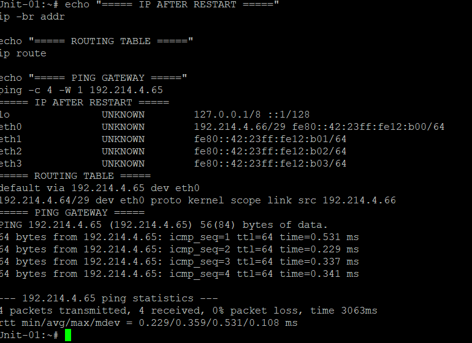

Hasil aktual pengujian adalah sebagai berikut:

```text
===== IP AFTER RESTART =====
lo     UNKNOWN    127.0.0.1/8 ::1/128
eth0   UNKNOWN    192.214.4.66/29 fe80::42:23ff:fe12:b00/64
eth1   UNKNOWN    fe80::42:23ff:fe12:b01/64
eth2   UNKNOWN    fe80::42:23ff:fe12:b02/64
eth3   UNKNOWN    fe80::42:23ff:fe12:b03/64

===== ROUTING TABLE =====
default via 192.214.4.65 dev eth0
192.214.4.64/29 dev eth0 proto kernel scope link src 192.214.4.66

===== PING GATEWAY =====
PING 192.214.4.65 (192.214.4.65) 56(84) bytes of data.
64 bytes from 192.214.4.65: icmp_seq=1 ttl=64 time=0.531 ms
64 bytes from 192.214.4.65: icmp_seq=2 ttl=64 time=0.229 ms
64 bytes from 192.214.4.65: icmp_seq=3 ttl=64 time=0.337 ms
64 bytes from 192.214.4.65: icmp_seq=4 ttl=64 time=0.341 ms

--- 192.214.4.65 ping statistics ---
4 packets transmitted, 4 received, 0% packet loss, time 3063ms
rtt min/avg/max/mdev = 0.229/0.359/0.531/0.108 ms
```


##### 5.2. Analisis Hasil Pengujian

| Parameter | Hasil Setelah Restart | Status |
|---|---|---|
| IP Address | 192.214.4.66/29 | Berhasil |
| Default Gateway | 192.214.4.65 | Berhasil |
| Connected Route | 192.214.4.64/29 | Berhasil |
| Paket dikirim | 4 | Berhasil |
| Paket diterima | 4 | Berhasil |
| Packet Loss | 0% | Berhasil |
| TTL balasan | 64 | Sesuai |
| RTT rata-rata | 0.359 ms | Berhasil |

Berdasarkan hasil pengujian, alamat IP dan default gateway Unit-01 tersedia kembali secara otomatis setelah restart. Pengujian ping menuju Misato juga berhasil dengan 0% packet loss.

Nilai TTL sebesar 64 pada paket balasan konsisten dengan komunikasi dalam subnet yang sama tanpa melalui router perantara.

Dengan demikian, metode penyimpanan konfigurasi melalui `/etc/network/interfaces` terbukti berhasil mempertahankan konfigurasi jaringan Unit-01 setelah restart.

#### 6. Audit Konektivitas Seluruh Node

Setelah seluruh node non-router dikonfigurasi, dilakukan audit terpusat dari Gendou untuk memastikan seluruh alamat IP dapat dijangkau melalui static routing yang telah dibuat pada soal 3.

Audit ini juga memastikan bahwa konfigurasi firewall pada soal 5 tidak mengganggu komunikasi internal.

##### 6.1. Script Audit Konektivitas

Perintah berikut dijalankan pada Gendou:

```bash
check_ping() {
    if ping -c 2 -W 1 "$2" >/dev/null 2>&1; then
        printf "[PASS] %-20s %s\n" "$1" "$2"
        PASS=$((PASS+1))
    else
        printf "[FAIL] %-20s %s\n" "$1" "$2"
        FAIL=$((FAIL+1))
    fi
}

PASS=0
FAIL=0

echo "===== ALL NON-ROUTER NODES ====="

check_ping Quarters       192.214.0.2
check_ping Comm-Net       192.214.2.2
check_ping Hangar-Crew    192.214.3.2
check_ping Sachiel        192.214.3.130
check_ping Pen-Pen        192.214.3.194
check_ping Medic-Bay      192.214.3.195
check_ping Relay-Node     192.214.3.226
check_ping Garden-Staff   192.214.4.2
check_ping Dock-Crew      192.214.4.34
check_ping Entry-Plug     192.214.4.50
check_ping Dummy-Plug     192.214.4.51
check_ping Magi-Casper    192.214.4.58
check_ping Magi-Balthasar 192.214.4.59
check_ping Magi-Melchior  192.214.4.60
check_ping Unit-01        192.214.4.66
check_ping Unit-02        192.214.4.67
check_ping Unit-00        192.214.4.68
check_ping Lilith         192.214.4.74
check_ping Adam           192.214.4.75
check_ping Zeruel         192.214.4.82
check_ping Armisael       192.214.4.83
check_ping Radar-Array    192.214.4.90
check_ping Archive-Vault  192.214.4.98
check_ping Spy            192.214.4.102
check_ping Tokyo3-Core    192.214.4.106

echo "===== AUDIT SUMMARY ====="
echo "PASS  : $PASS"
echo "FAIL  : $FAIL"
echo "TOTAL : $((PASS+FAIL))"
```

Script tersebut melakukan pengujian ping terhadap seluruh node non-router dan mengelompokkan hasil pengujian berdasarkan keberhasilan konektivitas.

##### 6.2. Hasil Akhir Audit

Berdasarkan hasil audit dan verifikasi akhir, seluruh 25 node berhasil dijangkau dari Gendou.

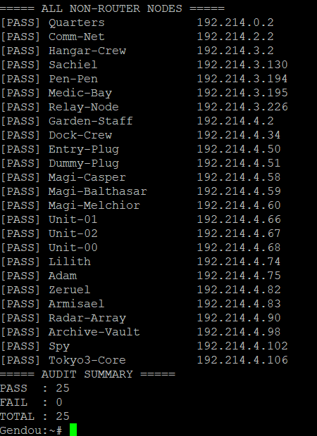

| Parameter | Hasil |
|---|---:|
| Jumlah subnet LAN | 17 |
| Jumlah node non-router | 25 |
| Node berhasil dijangkau | 25 |
| Node gagal dijangkau | 0 |
| Tingkat keberhasilan konektivitas | 100% |

Persentase keberhasilan pengujian dihitung menggunakan:

$$
Keberhasilan = \frac{25}{25} \times 100\% = 100\%
$$

Hasil tersebut menunjukkan bahwa seluruh node dapat dijangkau dari router pusat melalui konfigurasi pengalamatan dan static routing yang telah diterapkan.

### 7 - Membangunkan MAGI


