# JARKOM MODUL 5-2026-K-06

## Anggota Kelompok
|Nama|NRP|
|---|---|
|Dewa Ngakan Gede Wira Adhimukti|5027251063|
|Razana Aulia|5027251127|

### 1 - Markas Tanpa Peta
> tengah malam alarm meraung, dan Ritsuko terdiam. Markas sebesar ini dibangun tanpa peta alamat. Gendo anti pemborosan, jadi tiap subnet memakai prefix terkecil yang muat. Bagi prefix IP kelompokmu dengan VLSM untuk 17 LAN dan 16 link antar-router, urut dari kebutuhan terbesar. Tunjukkan tabel berisi network, prefix, gateway, broadcast, IP terpakai, dan sisa. Tunjukkan juga gambar pohon IP, dengan subnet jalur Dummy-Plug ke Armisael dilingkari. Di laporan, jelaskan hitungan satu subnet.

Soal meminta untuk membagi alamat IP jaringan Geofront menggunakan metode Variable Length Subnet Mask (VLSM) untuk memenuhi kebutuhan 17 LAN dan 16 link antar-router. Setiap subnet harus menggunakan prefix terkecil yang dapat memenuhi kebutuhan alamat IP agar penggunaan alamat IP menjadi efisien.

Pembagian subnet dilakukan berdasarkan kebutuhan host terbesar hingga terkecil. Apabila terdapat subnet dengan ukuran blok yang sama, LAN diprioritaskan terlebih dahulu dibandingkan link antar-router, kemudian mengikuti urutan tabel pada soal.

Hasil pembagian IP disajikan dalam bentuk tabel yang memuat Network ID, prefix, gateway, broadcast, jumlah IP terpakai, dan sisa IP. Selain itu, dibuat pohon pembagian IP dengan menandai subnet-subnet yang dilalui pada jalur komunikasi Dummy-Plug menuju Armisael.

#### 1.1 - Penentuan Network Induk

Blok alamat IP yang digunakan dalam perancangan jaringan Geofront adalah 192.214.0.0/21. Prefix /21 digunakan karena merupakan blok jaringan terkecil yang dapat menampung seluruh kebutuhan alamat IP dari 17 LAN dan 16 link antar-router.

| Keterangan | Nilai |
|---|---|
| Network ID | 192.214.0.0 |
| Prefix | /21 |
| Subnet Mask | 255.255.248.0 |
| Broadcast Address | 192.214.7.255 |
| Rentang Alamat IP | 192.214.0.0 – 192.214.7.255 |
| Total Alamat IP | 2048 |
| Jumlah LAN | 17 |
| Jumlah Link Antar-router | 16 |
| Total Subnet | 33 |

#### 1.2 - Perhitungan Kebutuhan Alamat IP

Dalam menentukan ukuran subnet LAN, jumlah alamat IP yang dibutuhkan dihitung dengan memperhitungkan jumlah host, satu alamat IP gateway, satu Network ID, dan satu Broadcast Address.

Rumus yang digunakan adalah:

$$
2^h \geq H + G + 2
$$

Keterangan:

- $h$ = jumlah bit host.
- $H$ = jumlah host yang dibutuhkan.
- $G$ = jumlah alamat IP gateway, yaitu 1.
- 2 = alamat yang digunakan untuk Network ID dan Broadcast Address.

Setelah memperoleh jumlah bit host terkecil yang memenuhi kebutuhan, prefix subnet dapat ditentukan menggunakan rumus:

$$
Prefix = 32 - h
$$

Sedangkan jumlah alamat IP usable dan sisa alamat IP dihitung menggunakan rumus:

$$
IP_{usable} = 2^h - 2
$$

$$
IP_{sisa} = IP_{usable} - (H + G)
$$

Berikut merupakan hasil perhitungan kebutuhan alamat IP setiap LAN.

| No. | LAN | Jumlah Host | Gateway | Total Kebutuhan IP | Ukuran Blok | Prefix |
|---|---|---:|---:|---:|---:|---|
| 1 | Switch-Quarters | 500 | 1 | 503 | 512 | /23 |
| 2 | Switch-Comm | 200 | 1 | 203 | 256 | /24 |
| 3 | Switch-Hangar | 100 | 1 | 103 | 128 | /25 |
| 4 | Switch-Bunker | 55 | 1 | 58 | 64 | /26 |
| 5 | Switch-Medic | 26 | 1 | 29 | 32 | /27 |
| 6 | Switch-Relay | 25 | 1 | 28 | 32 | /27 |
| 7 | Switch-Garden | 14 | 1 | 17 | 32 | /27 |
| 8 | Switch-Dock | 12 | 1 | 15 | 16 | /28 |
| 9 | Switch-Lab | 5 | 1 | 8 | 8 | /29 |
| 10 | Switch-Terminal | 3 | 1 | 6 | 8 | /29 |
| 11 | Switch-Cage | 3 | 1 | 6 | 8 | /29 |
| 12 | Switch-Dogma | 2 | 1 | 5 | 8 | /29 |
| 13 | Switch-Monolith | 2 | 1 | 5 | 8 | /29 |
| 14 | Switch-Radar | 4 | 1 | 7 | 8 | /29 |
| 15 | Switch-Archive | 1 | 1 | 4 | 4 | /30 |
| 16 | Switch-Intel | 1 | 1 | 4 | 4 | /30 |
| 17 | Switch-Cmd | 1 | 1 | 4 | 4 | /30 |

Setiap link antar-router membutuhkan dua alamat IP usable untuk kedua interface router. Dengan memperhitungkan Network ID dan Broadcast Address, setiap link membutuhkan empat alamat IP sehingga digunakan prefix /30.

Total ukuran blok yang dialokasikan adalah:

- Total alokasi 17 LAN = 1132 alamat IP.
- Total alokasi 16 link antar-router = 16 × 4 = 64 alamat IP.
- Total alokasi keseluruhan = 1196 alamat IP.

Prefix /22 hanya menyediakan 1024 alamat IP sehingga tidak dapat memenuhi seluruh kebutuhan jaringan. Oleh karena itu, digunakan prefix /21 yang menyediakan 2048 alamat IP.

#### 1.3 - Tabel Pembagian VLSM LAN

Pembagian alamat IP dilakukan secara berurutan berdasarkan ukuran blok terbesar hingga terkecil. Alamat IP usable pertama pada setiap subnet digunakan sebagai gateway.

| No. | LAN | Router Gateway | Network ID | Prefix | Gateway | Broadcast | IP Terpakai | Sisa IP |
|---|---|---|---|---|---|---|---:|---:|
| 1 | Switch-Quarters | Rei | 192.214.0.0 | /23 | 192.214.0.1 | 192.214.1.255 | 501 | 9 |
| 2 | Switch-Comm | Hikari | 192.214.2.0 | /24 | 192.214.2.1 | 192.214.2.255 | 201 | 53 |
| 3 | Switch-Hangar | Yui | 192.214.3.0 | /25 | 192.214.3.1 | 192.214.3.127 | 101 | 25 |
| 4 | Switch-Bunker | Kensuke | 192.214.3.128 | /26 | 192.214.3.129 | 192.214.3.191 | 56 | 6 |
| 5 | Switch-Medic | Maya | 192.214.3.192 | /27 | 192.214.3.193 | 192.214.3.223 | 27 | 3 |
| 6 | Switch-Relay | Kaworu | 192.214.3.224 | /27 | 192.214.3.225 | 192.214.3.255 | 26 | 4 |
| 7 | Switch-Garden | Shinji | 192.214.4.0 | /27 | 192.214.4.1 | 192.214.4.31 | 15 | 15 |
| 8 | Switch-Dock | Mari | 192.214.4.32 | /28 | 192.214.4.33 | 192.214.4.47 | 13 | 1 |
| 9 | Switch-Lab | Ritsuko | 192.214.4.48 | /29 | 192.214.4.49 | 192.214.4.55 | 6 | 0 |
| 10 | Switch-Terminal | Fuyutsuki | 192.214.4.56 | /29 | 192.214.4.57 | 192.214.4.63 | 4 | 2 |
| 11 | Switch-Cage | Misato | 192.214.4.64 | /29 | 192.214.4.65 | 192.214.4.71 | 4 | 2 |
| 12 | Switch-Dogma | Toji | 192.214.4.72 | /29 | 192.214.4.73 | 192.214.4.79 | 3 | 3 |
| 13 | Switch-Monolith | Shigeru | 192.214.4.80 | /29 | 192.214.4.81 | 192.214.4.87 | 3 | 3 |
| 14 | Switch-Radar | Makoto | 192.214.4.88 | /29 | 192.214.4.89 | 192.214.4.95 | 5 | 1 |
| 15 | Switch-Archive | Asuka | 192.214.4.96 | /30 | 192.214.4.97 | 192.214.4.99 | 2 | 0 |
| 16 | Switch-Intel | Kaji | 192.214.4.100 | /30 | 192.214.4.101 | 192.214.4.103 | 2 | 0 |
| 17 | Switch-Cmd | Gendo | 192.214.4.104 | /30 | 192.214.4.105 | 192.214.4.107 | 2 | 0 |

Keterangan:

- IP Terpakai merupakan jumlah kebutuhan alamat IP host dan gateway.
- Sisa IP merupakan jumlah alamat IP usable yang belum dialokasikan.
- Network ID dan Broadcast Address tidak termasuk alamat IP usable.

#### 1.4 - Tabel Pembagian VLSM Link Antar-router

Setiap link antar-router menggunakan prefix /30 dengan subnet mask 255.255.255.252. Alamat IP usable pertama diberikan kepada router induk, sedangkan alamat IP usable kedua diberikan kepada router cabang.

| No. | Link Antar-router | Network ID | Prefix | IP Router Induk | IP Router Cabang | Broadcast | IP Terpakai | Sisa IP |
|---|---|---|---|---|---|---|---:|---:|
| 1 | Gendo – Yui | 192.214.4.108 | /30 | 192.214.4.109 | 192.214.4.110 | 192.214.4.111 | 2 | 0 |
| 2 | Gendo – Hikari | 192.214.4.112 | /30 | 192.214.4.113 | 192.214.4.114 | 192.214.4.115 | 2 | 0 |
| 3 | Gendo – Asuka | 192.214.4.116 | /30 | 192.214.4.117 | 192.214.4.118 | 192.214.4.119 | 2 | 0 |
| 4 | Gendo – Kaji | 192.214.4.120 | /30 | 192.214.4.121 | 192.214.4.122 | 192.214.4.123 | 2 | 0 |
| 5 | Gendo – Misato | 192.214.4.124 | /30 | 192.214.4.125 | 192.214.4.126 | 192.214.4.127 | 2 | 0 |
| 6 | Gendo – Shigeru | 192.214.4.128 | /30 | 192.214.4.129 | 192.214.4.130 | 192.214.4.131 | 2 | 0 |
| 7 | Gendo – Fuyutsuki | 192.214.4.132 | /30 | 192.214.4.133 | 192.214.4.134 | 192.214.4.135 | 2 | 0 |
| 8 | Yui – Mari | 192.214.4.136 | /30 | 192.214.4.137 | 192.214.4.138 | 192.214.4.139 | 2 | 0 |
| 9 | Yui – Rei | 192.214.4.140 | /30 | 192.214.4.141 | 192.214.4.142 | 192.214.4.143 | 2 | 0 |
| 10 | Yui – Shinji | 192.214.4.144 | /30 | 192.214.4.145 | 192.214.4.146 | 192.214.4.147 | 2 | 0 |
| 11 | Hikari – Kaworu | 192.214.4.148 | /30 | 192.214.4.149 | 192.214.4.150 | 192.214.4.151 | 2 | 0 |
| 12 | Asuka – Kensuke | 192.214.4.152 | /30 | 192.214.4.153 | 192.214.4.154 | 192.214.4.155 | 2 | 0 |
| 13 | Asuka – Ritsuko | 192.214.4.156 | /30 | 192.214.4.157 | 192.214.4.158 | 192.214.4.159 | 2 | 0 |
| 14 | Shigeru – Makoto | 192.214.4.160 | /30 | 192.214.4.161 | 192.214.4.162 | 192.214.4.163 | 2 | 0 |
| 15 | Fuyutsuki – Maya | 192.214.4.164 | /30 | 192.214.4.165 | 192.214.4.166 | 192.214.4.167 | 2 | 0 |
| 16 | Fuyutsuki – Toji | 192.214.4.168 | /30 | 192.214.4.169 | 192.214.4.170 | 192.214.4.171 | 2 | 0 |

Pada subnet link antar-router, tidak terdapat gateway LAN tersendiri. Kedua alamat IP usable digunakan sebagai alamat interface masing-masing router sehingga tidak terdapat alamat IP usable yang tersisa.

#### 1.5 - Contoh Perhitungan Subnet

Sebagai contoh, dilakukan perhitungan VLSM pada Switch-Quarters yang berada di bawah router Rei.

Berdasarkan tabel kebutuhan host, Switch-Quarters membutuhkan 500 alamat IP host. Selain itu, diperlukan satu alamat IP gateway untuk router Rei, satu Network ID, dan satu Broadcast Address.

##### 1.5.1 - Menghitung Total Kebutuhan IP

$$
Total\ Kebutuhan = 500 + 1 + 2
$$

$$
Total\ Kebutuhan = 503
$$

##### 1.5.2 - Menentukan Jumlah Bit Host

Jumlah bit host ditentukan dengan mencari nilai pangkat dua terkecil yang dapat memenuhi kebutuhan 503 alamat IP.

$$
2^8 = 256 < 503
$$

$$
2^9 = 512 \geq 503
$$

Berdasarkan hasil tersebut, diperlukan 9 bit host karena 8 bit host tidak dapat memenuhi kebutuhan alamat IP.

##### 1.5.3 - Menentukan Prefix

$$
Prefix = 32 - 9
$$

$$
Prefix = /23
$$

Dengan demikian, prefix terkecil yang dapat memenuhi kebutuhan Switch-Quarters adalah /23 dengan subnet mask 255.255.254.0.

##### 1.5.4 - Menentukan Jumlah IP Usable

$$
IP_{usable} = 2^9 - 2
$$

$$
IP_{usable} = 512 - 2 = 510
$$

##### 1.5.5 - Menghitung Sisa IP

$$
IP_{sisa} = 510 - (500 + 1)
$$

$$
IP_{sisa} = 9
$$

##### 1.5.6 - Hasil Perhitungan

| Keterangan | Hasil |
|---|---|
| Network ID | 192.214.0.0 |
| Prefix | /23 |
| Subnet Mask | 255.255.254.0 |
| Total Alamat IP | 512 |
| Total IP Usable | 510 |
| Gateway | 192.214.0.1 |
| Rentang IP Usable | 192.214.0.1 – 192.214.1.254 |
| Broadcast Address | 192.214.1.255 |
| Kebutuhan Host | 500 |
| IP Usable Terpakai | 501 |
| Sisa IP Usable | 9 |

Berdasarkan perhitungan tersebut, prefix /23 merupakan prefix terkecil yang dapat memenuhi kebutuhan Switch-Quarters. Penggunaan prefix /24 tidak memungkinkan karena hanya menyediakan 254 alamat IP usable, sedangkan penggunaan prefix /22 akan mengalokasikan lebih banyak alamat IP daripada yang dibutuhkan.

#### 1.6 - Pohon Pembagian IP

Pohon pembagian IP menggambarkan proses pembagian network induk 192.214.0.0/21 menjadi subnet-subnet dengan ukuran yang berbeda menggunakan metode VLSM.

Subnet dengan kebutuhan alamat IP terbesar dialokasikan terlebih dahulu, kemudian blok alamat yang tersisa dibagi kembali hingga seluruh kebutuhan 17 LAN dan 16 link antar-router terpenuhi.


*Gambar 1. Pohon pembagian alamat IP jaringan Geofront menggunakan VLSM.*

Pada pohon pembagian IP tersebut, terdapat lima subnet yang dilingkari untuk menunjukkan subnet-subnet yang dilalui pada jalur komunikasi Dummy-Plug menuju Armisael.

#### 1.7 - Identifikasi Jalur Dummy-Plug menuju Armisael

Dummy-Plug berada pada Switch-Lab dengan router Ritsuko sebagai gateway, sedangkan Armisael berada pada Switch-Monolith dengan router Shigeru sebagai gateway.

Berdasarkan ketentuan pengalamatan node, diperoleh alamat berikut:

| Node | IP Address | Prefix | Gateway |
|---|---|---|---|
| Dummy-Plug | 192.214.4.51 | /29 | 192.214.4.49 |
| Armisael | 192.214.4.83 | /29 | 192.214.4.81 |

Jalur komunikasi berdasarkan topologi jaringan adalah sebagai berikut:

```text
Dummy-Plug
    |
Switch-Lab
    |
Ritsuko
    |
Asuka
    |
Gendo
    |
Shigeru
    |
Switch-Monolith
    |
Armisael
```

Subnet-subnet yang dilalui pada jalur tersebut adalah:

| Urutan | Segmen Jaringan | Network ID | Prefix |
|---|---|---|---|
| 1 | Switch-Lab | 192.214.4.48 | /29 |
| 2 | Ritsuko – Asuka | 192.214.4.156 | /30 |
| 3 | Asuka – Gendo | 192.214.4.116 | /30 |
| 4 | Gendo – Shigeru | 192.214.4.128 | /30 |
| 5 | Switch-Monolith | 192.214.4.80 | /29 |

Kelima subnet tersebut ditandai pada pohon pembagian IP karena merupakan segmen jaringan yang akan dilalui oleh paket dari Dummy-Plug menuju Armisael setelah konfigurasi routing dilakukan.

#### 1.8 - Hasil Pembgaian IP

Berdasarkan hasil pembagian VLSM, seluruh kebutuhan alamat IP jaringan Geofront dapat dipenuhi menggunakan network induk 192.214.0.0/21.

| Keterangan | Jumlah |
|---|---:|
| Total alamat IP network induk | 2048 |
| Total alamat IP yang dialokasikan untuk LAN | 1132 |
| Total alamat IP yang dialokasikan untuk link antar-router | 64 |
| Total alamat IP yang dialokasikan | 1196 |
| Total alamat IP yang belum dialokasikan ke subnet | 852 |
| Jumlah subnet LAN | 17 |
| Jumlah subnet link antar-router | 16 |
| Total subnet | 33 |

Persentase alokasi alamat IP terhadap kapasitas network induk adalah:

$$
Persentase\ Alokasi = \frac{1196}{2048} \times 100\%
$$

$$
Persentase\ Alokasi = 58.40\%
$$

Sebanyak 58.40% alamat IP pada network induk telah dialokasikan menjadi subnet, sedangkan 41.60% alamat IP lainnya belum dialokasikan dan dapat digunakan untuk pengembangan jaringan selanjutnya.

### 2 - Geofront Gelap Gulita
> Kabel sudah ditarik, tapi saat Misato menekan tombol daya, Geofront tetap gelap. Tidak ada alamat dan tidak ada rute. Pasang semua node di GNS3 sesuai topologi. Beri IP ke tiap interface router sesuai soal 1, lalu aktifkan IP forwarding di semua router. Hanya Gendo yang terhubung ke NAT1 dan mendapat alamat lewat DHCP. Router lain baru bisa memasang paket setelah soal 4, karena internet baru ada saat itu. Tunjukkan `ip -br` di tiap router dan ping dua ujung tiap link router ke router.

Soal meminta untuk membangung topologi jaringan Geofront pada GNS3 menggunakan Alpine Linux dengan mengikuti rancangan topologi yang telah diberikan. Setiap interface router dikonfigurasi menggunakan alamat IP berdasarkan hasil pembagian VLSM pada soal 1.

Seluruh router harus mengaktifkan IP forwarding agar dapat meneruskan paket antarjaringan. Hanya router Gendou yang terhubung langsung dengan NAT1 dan memperoleh alamat IP secara dinamis melalui DHCP.

Setelah konfigurasi dilakukan, setiap router diverifikasi menggunakan command `ip -br addr`, kemudian dilakukan pengujian ping dua arah pada seluruh 16 link antar-router untuk memastikan konektivitas jaringan.

#### 2.1 - Pembuatan Topologi Jaringan

Topologi jaringan Geofront dibangun menggunakan GNS3 dengan Alpine Linux sebagai sistem operasi pada setiap router dan container host.

Topologi terdiri dari:

- 17 router.
- 17 switch LAN.
- 25 container host.
- 16 link antar-router.
- 1 NAT yang terhubung langsung dengan router Gendou.

Gendou berperan sebagai router pusat yang menghubungkan seluruh cabang jaringan Geofront. Setiap router memiliki satu interface yang berfungsi sebagai gateway LAN dan satu atau beberapa interface yang digunakan untuk koneksi antar-router.

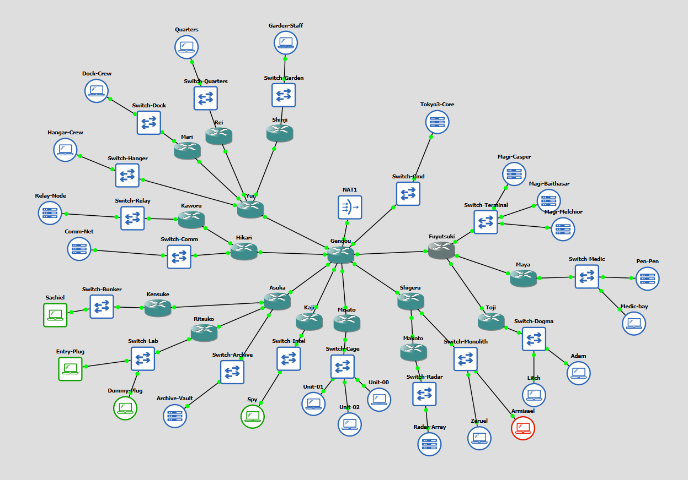

#### 2.2 - Konfigurasi IP Address dan IP Forwarding

Konfigurasi alamat IP dilakukan menggunakan command `ip addr add` sesuai dengan hasil pembagian VLSM pada soal 1.

Command yang digunakan untuk menambahkan alamat IP pada interface adalah:

```bash
ip addr add <IP_ADDRESS>/<PREFIX> dev <INTERFACE>
```

Selanjutnya, IP forwarding diaktifkan pada setiap router menggunakan command:

```bash
sysctl -w net.ipv4.ip_forward=1
```

Untuk melakukan verifikasi konfigurasi, digunakan command:

```bash
ip -br addr
ip route
sysctl net.ipv4.ip_forward
```

#### 2.3 - Konfigurasi Router Gendou

Gendou merupakan router pusat jaringan Geofront dan satu-satunya router yang terhubung langsung dengan NAT1.

##### 2.3.1 - Alokasi Interface

| Interface | Terhubung ke | IP Address |
|---|---|---|
| eth0 | NAT1 | DHCP |
| eth1 | Switch-Cmd | 192.214.4.105/30 |
| eth2 | Fuyutsuki | 192.214.4.133/30 |
| eth3 | Shigeru | 192.214.4.129/30 |
| eth4 | Misato | 192.214.4.125/30 |
| eth5 | Kaji | 192.214.4.121/30 |
| eth6 | Asuka | 192.214.4.117/30 |
| eth7 | Hikari | 192.214.4.113/30 |
| eth8 | Yui | 192.214.4.109/30 |

##### 2.3.2 - Konfigurasi

```bash
ip addr add 192.214.4.105/30 dev eth1
ip addr add 192.214.4.133/30 dev eth2
ip addr add 192.214.4.129/30 dev eth3
ip addr add 192.214.4.125/30 dev eth4
ip addr add 192.214.4.121/30 dev eth5
ip addr add 192.214.4.117/30 dev eth6
ip addr add 192.214.4.113/30 dev eth7
ip addr add 192.214.4.109/30 dev eth8

sysctl -w net.ipv4.ip_forward=1
```

##### 2.3.3 - Konfigurasi DHCP

Interface eth0 pada Gendou dikonfigurasi untuk memperoleh alamat IP secara dinamis dari NAT1 menggunakan DHCP client `udhcpc`.

```bash
ip link set eth0 up
udhcpc -i eth0 -n -q
```


##### 2.3.4 - Verifikasi

```bash
ip -br addr
ip route
sysctl net.ipv4.ip_forward
```


#### 2.4 - Konfigurasi Cabang Yui

Cabang Yui terdiri dari empat router, yaitu Yui, Mari, Rei, dan Shinji. Yui terhubung langsung dengan Gendou dan menjadi router induk bagi ketiga router lainnya.

##### 2.4.1 - Router Yui

| Interface | Terhubung ke | IP Address |
|---|---|---|
| eth0 | Gendou | 192.214.4.110/30 |
| eth1 | Switch-Hangar | 192.214.3.1/25 |
| eth2 | Mari | 192.214.4.137/30 |
| eth3 | Rei | 192.214.4.141/30 |
| eth4 | Shinji | 192.214.4.145/30 |

Konfigurasi:

```bash
ip addr add 192.214.4.110/30 dev eth0
ip addr add 192.214.3.1/25 dev eth1
ip addr add 192.214.4.137/30 dev eth2
ip addr add 192.214.4.141/30 dev eth3
ip addr add 192.214.4.145/30 dev eth4

sysctl -w net.ipv4.ip_forward=1
```

Verifikasi:

```bash
ip -br addr
ip route
sysctl net.ipv4.ip_forward

ping -c 4 192.214.4.109
```


##### 2.4.2 - Router Mari

| Interface | Terhubung ke | IP Address |
|---|---|---|
| eth0 | Yui | 192.214.4.138/30 |
| eth1 | Switch-Dock | 192.214.4.33/28 |

Konfigurasi:

```bash
ip addr add 192.214.4.138/30 dev eth0
ip addr add 192.214.4.33/28 dev eth1

sysctl -w net.ipv4.ip_forward=1
```

Verifikasi:

```bash
ip -br addr
ping -c 4 192.214.4.137
```


##### 2.4.3 - Router Rei

| Interface | Terhubung ke | IP Address |
|---|---|---|
| eth0 | Yui | 192.214.4.142/30 |
| eth1 | Switch-Quarters | 192.214.0.1/23 |

Konfigurasi:

```bash
ip addr add 192.214.4.142/30 dev eth0
ip addr add 192.214.0.1/23 dev eth1

sysctl -w net.ipv4.ip_forward=1
```

Verifikasi:

```bash
ip -br addr
ping -c 4 192.214.4.141
```

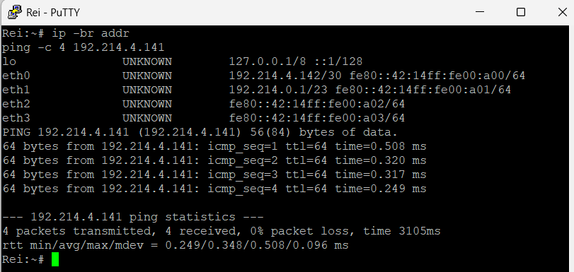

##### 2.4.4 - Router Shinji

| Interface | Terhubung ke | IP Address |
|---|---|---|
| eth0 | Yui | 192.214.4.146/30 |
| eth1 | Switch-Garden | 192.214.4.1/27 |

Konfigurasi:

```bash
ip addr add 192.214.4.146/30 dev eth0
ip addr add 192.214.4.1/27 dev eth1

sysctl -w net.ipv4.ip_forward=1
```

Verifikasi:

```bash
ip -br addr
ping -c 4 192.214.4.145
```

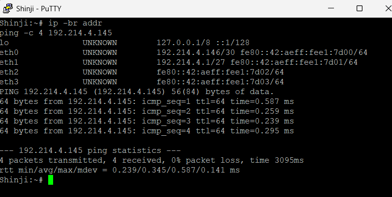

##### 2.4.5 - Pengujian Konektivitas Cabang Yui

Pengujian ping dilakukan dari Yui menuju seluruh router cabangnya untuk memastikan konektivitas dua arah.

Verifikasi di Yui:

```bash
echo "===== Yui ke Mari ====="
ping -c 4 192.214.4.138

echo "===== Yui ke Rei ====="
ping -c 4 192.214.4.142

echo "===== Yui ke Shinji ====="
ping -c 4 192.214.4.146
```

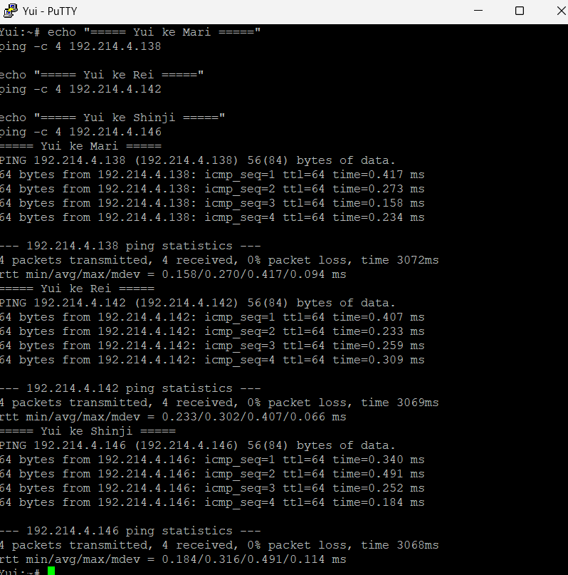

Verifikasi di Gendou:

```bash
ping -c 4 192.214.4.110
```


#### 2.5 - Konfigurasi Cabang Hikari

Cabang Hikari terdiri dari router Hikari dan Kaworu. Hikari terhubung langsung dengan Gendou, sedangkan Kaworu terhubung dengan Hikari.

##### 2.5.1 - Router Hikari

| Interface | Terhubung ke | IP Address |
|---|---|---|
| eth0 | Gendou | 192.214.4.114/30 |
| eth1 | Kaworu | 192.214.4.149/30 |
| eth2 | Switch-Comm | 192.214.2.1/24 |

Konfigurasi:

```bash
ip addr add 192.214.4.114/30 dev eth0
ip addr add 192.214.4.149/30 dev eth1
ip addr add 192.214.2.1/24 dev eth2

sysctl -w net.ipv4.ip_forward=1
```

Verifikasi:

```bash
ip -br addr
ip route
sysctl net.ipv4.ip_forward

ping -c 4 -W 1 192.214.4.113
```


##### 2.5.2 - Router Kaworu

| Interface | Terhubung ke | IP Address |
|---|---|---|
| eth0 | Hikari | 192.214.4.150/30 |
| eth1 | Switch-Relay | 192.214.3.225/27 |

Konfigurasi:

```bash
ip addr add 192.214.4.150/30 dev eth0
ip addr add 192.214.3.225/27 dev eth1

sysctl -w net.ipv4.ip_forward=1
```

Verifikasi:

```bash
ip -br addr
ip route
sysctl net.ipv4.ip_forward

ping -c 4 -W 1 192.214.4.149
```


##### 2.5.3 - Pengujian Konektivitas Cabang Hikari

Pada router Gendou:

```bash
ping -c 4 -W 1 192.214.4.114
```

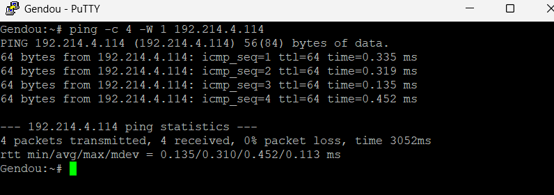

Pada router Hikari:

```bash
ping -c 4 -W 1 192.214.4.150
```

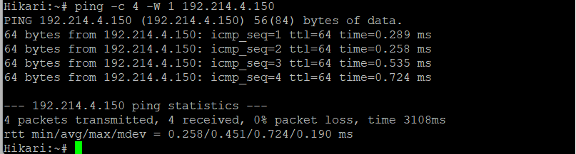

#### 2.6 - Konfigurasi Cabang Asuka

Cabang Asuka terdiri dari router Asuka, Kensuke, dan Ritsuko. Asuka berperan sebagai gateway Switch-Archive sekaligus router induk bagi Kensuke dan Ritsuko.

##### 2.6.1 - Router Asuka

| Interface | Terhubung ke | IP Address |
|---|---|---|
| eth0 | Gendou | 192.214.4.118/30 |
| eth1 | Switch-Archive | 192.214.4.97/30 |
| eth2 | Ritsuko | 192.214.4.157/30 |
| eth3 | Kensuke | 192.214.4.153/30 |

Konfigurasi:

```bash
ip addr add 192.214.4.118/30 dev eth0
ip addr add 192.214.4.97/30 dev eth1
ip addr add 192.214.4.157/30 dev eth2
ip addr add 192.214.4.153/30 dev eth3

sysctl -w net.ipv4.ip_forward=1
```

Verifikasi:

```bash
ip -br addr
ip route
sysctl net.ipv4.ip_forward

ping -c 4 -W 1 192.214.4.117
```

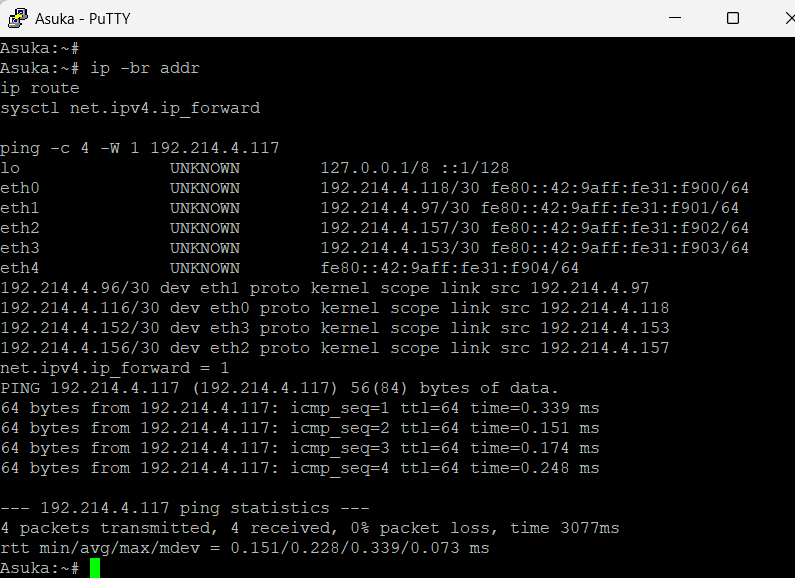

##### 2.6.2 - Router Kensuke

| Interface | Terhubung ke | IP Address |
|---|---|---|
| eth0 | Asuka | 192.214.4.154/30 |
| eth1 | Switch-Bunker | 192.214.3.129/26 |

Konfigurasi:

```bash
ip addr add 192.214.4.154/30 dev eth0
ip addr add 192.214.3.129/26 dev eth1

sysctl -w net.ipv4.ip_forward=1
```

Verifikasi:

```bash
ip -br addr
ip route

ping -c 4 -W 1 192.214.4.153
```


##### 2.6.3 - Router Ritsuko

| Interface | Terhubung ke | IP Address |
|---|---|---|
| eth0 | Asuka | 192.214.4.158/30 |
| eth1 | Switch-Lab | 192.214.4.49/29 |

Konfigurasi:

```bash
ip addr add 192.214.4.158/30 dev eth0
ip addr add 192.214.4.49/29 dev eth1

sysctl -w net.ipv4.ip_forward=1
```

Verifikasi:

```bash
ip -br addr
ip route

ping -c 4 -W 1 192.214.4.157
```

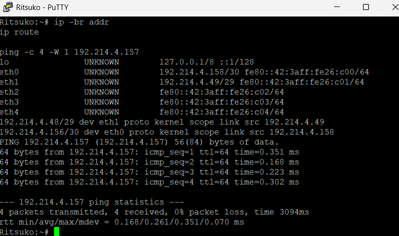

##### 2.6.4 - Pengujian Konektivitas Cabang Asuka

Pada router Gendou:

```bash
ping -c 4 -W 1 192.214.4.118
```

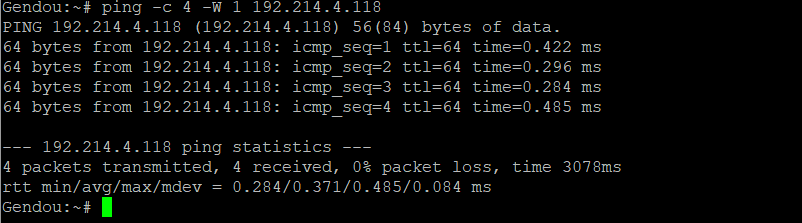

Pada router Asuka:

```bash
echo "===== Asuka ke Kensuke ====="
ping -c 4 -W 1 192.214.4.154

echo "===== Asuka ke Ritsuko ====="
ping -c 4 -W 1 192.214.4.158
```


#### 2.7 - Konfigurasi Router Kaji

Kaji terhubung langsung dengan Gendou dan berperan sebagai gateway bagi Switch-Intel.

| Interface | Terhubung ke | IP Address |
|---|---|---|
| eth0 | Gendou | 192.214.4.122/30 |
| eth1 | Switch-Intel | 192.214.4.101/30 |

Konfigurasi:

```bash
ip addr add 192.214.4.122/30 dev eth0
ip addr add 192.214.4.101/30 dev eth1

sysctl -w net.ipv4.ip_forward=1
```

Verifikasi:

```bash
ip -br addr
ip route

ping -c 4 -W 1 192.214.4.121
```

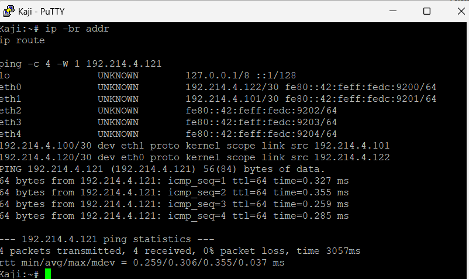

Pengujian arah sebaliknya dilakukan pada router Gendou:

```bash
ping -c 4 -W 1 192.214.4.122
```

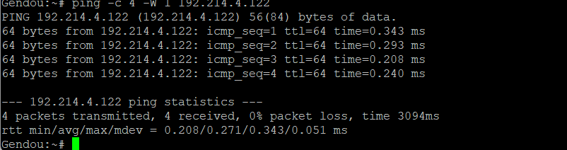

#### 2.8 - Konfigurasi Router Misato

Misato terhubung langsung dengan Gendou dan berperan sebagai gateway bagi Switch-Cage yang menaungi Unit-01, Unit-02, dan Unit-00.

| Interface | Terhubung ke | IP Address |
|---|---|---|
| eth0 | Gendou | 192.214.4.126/30 |
| eth1 | Switch-Cage | 192.214.4.65/29 |

Konfigurasi:

```bash
ip addr add 192.214.4.126/30 dev eth0
ip addr add 192.214.4.65/29 dev eth1

sysctl -w net.ipv4.ip_forward=1
```

Verifikasi:

```bash
ip -br addr
ip route

ping -c 4 -W 1 192.214.4.125
```

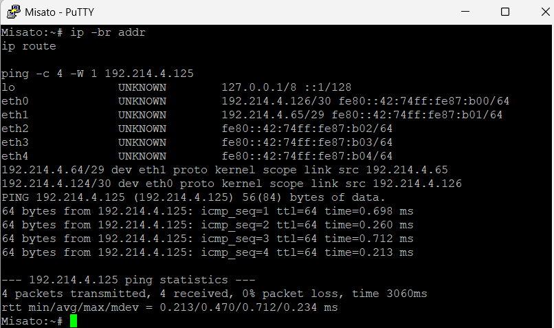

Pengujian arah sebaliknya dilakukan pada router Gendou:

```bash
ping -c 4 -W 1 192.214.4.126
```


#### 2.9 - Konfigurasi Cabang Shigeru

Cabang Shigeru terdiri dari router Shigeru dan Makoto. Kedua router tersebut menaungi zona sensitif jaringan Geofront, yaitu Switch-Monolith dan Switch-Radar.

##### 2.9.1 - Router Shigeru

| Interface | Terhubung ke | IP Address |
|---|---|---|
| eth0 | Gendou | 192.214.4.130/30 |
| eth1 | Switch-Monolith | 192.214.4.81/29 |
| eth2 | Makoto | 192.214.4.161/30 |

Konfigurasi:

```bash
ip addr add 192.214.4.130/30 dev eth0
ip addr add 192.214.4.81/29 dev eth1
ip addr add 192.214.4.161/30 dev eth2

sysctl -w net.ipv4.ip_forward=1
```

Verifikasi:

```bash
ip -br addr
ip route

ping -c 4 -W 1 192.214.4.129
```

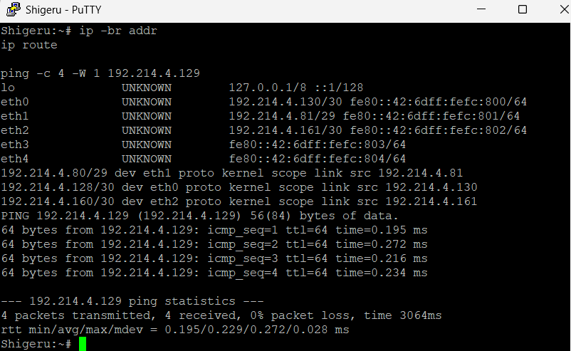

##### 2.9.2 - Router Makoto

| Interface | Terhubung ke | IP Address |
|---|---|---|
| eth0 | Shigeru | 192.214.4.162/30 |
| eth1 | Switch-Radar | 192.214.4.89/29 |

Konfigurasi:

```bash
ip addr add 192.214.4.162/30 dev eth0
ip addr add 192.214.4.89/29 dev eth1

sysctl -w net.ipv4.ip_forward=1
```

Verifikasi:

```bash
ip -br addr
ip route

ping -c 4 -W 1 192.214.4.161
```

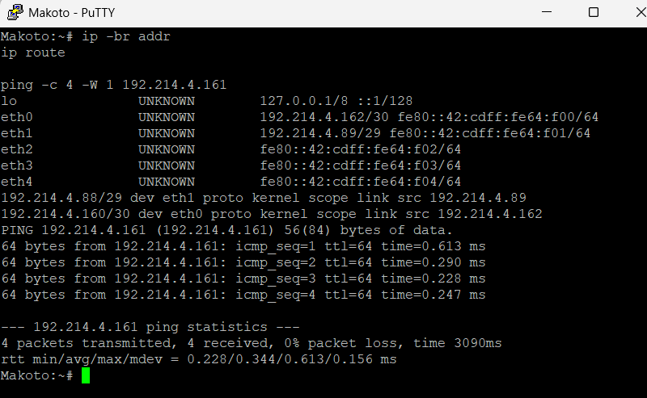

##### 2.9.3 - Pengujian Konektivitas Cabang Shigeru

Pada router Gendou:

```bash
ping -c 4 -W 1 192.214.4.130
```

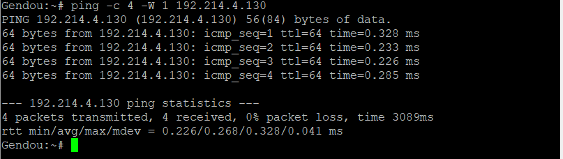

Pada router Shigeru:

```bash
ping -c 4 -W 1 192.214.4.162
```

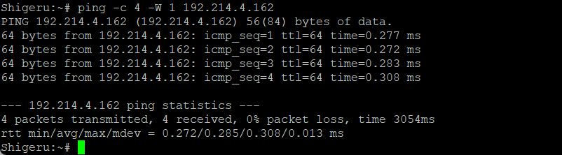

#### 2.10 - Konfigurasi Cabang Fuyutsuki

Cabang Fuyutsuki terdiri dari router Fuyutsuki, Maya, dan Toji. Fuyutsuki merupakan gateway Switch-Terminal yang menaungi tiga perangkat MAGI sekaligus menjadi router induk bagi Maya dan Toji.

##### 2.10.1 - Router Fuyutsuki

| Interface | Terhubung ke | IP Address |
|---|---|---|
| eth0 | Gendou | 192.214.4.134/30 |
| eth1 | Switch-Terminal | 192.214.4.57/29 |
| eth2 | Maya | 192.214.4.165/30 |
| eth3 | Toji | 192.214.4.169/30 |

Konfigurasi:

```bash
ip addr add 192.214.4.134/30 dev eth0
ip addr add 192.214.4.57/29 dev eth1
ip addr add 192.214.4.165/30 dev eth2
ip addr add 192.214.4.169/30 dev eth3

sysctl -w net.ipv4.ip_forward=1
```

Verifikasi:

```bash
ip -br addr
ip route
sysctl net.ipv4.ip_forward

ping -c 4 -W 1 192.214.4.133
```


##### 2.10.2 - Router Maya

| Interface | Terhubung ke | IP Address |
|---|---|---|
| eth0 | Fuyutsuki | 192.214.4.166/30 |
| eth1 | Switch-Medic | 192.214.3.193/27 |

Konfigurasi:

```bash
ip addr add 192.214.4.166/30 dev eth0
ip addr add 192.214.3.193/27 dev eth1

sysctl -w net.ipv4.ip_forward=1
```

Verifikasi:

```bash
ip -br addr
ip route

ping -c 4 -W 1 192.214.4.165
```

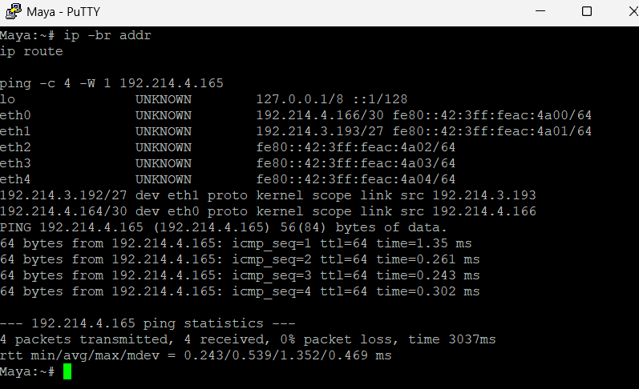

##### 2.10.3 - Router Toji

| Interface | Terhubung ke | IP Address |
|---|---|---|
| eth0 | Fuyutsuki | 192.214.4.170/30 |
| eth1 | Switch-Dogma | 192.214.4.73/29 |

Konfigurasi:

```bash
ip addr add 192.214.4.170/30 dev eth0
ip addr add 192.214.4.73/29 dev eth1

sysctl -w net.ipv4.ip_forward=1
```

Verifikasi:

```bash
ip -br addr
ip route

ping -c 4 -W 1 192.214.4.169
```


##### 2.10.4 - Pengujian Konektivitas Cabang Fuyutsuki

Pada router Gendou:

```bash
ping -c 4 -W 1 192.214.4.134
```

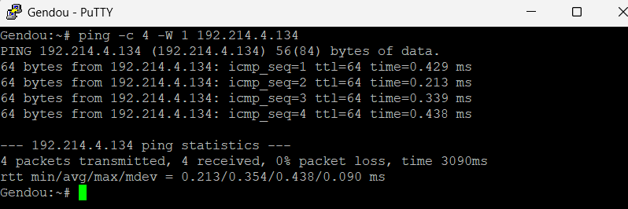

Pada router Fuyutsuki:

```bash
echo "===== Fuyutsuki ke Maya ====="
ping -c 4 -W 1 192.214.4.166

echo "===== Fuyutsuki ke Toji ====="
ping -c 4 -W 1 192.214.4.170
```

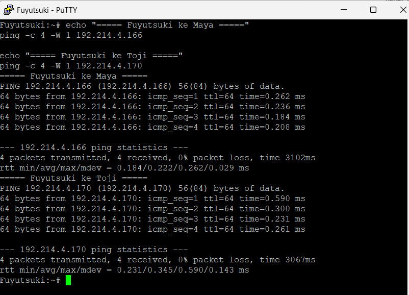

### 3 - Pulau Pulau yang Terpisah

> Lampu mulai menyala, tapi tiap segmen masih seperti pulau terpisah. Fuyutsuki mengingatkan: bangun jalur dari Gendo ke bawah, cabang demi cabang. Hubungkan semua subnet dengan routing statis dan jumlah rute sesedikit mungkin. Router selain Gendo cukup punya satu default route ke atas dan rute untuk subnet di bawahnya. Gendo memakai default route ke NAT1. Subnet satu cabang yang bisa digabung tepat menjadi satu CIDR harus diringkas. Untuk soal 3 sampai 5, beri IP dan gateway sementara pada node uji. IP permanen dibuat di soal 6. Buktikan Armisael bisa ping ke Lilith, Sachiel, dan Comm-Net.

Soal meminta untuk menghubungkan seluruh subnet jaringan Geofront menggunakan static routing dengan jumlah rute seminimal mungkin. Setiap router selain Gendou menggunakan satu default route menuju router induknya dan static route menuju subnet yang berada di bawahnya.

Subnet yang berada dalam satu cabang dan dapat digabungkan secara tepat harus diringkas menggunakan metode CIDR atau route summarization. Gendou sebagai router pusat menggunakan default route menuju NAT1 untuk mengakses jaringan eksternal.

Untuk membuktikan keberhasilan konfigurasi, diberikan alamat IP dan gateway sementara pada Armisael, Lilith, Sachiel, dan Comm-Net. Selanjutnya, dilakukan pengujian ping dari Armisael menuju ketiga node tujuan.

#### 3.1 - Perancangan Static Routing

Konfigurasi static routing menggunakan hasil pembagian alamat IP dengan metode VLSM pada soal 1 dan konfigurasi interface router pada soal 2.

Strategi routing yang digunakan adalah sebagai berikut:

- Gendou memiliki static route menuju seluruh subnet yang tidak terhubung secara langsung dengannya.
- Router yang memiliki cabang menggunakan satu default route menuju router induk dan static route menuju subnet di bawahnya.
- Router ujung hanya membutuhkan satu default route menuju router induknya.
- Subnet yang terhubung secara langsung tidak memerlukan konfigurasi static route karena telah dimasukkan secara otomatis ke dalam routing table.
- Subnet yang dapat digabungkan secara tepat dan memiliki next hop yang sama diringkas menggunakan route summarization.

Strategi tersebut digunakan untuk mengurangi jumlah rute yang harus dikonfigurasi pada setiap router tanpa menghilangkan konektivitas antar-subnet.

Command yang digunakan untuk menambahkan static route adalah:

```bash
ip route replace <NETWORK>/<PREFIX> via <NEXT_HOP>
```

Sedangkan untuk menambahkan default route digunakan command:

```bash
ip route replace default via <NEXT_HOP>
```

Penggunaan `ip route replace` memungkinkan penambahan atau pembaruan rute tanpa menghasilkan duplikasi apabila command dijalankan kembali.

#### 3.2 - Analisis Route Summarization

Route summarization merupakan teknik penggabungan beberapa subnet menjadi satu alamat network dengan prefix yang lebih pendek. Teknik ini digunakan untuk mengurangi jumlah entri pada routing table.

Suatu subnet dapat digabungkan apabila memiliki rentang alamat yang berurutan, memenuhi batas blok CIDR, dan dapat dijangkau melalui next hop yang sama.

Berdasarkan hasil pembagian VLSM, terdapat tiga penggabungan subnet yang dapat diterapkan pada router Gendou.

| No. | Cabang | Subnet Awal | Summary Route | Next Hop |
|---|---|---|---|---|
| 1 | Yui | 192.214.4.136/30 dan 192.214.4.140/30 | 192.214.4.136/29 | 192.214.4.110 |
| 2 | Asuka | 192.214.4.152/30 dan 192.214.4.156/30 | 192.214.4.152/29 | 192.214.4.118 |
| 3 | Shigeru | 192.214.4.80/29 dan 192.214.4.88/29 | 192.214.4.80/28 | 192.214.4.130 |

Ketiga summary route tersebut mencakup seluruh alamat dari subnet yang digabungkan tanpa mencakup subnet milik cabang lain.

##### 3.2.1 - Summarization Cabang Yui

Subnet yang dapat digabungkan adalah subnet link Yui–Mari dan Yui–Rei.

| Subnet | Network ID | Broadcast |
|---|---|---|
| Yui – Mari | 192.214.4.136/30 | 192.214.4.139 |
| Yui – Rei | 192.214.4.140/30 | 192.214.4.143 |
| Summary Route | 192.214.4.136/29 | 192.214.4.143 |

Kedua subnet memiliki total delapan alamat IP yang berurutan dan dapat direpresentasikan menggunakan satu prefix /29.

##### 3.2.2 - Summarization Cabang Asuka

Subnet yang dapat digabungkan adalah subnet link Asuka–Kensuke dan Asuka–Ritsuko.

| Subnet | Network ID | Broadcast |
|---|---|---|
| Asuka – Kensuke | 192.214.4.152/30 | 192.214.4.155 |
| Asuka – Ritsuko | 192.214.4.156/30 | 192.214.4.159 |
| Summary Route | 192.214.4.152/29 | 192.214.4.159 |

Kedua subnet memiliki total delapan alamat IP yang berurutan dan dapat direpresentasikan menggunakan satu prefix /29.

##### 3.2.3 - Summarization Cabang Shigeru

Subnet yang dapat digabungkan adalah subnet Switch-Monolith dan Switch-Radar.

| Subnet | Network ID | Broadcast |
|---|---|---|
| Switch-Monolith | 192.214.4.80/29 | 192.214.4.87 |
| Switch-Radar | 192.214.4.88/29 | 192.214.4.95 |
| Summary Route | 192.214.4.80/28 | 192.214.4.95 |

Kedua subnet memiliki total 16 alamat IP yang berurutan dan dapat direpresentasikan menggunakan satu prefix /28.

##### 3.2.4 - Contoh Perhitungan Route Summarization

Sebagai contoh, dilakukan penggabungan subnet Switch-Monolith dan Switch-Radar.

Kedua subnet menggunakan prefix /29:

- Switch-Monolith: 192.214.4.80/29.
- Switch-Radar: 192.214.4.88/29.

Representasi biner dari oktet terakhir kedua Network ID tersebut adalah:

```text
80 = 01010000
88 = 01011000
     ||||
     0101
```

Empat bit pertama pada oktet terakhir memiliki nilai yang sama. Ditambah dengan 24 bit pertama dari tiga oktet sebelumnya, diperoleh panjang prefix yang sama sebesar:

$$
Prefix = 24 + 4 = 28
$$

Dengan demikian, summary route yang dihasilkan adalah:

```text
192.214.4.80/28
```

Subnet tersebut memiliki rentang alamat 192.214.4.80 sampai 192.214.4.95, sehingga mencakup seluruh alamat dari Switch-Monolith dan Switch-Radar secara tepat.

Penggabungan ini hanya diterapkan pada routing table Gendou. Prefix asli pada interface gateway Switch-Monolith dan Switch-Radar tetap menggunakan /29.

#### 3.3 - Konfigurasi Static Routing Gendou

Gendou merupakan router pusat yang terhubung langsung dengan tujuh router cabang. Setiap router cabang digunakan sebagai next hop untuk menjangkau subnet yang berada di bawahnya.

Berikut merupakan daftar next hop yang digunakan oleh Gendou.

| Router Cabang | Next Hop | Interface Gendou |
|---|---|---|
| Yui | 192.214.4.110 | eth8 |
| Hikari | 192.214.4.114 | eth7 |
| Asuka | 192.214.4.118 | eth6 |
| Kaji | 192.214.4.122 | eth5 |
| Misato | 192.214.4.126 | eth4 |
| Shigeru | 192.214.4.130 | eth3 |
| Fuyutsuki | 192.214.4.134 | eth2 |

##### 3.3.1 - Konfigurasi Routing Cabang Yui

```bash
ip route replace 192.214.0.0/23 via 192.214.4.110
ip route replace 192.214.3.0/25 via 192.214.4.110
ip route replace 192.214.4.0/27 via 192.214.4.110
ip route replace 192.214.4.32/28 via 192.214.4.110
ip route replace 192.214.4.136/29 via 192.214.4.110
ip route replace 192.214.4.144/30 via 192.214.4.110
```

Enam rute tersebut mencakup empat subnet LAN dan tiga subnet link antar-router. Dua subnet link telah digabungkan menjadi satu summary route.

##### 3.3.2 - Konfigurasi Routing Cabang Hikari

```bash
ip route replace 192.214.2.0/24 via 192.214.4.114
ip route replace 192.214.3.224/27 via 192.214.4.114
ip route replace 192.214.4.148/30 via 192.214.4.114
```

Ketiga rute digunakan untuk menjangkau Switch-Comm, Switch-Relay, dan subnet link Hikari–Kaworu.

##### 3.3.3 - Konfigurasi Routing Cabang Asuka

```bash
ip route replace 192.214.3.128/26 via 192.214.4.118
ip route replace 192.214.4.48/29 via 192.214.4.118
ip route replace 192.214.4.96/30 via 192.214.4.118
ip route replace 192.214.4.152/29 via 192.214.4.118
```

Empat rute tersebut mencakup Switch-Bunker, Switch-Lab, Switch-Archive, serta dua subnet link antar-router yang telah diringkas.

##### 3.3.4 - Konfigurasi Routing Cabang Kaji

```bash
ip route replace 192.214.4.100/30 via 192.214.4.122
```

Rute tersebut digunakan untuk menjangkau Switch-Intel.

##### 3.3.5 - Konfigurasi Routing Cabang Misato

```bash
ip route replace 192.214.4.64/29 via 192.214.4.126
```

Rute tersebut digunakan untuk menjangkau Switch-Cage.

##### 3.3.6 - Konfigurasi Routing Cabang Shigeru

```bash
ip route replace 192.214.4.80/28 via 192.214.4.130
ip route replace 192.214.4.160/30 via 192.214.4.130
```

Summary route 192.214.4.80/28 digunakan untuk menjangkau Switch-Monolith dan Switch-Radar. Rute kedua digunakan untuk menjangkau subnet link Shigeru–Makoto.

##### 3.3.7 - Konfigurasi Routing Cabang Fuyutsuki

```bash
ip route replace 192.214.3.192/27 via 192.214.4.134
ip route replace 192.214.4.56/29 via 192.214.4.134
ip route replace 192.214.4.72/29 via 192.214.4.134
ip route replace 192.214.4.164/30 via 192.214.4.134
ip route replace 192.214.4.168/30 via 192.214.4.134
```

Kelima rute tersebut digunakan untuk menjangkau Switch-Medic, Switch-Terminal, Switch-Dogma, serta subnet link Fuyutsuki–Maya dan Fuyutsuki–Toji.

##### 3.3.8 - Verifikasi Routing Table Gendou

Setelah seluruh static route ditambahkan, dilakukan verifikasi menggunakan command:

```bash
ip route
ip route | grep ' via ' | wc -l
```

Hasil penghitungan menunjukkan bahwa terdapat 22 static route pada router Gendou.

```text
22
```

Selain static route tersebut, Gendou memiliki delapan directly connected route yang berasal dari konfigurasi interface pada soal 2.

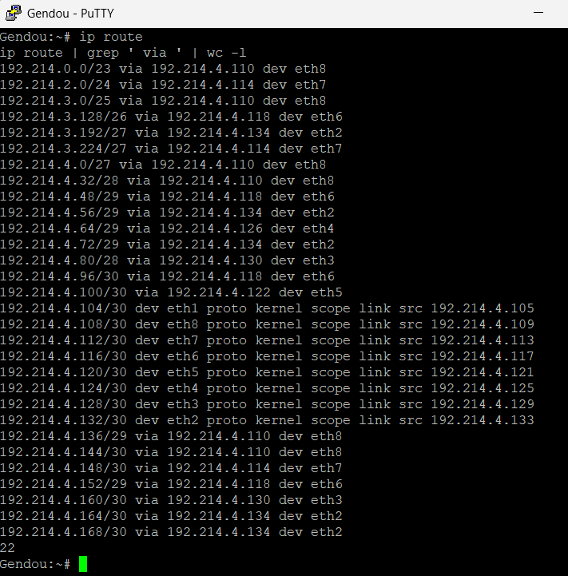

Berikut merupakan rekapitulasi jumlah rute pada setiap cabang sebelum dan sesudah penerapan route summarization.

| Cabang | Sebelum Summarization | Setelah Summarization | Pengurangan |
|---|---:|---:|---:|
| Yui | 7 | 6 | 1 |
| Hikari | 3 | 3 | 0 |
| Asuka | 5 | 4 | 1 |
| Kaji | 1 | 1 | 0 |
| Misato | 1 | 1 | 0 |
| Shigeru | 3 | 2 | 1 |
| Fuyutsuki | 5 | 5 | 0 |
| **Total** | **25** | **22** | **3** |

Persentase pengurangan jumlah static route adalah:

$$
Efisiensi = \frac{25 - 22}{25} \times 100\%
$$

$$
Efisiensi = 12\%
$$

Penerapan route summarization berhasil mengurangi jumlah static route spesifik pada Gendou sebesar 12% tanpa mengurangi cakupan subnet jaringan internal.

##### 3.3.9 - Default Route Menuju NAT1

Gendou merupakan satu-satunya router yang terhubung langsung dengan NAT1 melalui interface eth0.

Default route menuju NAT1 direncanakan menggunakan gateway yang diperoleh melalui DHCP.

```bash
udhcpc -i eth0 -n -q
```

Setelah DHCP berhasil memberikan alamat IP dan informasi gateway, default route dapat diperiksa menggunakan:

```bash
ip route show default
```


Default route yang terbentuk adalah:

```text
default via 192.168.122.1 dev eth0
```

Default route tersebut digunakan untuk meneruskan paket menuju jaringan eksternal apabila alamat IP tujuan tidak memiliki rute yang lebih spesifik pada routing table Gendou.

Penggunaan DHCP memungkinkan Gendou memperoleh dan memperbarui konfigurasi jaringan eksternal secara otomatis tanpa perlu menentukan alamat IP dan gateway secara manual.

Dengan demikian, seluruh konfigurasi static routing internal dan default route menuju NAT1 telah berhasil diterapkan.

#### 3.4 - Konfigurasi Routing Cabang Yui

Yui merupakan router induk bagi Mari, Rei, dan Shinji. Yui membutuhkan satu default route menuju Gendou dan tiga static route menuju LAN router cabangnya.

##### 3.4.1 - Router Yui

```bash
ip route replace default via 192.214.4.109

ip route replace 192.214.4.32/28 via 192.214.4.138
ip route replace 192.214.0.0/23 via 192.214.4.142
ip route replace 192.214.4.0/27 via 192.214.4.146
```

##### 3.4.2 - Router Mari

```bash
ip route replace default via 192.214.4.137
```

##### 3.4.3 - Router Rei

```bash
ip route replace default via 192.214.4.141
```

##### 3.4.4 - Router Shinji

```bash
ip route replace default via 192.214.4.145
```

Mari, Rei, dan Shinji merupakan router ujung sehingga masing-masing hanya membutuhkan satu default route menuju Yui.

#### 3.5 - Konfigurasi Routing Cabang Hikari

Hikari membutuhkan satu default route menuju Gendou dan satu static route menuju LAN Kaworu.

##### 3.5.1 - Router Hikari

```bash
ip route replace default via 192.214.4.113
ip route replace 192.214.3.224/27 via 192.214.4.150
```

##### 3.5.2 - Router Kaworu

```bash
ip route replace default via 192.214.4.149
```

Kaworu hanya membutuhkan satu default route karena tidak memiliki router cabang di bawahnya.

#### 3.6 - Konfigurasi Routing Cabang Asuka

Asuka merupakan router induk bagi Kensuke dan Ritsuko. Asuka membutuhkan satu default route menuju Gendou dan dua static route menuju LAN kedua router tersebut.

##### 3.6.1 - Router Asuka

```bash
ip route replace default via 192.214.4.117
ip route replace 192.214.3.128/26 via 192.214.4.154
ip route replace 192.214.4.48/29 via 192.214.4.158
```

##### 3.6.2 - Router Kensuke

```bash
ip route replace default via 192.214.4.153
```

##### 3.6.3 - Router Ritsuko

```bash
ip route replace default via 192.214.4.157
```

Kensuke dan Ritsuko menggunakan Asuka sebagai default gateway untuk menjangkau subnet di luar jaringan yang terhubung secara langsung.

#### 3.7 - Konfigurasi Routing Kaji dan Misato

Kaji dan Misato merupakan router ujung yang terhubung langsung dengan Gendou sehingga masing-masing hanya membutuhkan satu default route.

##### 3.7.1 - Router Kaji

```bash
ip route replace default via 192.214.4.121
```

##### 3.7.2 - Router Misato

```bash
ip route replace default via 192.214.4.125
```

#### 3.8 - Konfigurasi Routing Cabang Shigeru

Shigeru merupakan gateway Switch-Monolith sekaligus router induk bagi Makoto.

Shigeru membutuhkan satu default route menuju Gendou dan satu static route menuju Switch-Radar.

##### 3.8.1 - Router Shigeru

```bash
ip route replace default via 192.214.4.129
ip route replace 192.214.4.88/29 via 192.214.4.162
```

##### 3.8.2 - Router Makoto

```bash
ip route replace default via 192.214.4.161
```

Meskipun subnet Switch-Monolith dan Switch-Radar telah diringkas pada Gendou, Shigeru tetap menggunakan rute spesifik menuju Switch-Radar karena subnet Switch-Monolith terhubung langsung dengannya, sedangkan subnet Switch-Radar berada di bawah Makoto.

#### 3.9 - Konfigurasi Routing Cabang Fuyutsuki

Fuyutsuki merupakan gateway Switch-Terminal sekaligus router induk bagi Maya dan Toji.

Fuyutsuki membutuhkan satu default route menuju Gendou dan dua static route menuju LAN Maya dan Toji.

##### 3.9.1 - Router Fuyutsuki

```bash
ip route replace default via 192.214.4.133
ip route replace 192.214.3.192/27 via 192.214.4.166
ip route replace 192.214.4.72/29 via 192.214.4.170
```

##### 3.9.2 - Router Maya

```bash
ip route replace default via 192.214.4.165
```

##### 3.9.3 - Router Toji

```bash
ip route replace default via 192.214.4.169
```

Maya dan Toji hanya membutuhkan satu default route menuju Fuyutsuki karena tidak memiliki router cabang di bawahnya.

#### 3.10 - Verifikasi Routing Router Cabang

Setelah konfigurasi static routing selesai dilakukan, setiap router diperiksa menggunakan command:

```bash
ip route
```

Sebagai contoh, routing table Asuka setelah konfigurasi adalah sebagai berikut:

```text
default via 192.214.4.117 dev eth0
192.214.3.128/26 via 192.214.4.154 dev eth3
192.214.4.48/29 via 192.214.4.158 dev eth2
192.214.4.96/30 dev eth1 proto kernel scope link src 192.214.4.97
192.214.4.116/30 dev eth0 proto kernel scope link src 192.214.4.118
192.214.4.152/30 dev eth3 proto kernel scope link src 192.214.4.153
192.214.4.156/30 dev eth2 proto kernel scope link src 192.214.4.157
```

Routing table tersebut memperlihatkan bahwa Asuka memiliki satu default route menuju Gendou, dua static route menuju LAN router cabangnya, dan empat directly connected route.


Sebagai perbandingan, router ujung seperti Kensuke memiliki routing table dengan susunan berikut:

```text
default via 192.214.4.153 dev eth0
192.214.3.128/26 dev eth1 proto kernel scope link src 192.214.3.129
192.214.4.152/30 dev eth0 proto kernel scope link src 192.214.4.154
```

Kensuke hanya memiliki satu default route dan dua directly connected route. Tidak diperlukan static route spesifik karena seluruh jaringan di luar subnet yang terhubung langsung dapat dijangkau melalui Asuka.

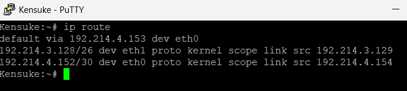

#### 3.11 - Konfigurasi IP Sementara pada Node Uji

Sesuai ketentuan soal, alamat IP dan gateway pada node uji dikonfigurasi secara sementara. Konfigurasi permanen akan dilakukan pada soal 6.

Empat node digunakan untuk membuktikan keberhasilan static routing, yaitu Armisael, Lilith, Sachiel, dan Comm-Net.

| Node | Switch | IP Address | Gateway |
|---|---|---|---|
| Armisael | Switch-Monolith | 192.214.4.83/29 | 192.214.4.81 |
| Lilith | Switch-Dogma | 192.214.4.74/29 | 192.214.4.73 |
| Sachiel | Switch-Bunker | 192.214.3.130/26 | 192.214.3.129 |
| Comm-Net | Switch-Comm | 192.214.2.2/24 | 192.214.2.1 |

##### 3.11.1 - Node Armisael

```bash
ip link set eth0 up
ip addr add 192.214.4.83/29 dev eth0
ip route replace default via 192.214.4.81
```

Verifikasi:

```bash
ip -br addr
ip route
ping -c 4 -W 1 192.214.4.81
```


##### 3.11.2 - Node Lilith

```bash
ip link set eth0 up
ip addr add 192.214.4.74/29 dev eth0
ip route replace default via 192.214.4.73
```

Verifikasi:

```bash
ip -br addr
ip route
ping -c 4 -W 1 192.214.4.73
```


##### 3.11.3 - Node Sachiel

```bash
ip link set eth0 up
ip addr add 192.214.3.130/26 dev eth0
ip route replace default via 192.214.3.129
```

Verifikasi:

```bash
ip -br addr
ip route
ping -c 4 -W 1 192.214.3.129
```


##### 3.11.4 - Node Comm-Net

```bash
ip link set eth0 up
ip addr add 192.214.2.2/24 dev eth0
ip route replace default via 192.214.2.1
```

Verifikasi:

```bash
ip -br addr
ip route
ping -c 4 -W 1 192.214.2.1
```


##### 3.11.5 - Hasil Pengujian Gateway

Setiap node diuji menggunakan ping menuju alamat gateway masing-masing untuk memastikan konfigurasi IP dan konektivitas LAN telah berfungsi sebelum dilakukan pengujian antar-subnet.

| Node | Gateway | Paket Dikirim | Paket Diterima | Packet Loss | RTT Rata-rata |
|---|---|---:|---:|---:|---:|
| Armisael | 192.214.4.81 | 4 | 4 | 0% | 0.338 ms |
| Lilith | 192.214.4.73 | 4 | 4 | 0% | 0.560 ms |
| Sachiel | 192.214.3.129 | 4 | 4 | 0% | 1.933 ms |
| Comm-Net | 192.214.2.1 | 4 | 4 | 0% | 0.370 ms |

Seluruh node berhasil melakukan ping menuju gateway masing-masing dengan 0% packet loss. Hal tersebut menunjukkan bahwa konfigurasi alamat IP, prefix, dan koneksi menuju gateway telah berfungsi dengan baik.

#### 3.12 - Pengujian Konektivitas Antar-subnet

Pengujian utama dilakukan dari Armisael menuju Lilith, Sachiel, dan Comm-Net. Ketiga node tujuan berada pada subnet dan cabang router yang berbeda sehingga pengujian tersebut dapat membuktikan bahwa static routing berfungsi melampaui jaringan yang terhubung secara langsung.

Command berikut dijalankan pada Armisael:

```bash
echo "===== Armisael ke Lilith ====="
ping -c 4 -W 1 192.214.4.74

echo "===== Armisael ke Sachiel ====="
ping -c 4 -W 1 192.214.3.130

echo "===== Armisael ke Comm-Net ====="
ping -c 4 -W 1 192.214.2.2
```

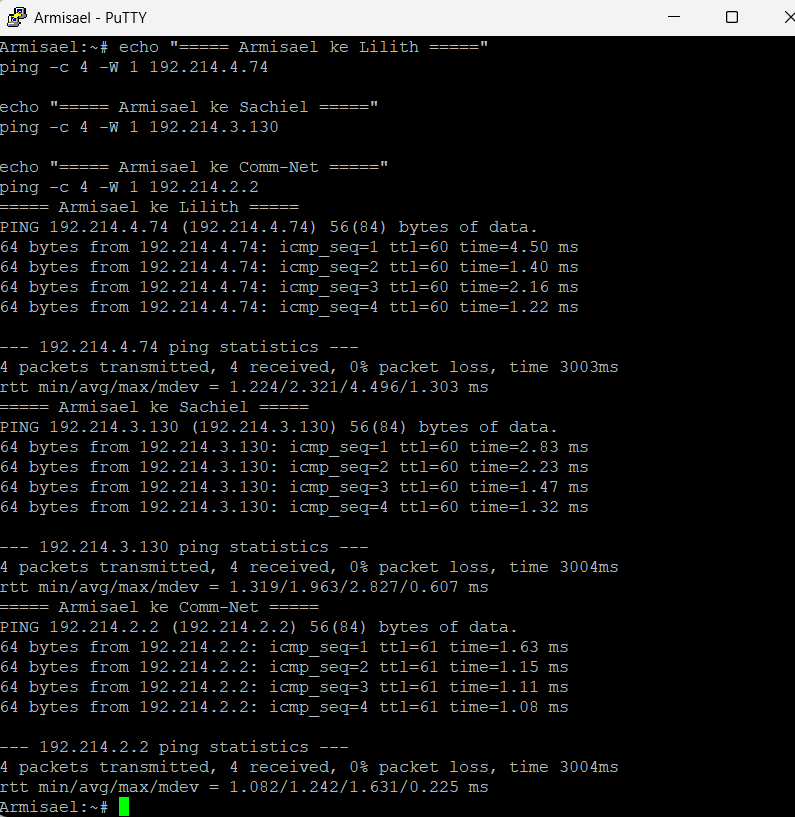

| No. | Sumber | Tujuan | IP Tujuan | Paket Dikirim | Paket Diterima | Packet Loss | Status |
|---|---|---|---|---:|---:|---:|---|
| 1 | Armisael | Lilith | 192.214.4.74 | 4 | 4 | 0% | Berhasil |
| 2 | Armisael | Sachiel | 192.214.3.130 | 4 | 4 | 0% | Berhasil |
| 3 | Armisael | Comm-Net | 192.214.2.2 | 4 | 4 | 0% | Berhasil |
| **Total** | | | | **12** | **12** | **0%** | **Berhasil** |

Berdasarkan hasil pengujian, jalur yang dilalui paket adalah sebagai berikut:

- **Armisael ke Lilith:** paket diteruskan melalui Shigeru, Gendou, Fuyutsuki, dan Toji menuju subnet Switch-Dogma.
- **Armisael ke Sachiel:** paket diteruskan melalui Shigeru, Gendou, Asuka, dan Kensuke menuju subnet Switch-Bunker.
- **Armisael ke Comm-Net:** paket diteruskan melalui Shigeru, Gendou, dan Hikari menuju subnet Switch-Comm.

Seluruh pengujian berhasil dengan jumlah 12 paket ICMP yang dikirimkan dan 12 paket balasan yang diterima.

Hasil tersebut menunjukkan bahwa paket dapat diteruskan dari Armisael menuju subnet tujuan dan paket balasan dapat dikirimkan kembali menuju Armisael.

#### 3.13 - Analisis TTL dan Round Trip Time

Selain packet loss, hasil pengujian ping juga memberikan informasi mengenai Time to Live (TTL) dan Round Trip Time (RTT).

TTL merupakan nilai pada paket IP yang dikurangi setiap kali paket diteruskan oleh router. Dengan asumsi TTL awal paket balasan Alpine Linux adalah 64, jumlah router yang dilalui paket balasan dapat diperkirakan berdasarkan selisih TTL tersebut.

| Pengujian | TTL Awal (Asumsi) | TTL Balasan | Router Dilalui | RTT Rata-rata |
|---|---:|---:|---:|---:|
| Armisael – Lilith | 64 | 60 | 4 | 1.320 ms |
| Armisael – Sachiel | 64 | 60 | 4 | 1.227 ms |
| Armisael – Comm-Net | 64 | 61 | 3 | 1.106 ms |

Pada pengujian menuju Lilith dan Sachiel, TTL balasan yang diperoleh adalah 60.

$$
Jumlah\ Router = 64 - 60 = 4
$$

Sedangkan pada pengujian menuju Comm-Net, TTL balasan yang diperoleh adalah 61.

$$
Jumlah\ Router = 64 - 61 = 3
$$

Hasil tersebut konsisten dengan jumlah router pada jalur komunikasi yang dirancang.

Comm-Net juga memiliki RTT rata-rata paling rendah pada pengujian ini, yaitu 1.106 ms. Hal tersebut konsisten dengan jalur komunikasinya yang melewati lebih sedikit router dibandingkan jalur menuju Lilith dan Sachiel, meskipun RTT juga dapat dipengaruhi oleh kondisi pemrosesan paket dan jaringan.

#### 3.14 - Verifikasi Pemilihan Rute

Untuk memastikan Armisael menggunakan next hop yang benar ketika mengirimkan paket menuju subnet tujuan, dilakukan pemeriksaan menggunakan command `ip route get`.

```bash
ip route get 192.214.4.74
ip route get 192.214.3.130
ip route get 192.214.2.2
```


Hasil pengujian:

```text
192.214.4.74 via 192.214.4.81 dev eth0 src 192.214.4.83 uid 0
    cache

192.214.3.130 via 192.214.4.81 dev eth0 src 192.214.4.83 uid 0
    cache

192.214.2.2 via 192.214.4.81 dev eth0 src 192.214.4.83 uid 0
    cache
```

Berdasarkan hasil tersebut, seluruh paket menuju Lilith, Sachiel, dan Comm-Net menggunakan alamat 192.214.4.81 sebagai next hop melalui interface eth0.

Alamat tersebut merupakan alamat interface LAN Shigeru yang berfungsi sebagai default gateway Armisael.

### 4 - Haus Kabar dari Dunia Luar
> Maya melapor bahwa semua sistem butuh update dari luar, padahal pintu keluarnya hanya Gendo. IP dari NAT1 juga bisa berganti kapan saja. Beri seluruh jaringan akses internet lewat Gendo. Konfigurasinya tidak boleh perlu diubah saat IP NAT1 berganti. Hanya traffic dari prefix internal yang keluar lewat NAT1 yang boleh diterjemahkan alamatnya, sedangkan traffic antar-LAN harus tetap membawa alamat asli pengirimnya. Node yang nanti memasang paket juga harus bisa me-resolve nama domain. Selesaikan sebelum node lain memasang paket. Buktikan ping 8.8.8.8 dan ping deb.debian.org dari Armisael dan Lilith berhasil, dan tunjukkan counter rule NAT.

Soal meminta untuk mengonfigurasi akses internet untuk seluruh jaringan Geofront melalui Gendou sebagai satu-satunya router yang terhubung langsung dengan NAT1.

Konfigurasi NAT harus dapat menyesuaikan perubahan alamat IP eksternal Gendou tanpa memerlukan perubahan rule. Translasi alamat IP hanya dilakukan terhadap traffic yang berasal dari prefix internal dan keluar melalui interface menuju NAT1, sedangkan komunikasi antar-LAN harus tetap menggunakan alamat IP asli pengirim.

Selain itu, dilakukan konfigurasi DNS agar node dapat melakukan resolusi nama domain dan mengakses repository untuk instalasi paket.

Keberhasilan konfigurasi dibuktikan melalui pengujian ping menuju 8.8.8.8 dan deb.debian.org dari Armisael dan Lilith, serta pemeriksaan counter pada rule NAT.

#### 4.1 - Perancangan NAT

Network Address Translation (NAT) merupakan mekanisme yang digunakan untuk menerjemahkan alamat IP pada paket jaringan ketika paket melewati perangkat jaringan tertentu.

Pada jaringan Geofront, NAT digunakan agar seluruh node internal dapat mengakses internet melalui satu interface eksternal milik Gendou.

Jenis NAT yang digunakan adalah Source NAT (SNAT) dengan mekanisme MASQUERADE. Mekanisme ini menerjemahkan alamat IP sumber paket menjadi alamat IP yang digunakan oleh interface keluar secara otomatis.

Konfigurasi NAT pada Gendou dirancang berdasarkan parameter berikut:

| Parameter | Nilai |
|---|---|
| Router NAT | Gendou |
| Prefix jaringan internal | 192.214.0.0/21 |
| Interface eksternal | eth0 |
| Tujuan koneksi eksternal | NAT1 |
| Jenis translasi | Source NAT |
| Mekanisme translasi | MASQUERADE |
| Firewall framework | nftables |
| Hook | POSTROUTING |

Alur komunikasi node internal menuju internet adalah sebagai berikut:

```text
Node Internal
      |
Gateway LAN
      |
Router Cabang
      |
    Gendou
      |
NAT MASQUERADE
      |
     eth0
      |
     NAT1
      |
   Internet
```

Dengan konfigurasi tersebut, seluruh traffic menuju internet diteruskan melalui Gendou. Traffic yang memenuhi kondisi rule NAT akan mengalami translasi alamat sumber sebelum diteruskan menuju NAT1.

#### 4.2 - Konfigurasi NAT Menggunakan nftables

NAT dikonfigurasi menggunakan nftables karena telah tersedia pada Alpine Linux yang digunakan oleh Gendou.

##### 4.2.1 - Pembuatan Tabel NAT

```bash
nft add table ip nat
```

Command tersebut membuat tabel bernama `nat` dengan address family `ip`, sehingga tabel digunakan untuk memproses traffic IPv4.

##### 4.2.2 - Pembuatan Chain POSTROUTING

```bash
nft 'add chain ip nat postrouting { type nat hook postrouting priority srcnat; policy accept; }'
```

Chain POSTROUTING digunakan untuk memproses paket setelah keputusan routing dibuat dan sebelum paket keluar melalui interface jaringan.

Penggunaan hook POSTROUTING memungkinkan NAT diterapkan berdasarkan interface keluar yang telah ditentukan oleh routing table.

##### 4.2.3 - Pembuatan Rule MASQUERADE

```bash
nft add rule ip nat postrouting ip saddr 192.214.0.0/21 oifname "eth0" counter masquerade
```

Penjelasan setiap komponen rule adalah sebagai berikut:

| Komponen | Fungsi |
|---|---|
| `ip nat` | Menentukan tabel NAT untuk IPv4 |
| `postrouting` | Menentukan chain tempat rule diterapkan |
| `ip saddr 192.214.0.0/21` | Membatasi translasi pada traffic yang berasal dari prefix internal Geofront |
| `oifname "eth0"` | Membatasi translasi pada traffic yang keluar melalui interface menuju NAT1 |
| `counter` | Menghitung jumlah paket dan byte yang cocok dengan rule |
| `masquerade` | Menerjemahkan alamat IP sumber menggunakan alamat IP interface keluar |

Rule tersebut memiliki dua kondisi utama yang harus dipenuhi secara bersamaan:

1. Alamat IP sumber paket berada dalam prefix 192.214.0.0/21.
2. Paket keluar melalui interface eth0 yang terhubung dengan NAT1.

Apabila salah satu kondisi tidak terpenuhi, paket tidak akan mengalami translasi oleh rule tersebut.

##### 4.2.4 - Verifikasi Rule NAT

Konfigurasi NAT diperiksa menggunakan command berikut:

```bash
nft list ruleset
```

Struktur ruleset yang dihasilkan adalah sebagai berikut:

```text
table ip nat {
    chain postrouting {
        type nat hook postrouting priority srcnat; policy accept;
        ip saddr 192.214.0.0/21 oifname "eth0" counter masquerade
    }
}
```

Nilai counter paket dan byte akan ditampilkan pada rule tersebut dan berubah sesuai traffic yang diproses.

#### 4.3 - Konfigurasi DNS

Domain Name System (DNS) digunakan untuk menerjemahkan nama domain menjadi alamat IP agar perangkat dapat mengakses layanan menggunakan nama domain.

Akses internet berdasarkan alamat IP saja belum cukup untuk memenuhi kebutuhan instalasi paket. Package manager seperti `apk` pada Alpine Linux memerlukan resolusi nama domain untuk mengakses repository.

DNS dikonfigurasi melalui file `/etc/resolv.conf` menggunakan dua DNS resolver publik.

| DNS Server | Alamat IP |
|---|---|
| Google Public DNS | 8.8.8.8 |
| Cloudflare DNS | 1.1.1.1 |

Konfigurasi dilakukan menggunakan command berikut:

```bash
printf 'nameserver 8.8.8.8\nnameserver 1.1.1.1\n' > /etc/resolv.conf
```

Verifikasi konfigurasi:

```bash
cat /etc/resolv.conf
```


Isi file setelah konfigurasi:

```text
nameserver 8.8.8.8
nameserver 1.1.1.1
```

Konfigurasi tersebut diterapkan pada Gendou, Armisael, dan Lilith untuk kebutuhan pengujian soal 4.

Router dan node lainnya yang membutuhkan instalasi paket dapat menggunakan konfigurasi DNS yang sama setelah memiliki alamat IP dan gateway yang sesuai.

#### 4.4 - Konfigurasi dan Pengujian Node Armisael

Armisael telah memiliki konfigurasi IP dan gateway sementara yang dibuat pada soal 3 sehingga tidak diperlukan konfigurasi ulang.

| Parameter | Nilai |
|---|---|
| Node | Armisael |
| Switch | Switch-Monolith |
| IP Address | 192.214.4.83/29 |
| Default Gateway | 192.214.4.81 |
| Router Gateway | Shigeru |
| DNS Primer | 8.8.8.8 |
| DNS Sekunder | 1.1.1.1 |

Konfigurasi DNS dan pengujian dilakukan menggunakan command berikut:

```bash
printf 'nameserver 8.8.8.8\nnameserver 1.1.1.1\n' > /etc/resolv.conf

cat /etc/resolv.conf

echo "===== PING INTERNET ====="
ping -c 4 -W 2 8.8.8.8

echo "===== PING DOMAIN ====="
ping -4 -c 4 -W 2 deb.debian.org
```


##### 4.4.1 - Jalur Komunikasi Armisael

Berdasarkan konfigurasi static routing, jalur komunikasi Armisael menuju internet adalah sebagai berikut:

```text
Armisael
192.214.4.83
      |
Switch-Monolith
      |
   Shigeru
      |
    Gendou
      |
NAT MASQUERADE
      |
     NAT1
      |
   Internet
```

Armisael meneruskan paket menuju Shigeru sebagai default gateway. Shigeru kemudian meneruskan paket menuju Gendou menggunakan default route.

Gendou meneruskan paket melalui eth0 menuju NAT1 setelah melakukan translasi alamat sumber menggunakan MASQUERADE.

Keberhasilan ping menuju 8.8.8.8 menunjukkan bahwa konektivitas IPv4 menuju internet telah berfungsi. Keberhasilan ping menuju deb.debian.org menunjukkan bahwa resolusi nama domain dan konektivitas menuju alamat hasil resolusi juga telah berfungsi.

#### 4.5 - Konfigurasi dan Pengujian Node Lilith

Lilith juga menggunakan konfigurasi IP dan gateway sementara yang telah dibuat pada soal 3.

| Parameter | Nilai |
|---|---|
| Node | Lilith |
| Switch | Switch-Dogma |
| IP Address | 192.214.4.74/29 |
| Default Gateway | 192.214.4.73 |
| Router Gateway | Toji |
| DNS Primer | 8.8.8.8 |
| DNS Sekunder | 1.1.1.1 |

Konfigurasi DNS dan pengujian dilakukan menggunakan command berikut:

```bash
printf 'nameserver 8.8.8.8\nnameserver 1.1.1.1\n' > /etc/resolv.conf

cat /etc/resolv.conf

echo "===== PING INTERNET ====="
ping -c 4 -W 2 8.8.8.8

echo "===== PING DOMAIN ====="
ping -4 -c 4 -W 2 deb.debian.org
```


##### 4.5.1 - Jalur Komunikasi Lilith

Jalur komunikasi Lilith menuju internet adalah sebagai berikut:

```text
     Lilith
192.214.4.74
       |
 Switch-Dogma
       |
      Toji
       |
   Fuyutsuki
       |
     Gendou
       |
 NAT MASQUERADE
       |
      NAT1
       |
    Internet
```

Lilith mengirimkan paket melalui Toji sebagai default gateway. Paket kemudian diteruskan menuju Fuyutsuki dan Gendou menggunakan default route yang telah dikonfigurasi pada soal 3.

Meskipun Lilith berada pada cabang router yang berbeda dengan Armisael, kedua node menggunakan mekanisme NAT yang sama pada Gendou untuk mengakses internet.

#### 4.6 - Verifikasi Counter Rule NAT

Untuk membuktikan bahwa traffic dari jaringan internal telah diproses oleh rule MASQUERADE, dilakukan pemeriksaan counter nftables setelah pengujian akses internet.

Pada Gendou:

```bash
nft -a list chain ip nat postrouting
```

Output akan memperlihatkan rule dengan struktur berikut:

```text
ip saddr 192.214.0.0/21 oifname "eth0" counter packets <JUMLAH_PAKET> bytes <JUMLAH_BYTE> masquerade
```

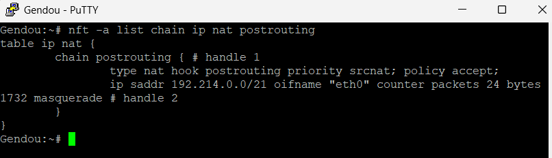

Counter memiliki dua informasi utama:

| Counter | Fungsi |
|---|---|
| Packets | Jumlah paket yang cocok dengan rule NAT |
| Bytes | Jumlah byte dari paket yang cocok dengan rule NAT |

Peningkatan nilai counter menunjukkan bahwa terdapat traffic yang berasal dari prefix internal Geofront dan keluar melalui interface eth0 sehingga diproses oleh rule MASQUERADE.

Pada chain NAT, counter umumnya bertambah ketika paket awal suatu koneksi diproses. Paket berikutnya dalam koneksi yang sama menggunakan informasi translasi yang telah disimpan oleh connection tracking.

Oleh karena itu, jumlah counter NAT tidak harus sama dengan jumlah keseluruhan paket ping yang dikirimkan.

#### 4.7 - Verifikasi Komunikasi Antar-LAN Tanpa NAT

Salah satu ketentuan soal adalah memastikan bahwa traffic antar-LAN tidak mengalami translasi alamat IP.

Pembatasan tersebut diterapkan melalui kondisi berikut pada rule NAT:

```text
oifname "eth0"
```

Traffic antar-LAN menggunakan interface internal Gendou sehingga tidak memenuhi kondisi output interface pada rule MASQUERADE.

Sebagai contoh, traffic dari Armisael menuju Lilith menggunakan jalur berikut:

```text
Armisael
192.214.4.83
      |
   Shigeru
      |
    Gendou
      |
  Fuyutsuki
      |
     Toji
      |
    Lilith
192.214.4.74
```

Pada Gendou, paket diterima melalui eth3 dan diteruskan melalui eth2 menuju Fuyutsuki. Karena paket tidak keluar melalui eth0, rule MASQUERADE tidak diterapkan.

##### 4.7.1 - Pemeriksaan Counter Sebelum Pengujian

Pada Gendou, dilakukan pemeriksaan counter NAT sebelum pengujian komunikasi internal.

```bash
nft list chain ip nat postrouting
```

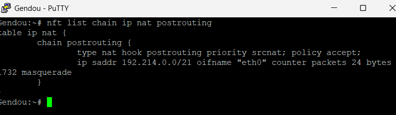

##### 4.7.2 - Pengujian Komunikasi Antar-LAN

Pada Armisael, dilakukan pengujian ping menuju tiga node internal yang sebelumnya telah digunakan pada soal 3.

```bash
echo "===== Armisael ke Lilith ====="
ping -c 4 -W 1 192.214.4.74

echo "===== Armisael ke Sachiel ====="
ping -c 4 -W 1 192.214.3.130

echo "===== Armisael ke Comm-Net ====="
ping -c 4 -W 1 192.214.2.2
```

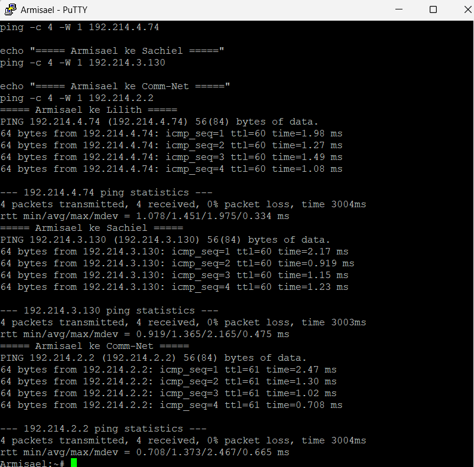

##### 4.7.3 - Pemeriksaan Counter Setelah Pengujian

Setelah pengujian komunikasi internal selesai, dilakukan pemeriksaan kembali pada Gendou.

```bash
nft list chain ip nat postrouting
```


Berdasarkan pengujian, komunikasi antar-LAN tetap berhasil dan tidak menyebabkan peningkatan counter NAT selama tidak terdapat traffic eksternal lain yang berjalan secara bersamaan.

Hal tersebut konsisten dengan konfigurasi rule yang hanya menerapkan MASQUERADE terhadap paket yang keluar melalui eth0.

Perbedaan pemrosesan traffic internal dan eksternal dapat dilihat pada tabel berikut:

| Traffic | Interface Keluar Gendou | Source IP Awal | Source IP Setelah Gendou | NAT |
|---|---|---|---|---|
| Armisael menuju Internet | eth0 | 192.214.4.83 | IP eksternal Gendou | Ya |
| Lilith menuju Internet | eth0 | 192.214.4.74 | IP eksternal Gendou | Ya |
| Armisael menuju Lilith | eth2 | 192.214.4.83 | 192.214.4.83 | Tidak |
| Armisael menuju Sachiel | eth6 | 192.214.4.83 | 192.214.4.83 | Tidak |
| Armisael menuju Comm-Net | eth7 | 192.214.4.83 | 192.214.4.83 | Tidak |

Dengan demikian, konfigurasi NAT tidak mengganggu komunikasi antar-LAN yang telah dibangun menggunakan static routing pada soal 3.

### 5 - Pintu Depan Dikunci Rapat

> Kaji memperingatkan Kaworu bahwa SEELE cukup mengetuk pintu depan. Gendo mengunci NAT1: boleh keluar, tidak boleh dimasuki. Di Gendo, ubah policy INPUT dan FORWARD menjadi DROP. Lalu izinkan empat hal: (a) balasan koneksi yang sudah ada, (b) traffic dari jaringan internal ke internet, (c) traffic antar-LAN, dan (d) traffic dari jaringan internal ke Gendo sendiri. Loopback dan DHCP dari NAT1 juga harus tetap jalan. Koneksi baru dari sisi NAT1 tidak boleh masuk. Soal 2 sampai 4 harus tetap jalan, dan semuanya ditulis di gendo.sh. Tunjukkan iptables -S di Gendo, dan buktikan ping 8.8.8.8 dari Armisael masih berhasil.

Soal meminta untuk mengamankan router Gendou dari koneksi baru yang berasal dari jaringan eksternal NAT1 dengan mengubah default policy chain INPUT dan FORWARD menjadi DROP.

Firewall harus tetap mengizinkan balasan koneksi yang sudah ada, traffic jaringan internal menuju internet, komunikasi antar-LAN, serta traffic jaringan internal menuju Gendou. Komunikasi melalui loopback dan DHCP dari NAT1 juga harus tetap berfungsi.

Seluruh konfigurasi Gendou pada soal 2 sampai soal 5 disimpan dalam script `gendo.sh`.

Keberhasilan konfigurasi dibuktikan dengan menampilkan hasil `iptables -S` pada Gendou dan melakukan pengujian ping menuju 8.8.8.8 dari Armisael setelah firewall diaktifkan.

#### 5.1 - Pemeriksaan Kondisi Awal Gendou

Sebelum menerapkan firewall, dilakukan pemeriksaan terhadap konfigurasi jaringan yang telah dibuat pada soal sebelumnya. Pemeriksaan ini bertujuan memastikan bahwa pengalamatan IP, static routing, DHCP, NAT, dan konektivitas internet telah berfungsi dengan baik.

Pemeriksaan dilakukan menggunakan command berikut:

```bash
sysctl net.ipv4.ip_forward
ip route
iptables --version
iptables -S
command -v iptables-restore
nft list ruleset
ps aux | grep '[u]dhcpc'
```

Berdasarkan hasil pemeriksaan, diperoleh kondisi awal sebagai berikut:

| Komponen | Kondisi Awal |
|---|---|
| IP eksternal Gendou | 192.168.122.60/24 |
| Metode pengalamatan eksternal | DHCP |
| DHCP client | Aktif, PID 354 |
| Default gateway NAT1 | 192.168.122.1 |
| IP forwarding | 1 (aktif) |
| Connected route | 9 rute |
| Static route spesifik | 22 rute |
| Default route | 1 rute |
| Total routing table | 32 rute |
| iptables | v1.8.11 |
| Backend iptables | nf_tables |
| iptables-restore | Tersedia |
| NAT MASQUERADE | Aktif |
| Counter NAT | 24 packets, 1732 bytes |

Kondisi awal firewall Gendou adalah sebagai berikut:

```text
-P INPUT ACCEPT
-P FORWARD ACCEPT
-P OUTPUT ACCEPT
```

Kondisi tersebut menunjukkan bahwa seluruh chain utama pada tabel filter masih menggunakan default policy ACCEPT. Dengan demikian, belum terdapat pembatasan terhadap koneksi baru yang berasal dari jaringan eksternal.

Sebelum firewall diterapkan, dilakukan pengujian konektivitas sebagai baseline.

| Sumber | Tujuan | Packet Loss | RTT Rata-rata | Status |
|---|---|---:|---:|---|
| Gendou | 8.8.8.8 | 0% | 21.365 ms | Berhasil |
| Gendou | Armisael | 0% | 0.787 ms | Berhasil |
| Gendou | Lilith | 0% | 1.124 ms | Berhasil |
| Armisael | 8.8.8.8 | 0% | 22.269 ms | Berhasil |
| Armisael | deb.debian.org | 0% | 22.148 ms | Berhasil |
| Armisael | Lilith | 0% | 1.483 ms | Berhasil |

Seluruh pengujian berhasil sehingga konfigurasi firewall dapat diterapkan tanpa perlu melakukan perubahan terhadap pengalamatan dan static routing yang telah tersedia.

#### 5.2 - Perancangan Kebijakan Firewall

Firewall pada Gendou menggunakan pendekatan default deny, yaitu seluruh traffic akan ditolak secara otomatis apabila tidak memenuhi rule yang secara eksplisit mengizinkannya.

Pendekatan tersebut digunakan karena Gendou merupakan satu-satunya router yang terhubung langsung dengan jaringan eksternal NAT1 sehingga berfungsi sebagai batas antara jaringan internal Geofront dan jaringan luar.

Parameter jaringan yang digunakan dalam konfigurasi firewall adalah sebagai berikut:

| Parameter | Nilai |
|---|---|
| Router firewall | Gendou |
| Prefix internal | 192.214.0.0/21 |
| Interface eksternal | eth0 |
| Interface internal | eth1–eth8 |
| Pengalamatan eksternal | DHCP |
| Firewall | iptables |
| Mekanisme filtering | Stateful packet filtering |
| NAT | nftables MASQUERADE |

##### 5.2.1 - Default Policy

Default policy yang digunakan pada setiap chain adalah sebagai berikut:

| Chain | Policy | Fungsi |
|---|---|---|
| INPUT | DROP | Menolak paket menuju Gendou yang tidak memenuhi rule |
| FORWARD | DROP | Menolak paket yang melewati Gendou apabila tidak memenuhi rule |
| OUTPUT | ACCEPT | Mengizinkan paket yang dihasilkan oleh Gendou |

Chain INPUT digunakan untuk memproses paket yang memiliki tujuan Gendou sendiri, sedangkan chain FORWARD digunakan untuk memproses paket yang diteruskan melalui Gendou menuju perangkat lain.

Chain OUTPUT tetap menggunakan policy ACCEPT agar Gendou dapat melakukan komunikasi keluar, termasuk akses internet, permintaan DNS, dan komunikasi DHCP.

##### 5.2.2 - Kebijakan Traffic

Berdasarkan ketentuan soal, kebijakan firewall dirancang sebagai berikut:

| No. | Traffic | Chain | Aksi |
|---|---|---|---|
| 1 | Komunikasi melalui loopback | INPUT | ACCEPT |
| 2 | DHCP dari NAT1 | INPUT | ACCEPT |
| 3 | Paket dengan connection state INVALID | INPUT dan FORWARD | DROP |
| 4 | Balasan koneksi yang sudah ada | INPUT dan FORWARD | ACCEPT |
| 5 | Jaringan internal menuju Gendou | INPUT | ACCEPT |
| 6 | Jaringan internal menuju internet | FORWARD | ACCEPT |
| 7 | Komunikasi antar-LAN | FORWARD | ACCEPT |
| 8 | Koneksi baru NAT1 menuju Gendou | INPUT | DROP |
| 9 | Koneksi baru NAT1 menuju jaringan internal | FORWARD | DROP |
| 10 | Traffic yang dihasilkan Gendou | OUTPUT | ACCEPT |

Koneksi baru dari NAT1 tidak memiliki rule ACCEPT umum sehingga akan ditolak oleh default policy DROP, kecuali traffic yang memenuhi pengecualian DHCP atau merupakan bagian dari koneksi yang diizinkan.

Ilustrasi kebijakan firewall adalah sebagai berikut:

```text
                 SEELE / Internet
                         |
                        NAT1
                         |
                        eth0
                         |
          +-----------------------------+
          |           GENDOU            |
          |                             |
          | INPUT   : DROP              |
          | FORWARD : DROP              |
          | OUTPUT  : ACCEPT            |
          |                             |
          | Stateful Packet Filtering   |
          | NAT MASQUERADE               |
          +-----------------------------+
                         |
                    eth1 - eth8
                         |
                  Jaringan Internal
```

Kebijakan komunikasi:

```text
Internal --> Internet          : ACCEPT
Internet --> Internal (Reply)  : ACCEPT
Internet --> Internal (New)    : DROP

Internal --> Gendou            : ACCEPT
Gendou --> Internet            : ACCEPT
Internet --> Gendou (Reply)    : ACCEPT
Internet --> Gendou (New)      : DROP

Internal --> Internal          : ACCEPT
Loopback                       : ACCEPT
DHCP NAT1 --> Gendou            : ACCEPT
```

#### 5.3 - Stateful Packet Filtering

Stateful packet filtering merupakan mekanisme firewall yang mempertimbangkan status koneksi ketika menentukan apakah suatu paket diizinkan atau ditolak.

Berbeda dengan stateless packet filtering yang memeriksa setiap paket secara independen, stateful packet filtering menggunakan mekanisme connection tracking untuk mengetahui hubungan suatu paket dengan koneksi yang telah berlangsung.

Pada konfigurasi ini, iptables menggunakan modul `conntrack`.

| Connection State | Keterangan |
|---|---|
| NEW | Paket yang memulai koneksi baru atau belum menjadi bagian dari komunikasi dua arah |
| ESTABLISHED | Paket yang menjadi bagian dari koneksi yang telah berlangsung |
| RELATED | Paket yang berhubungan dengan koneksi lain yang sudah ada |
| INVALID | Paket yang tidak dapat dikaitkan dengan status koneksi yang valid |

Penggunaan connection tracking memungkinkan node internal memulai koneksi menuju internet dan menerima paket balasannya tanpa mengizinkan seluruh koneksi baru dari jaringan eksternal.

Sebagai contoh, ketika Armisael melakukan ping menuju 8.8.8.8, paket ICMP Echo Request diizinkan oleh rule jaringan internal menuju internet.

Ketika ICMP Echo Reply diterima melalui eth0, paket tersebut dikenali oleh connection tracking sebagai bagian dari koneksi yang telah berlangsung sehingga diizinkan oleh rule ESTABLISHED.

Mekanisme tersebut memungkinkan penerapan prinsip boleh keluar, tetapi tidak boleh dimasuki oleh koneksi baru dari jaringan eksternal.

#### 5.4 - Konfigurasi Firewall Menggunakan iptables

Firewall dikonfigurasi menggunakan iptables dengan backend nf_tables.

NAT yang sebelumnya dikonfigurasi menggunakan nftables tetap dipertahankan. iptables digunakan untuk packet filtering, sedangkan nftables digunakan untuk NAT MASQUERADE.

##### 5.4.1 - Mengizinkan Komunikasi Loopback

```bash
iptables -A INPUT -i lo -j ACCEPT
```

Rule tersebut mengizinkan seluruh traffic yang masuk melalui interface loopback.

Loopback digunakan oleh sistem untuk melakukan komunikasi lokal antara aplikasi dan layanan yang berjalan pada perangkat yang sama.

Tanpa pengecualian tersebut, default policy INPUT DROP dapat mengganggu komunikasi lokal pada Gendou.

##### 5.4.2 - Mengizinkan DHCP dari NAT1

```bash
iptables -A INPUT -i eth0 -p udp --sport 67 --dport 68 -j ACCEPT
```

Rule tersebut mengizinkan paket DHCP yang berasal dari interface eksternal eth0.

DHCP menggunakan dua port UDP utama:

| Port | Penggunaan |
|---|---|
| UDP 67 | DHCP server |
| UDP 68 | DHCP client |

Karena Gendou berperan sebagai DHCP client, paket balasan dari DHCP server menggunakan source port 67 dan destination port 68.

Pengecualian ini diperlukan agar proses memperoleh alamat IP dan memperbarui lease DHCP tetap dapat berlangsung meskipun default policy INPUT menggunakan DROP.

##### 5.4.3 - Menolak Paket INVALID

```bash
iptables -A INPUT -m conntrack --ctstate INVALID -j DROP

iptables -A FORWARD -m conntrack --ctstate INVALID -j DROP
```

Rule tersebut digunakan untuk membuang paket yang tidak dapat dikaitkan dengan status koneksi yang valid.

Rule INVALID ditempatkan sebelum rule penerimaan koneksi umum agar paket dengan status tersebut tidak diterima oleh rule internal berikutnya.

##### 5.4.4 - Mengizinkan Balasan Koneksi yang Sudah Ada

```bash
iptables -A INPUT -m conntrack --ctstate ESTABLISHED,RELATED -j ACCEPT

iptables -A FORWARD -m conntrack --ctstate ESTABLISHED,RELATED -j ACCEPT
```

Rule pada chain INPUT digunakan untuk mengizinkan paket balasan dari koneksi yang dimulai oleh Gendou.

Rule pada chain FORWARD digunakan untuk mengizinkan paket balasan dari koneksi yang dimulai oleh perangkat internal dan diteruskan melalui Gendou.

Penjelasan parameter:

| Parameter | Fungsi |
|---|---|
| `-m conntrack` | Menggunakan modul connection tracking |
| `--ctstate ESTABLISHED,RELATED` | Mencocokkan paket berdasarkan status koneksi |
| `-j ACCEPT` | Mengizinkan paket yang memenuhi kondisi |

Rule tersebut merupakan bagian utama dari mekanisme stateful firewall.

##### 5.4.5 - Mengizinkan Traffic Internal Menuju Gendou

```bash
iptables -A INPUT ! -i eth0 -s 192.214.0.0/21 -j ACCEPT
```

Rule tersebut mengizinkan perangkat internal untuk berkomunikasi dengan Gendou.

Terdapat dua kondisi yang harus dipenuhi:

1. Paket berasal dari prefix internal 192.214.0.0/21.
2. Paket tidak masuk melalui interface eksternal eth0.

Penggunaan kondisi `! -i eth0` memastikan bahwa paket dengan alamat sumber internal yang masuk melalui NAT1 tidak otomatis diizinkan oleh rule tersebut.

Dengan demikian, pembatasan traffic internal tidak hanya didasarkan pada alamat IP sumber, tetapi juga pada interface masuk.

##### 5.4.6 - Mengizinkan Traffic Internal Menuju Internet

```bash
iptables -A FORWARD ! -i eth0 -o eth0 \
    -s 192.214.0.0/21 -j ACCEPT
```

Rule tersebut mengizinkan perangkat internal mengakses internet melalui Gendou.

Penjelasan parameter:

| Parameter | Fungsi |
|---|---|
| `! -i eth0` | Paket tidak berasal dari interface eksternal |
| `-o eth0` | Paket keluar melalui interface menuju NAT1 |
| `-s 192.214.0.0/21` | Paket berasal dari prefix internal |
| `-j ACCEPT` | Mengizinkan paket diteruskan |

Setelah paket diizinkan oleh chain FORWARD, paket akan diproses oleh rule NAT MASQUERADE pada chain POSTROUTING sebelum diteruskan menuju NAT1.

##### 5.4.7 - Mengizinkan Komunikasi Antar-LAN

```bash
iptables -A FORWARD ! -i eth0 ! -o eth0 \
    -s 192.214.0.0/21 \
    -d 192.214.0.0/21 \
    -j ACCEPT
```

Rule tersebut mengizinkan komunikasi antar-subnet dalam jaringan Geofront yang melewati Gendou.

Paket harus memenuhi kondisi berikut:

- Berasal dari prefix internal.
- Memiliki tujuan pada prefix internal.
- Tidak masuk melalui interface eksternal eth0.
- Tidak keluar melalui interface eksternal eth0.

Pembatasan tersebut memastikan bahwa komunikasi antar-LAN tetap berjalan dan tidak membuka akses baru dari jaringan eksternal.

##### 5.4.8 - Menetapkan Default Policy

```bash
iptables -P INPUT DROP
iptables -P FORWARD DROP
iptables -P OUTPUT ACCEPT
```

Default policy DROP digunakan untuk membuang paket yang tidak cocok dengan rule ACCEPT yang telah ditentukan.

Pada implementasi aktual, seluruh konfigurasi tabel filter diterapkan secara bersamaan menggunakan `iptables-restore` untuk menghindari duplikasi rule dan mengurangi risiko gangguan akibat penerapan rule secara bertahap.

#### 5.5 - Pembuatan Script gendo.sh

Sesuai ketentuan soal, seluruh konfigurasi Gendou dari soal 2 sampai soal 5 disimpan dalam satu script bernama `gendo.sh`.

Script mencakup konfigurasi berikut:

| Bagian | Konfigurasi |
|---|---|
| Soal 2 | IP addressing, DHCP, dan IP forwarding |
| Soal 3 | Static routing, route summarization, dan default route |
| Soal 4 | NAT MASQUERADE dan DNS |
| Soal 5 | Stateful firewall |

Script disimpan pada lokasi:

```text
/root/gendo.sh
```

Script dirancang agar dapat dijalankan kembali tanpa menduplikasi konfigurasi alamat IP, static route, DHCP client, maupun rule firewall pada kondisi lab yang telah ditentukan.

Penggunaan script juga membantu proses pemulihan konfigurasi apabila konfigurasi runtime hilang setelah router direstart, selama file script masih tersedia.

##### 5.5.1 - Konfigurasi Lengkap gendo.sh

```bash
#!/bin/sh

set -eu

# ==========================================
# GENDOU ROUTER CONFIGURATION
# Soal 2 - 5
# ==========================================

INTERNAL="192.214.0.0/21"
WAN="eth0"

# Memastikan script dijalankan pada Gendou
case "$(hostname)" in
    Gendou|Gendo|gendou|gendo) ;;
    *)
        echo "ERROR: Script hanya untuk router Gendou."
        exit 1
        ;;
esac

# ==========================================
# SOAL 2 - IP ADDRESSING
# ==========================================

echo "===== CONFIGURING INTERFACES ====="

for iface in eth0 eth1 eth2 eth3 eth4 eth5 eth6 eth7 eth8
do
    ip link set "$iface" up
done

ip addr replace 192.214.4.105/30 dev eth1
ip addr replace 192.214.4.133/30 dev eth2
ip addr replace 192.214.4.129/30 dev eth3
ip addr replace 192.214.4.125/30 dev eth4
ip addr replace 192.214.4.121/30 dev eth5
ip addr replace 192.214.4.117/30 dev eth6
ip addr replace 192.214.4.113/30 dev eth7
ip addr replace 192.214.4.109/30 dev eth8

# Aktifkan IP forwarding
sysctl -w net.ipv4.ip_forward=1

# ==========================================
# SOAL 3 - STATIC ROUTING
# ==========================================

echo "===== CONFIGURING STATIC ROUTES ====="

# Cabang Yui
ip route replace 192.214.0.0/23 via 192.214.4.110 dev eth8
ip route replace 192.214.3.0/25 via 192.214.4.110 dev eth8
ip route replace 192.214.4.0/27 via 192.214.4.110 dev eth8
ip route replace 192.214.4.32/28 via 192.214.4.110 dev eth8
ip route replace 192.214.4.136/29 via 192.214.4.110 dev eth8
ip route replace 192.214.4.144/30 via 192.214.4.110 dev eth8

# Cabang Hikari
ip route replace 192.214.2.0/24 via 192.214.4.114 dev eth7
ip route replace 192.214.3.224/27 via 192.214.4.114 dev eth7
ip route replace 192.214.4.148/30 via 192.214.4.114 dev eth7

# Cabang Asuka
ip route replace 192.214.3.128/26 via 192.214.4.118 dev eth6
ip route replace 192.214.4.48/29 via 192.214.4.118 dev eth6
ip route replace 192.214.4.96/30 via 192.214.4.118 dev eth6
ip route replace 192.214.4.152/29 via 192.214.4.118 dev eth6

# Cabang Kaji
ip route replace 192.214.4.100/30 via 192.214.4.122 dev eth5

# Cabang Misato
ip route replace 192.214.4.64/29 via 192.214.4.126 dev eth4

# Cabang Shigeru
ip route replace 192.214.4.80/28 via 192.214.4.130 dev eth3
ip route replace 192.214.4.160/30 via 192.214.4.130 dev eth3

# Cabang Fuyutsuki
ip route replace 192.214.3.192/27 via 192.214.4.134 dev eth2
ip route replace 192.214.4.56/29 via 192.214.4.134 dev eth2
ip route replace 192.214.4.72/29 via 192.214.4.134 dev eth2
ip route replace 192.214.4.164/30 via 192.214.4.134 dev eth2
ip route replace 192.214.4.168/30 via 192.214.4.134 dev eth2

# ==========================================
# SOAL 5 - STATEFUL FIREWALL
# ==========================================

echo "===== CONFIGURING FIREWALL ====="

iptables-restore <<RULES
*filter
:INPUT DROP [0:0]
:FORWARD DROP [0:0]
:OUTPUT ACCEPT [0:0]

# Allow loopback
-A INPUT -i lo -j ACCEPT

# Allow DHCP replies from NAT1
-A INPUT -i $WAN -p udp --sport 67 --dport 68 -j ACCEPT

# Drop invalid packets
-A INPUT -m conntrack --ctstate INVALID -j DROP
-A FORWARD -m conntrack --ctstate INVALID -j DROP

# Allow established and related connections
-A INPUT -m conntrack --ctstate ESTABLISHED,RELATED -j ACCEPT
-A FORWARD -m conntrack --ctstate ESTABLISHED,RELATED -j ACCEPT

# Allow internal network to Gendou
-A INPUT ! -i $WAN -s $INTERNAL -j ACCEPT

# Allow internal network to internet
-A FORWARD ! -i $WAN -o $WAN -s $INTERNAL -j ACCEPT

# Allow inter-LAN communication
-A FORWARD ! -i $WAN ! -o $WAN -s $INTERNAL -d $INTERNAL -j ACCEPT

COMMIT
RULES

# ==========================================
# SOAL 2 - DHCP CLIENT
# SOAL 3 - DEFAULT ROUTE VIA DHCP
# ==========================================

echo "===== CHECKING DHCP ====="

if ps aux | grep '[u]dhcpc' | grep -q 'eth0'; then
    echo "DHCP client already running."
else
    udhcpc -i "$WAN" -n
fi

# Verify external address and default route
if ! ip -4 addr show dev "$WAN" scope global | grep -q 'inet '; then
    echo "ERROR: No external IPv4 address."
    exit 1
fi

if ! ip -4 route show default dev "$WAN" | grep -q '^default'; then
    echo "ERROR: No default route via NAT1."
    exit 1
fi

# ==========================================
# SOAL 4 - NAT MASQUERADE
# ==========================================

echo "===== CONFIGURING NAT ====="

# Create NAT table if it does not exist
if ! nft list table ip nat >/dev/null 2>&1; then
    nft add table ip nat
fi

# Create postrouting chain if needed
if ! nft list chain ip nat postrouting >/dev/null 2>&1; then
    nft 'add chain ip nat postrouting { type nat hook postrouting priority srcnat; policy accept; }'
fi

# Avoid duplicate masquerade rules
if ! nft list chain ip nat postrouting | grep -F "ip saddr $INTERNAL oifname \"$WAN\"" | grep -q masquerade; then
    nft add rule ip nat postrouting \
        ip saddr "$INTERNAL" \
        oifname "$WAN" \
        counter masquerade
fi

# ==========================================
# SOAL 4 - DNS CONFIGURATION
# ==========================================

echo "===== CONFIGURING DNS ====="

printf 'nameserver 8.8.8.8\nnameserver 1.1.1.1\n' > /etc/resolv.conf

# ==========================================
# VERIFICATION
# ==========================================

echo "===== INTERFACES ====="
ip -4 -br addr

echo "===== IP FORWARDING ====="
sysctl net.ipv4.ip_forward

echo "===== ROUTING TABLE ====="
ip -4 route

echo "===== IPTABLES FIREWALL ====="
iptables -S

echo "===== NAT RULESET ====="
nft list chain ip nat postrouting

echo "===== DNS CONFIGURATION ====="
cat /etc/resolv.conf

echo "===== CONFIGURATION COMPLETE ====="
```

##### 5.5.2 - Pemberian Permission dan Eksekusi Script

Agar script dapat dijalankan secara langsung, diberikan permission executable menggunakan command:

```bash
chmod +x /root/gendo.sh
```

Validasi sintaks dapat dilakukan menggunakan:

```bash
sh -n /root/gendo.sh
```

Selanjutnya, script dijalankan menggunakan:

```bash
/root/gendo.sh
```

Untuk membuktikan bahwa script telah tersedia dan memiliki sintaks yang valid, digunakan command:

```bash
ls -l /root/gendo.sh
sh -n /root/gendo.sh && echo "Script syntax: OK"
```

[SS - Keberadaan file gendo.sh dan hasil validasi sintaks script]

##### 5.5.3 - Analisis Mekanisme Script

Beberapa mekanisme yang diterapkan pada script adalah sebagai berikut:

| Mekanisme | Fungsi |
|---|---|
| `set -eu` | Menghentikan script ketika terjadi error atau terdapat variabel yang belum didefinisikan |
| Pemeriksaan hostname | Mencegah script dijalankan pada router yang salah |
| `ip addr replace` | Menambahkan atau memperbarui alamat IP yang ditentukan |
| `ip route replace` | Menambahkan atau memperbarui static route tanpa menduplikasi rute dengan prefix yang sama |
| Pemeriksaan proses DHCP | Mencegah DHCP client dijalankan ulang apabila sudah aktif |
| `iptables-restore` | Menerapkan seluruh konfigurasi tabel filter secara bersamaan |
| Pemeriksaan tabel dan rule NAT | Mencegah pembuatan rule MASQUERADE yang sama secara berulang |
| Verifikasi konfigurasi | Menampilkan kondisi jaringan setelah script dijalankan |

Penggunaan `iptables-restore` menggantikan konfigurasi tabel filter sebelumnya dengan konfigurasi yang terdapat pada script. Oleh karena itu, apabila terdapat kebijakan firewall tambahan pada soal berikutnya, konfigurasi tersebut perlu dimasukkan ke dalam script agar tidak terhapus ketika script dijalankan kembali.

Penyimpanan konfigurasi dalam `gendo.sh` belum membuat konfigurasi berjalan secara otomatis ketika Gendou dinyalakan. Mekanisme startup dan penyimpanan permanen merupakan konfigurasi tambahan yang dapat diterapkan pada tahap berikutnya.

#### 5.6 - Verifikasi Konfigurasi Firewall

Setelah script dijalankan, konfigurasi firewall diverifikasi menggunakan command:

```bash
iptables -S
```

Hasil aktual pada Gendou adalah sebagai berikut:

```text
-P INPUT DROP
-P FORWARD DROP
-P OUTPUT ACCEPT
-A INPUT -i lo -j ACCEPT
-A INPUT -i eth0 -p udp -m udp --sport 67 --dport 68 -j ACCEPT
-A INPUT -m conntrack --ctstate INVALID -j DROP
-A INPUT -m conntrack --ctstate RELATED,ESTABLISHED -j ACCEPT
-A INPUT -s 192.214.0.0/21 ! -i eth0 -j ACCEPT
-A FORWARD -m conntrack --ctstate INVALID -j DROP
-A FORWARD -m conntrack --ctstate RELATED,ESTABLISHED -j ACCEPT
-A FORWARD -s 192.214.0.0/21 ! -i eth0 -o eth0 -j ACCEPT
-A FORWARD -s 192.214.0.0/21 -d 192.214.0.0/21 ! -i eth0 ! -o eth0 -j ACCEPT
```


Berdasarkan hasil tersebut, seluruh rule firewall telah berhasil diterapkan.

Chain INPUT memiliki lima rule, sedangkan chain FORWARD memiliki empat rule. Chain OUTPUT tidak membutuhkan rule tambahan karena menggunakan default policy ACCEPT.

| Chain | Jumlah Rule | Default Policy |
|---|---:|---|
| INPUT | 5 | DROP |
| FORWARD | 4 | DROP |
| OUTPUT | 0 | ACCEPT |
| **Total** | **9** | |

Konfigurasi tersebut mencakup seluruh pengecualian yang diminta pada soal tanpa memerlukan rule terpisah untuk setiap subnet internal.

#### 5.7 - Hasil Pengujian Konektivitas Armisael

Setelah firewall diterapkan, dilakukan pengujian konektivitas dari Armisael menuju internet, nama domain, node pada LAN lain, dan router Gendou untuk memastikan konfigurasi sebelumnya tetap berfungsi.

Pengujian dilakukan menggunakan command berikut:

```bash
echo "===== INTERNET CONNECTIVITY ====="
ping -c 4 -W 2 8.8.8.8

echo "===== DNS CONNECTIVITY ====="
ping -4 -c 4 -W 2 deb.debian.org

echo "===== INTER-LAN CONNECTIVITY ====="
ping -c 4 -W 1 192.214.4.74

echo "===== ACCESS TO GENDOU ====="
ping -c 4 -W 1 192.214.4.129
```


| Tujuan | IP Tujuan | Paket Dikirim | Paket Diterima | Packet Loss | RTT Rata-rata | Status |
|---|---|---:|---:|---:|---:|---|
| Internet | 8.8.8.8 | 4 | 4 | 0% | 22.477 ms | Berhasil |
| deb.debian.org | 151.101.66.132 | 4 | 4 | 0% | 22.310 ms | Berhasil |
| Lilith | 192.214.4.74 | 4 | 4 | 0% | 1.424 ms | Berhasil |
| Gendou | 192.214.4.129 | 4 | 4 | 0% | 0.558 ms | Berhasil |
| **Total** | | **16** | **16** | **0%** | | **Berhasil** |

Berdasarkan hasil pengujian, diperoleh kesimpulan sebagai berikut:

- **Akses internet:** Rule FORWARD mengizinkan traffic internal menuju internet, sedangkan rule ESTABLISHED,RELATED mengizinkan paket balasan.
- **Resolusi DNS:** Domain deb.debian.org berhasil diterjemahkan menjadi alamat IP 151.101.66.132 dan dapat dijangkau.
- **Komunikasi antar-LAN:** Armisael tetap dapat berkomunikasi dengan Lilith karena terdapat pengecualian traffic antar-subnet internal pada chain FORWARD.
- **Akses menuju Gendou:** Armisael tetap dapat mengakses Gendou karena terdapat rule INPUT yang mengizinkan traffic dari prefix internal.

Seluruh pengujian menghasilkan 0% packet loss. Dengan demikian, penerapan default policy INPUT dan FORWARD DROP tidak mengganggu konektivitas jaringan internal, static routing, NAT MASQUERADE, maupun resolusi DNS yang telah dikonfigurasi pada soal sebelumnya.

#### 5.8 - Verifikasi Layanan Gendou

Selain pengujian dari Armisael, dilakukan pemeriksaan terhadap fungsi komunikasi lokal, akses internet Gendou, serta konfigurasi DHCP.

Command yang digunakan adalah sebagai berikut:

```bash
echo "===== LOOPBACK ====="
ping -c 3 -W 1 127.0.0.1

echo "===== INTERNET ====="
ping -c 3 -W 2 8.8.8.8

echo "===== DHCP CLIENT ====="
ps aux | grep '[u]dhcpc'

echo "===== DHCP ADDRESS ====="
ip -4 -br addr show dev eth0

echo "===== DEFAULT ROUTE ====="
ip route show default
```


Setelah firewall diterapkan, dilakukan pengujian terhadap komunikasi loopback, akses internet, dan konfigurasi DHCP untuk memastikan fungsi utama Gendou tetap berjalan.

| Pengujian | Tujuan | Paket Dikirim | Paket Diterima | Packet Loss | RTT Rata-rata | Status |
|---|---|---:|---:|---:|---:|---|
| Loopback | 127.0.0.1 | 3 | 3 | 0% | 0.052 ms | Berhasil |
| Akses Internet | 8.8.8.8 | 3 | 3 | 0% | 21.714 ms | Berhasil |

Hasil pemeriksaan konfigurasi DHCP setelah firewall diaktifkan adalah sebagai berikut:

| Parameter | Hasil |
|---|---|
| DHCP client | Aktif |
| PID | 354 |
| Interface | eth0 |
| IP Address | 192.168.122.60/24 |
| Default Gateway | 192.168.122.1 |
| Route Metric | 166366 |

Berdasarkan hasil pengujian, diperoleh kesimpulan sebagai berikut:

- **Loopback:** Komunikasi lokal tetap berfungsi karena terdapat rule ACCEPT untuk interface lo pada chain INPUT.
- **Akses internet:** Gendou tetap dapat mengakses internet karena chain OUTPUT menggunakan policy ACCEPT dan paket balasan diizinkan melalui rule ESTABLISHED,RELATED pada chain INPUT.
- **DHCP:** DHCP client tetap aktif, serta alamat IP eksternal dan default route tetap tersedia setelah firewall diterapkan. Rule pengecualian UDP port 67 menuju port 68 juga telah tersedia, meskipun proses pembaruan lease belum diuji secara langsung.

Dengan demikian, penerapan firewall tidak mengganggu fungsi komunikasi lokal, akses internet, maupun konfigurasi jaringan eksternal Gendou yang sedang berjalan.

#### 5.9 - Verifikasi Counter Firewall

Counter firewall digunakan untuk mengetahui apakah rule yang telah dikonfigurasi benar-benar memproses traffic jaringan.

Pemeriksaan dilakukan menggunakan command berikut:

```bash
echo "===== INPUT COUNTERS ====="
iptables -L INPUT -n -v --line-numbers

echo "===== FORWARD COUNTERS ====="
iptables -L FORWARD -n -v --line-numbers

echo "===== NAT COUNTERS ====="
nft list chain ip nat postrouting
```

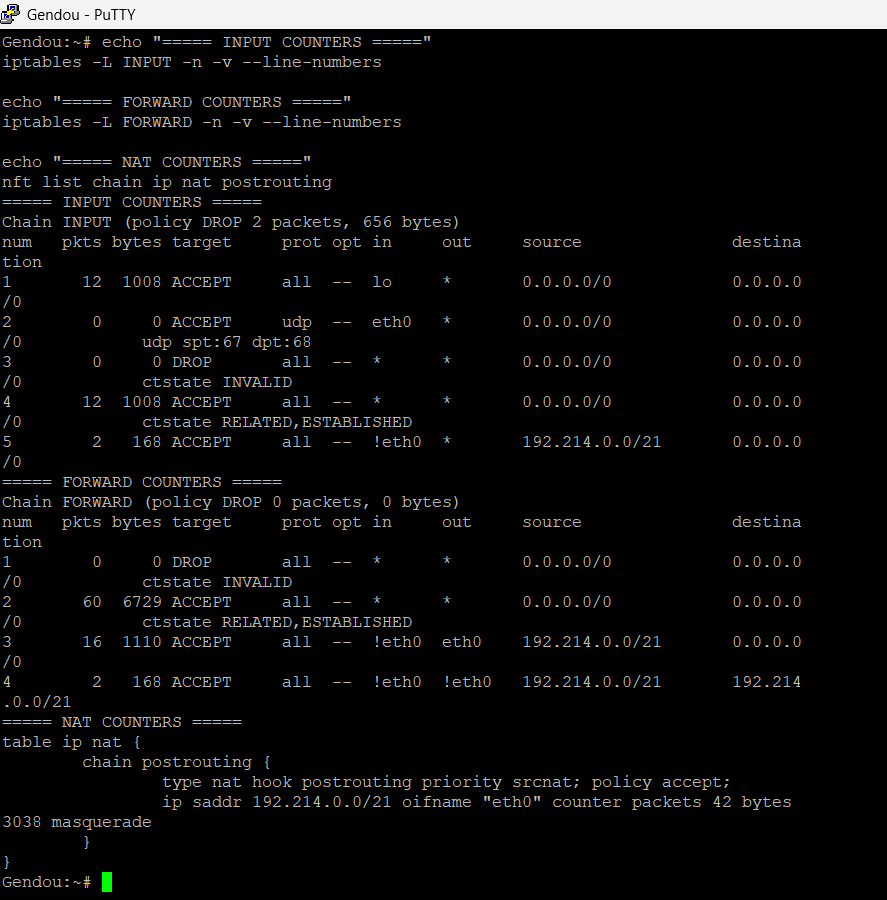

##### 5.9.1 - Counter Chain INPUT

Hasil aktual counter chain INPUT adalah sebagai berikut:

| No. | Rule | Packets | Bytes |
|---|---|---:|---:|
| 1 | ACCEPT loopback | 6 | 504 |
| 2 | ACCEPT DHCP | 0 | 0 |
| 3 | DROP INVALID | 0 | 0 |
| 4 | ACCEPT RELATED,ESTABLISHED | 6 | 504 |
| 5 | ACCEPT internal menuju Gendou | 1 | 84 |

Berdasarkan hasil tersebut, diperoleh beberapa informasi:

- Rule loopback telah memproses enam paket yang berasal dari pengujian komunikasi lokal.
- Rule RELATED,ESTABLISHED telah memproses paket yang menjadi bagian dari koneksi yang sudah ada.
- Rule internal menuju Gendou telah memproses paket dari jaringan internal.
- Rule DHCP belum memiliki counter karena belum terdapat paket DHCP yang tercatat oleh rule tersebut selama periode pengujian.
- Rule DROP INVALID belum memproses paket karena tidak terdapat paket dengan connection state INVALID yang cocok.

Default policy INPUT DROP juga menunjukkan counter sebesar nol paket selama periode pengujian.

Hal tersebut tidak berarti policy DROP gagal diterapkan, melainkan belum terdapat paket yang mencapai akhir chain dan harus dibuang oleh default policy selama pengujian tersebut.

##### 5.9.2 - Counter Chain FORWARD

Hasil aktual counter chain FORWARD adalah sebagai berikut:

| No. | Rule | Packets | Bytes |
|---|---|---:|---:|
| 1 | DROP INVALID | 0 | 0 |
| 2 | ACCEPT RELATED,ESTABLISHED | 30 | 3363 |
| 3 | ACCEPT internal menuju internet | 8 | 554 |
| 4 | ACCEPT komunikasi antar-LAN | 1 | 84 |

Counter menunjukkan bahwa traffic internal menuju internet dan komunikasi antar-LAN berhasil diproses oleh firewall.

Rule RELATED,ESTABLISHED memiliki jumlah paket paling banyak karena paket dari koneksi yang telah berlangsung akan cocok dengan rule tersebut terlebih dahulu.

Sebagai contoh, ketika Armisael melakukan ping sebanyak empat kali menuju Lilith, paket awal dapat cocok dengan rule antar-LAN. Paket berikutnya dapat dikenali sebagai bagian dari koneksi yang sudah berlangsung sehingga diproses oleh rule ESTABLISHED.

Oleh karena itu, counter rule antar-LAN tidak harus sama dengan jumlah keseluruhan paket ping yang dikirimkan.

#### 5.10 - Verifikasi NAT MASQUERADE

Firewall yang diterapkan pada soal 5 tidak boleh mengganggu konfigurasi NAT yang telah dibuat pada soal 4.

Untuk memastikan NAT tetap berfungsi, dilakukan pemeriksaan menggunakan:

```bash
nft list chain ip nat postrouting
```

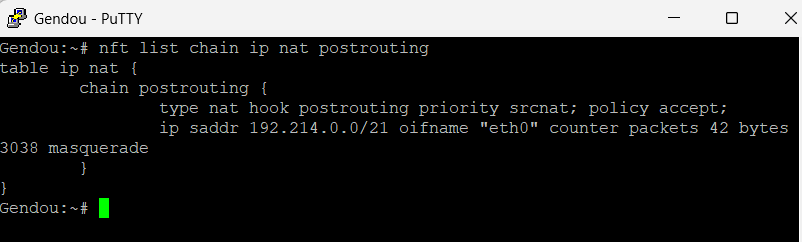

Hasil aktual setelah penerapan firewall adalah sebagai berikut:

```text
table ip nat {
    chain postrouting {
        type nat hook postrouting priority srcnat; policy accept;
        ip saddr 192.214.0.0/21 oifname "eth0" counter packets 36 bytes 2602 masquerade
    }
}
```

Perbandingan counter NAT sebelum dan setelah firewall diterapkan adalah sebagai berikut:

| Parameter | Sebelum Firewall | Setelah Firewall | Peningkatan |
|---|---:|---:|---:|
| Packets | 24 | 36 | 12 |
| Bytes | 1732 | 2602 | 870 |

Peningkatan counter paket:

$$
36 - 24 = 12
$$

Peningkatan counter byte:

$$
2602 - 1732 = 870
$$

Peningkatan counter tersebut menunjukkan bahwa rule NAT MASQUERADE tetap memproses traffic setelah firewall diaktifkan.

Rule NAT masih menggunakan kondisi yang sama, yaitu:

```text
ip saddr 192.214.0.0/21 oifname "eth0" counter masquerade
```

Dengan demikian, translasi alamat tetap hanya dilakukan terhadap paket yang berasal dari prefix internal dan keluar melalui interface eth0 menuju NAT1.

#### 5.11 - Analisis Alur Pemrosesan Paket

##### 5.11.1 - Traffic Internal Menuju Internet

Ketika Armisael mengirimkan paket menuju 8.8.8.8, alur pemrosesan paket pada Gendou adalah sebagai berikut:

```text
Armisael
192.214.4.83
       |
       v
    Shigeru
       |
       v
Gendou - eth3
       |
       v
   PREROUTING
       |
       v
 Routing Decision
       |
       v
     FORWARD
Internal --> Internet
       ACCEPT
       |
       v
   POSTROUTING
  NAT MASQUERADE
       |
       v
Gendou - eth0
       |
       v
      NAT1
       |
       v
    Internet
```

Paket terlebih dahulu melewati proses routing dan filtering pada chain FORWARD.

Setelah diizinkan, paket diproses oleh chain POSTROUTING untuk melakukan translasi alamat sumber menggunakan MASQUERADE.

Alamat sumber paket berubah dari 192.214.4.83 menjadi alamat eksternal Gendou, yaitu 192.168.122.60.

##### 5.11.2 - Paket Balasan dari Internet

Ketika paket balasan diterima dari internet, Gendou menggunakan informasi connection tracking untuk mengembalikan alamat tujuan paket ke alamat IP asli Armisael.

```text
Internet
    |
   NAT1
    |
Gendou - eth0
    |
PREROUTING
Reverse NAT
    |
Routing Decision
    |
FORWARD
ESTABLISHED
ACCEPT
    |
Gendou - eth3
    |
 Shigeru
    |
 Armisael
```

Paket balasan diizinkan karena merupakan bagian dari koneksi yang telah dimulai oleh Armisael.

##### 5.11.3 - Koneksi Baru dari NAT1 Menuju Gendou

Apabila perangkat eksternal mengirimkan paket koneksi baru menuju Gendou melalui eth0, paket akan diproses melalui chain INPUT.

```text
Perangkat Eksternal
        |
       NAT1
        |
       eth0
        |
       INPUT
        |
Tidak memenuhi rule ACCEPT
        |
Default Policy DROP
        |
      Dibuang
```

Paket koneksi baru tersebut tidak memenuhi rule internal karena berasal dari eth0. Paket juga tidak memenuhi rule ESTABLISHED,RELATED karena bukan bagian dari koneksi yang telah ada.

Selama paket tersebut bukan bagian dari pengecualian yang diizinkan, seperti DHCP, paket akan dibuang oleh default policy INPUT DROP.

##### 5.11.4 - Koneksi Baru dari NAT1 Menuju Jaringan Internal

Apabila paket koneksi baru dari NAT1 memiliki tujuan perangkat internal dan diteruskan oleh Gendou, paket akan diproses melalui chain FORWARD.

Rule internal menuju internet dan rule antar-LAN memiliki kondisi bahwa paket tidak boleh masuk melalui eth0.

Karena koneksi baru tersebut berasal dari eth0 dan tidak memenuhi rule ESTABLISHED,RELATED, paket tidak akan cocok dengan rule ACCEPT yang tersedia.

Akibatnya, paket akan dibuang oleh default policy FORWARD DROP.

Mekanisme tersebut memenuhi prinsip pengamanan jaringan eksternal, yaitu perangkat internal diperbolehkan memulai koneksi keluar, sedangkan koneksi baru yang tidak diizinkan dari jaringan eksternal ditolak.

#### 5.12 - Persistensi Konfigurasi Gendou

Konfigurasi IP interface, static routing, NAT, dan firewall yang diterapkan pada Gendou bersifat runtime sehingga dapat hilang ketika router direstart. Meskipun seluruh konfigurasi telah disimpan dalam script `/root/gendo.sh`, script tersebut belum dijalankan secara otomatis ketika router dinyalakan.

Oleh karena itu, diperlukan mekanisme startup otomatis untuk memastikan seluruh konfigurasi soal 2 sampai soal 5 dapat dipulihkan tanpa konfigurasi ulang secara manual.

##### 5.12.1 - Konfigurasi Startup Otomatis

Mekanisme startup otomatis diterapkan menggunakan file `/etc/network/interfaces` yang berada pada persistent volume GNS3.

Script `gendo.sh` dipanggil menggunakan parameter `post-up`, sehingga script dijalankan setelah interface eth1 selesai dikonfigurasi.

Konfigurasi dilakukan menggunakan command berikut:

```bash
cat > /etc/network/interfaces <<'EOF'
auto lo
iface lo inet loopback

auto eth1
iface eth1 inet static
    address 192.214.4.105
    netmask 255.255.255.252
    post-up /bin/sh /root/gendo.sh > /root/gendo-startup.log 2>&1
EOF

sync
```

Penjelasan parameter konfigurasi:

| Parameter | Fungsi |
|---|---|
| `auto lo` | Mengaktifkan interface loopback secara otomatis |
| `auto eth1` | Mengaktifkan eth1 ketika router dinyalakan |
| `iface eth1 inet static` | Menentukan konfigurasi IPv4 statis pada eth1 |
| `address` | Menentukan alamat IP awal interface eth1 |
| `netmask` | Menentukan subnet mask interface eth1 |
| `post-up` | Menjalankan command setelah konfigurasi interface diterapkan |
| `/bin/sh /root/gendo.sh` | Mengeksekusi script konfigurasi Gendou |
| `> /root/gendo-startup.log 2>&1` | Menyimpan standard output dan standard error ke dalam file log |
| `sync` | Memastikan perubahan file dituliskan ke media penyimpanan |

Interface eth1 digunakan sebagai pemicu eksekusi script karena merupakan interface internal Gendou yang terhubung dengan Switch-Cmd dan memiliki alamat IP statis.

Konfigurasi interface lainnya, termasuk DHCP pada eth0, tetap dikelola melalui `gendo.sh` sehingga konfigurasi utama Gendou tidak perlu dituliskan ulang pada `/etc/network/interfaces`.

##### 5.12.2 - Penyesuaian Kompatibilitas Script

Untuk memastikan script dapat dijalankan dengan baik pada environment startup maupun terminal interaktif, command verifikasi alamat IP menggunakan absolute path menuju executable iproute2.

Penyesuaian dilakukan menggunakan command berikut:

```bash
cp /root/gendo.sh /root/gendo.sh.bak

sed -i 's|^ip -4 -br addr$|/sbin/ip -4 -br addr|' /root/gendo.sh

sh -n /root/gendo.sh
```

Command verifikasi alamat IP pada bagian akhir script menjadi:

```bash
echo "===== INTERFACES ====="
/sbin/ip -4 -br addr
```

Penggunaan absolute path `/sbin/ip` memastikan script menggunakan executable yang mendukung opsi `-br`, tanpa bergantung pada urutan pencarian executable melalui environment variable `PATH`.

Penyesuaian tersebut hanya memengaruhi bagian verifikasi dan tidak mengubah konfigurasi IP, static routing, NAT, maupun kebijakan firewall yang telah diterapkan.

##### 5.12.3 - Mekanisme Pemulihan Konfigurasi

Ketika Gendou dinyalakan kembali, konfigurasi jaringan dipulihkan melalui urutan berikut:

1. GNS3 menjalankan proses startup container Gendou.
2. Sistem membaca file `/etc/network/interfaces`.
3. Interface eth1 dikonfigurasi dengan alamat IP 192.214.4.105/30.
4. Parameter `post-up` menjalankan `/root/gendo.sh`.
5. Seluruh interface internal dikonfigurasi sesuai alokasi IP pada soal 2.
6. IP forwarding diaktifkan dan static routing diterapkan kembali.
7. Kebijakan firewall beserta rule iptables diterapkan.
8. DHCP client dijalankan pada eth0 untuk memperoleh alamat IP dan default gateway dari NAT1.
9. Rule NAT MASQUERADE dan DNS resolver dikonfigurasi.
10. Hasil konfigurasi dicatat dalam `/root/gendo-startup.log`.

Dengan mekanisme tersebut, seluruh konfigurasi utama Gendou dikelola melalui satu script yang dijalankan secara otomatis setelah restart.

##### 5.12.4 - Pengujian Setelah Restart

Pengujian persistensi dilakukan dengan menghentikan dan menyalakan kembali Gendou melalui GNS3.

Setelah router kembali aktif, tidak dilakukan eksekusi `gendo.sh` maupun konfigurasi jaringan secara manual.

Verifikasi dilakukan menggunakan command berikut:

```bash
echo "===== STARTUP STATUS ====="
tail -n 1 /root/gendo-startup.log

echo "===== IP ADDRESS ====="
ip -4 -br addr

echo "===== ROUTE COUNT ====="
ip route | wc -l

echo "===== IP FORWARDING ====="
sysctl net.ipv4.ip_forward

echo "===== DHCP ====="
ps aux | grep '[u]dhcpc'

echo "===== FIREWALL ====="
iptables -S

echo "===== NAT ====="
nft list chain ip nat postrouting

echo "===== INTERNET ====="
ping -c 3 -W 2 8.8.8.8
```

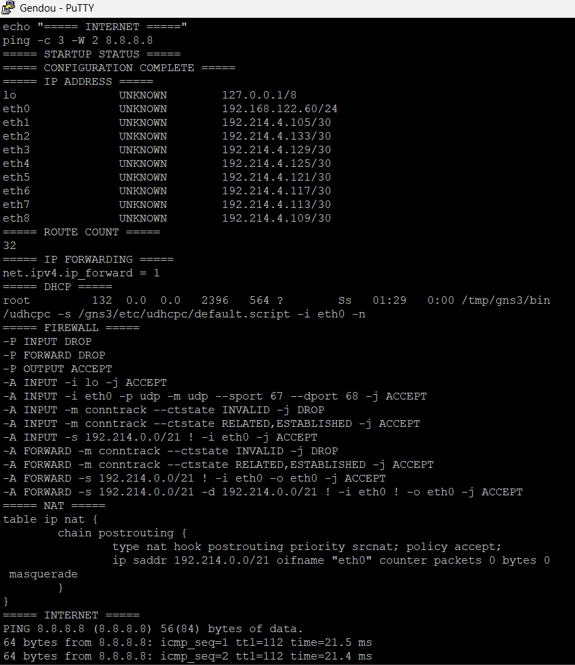

Hasil pengujian menunjukkan bahwa konfigurasi IP, static routing, DHCP, IP forwarding, NAT, dan firewall berhasil dipulihkan setelah restart.

### 6 - Alamat Para Pilot

> Jaringan sudah hidup, tapi para pilot dan staf tidak tahu alamat mereka sendiri. Unit-01 bahkan tidak tahu siapa gateway-nya. Beri IP statis dan gateway ke semua node non-router, sesuai aturan alamat di glosarium. Simpan agar bertahan setelah restart. Tunjukkan ip -br dan ping ke gateway di Unit-01.

Soal meminta untuk memberikan alamat IP statis dan default gateway kepada seluruh node non-router sesuai aturan pengalamatan pada glosarium dan hasil pembagian VLSM pada soal 1.

Konfigurasi harus disimpan secara permanen agar alamat IP dan default gateway tetap tersedia setelah node direstart.

Keberhasilan konfigurasi dibuktikan dengan menampilkan hasil `ip -br addr` dan pengujian ping menuju gateway pada Unit-01 setelah restart.

#### 6.1 - Perencanaan Pengalamatan IP

Pengalamatan IP pada seluruh node non-router menggunakan hasil pembagian subnet dengan metode VLSM yang telah ditentukan pada soal 1.

Alamat usable pertama pada setiap subnet digunakan sebagai alamat gateway router, sedangkan alamat usable berikutnya dialokasikan kepada node secara berurutan.

Berikut merupakan alokasi alamat IP, subnet mask, dan default gateway untuk seluruh node non-router pada jaringan Geofront.

| No. | Node | IP Address/Prefix | Subnet Mask | Default Gateway |
|---|---|---|---|---|
| 1 | Quarters | 192.214.0.2/23 | 255.255.254.0 | 192.214.0.1 |
| 2 | Comm-Net | 192.214.2.2/24 | 255.255.255.0 | 192.214.2.1 |
| 3 | Hangar-Crew | 192.214.3.2/25 | 255.255.255.128 | 192.214.3.1 |
| 4 | Sachiel | 192.214.3.130/26 | 255.255.255.192 | 192.214.3.129 |
| 5 | Pen-Pen | 192.214.3.194/27 | 255.255.255.224 | 192.214.3.193 |
| 6 | Medic-Bay | 192.214.3.195/27 | 255.255.255.224 | 192.214.3.193 |
| 7 | Relay-Node | 192.214.3.226/27 | 255.255.255.224 | 192.214.3.225 |
| 8 | Garden-Staff | 192.214.4.2/27 | 255.255.255.224 | 192.214.4.1 |
| 9 | Dock-Crew | 192.214.4.34/28 | 255.255.255.240 | 192.214.4.33 |
| 10 | Entry-Plug | 192.214.4.50/29 | 255.255.255.248 | 192.214.4.49 |
| 11 | Dummy-Plug | 192.214.4.51/29 | 255.255.255.248 | 192.214.4.49 |
| 12 | Magi-Casper | 192.214.4.58/29 | 255.255.255.248 | 192.214.4.57 |
| 13 | Magi-Balthasar | 192.214.4.59/29 | 255.255.255.248 | 192.214.4.57 |
| 14 | Magi-Melchior | 192.214.4.60/29 | 255.255.255.248 | 192.214.4.57 |
| 15 | Unit-01 | 192.214.4.66/29 | 255.255.255.248 | 192.214.4.65 |
| 16 | Unit-02 | 192.214.4.67/29 | 255.255.255.248 | 192.214.4.65 |
| 17 | Unit-00 | 192.214.4.68/29 | 255.255.255.248 | 192.214.4.65 |
| 18 | Lilith | 192.214.4.74/29 | 255.255.255.248 | 192.214.4.73 |
| 19 | Adam | 192.214.4.75/29 | 255.255.255.248 | 192.214.4.73 |
| 20 | Zeruel | 192.214.4.82/29 | 255.255.255.248 | 192.214.4.81 |
| 21 | Armisael | 192.214.4.83/29 | 255.255.255.248 | 192.214.4.81 |
| 22 | Radar-Array | 192.214.4.90/29 | 255.255.255.248 | 192.214.4.89 |
| 23 | Archive-Vault | 192.214.4.98/30 | 255.255.255.252 | 192.214.4.97 |
| 24 | Spy | 192.214.4.102/30 | 255.255.255.252 | 192.214.4.101 |
| 25 | Tokyo3-Core | 192.214.4.106/30 | 255.255.255.252 | 192.214.4.105 |

Terdapat 25 node non-router yang tersebar pada 17 subnet LAN. Seluruh alamat IP dialokasikan secara unik dan berada dalam rentang usable host pada subnet masing-masing.

Selain alamat IP dan default gateway, setiap node juga dikonfigurasi menggunakan DNS resolver 8.8.8.8 dan 1.1.1.1 untuk mendukung kebutuhan resolusi nama domain dan instalasi paket pada tahap selanjutnya.

#### 6.2 - Penentuan Metode Konfigurasi Permanen

Pada soal sebelumnya, konfigurasi IP node uji dilakukan menggunakan command `ip addr add` dan `ip route replace`. Konfigurasi tersebut bersifat runtime sehingga tidak secara otomatis tersedia kembali setelah node direstart.

Untuk memenuhi ketentuan persistensi pada soal 6, konfigurasi jaringan disimpan melalui file `/etc/network/interfaces` pada setiap node Alpine Linux.

##### 6.2.1 - Pemeriksaan Dukungan Persistensi

Sebelum konfigurasi diterapkan pada seluruh node, dilakukan pemeriksaan awal pada Unit-01 menggunakan command berikut:

```bash
ip -br addr
ip route
cat /etc/network/interfaces

command -v ifup
command -v ifdown

mount | grep '/etc/network'
```

Hasil pemeriksaan menunjukkan bahwa perangkat menyediakan utilitas konfigurasi interface berikut:

```text
/sbin/ifup
/sbin/ifdown
```

Selain itu, ditemukan persistent volume GNS3 yang digunakan untuk menyimpan konfigurasi jaringan:

```text
/dev/sdb1 on /gns3volumes/etc/network type ext4 (rw,nodiratime,relatime)
/dev/sdb1 on /etc/network type ext4 (rw,nodiratime,relatime)
```

Hasil tersebut menunjukkan bahwa direktori `/etc/network` menggunakan penyimpanan persisten sehingga file konfigurasi jaringan dapat dipertahankan ketika node dihentikan dan dinyalakan kembali.

##### 6.2.2 - Pemilihan Metode Konfigurasi

| Aspek | Konfigurasi Runtime | Konfigurasi Permanen |
|---|---|---|
| Metode | `ip addr` dan `ip route` | `/etc/network/interfaces` |
| Penyimpanan | Kondisi jaringan aktif | File konfigurasi |
| Bertahan setelah restart | Tidak | Ya, melalui persistent volume |
| Aktivasi otomatis | Tidak | Ya, menggunakan `auto` |
| Penggunaan | Pengujian sementara | Konfigurasi seluruh node |

Konfigurasi melalui `/etc/network/interfaces` dipilih karena dapat menyimpan alamat IP, subnet mask, default gateway, dan command tambahan untuk konfigurasi DNS dalam satu file.

#### 6.3 - Konfigurasi IP Statis Unit-01

Unit-01 digunakan sebagai node pertama untuk menguji metode konfigurasi permanen sebelum diterapkan pada seluruh node lainnya.

Unit-01 berada pada Switch-Cage dengan Misato sebagai router gateway.

| Parameter | Nilai |
|---|---|
| Node | Unit-01 |
| Switch | Switch-Cage |
| Interface | eth0 |
| Network ID | 192.214.4.64/29 |
| IP Address | 192.214.4.66 |
| Subnet Mask | 255.255.255.248 |
| Default Gateway | 192.214.4.65 |
| Broadcast | 192.214.4.71 |
| Router Gateway | Misato |
| DNS Primer | 8.8.8.8 |
| DNS Sekunder | 1.1.1.1 |

##### 6.3.1 - Penyimpanan Konfigurasi

Konfigurasi dilakukan dengan menuliskan pengaturan jaringan pada file `/etc/network/interfaces`.

```bash
cat > /etc/network/interfaces <<'EOF'
auto lo
iface lo inet loopback

auto eth0
iface eth0 inet static
    address 192.214.4.66
    netmask 255.255.255.248
    gateway 192.214.4.65
    up printf 'nameserver 8.8.8.8\nnameserver 1.1.1.1\n' > /etc/resolv.conf
EOF
```

Konfigurasi DNS disertakan dalam command `up` agar file `/etc/resolv.conf` dapat dikonfigurasi kembali ketika interface diaktifkan, tanpa bergantung pada persistensi file tersebut secara terpisah.

##### 6.3.2 - Aktivasi Konfigurasi

Setelah file konfigurasi disimpan, interface eth0 diaktifkan menggunakan command:

```bash
ifup eth0
```

Selanjutnya, dilakukan pemeriksaan menggunakan:

```bash
ip -br addr
ip route
cat /etc/resolv.conf
```

Konfigurasi tersebut menghasilkan alamat IP 192.214.4.66/29 dan default route menuju 192.214.4.65.

#### 6.4 - Konfigurasi Seluruh Node Non-Router

Setelah metode konfigurasi permanen berhasil diterapkan pada Unit-01, metode yang sama digunakan pada seluruh node non-router lainnya.

Konfigurasi setiap node mengikuti alamat IP, subnet mask, dan default gateway yang telah ditentukan pada tabel pengalamatan.

##### 6.4.1 - Template Konfigurasi

Untuk mempermudah penerapan konfigurasi pada seluruh node, digunakan template berikut:

```bash
cat > /etc/network/interfaces <<'EOF'
auto lo
iface lo inet loopback

auto eth0
iface eth0 inet static
    address <IP_ADDRESS>
    netmask <SUBNET_MASK>
    gateway <DEFAULT_GATEWAY>
    up printf 'nameserver 8.8.8.8\nnameserver 1.1.1.1\n' > /etc/resolv.conf
EOF
```

Parameter `<IP_ADDRESS>`, `<SUBNET_MASK>`, dan `<DEFAULT_GATEWAY>` diganti berdasarkan alokasi masing-masing node.

Nama interface disesuaikan dengan interface yang terhubung ke switch pada topologi GNS3.

##### 6.4.2 - Penerapan Konfigurasi

Beberapa node, seperti Armisael, Lilith, Sachiel, dan Comm-Net, sebelumnya telah memiliki konfigurasi IP sementara untuk kebutuhan pengujian soal 3 sampai soal 5.

Oleh karena itu, sebelum konfigurasi permanen diterapkan, konfigurasi runtime lama pada interface yang bersangkutan dibersihkan untuk menghindari konflik alamat IP maupun default route.

Contoh penerapan konfigurasi lengkap pada Unit-02 adalah sebagai berikut:

```bash
ifdown eth0 2>/dev/null || true

cat > /etc/network/interfaces <<'EOF'
auto lo
iface lo inet loopback

auto eth0
iface eth0 inet static
    address 192.214.4.67
    netmask 255.255.255.248
    gateway 192.214.4.65
    up printf 'nameserver 8.8.8.8\nnameserver 1.1.1.1\n' > /etc/resolv.conf
EOF

ip -4 addr flush dev eth0
ip -4 route flush dev eth0 scope global

ifup eth0

ip -br addr
ip route
ping -c 4 -W 1 192.214.4.65
```

Metode tersebut diterapkan pada seluruh node dengan menyesuaikan parameter pengalamatan masing-masing.

Dengan menggunakan file konfigurasi yang tersimpan pada persistent volume GNS3, setiap node memiliki konfigurasi jaringan yang dapat diterapkan secara otomatis ketika dinyalakan kembali.

Tidak diperlukan konfigurasi DHCP pada node non-router karena seluruh node menggunakan alamat IP statis sesuai ketentuan soal.

#### 6.5 - Pengujian Persistensi Unit-01

Pengujian persistensi dilakukan untuk membuktikan bahwa konfigurasi IP dan default gateway tidak hanya tersedia selama node berjalan, tetapi juga dapat dipulihkan secara otomatis setelah restart.

Pengujian dilakukan dengan menghentikan Unit-01 menggunakan opsi Stop pada GNS3, kemudian menyalakannya kembali menggunakan opsi Start.

Setelah Unit-01 dinyalakan kembali, tidak dilakukan konfigurasi IP, routing, maupun aktivasi interface secara manual.

##### 6.5.1 - Verifikasi Setelah Restart

Command berikut dijalankan setelah Unit-01 kembali aktif:

```bash
echo "===== IP AFTER RESTART ====="
ip -br addr

echo "===== ROUTING TABLE ====="
ip route

echo "===== PING GATEWAY ====="
ping -c 4 -W 1 192.214.4.65
```


Hasil aktual pengujian adalah sebagai berikut:

```text
===== IP AFTER RESTART =====
lo     UNKNOWN    127.0.0.1/8 ::1/128
eth0   UNKNOWN    192.214.4.66/29 fe80::42:23ff:fe12:b00/64
eth1   UNKNOWN    fe80::42:23ff:fe12:b01/64
eth2   UNKNOWN    fe80::42:23ff:fe12:b02/64
eth3   UNKNOWN    fe80::42:23ff:fe12:b03/64

===== ROUTING TABLE =====
default via 192.214.4.65 dev eth0
192.214.4.64/29 dev eth0 proto kernel scope link src 192.214.4.66

===== PING GATEWAY =====
PING 192.214.4.65 (192.214.4.65) 56(84) bytes of data.
64 bytes from 192.214.4.65: icmp_seq=1 ttl=64 time=0.531 ms
64 bytes from 192.214.4.65: icmp_seq=2 ttl=64 time=0.229 ms
64 bytes from 192.214.4.65: icmp_seq=3 ttl=64 time=0.337 ms
64 bytes from 192.214.4.65: icmp_seq=4 ttl=64 time=0.341 ms

--- 192.214.4.65 ping statistics ---
4 packets transmitted, 4 received, 0% packet loss, time 3063ms
rtt min/avg/max/mdev = 0.229/0.359/0.531/0.108 ms
```

##### 6.5.2 - Analisis Hasil Pengujian

| Parameter | Hasil Setelah Restart | Status |
|---|---|---|
| IP Address | 192.214.4.66/29 | Berhasil |
| Default Gateway | 192.214.4.65 | Berhasil |
| Connected Route | 192.214.4.64/29 | Berhasil |
| Paket dikirim | 4 | Berhasil |
| Paket diterima | 4 | Berhasil |
| Packet Loss | 0% | Berhasil |
| TTL balasan | 64 | Sesuai |
| RTT rata-rata | 0.359 ms | Berhasil |

Berdasarkan hasil pengujian, alamat IP dan default gateway Unit-01 tersedia kembali secara otomatis setelah restart. Pengujian ping menuju Misato juga berhasil dengan 0% packet loss.

Nilai TTL sebesar 64 pada paket balasan konsisten dengan komunikasi dalam subnet yang sama tanpa melalui router perantara.

Dengan demikian, metode penyimpanan konfigurasi melalui `/etc/network/interfaces` terbukti berhasil mempertahankan konfigurasi jaringan Unit-01 setelah restart.

#### 6.6 - Audit Konektivitas Seluruh Node

Setelah seluruh node non-router dikonfigurasi, dilakukan audit terpusat dari Gendou untuk memastikan seluruh alamat IP dapat dijangkau melalui static routing yang telah dibuat pada soal 3.

Audit ini juga memastikan bahwa konfigurasi firewall pada soal 5 tidak mengganggu komunikasi internal.

##### 6.6.1 - Script Audit Konektivitas

Command berikut dijalankan pada Gendou:

```bash
check_ping() {
    if ping -c 2 -W 1 "$2" >/dev/null 2>&1; then
        printf "[PASS] %-20s %s\n" "$1" "$2"
        PASS=$((PASS+1))
    else
        printf "[FAIL] %-20s %s\n" "$1" "$2"
        FAIL=$((FAIL+1))
    fi
}

PASS=0
FAIL=0

echo "===== ALL NON-ROUTER NODES ====="

check_ping Quarters       192.214.0.2
check_ping Comm-Net       192.214.2.2
check_ping Hangar-Crew    192.214.3.2
check_ping Sachiel        192.214.3.130
check_ping Pen-Pen        192.214.3.194
check_ping Medic-Bay      192.214.3.195
check_ping Relay-Node     192.214.3.226
check_ping Garden-Staff   192.214.4.2
check_ping Dock-Crew      192.214.4.34
check_ping Entry-Plug     192.214.4.50
check_ping Dummy-Plug     192.214.4.51
check_ping Magi-Casper    192.214.4.58
check_ping Magi-Balthasar 192.214.4.59
check_ping Magi-Melchior  192.214.4.60
check_ping Unit-01        192.214.4.66
check_ping Unit-02        192.214.4.67
check_ping Unit-00        192.214.4.68
check_ping Lilith         192.214.4.74
check_ping Adam           192.214.4.75
check_ping Zeruel         192.214.4.82
check_ping Armisael       192.214.4.83
check_ping Radar-Array    192.214.4.90
check_ping Archive-Vault  192.214.4.98
check_ping Spy            192.214.4.102
check_ping Tokyo3-Core    192.214.4.106

echo "===== AUDIT SUMMARY ====="
echo "PASS  : $PASS"
echo "FAIL  : $FAIL"
echo "TOTAL : $((PASS+FAIL))"
```

Script tersebut melakukan pengujian ping terhadap seluruh node non-router dan mengelompokkan hasil pengujian berdasarkan keberhasilan konektivitas.

##### 6.6.2 - Hasil Akhir Audit

Berdasarkan hasil audit dan verifikasi akhir, seluruh 25 node berhasil dijangkau dari Gendou.


| Parameter | Hasil |
|---|---:|
| Jumlah subnet LAN | 17 |
| Jumlah node non-router | 25 |
| Node berhasil dijangkau | 25 |
| Node gagal dijangkau | 0 |
| Tingkat keberhasilan konektivitas | 100% |

Persentase keberhasilan pengujian dihitung menggunakan:

$$
Keberhasilan = \frac{25}{25} \times 100\% = 100\%
$$

Hasil tersebut menunjukkan bahwa seluruh node dapat dijangkau dari router pusat melalui konfigurasi pengalamatan dan static routing yang telah diterapkan.

#### 6.7 - Persistensi Konfigurasi Seluruh Router

Selain konfigurasi IP statis pada node non-router, konfigurasi seluruh router juga perlu disimpan secara permanen. Hal ini diperlukan karena komunikasi antar-subnet bergantung pada konfigurasi IP interface, IP forwarding, dan static routing pada setiap router.

Apabila konfigurasi router hilang setelah restart, node non-router tetap memiliki alamat IP dan default gateway, tetapi tidak dapat berkomunikasi dengan jaringan lain.

Oleh karena itu, mekanisme persistensi diterapkan pada seluruh 17 router, yang terdiri atas Gendou sebagai router pusat dan 16 router cabang.

##### 6.7.1 - Persistensi Konfigurasi Router Cabang

Konfigurasi permanen pada router cabang disimpan melalui file `/etc/network/interfaces` yang berada pada persistent volume GNS3.

Konfigurasi tersebut mencakup:

- Alamat IP statis pada setiap interface.
- Subnet mask berdasarkan hasil pembagian VLSM.
- Default gateway menuju router induk.
- Static route menuju subnet di bawahnya.
- Aktivasi IP forwarding.
- Konfigurasi DNS resolver.

Parameter `post-up` digunakan untuk menjalankan command tambahan setelah interface selesai dikonfigurasi.

Sebagai contoh, berikut konfigurasi permanen pada router Mari.

```bash
cat > /etc/network/interfaces <<'EOF'
auto lo
iface lo inet loopback

auto eth0
iface eth0 inet static
    address 192.214.4.138
    netmask 255.255.255.252
    gateway 192.214.4.137
    post-up sysctl -w net.ipv4.ip_forward=1
    post-up printf 'nameserver 8.8.8.8\nnameserver 1.1.1.1\n' > /etc/resolv.conf

auto eth1
iface eth1 inet static
    address 192.214.4.33
    netmask 255.255.255.240
EOF

sync
```

Interface eth0 digunakan untuk komunikasi menuju Yui sebagai router induk, sedangkan eth1 digunakan sebagai gateway bagi node pada Switch-Dock.

Mari tidak memerlukan static route tambahan karena tidak memiliki router cabang di bawahnya. Seluruh traffic menuju jaringan yang tidak terhubung secara langsung diteruskan melalui default route menuju Yui.

##### 6.7.2 - Persistensi Static Routing

Router yang memiliki router cabang di bawahnya memerlukan static route tambahan untuk menjangkau subnet yang tidak terhubung secara langsung.

Static route disimpan menggunakan parameter `post-up` pada konfigurasi interface yang menuju next-hop terkait.

Sebagai contoh, berikut konfigurasi permanen pada Yui yang memiliki tiga router cabang, yaitu Mari, Rei, dan Shinji.

```bash
cat > /etc/network/interfaces <<'EOF'
auto lo
iface lo inet loopback

auto eth0
iface eth0 inet static
    address 192.214.4.110
    netmask 255.255.255.252
    gateway 192.214.4.109
    post-up sysctl -w net.ipv4.ip_forward=1
    post-up printf 'nameserver 8.8.8.8\nnameserver 1.1.1.1\n' > /etc/resolv.conf

auto eth1
iface eth1 inet static
    address 192.214.3.1
    netmask 255.255.255.128

auto eth2
iface eth2 inet static
    address 192.214.4.137
    netmask 255.255.255.252
    post-up ip route replace 192.214.4.32/28 via 192.214.4.138 dev eth2

auto eth3
iface eth3 inet static
    address 192.214.4.141
    netmask 255.255.255.252
    post-up ip route replace 192.214.0.0/23 via 192.214.4.142 dev eth3

auto eth4
iface eth4 inet static
    address 192.214.4.145
    netmask 255.255.255.252
    post-up ip route replace 192.214.4.0/27 via 192.214.4.146 dev eth4
EOF

sync
```

Metode yang sama diterapkan pada Hikari, Asuka, Shigeru, dan Fuyutsuki dengan menyesuaikan subnet tujuan, next-hop, dan interface berdasarkan hasil static routing pada soal 3.

##### 6.7.3 - Pengujian Persistensi Router Cabang

Yui digunakan sebagai sampel pengujian persistensi router cabang karena memiliki lima interface dan tiga static route tambahan.

Pengujian dilakukan dengan menghentikan dan menyalakan kembali Yui melalui GNS3 tanpa menjalankan konfigurasi jaringan secara manual.

Setelah router kembali aktif, dilakukan verifikasi menggunakan command berikut:

```bash
echo "===== IP ADDRESS ====="
ip -4 -br addr

echo "===== ROUTING TABLE ====="
ip route

echo "===== ROUTE COUNT ====="
ip route | wc -l

echo "===== IP FORWARDING ====="
sysctl net.ipv4.ip_forward

echo "===== PING GENDOU ====="
ping -c 3 -W 1 192.214.4.109
```

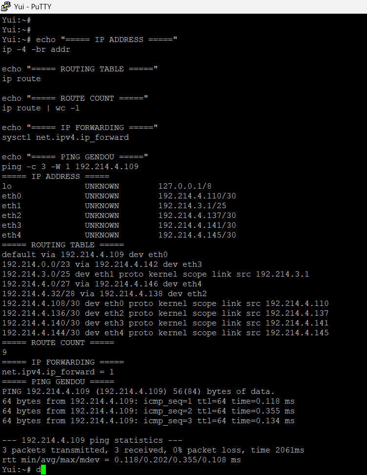

Hasil pengujian menunjukkan bahwa seluruh interface Yui kembali memiliki alamat IPv4 sesuai konfigurasi yang telah disimpan.

```text
eth0    UNKNOWN    192.214.4.110/30
eth1    UNKNOWN    192.214.3.1/25
eth2    UNKNOWN    192.214.4.137/30
eth3    UNKNOWN    192.214.4.141/30
eth4    UNKNOWN    192.214.4.145/30
```

Routing table yang terbentuk setelah restart adalah sebagai berikut:

```text
default via 192.214.4.109 dev eth0
192.214.0.0/23 via 192.214.4.142 dev eth3
192.214.3.0/25 dev eth1 proto kernel scope link src 192.214.3.1
192.214.4.0/27 via 192.214.4.146 dev eth4
192.214.4.32/28 via 192.214.4.138 dev eth2
192.214.4.108/30 dev eth0 proto kernel scope link src 192.214.4.110
192.214.4.136/30 dev eth2 proto kernel scope link src 192.214.4.137
192.214.4.140/30 dev eth3 proto kernel scope link src 192.214.4.141
192.214.4.144/30 dev eth4 proto kernel scope link src 192.214.4.145
```

Hasil pengujian membuktikan bahwa konfigurasi alamat IP, default route, static route, dan IP forwarding pada Yui dapat dipulihkan secara otomatis setelah restart.

##### 6.7.4 - Pengujian Setelah Restart Seluruh Topologi

Pengujian akhir dilakukan dengan menghentikan seluruh perangkat melalui opsi Stop All Nodes pada GNS3, kemudian menyalakannya kembali menggunakan opsi Start All Nodes.

Setelah seluruh perangkat aktif, tidak dilakukan konfigurasi IP, static routing, NAT, maupun firewall secara manual.

Verifikasi dilakukan dengan menjalankan kembali script audit konektivitas yang telah dijelaskan pada langkah 6.6 dari router Gendou.

Pengujian ini bertujuan memastikan bahwa mekanisme persistensi pada setiap router dan node non-router dapat berfungsi secara bersamaan setelah restart seluruh topologi.

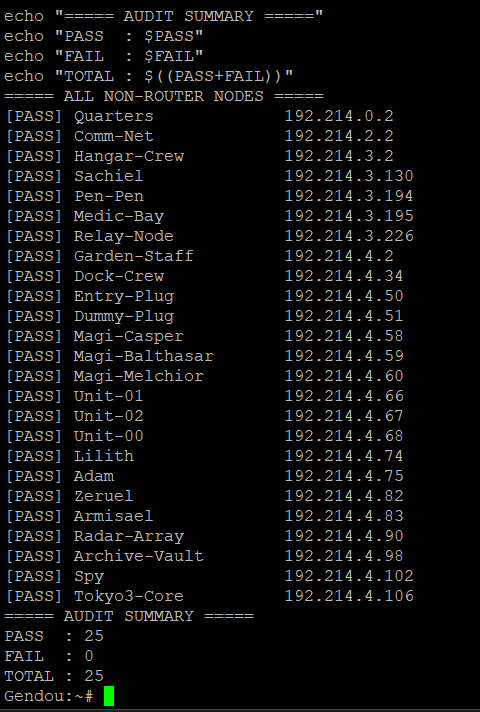

Target keberhasilan pengujian adalah sebagai berikut:

| Parameter | Target |
|---|---:|
| Jumlah router | 17 |
| Jumlah node non-router | 25 |
| Total perangkat dengan konfigurasi permanen | 42 |
| Node berhasil dijangkau | 25 |
| Node gagal dijangkau | 0 |
| Tingkat keberhasilan konektivitas | 100% |

Apabila seluruh node berhasil dijangkau tanpa konfigurasi ulang secara manual, mekanisme persistensi jaringan secara keseluruhan dapat dinyatakan berhasil.

### 7 - Membangunkan MAGI

> Casper, Balthasar, dan Melchior di Switch-Terminal menunggu diaktifkan. Ritsuko ingin ketiganya melayani dulu, urusan keamanan dibahas nanti. Pasang iptables dan netcat-traditional lewat /root/<nama>.sh, lalu nyalakan listener sesuai port di glosarium. Dari Lilith, kirim pesan ke ketiganya dan ke port 5001 Balthasar. Tampilkan pesan yang diterima di tiap node.

Soal meminta untuk mengaktifkan layanan TCP pada Magi-Casper, Magi-Balthasar, dan Magi-Melchior yang berada pada Switch-Terminal. Instalasi paket iptables dan netcat serta aktivasi listener dilakukan melalui script `/root/<nama>.sh` pada masing-masing node.

Pengujian dilakukan dengan mengirimkan pesan dari Lilith menuju ketiga node MAGI sesuai port yang ditentukan dalam glosarium, termasuk port TCP 5001 pada Balthasar. Keberhasilan konfigurasi dibuktikan dengan menampilkan pesan yang diterima pada setiap node.

#### 7.1 - Perencanaan Konfigurasi Layanan

MAGI System terdiri atas tiga node yang berada pada subnet Switch-Terminal dengan Network ID 192.214.4.56/29 dan Fuyutsuki sebagai router gateway.

Berikut merupakan konfigurasi pengalamatan dan layanan yang digunakan.

| Node | IP Address | Default Gateway | Port TCP | Script |
|---|---|---|---|---|
| Magi-Casper | 192.214.4.58/29 | 192.214.4.57 | 5000 | `/root/casper.sh` |
| Magi-Balthasar | 192.214.4.59/29 | 192.214.4.57 | 5000, 5001 | `/root/balthasar.sh` |
| Magi-Melchior | 192.214.4.60/29 | 192.214.4.57 | 5000 | `/root/melchior.sh` |
| Lilith | 192.214.4.74/29 | 192.214.4.73 | Client | - |

Terdapat empat TCP listener yang harus diaktifkan. Balthasar memiliki dua listener, sedangkan Casper dan Melchior masing-masing memiliki satu listener.

Pada tahap ini, belum diterapkan rule pembatasan akses pada ketiga node MAGI karena konfigurasi keamanan akan dilakukan pada soal selanjutnya.

#### 7.2 - Pemeriksaan Awal dan Pemilihan Paket

##### 7.2.1 - Penyesuaian Paket

Soal meminta penggunaan paket `iptables` dan `netcat-traditional`. Namun, sistem operasi yang digunakan pada node MAGI adalah Alpine Linux, sehingga digunakan package manager `apk` dengan paket `netcat-openbsd` sebagai alternatif fungsional dari `netcat-traditional`.

| Paket | Fungsi |
|---|---|
| iptables | Mengelola kebijakan firewall dan filtering paket jaringan |
| netcat-openbsd | Membuat TCP listener dan melakukan komunikasi TCP antar-node |

Instalasi paket dilakukan melalui script masing-masing node menggunakan command:

```bash
apk update
apk add iptables netcat-openbsd
```

Netcat varian OpenBSD mendukung parameter `-k` yang memungkinkan listener tetap aktif setelah suatu koneksi selesai. Fitur tersebut digunakan agar setiap node MAGI dapat menerima beberapa koneksi secara berurutan tanpa harus menjalankan ulang listener secara manual.

Executable netcat dipanggil menggunakan absolute path `/usr/bin/nc` untuk memastikan script menggunakan OpenBSD netcat, baik ketika dijalankan melalui terminal maupun secara otomatis saat startup.

#### 7.3 - Konfigurasi Layanan MAGI

##### 7.3.1 - Konfigurasi Magi-Casper

Magi-Casper dikonfigurasi untuk menerima koneksi TCP pada port 5000.

Seluruh proses instalasi paket, aktivasi listener, dan verifikasi layanan disimpan dalam script `/root/casper.sh`.

```bash
cat > /root/casper.sh <<'EOF'
#!/bin/sh
set -e

echo "===== INSTALLING PACKAGES ====="

if ! apk info -e iptables netcat-openbsd >/dev/null 2>&1; then
    apk update
    apk add iptables netcat-openbsd
fi

echo "===== STARTING CASPER SERVICE ====="

mkdir -p /root/magi-logs

PORT=5000
LOG="/root/magi-logs/5000.log"

if ss -lntH "sport = :$PORT" | grep -q .; then
    echo "TCP port $PORT is already listening"
else
    nohup /usr/bin/nc -4 -d -l -k "$PORT" >> "$LOG" 2>&1 </dev/null &
    echo "Listener started on TCP port $PORT"
fi

sleep 1

echo "===== INSTALLED PACKAGES ====="
apk info -e iptables
apk info -e netcat-openbsd

echo "===== FIREWALL ====="
iptables -S

echo "===== LISTENING PORTS ====="
ss -lntp

echo "===== CASPER CONFIGURATION COMPLETE ====="
EOF

chmod +x /root/casper.sh
/root/casper.sh
```

Listener dijalankan sebagai background process menggunakan `nohup` sehingga tetap aktif ketika sesi console ditutup.

Seluruh pesan yang diterima melalui TCP port 5000 disimpan pada file:

```text
/root/magi-logs/5000.log
```

##### 7.3.2 - Konfigurasi Magi-Balthasar

Magi-Balthasar dikonfigurasi untuk menerima koneksi TCP pada dua port, yaitu 5000 dan 5001.

Kedua listener dijalankan secara bersamaan dengan file log terpisah agar pesan yang diterima pada masing-masing port dapat diidentifikasi secara independen.

```bash
cat > /root/balthasar.sh <<'EOF'
#!/bin/sh
set -e

echo "===== INSTALLING PACKAGES ====="

if ! apk info -e iptables >/dev/null 2>&1 || \
   ! apk info -e netcat-openbsd >/dev/null 2>&1; then
    apk update
    apk add iptables netcat-openbsd
fi

mkdir -p /root/magi-logs

echo "===== STARTING BALTHASAR SERVICES ====="

for PORT in 5000 5001; do
    LOG="/root/magi-logs/$PORT.log"

    if ss -lntH "sport = :$PORT" | grep -q .; then
        echo "TCP port $PORT is already listening"
    else
        nohup /usr/bin/nc -4 -d -l -k "$PORT" >> "$LOG" 2>&1 </dev/null &
        echo "Listener started on TCP port $PORT"
    fi
done

sleep 1

echo "===== FIREWALL ====="
iptables -S

echo "===== LISTENING PORTS ====="
ss -lntp

echo "===== BALTHASAR CONFIGURATION COMPLETE ====="
EOF

chmod +x /root/balthasar.sh
/root/balthasar.sh
```

Perulangan `for` digunakan untuk mengaktifkan kedua listener tanpa menduplikasi blok konfigurasi.

Penyimpanan pesan dibedakan berdasarkan port tujuan.

| Port TCP | File Log |
|---|---|
| 5000 | `/root/magi-logs/5000.log` |
| 5001 | `/root/magi-logs/5001.log` |

##### 7.3.3 - Konfigurasi Magi-Melchior

Magi-Melchior dikonfigurasi untuk menerima koneksi TCP pada port 5000 menggunakan mekanisme yang sama dengan Casper.

```bash
cat > /root/melchior.sh <<'EOF'
#!/bin/sh
set -e

echo "===== INSTALLING PACKAGES ====="

if ! apk info -e iptables >/dev/null 2>&1 || \
   ! apk info -e netcat-openbsd >/dev/null 2>&1; then
    apk update
    apk add iptables netcat-openbsd
fi

mkdir -p /root/magi-logs

echo "===== STARTING MELCHIOR SERVICE ====="

PORT=5000
LOG="/root/magi-logs/$PORT.log"

if ss -lntH "sport = :$PORT" | grep -q .; then
    echo "TCP port $PORT is already listening"
else
    nohup /usr/bin/nc -4 -d -l -k "$PORT" >> "$LOG" 2>&1 </dev/null &
    echo "Listener started on TCP port $PORT"
fi

sleep 1

echo "===== FIREWALL ====="
iptables -S

echo "===== LISTENING PORTS ====="
ss -lntp

echo "===== MELCHIOR CONFIGURATION COMPLETE ====="
EOF

chmod +x /root/melchior.sh
/root/melchior.sh
```

Seluruh pesan yang diterima oleh Melchior disimpan pada file `/root/magi-logs/5000.log`.

##### 7.3.4 - Penjelasan Konfigurasi Listener

Ketiga script menggunakan mekanisme aktivasi listener yang sama, yaitu:

```bash
nohup /usr/bin/nc -4 -d -l -k "$PORT" >> "$LOG" 2>&1 </dev/null &
```

| Parameter | Fungsi |
|---|---|
| `nohup` | Mempertahankan proses ketika sesi terminal ditutup |
| `/usr/bin/nc` | Menjalankan executable OpenBSD netcat secara eksplisit |
| `-4` | Menggunakan protokol IPv4 |
| `-d` | Menonaktifkan pembacaan standard input |
| `-l` | Menjalankan netcat dalam mode listener |
| `-k` | Mempertahankan listener untuk menerima koneksi berikutnya |
| `$PORT` | Menentukan port TCP yang digunakan |
| `>> "$LOG"` | Menambahkan pesan yang diterima ke file log |
| `2>&1` | Mengarahkan standard error ke file log yang sama |
| `</dev/null` | Memisahkan standard input dari terminal |
| `&` | Menjalankan listener sebagai background process |

Sebelum listener dijalankan, script melakukan pemeriksaan menggunakan:

```bash
ss -lntH "sport = :$PORT"
```

Pemeriksaan tersebut bertujuan menghindari aktivasi listener ganda pada port yang sudah digunakan.

Penggunaan background process dan file log memungkinkan pengujian dilakukan tanpa membuka console pengirim dan penerima secara bersamaan.

#### 7.4 - Pemeriksaan Kebijakan Firewall

Paket iptables telah tersedia pada ketiga node MAGI, tetapi belum diterapkan rule pembatasan akses pada tahap ini.

Pemeriksaan kebijakan firewall dilakukan menggunakan:

```bash
iptables -S
```

Kebijakan dasar firewall yang digunakan adalah:

```text
-P INPUT ACCEPT
-P FORWARD ACCEPT
-P OUTPUT ACCEPT
```

| Chain | Default Policy | Keterangan |
|---|---|---|
| INPUT | ACCEPT | Mengizinkan traffic masuk |
| FORWARD | ACCEPT | Mengizinkan traffic yang diteruskan |
| OUTPUT | ACCEPT | Mengizinkan traffic keluar |

Kebijakan tersebut dipertahankan agar layanan MAGI dapat diuji terlebih dahulu tanpa pembatasan akses tambahan.

Konfigurasi keamanan dan pembatasan komunikasi terhadap layanan MAGI akan diterapkan pada soal berikutnya.

#### 7.5 - Pengujian Komunikasi dari Lilith

##### 7.5.1 - Persiapan Node Pengirim

Lilith digunakan sebagai client untuk menguji seluruh layanan TCP pada ketiga node MAGI.

Paket netcat dipastikan tersedia menggunakan command berikut:

```bash
if ! apk info -e netcat-openbsd >/dev/null 2>&1; then
    apk add --no-cache netcat-openbsd
fi

nc -h 2>&1 | head -n 5
```

Lilith memiliki alamat IP 192.214.4.74/29 dan default gateway 192.214.4.73 melalui router Toji.

Jalur komunikasi menuju MAGI System adalah:

```text
Lilith
  |
Switch-Dogma
  |
Toji
  |
Fuyutsuki
  |
Switch-Terminal
  |
  +-- Magi-Casper
  +-- Magi-Balthasar
  +-- Magi-Melchior
```

Komunikasi tersebut tidak perlu melewati Gendou karena Switch-Dogma dan Switch-Terminal berada dalam cabang jaringan Fuyutsuki.

##### 7.5.2 - Pengujian Konektivitas TCP

Sebelum mengirim pesan, dilakukan pengujian terhadap seluruh port TCP menggunakan parameter `-zv`.

```bash
echo "===== CASPER TCP 5000 ====="
nc -4 -zv -w 3 192.214.4.58 5000

echo "===== BALTHASAR TCP 5000 ====="
nc -4 -zv -w 3 192.214.4.59 5000

echo "===== BALTHASAR TCP 5001 ====="
nc -4 -zv -w 3 192.214.4.59 5001

echo "===== MELCHIOR TCP 5000 ====="
nc -4 -zv -w 3 192.214.4.60 5000
```

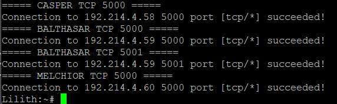

Seluruh pengujian koneksi TCP berhasil, menunjukkan bahwa keempat listener dapat diakses dari Lilith.

##### 7.5.3 - Pengiriman Pesan

Setelah konektivitas TCP berhasil diverifikasi, dilakukan pengiriman pesan yang berbeda menuju masing-masing layanan.

```bash
echo "===== SENDING TO CASPER ====="
printf 'Hello Casper, this is Lilith\n' | nc -4 -N -w 3 192.214.4.58 5000

echo "===== SENDING TO BALTHASAR PORT 5000 ====="
printf 'Hello Balthasar, this is Lilith\n' | nc -4 -N -w 3 192.214.4.59 5000

echo "===== SENDING TO BALTHASAR PORT 5001 ====="
printf 'Lilith testing Balthasar port 5001\n' | nc -4 -N -w 3 192.214.4.59 5001

echo "===== SENDING TO MELCHIOR ====="
printf 'Hello Melchior, this is Lilith\n' | nc -4 -N -w 3 192.214.4.60 5000
```

Tidak adanya output pesan pada sisi pengirim merupakan kondisi yang sesuai dengan konfigurasi layanan karena listener hanya menerima dan menyimpan pesan tanpa mengirimkan respons.

#### 7.6 - Verifikasi Penerimaan Pesan

Verifikasi dilakukan dengan memeriksa status listener dan isi file log pada masing-masing node MAGI.

##### 7.6.1 - Magi-Casper

```bash
hostname

ss -lntp | grep ':5000'

cat /root/magi-logs/5000.log
```

Hasil pengujian:

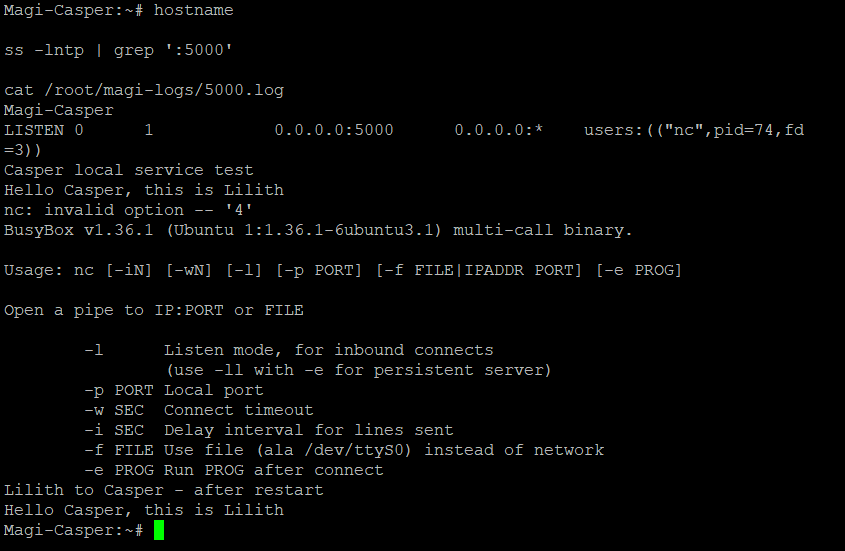

Magi-Casper berhasil menerima pesan dari Lilith melalui TCP port 5000.

##### 7.6.2 - Magi-Balthasar

```bash
hostname

ss -lntp | grep -E ':5000|:5001'

echo "===== RECEIVED MESSAGE PORT 5000 ====="
cat /root/magi-logs/5000.log

echo "===== RECEIVED MESSAGE PORT 5001 ====="
cat /root/magi-logs/5001.log
```

Hasil pengujian:

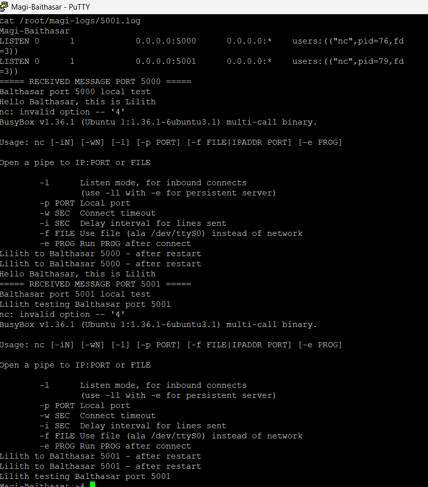

Magi-Balthasar berhasil menerima dua pesan yang berbeda melalui TCP port 5000 dan 5001. Kedua pesan tersimpan pada file log yang sesuai dengan port tujuan.

##### 7.6.3 - Magi-Melchior

```bash
hostname

ss -lntp | grep ':5000'

cat /root/magi-logs/5000.log
```

Hasil pengujian:

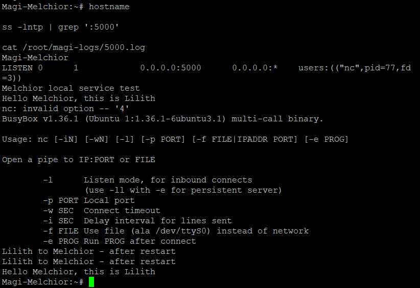

Magi-Melchior berhasil menerima pesan dari Lilith melalui TCP port 5000.

#### 7.7 - Persistensi Layanan MAGI

Selain menyimpan konfigurasi layanan dalam script, diperlukan mekanisme startup otomatis agar seluruh listener dapat kembali aktif setelah node direstart.

Mekanisme ini merupakan pengembangan tambahan untuk mempertahankan layanan MAGI ketika topologi dinyalakan kembali.

##### 7.7.1 - Konfigurasi Startup Otomatis

Startup otomatis diterapkan menggunakan parameter `post-up` pada file `/etc/network/interfaces`, sebagaimana mekanisme persistensi yang telah digunakan pada Gendou.

Parameter tersebut menjalankan script konfigurasi layanan setelah interface jaringan memperoleh alamat IP statis.

Konfigurasi akhir pada masing-masing node adalah sebagai berikut.

**Magi-Casper**

```text
auto lo
iface lo inet loopback

auto eth0
iface eth0 inet static
    address 192.214.4.58
    netmask 255.255.255.248
    gateway 192.214.4.57
    up printf 'nameserver 8.8.8.8\nnameserver 1.1.1.1\n' > /etc/resolv.conf
    post-up /bin/sh /root/casper.sh > /root/casper-startup.log 2>&1
```

**Magi-Balthasar**

```text
auto lo
iface lo inet loopback

auto eth0
iface eth0 inet static
    address 192.214.4.59
    netmask 255.255.255.248
    gateway 192.214.4.57
    up printf 'nameserver 8.8.8.8\nnameserver 1.1.1.1\n' > /etc/resolv.conf
    post-up /bin/sh /root/balthasar.sh > /root/balthasar-startup.log 2>&1
```

**Magi-Melchior**

```text
auto lo
iface lo inet loopback

auto eth0
iface eth0 inet static
    address 192.214.4.60
    netmask 255.255.255.248
    gateway 192.214.4.57
    up printf 'nameserver 8.8.8.8\nnameserver 1.1.1.1\n' > /etc/resolv.conf
    post-up /bin/sh /root/melchior.sh > /root/melchior-startup.log 2>&1
```

Seluruh script dan file log disimpan pada direktori `/root`, sedangkan konfigurasi jaringan disimpan pada `/etc/network`. Kedua direktori menggunakan persistent volume GNS3.

##### 7.7.2 - Kompatibilitas Environment Startup

Untuk memastikan listener menggunakan implementasi netcat yang sesuai, executable dipanggil menggunakan absolute path:

```bash
/usr/bin/nc
```

Pemanggilan executable secara eksplisit memastikan OpenBSD netcat digunakan tanpa bergantung pada urutan pencarian executable melalui environment variable `PATH`.

Hal ini penting karena environment startup dan terminal interaktif dapat menggunakan implementasi executable yang berbeda.

Penggunaan absolute path diterapkan pada seluruh script layanan MAGI.

##### 7.7.3 - Mekanisme Pemulihan Layanan

Ketika node MAGI dinyalakan kembali, mekanisme startup berjalan melalui urutan berikut:

1. Konfigurasi IP statis diterapkan melalui `/etc/network/interfaces`.
2. Default gateway dan DNS dikonfigurasi.
3. Parameter `post-up` menjalankan script layanan masing-masing node.
4. Script memeriksa ketersediaan paket iptables dan netcat-openbsd.
5. Paket yang belum tersedia diinstal melalui package manager `apk`.
6. Script memeriksa port TCP yang telah digunakan.
7. Listener diaktifkan menggunakan OpenBSD netcat.
8. Pesan yang diterima disimpan pada file log berdasarkan port.
9. Hasil startup dicatat pada file startup log masing-masing node.

| Node | Startup Script | Startup Log |
|---|---|---|
| Magi-Casper | `/root/casper.sh` | `/root/casper-startup.log` |
| Magi-Balthasar | `/root/balthasar.sh` | `/root/balthasar-startup.log` |
| Magi-Melchior | `/root/melchior.sh` | `/root/melchior-startup.log` |

#### 7.8 - Pengujian Setelah Restart

Pengujian persistensi dilakukan dengan menghentikan dan menyalakan kembali ketiga node MAGI melalui GNS3 tanpa menjalankan script layanan secara manual.

##### 7.8.1 - Pengiriman Pesan Setelah Restart

Untuk membedakan pesan pengujian sebelum dan sesudah restart, Lilith mengirimkan empat pesan baru menggunakan command berikut:

```bash
printf 'Lilith to Casper - after restart\n' | nc -4 -N -w 3 192.214.4.58 5000

printf 'Lilith to Balthasar 5000 - after restart\n' | nc -4 -N -w 3 192.214.4.59 5000

printf 'Lilith to Balthasar 5001 - after restart\n' | nc -4 -N -w 3 192.214.4.59 5001

printf 'Lilith to Melchior - after restart\n' | nc -4 -N -w 3 192.214.4.60 5000
```

##### 7.8.2 - Verifikasi Magi-Casper

```bash
hostname

echo "===== STARTUP STATUS ====="
tail -n 1 /root/casper-startup.log

echo "===== ACTIVE LISTENER ====="
ss -lntp | grep ':5000'

echo "===== RECEIVED MESSAGE ====="
grep -F 'after restart' /root/magi-logs/5000.log
```

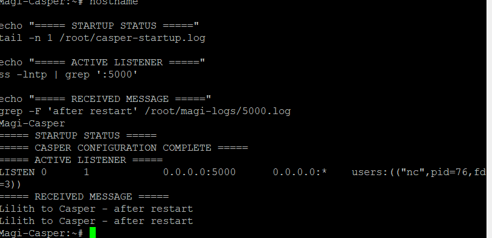

##### 7.8.3 - Verifikasi Magi-Balthasar

```bash
hostname

echo "===== STARTUP STATUS ====="
tail -n 1 /root/balthasar-startup.log

echo "===== ACTIVE LISTENERS ====="
ss -lntp | grep -E ':5000|:5001'

echo "===== RECEIVED MESSAGE PORT 5000 ====="
grep -F 'after restart' /root/magi-logs/5000.log

echo "===== RECEIVED MESSAGE PORT 5001 ====="
grep -F 'after restart' /root/magi-logs/5001.log
```

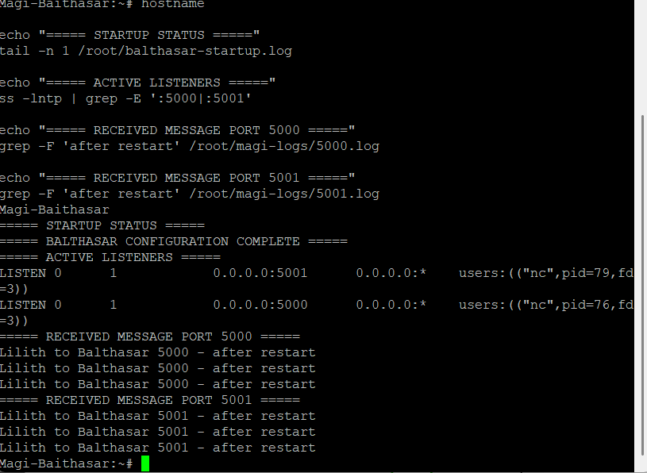

##### 7.8.4 - Verifikasi Magi-Melchior

```bash
hostname

echo "===== STARTUP STATUS ====="
tail -n 1 /root/melchior-startup.log

echo "===== ACTIVE LISTENER ====="
ss -lntp | grep ':5000'

echo "===== RECEIVED MESSAGE ====="
grep -F 'after restart' /root/magi-logs/5000.log
```

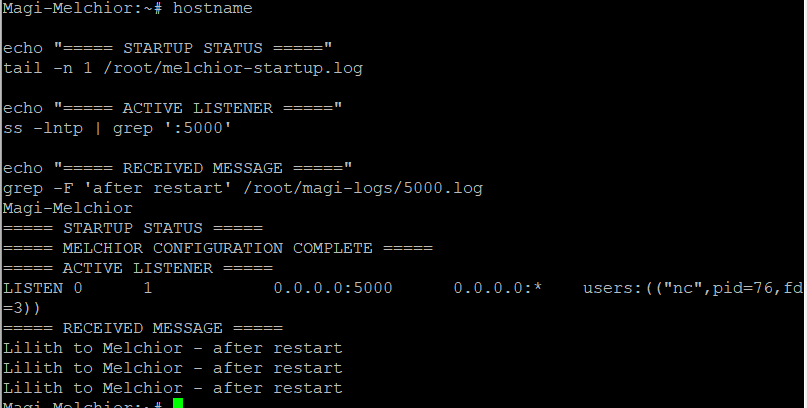

##### 7.8.5 - Hasil Pengujian Persistensi

Berdasarkan verifikasi akhir, seluruh layanan MAGI berhasil diaktifkan kembali setelah restart dan dapat menerima pesan dari Lilith tanpa menjalankan script konfigurasi secara manual.

| Node | Port TCP | Startup Otomatis | Listener Aktif | Penerimaan Pesan |
|---|---:|---|---|---|
| Magi-Casper | 5000 | Berhasil | Berhasil | Berhasil |
| Magi-Balthasar | 5000 | Berhasil | Berhasil | Berhasil |
| Magi-Balthasar | 5001 | Berhasil | Berhasil | Berhasil |
| Magi-Melchior | 5000 | Berhasil | Berhasil | Berhasil |

Pengujian tersebut menunjukkan bahwa konfigurasi layanan tidak hanya berhasil saat dijalankan secara manual, tetapi juga dapat dipulihkan melalui mekanisme startup otomatis.

### 8 - Mengenali Kondisi Normal

> Pen-Pen dan Tokyo3-Core sudah ditandai sebagai calon sasaran pertama SEELE. Sebelum dilindungi, keduanya harus melayani dulu agar kamu tahu kondisi normalnya. Koneksi ke port 80 dijawab Welcome to {hostname}. Koneksi ke port 8080 di Tokyo3-Core dijawab syifa imutz. Tunjukkan nc dari Lilith ke ketiga port itu. Tunjukkan juga bahwa port yang tidak dilayani, misalnya 22, langsung gagal, bukan menggantung.

Soal meminta untuk mengaktifkan layanan TCP pada Pen-Pen dan Tokyo3-Core sebagai kondisi awal sebelum penerapan kebijakan keamanan jaringan.

Setiap koneksi menuju TCP port 80 harus mendapatkan respons `Welcome to {hostname}`, sedangkan koneksi menuju TCP port 8080 pada Tokyo3-Core harus mendapatkan respons `syifa imutz`.

Pengujian dilakukan menggunakan netcat dari Lilith menuju ketiga layanan tersebut. Selain itu, dilakukan pengujian terhadap port yang tidak memiliki listener, yaitu TCP port 22, untuk membuktikan bahwa koneksi langsung ditolak tanpa mengalami timeout.

#### 8.1 - Perencanaan Konfigurasi Layanan

Pen-Pen berada pada Switch-Medic dengan Maya sebagai router gateway, sedangkan Tokyo3-Core berada pada Switch-Cmd yang terhubung langsung dengan Gendou.

Berikut merupakan konfigurasi pengalamatan dan layanan yang digunakan.

| Node | IP Address | Default Gateway | Port TCP | Respons |
|---|---|---|---:|---|
| Pen-Pen | 192.214.3.194/27 | 192.214.3.193 | 80 | Welcome to Pen-Pen |
| Tokyo3-Core | 192.214.4.106/30 | 192.214.4.105 | 80 | Welcome to Tokyo3-Core |
| Tokyo3-Core | 192.214.4.106/30 | 192.214.4.105 | 8080 | syifa imutz |
| Lilith | 192.214.4.74/29 | 192.214.4.73 | Client | - |

Terdapat tiga TCP listener yang perlu diaktifkan. TCP port 22 pada kedua node tidak diaktifkan karena digunakan sebagai pembanding untuk menguji perilaku koneksi menuju port tertutup.

#### 8.2 - Konfigurasi Layanan Pen-Pen

##### 8.2.1 - Pembuatan Script penpen.sh

Pen-Pen dikonfigurasi untuk menerima koneksi pada TCP port 80 dan memberikan respons berupa pesan `Welcome to Pen-Pen`.

Seluruh konfigurasi layanan disimpan pada script `/root/penpen.sh`.

```bash
cat > /root/penpen.sh <<'EOF'
#!/bin/sh
set -e

export PATH=/usr/sbin:/usr/bin:/sbin:/bin

echo "===== INSTALLING PACKAGES ====="

if ! apk info -e iptables >/dev/null 2>&1 || \
   ! apk info -e netcat-openbsd >/dev/null 2>&1; then
    apk add --no-cache iptables netcat-openbsd
fi

echo "===== STARTING PEN-PEN SERVICE ====="

mkdir -p /root/service-logs

PORT=80
MESSAGE="Welcome to $(hostname)"

if ss -lntH "sport = :$PORT" | grep -q .; then
    echo "TCP port $PORT is already listening"
else
    nohup /bin/sh -c '
        while true; do
            printf "%s\n" "$2" | /usr/bin/nc -4 -N -l "$1"
            sleep 0.1
        done
    ' listener "$PORT" "$MESSAGE" \
        >> /root/service-logs/80.log 2>&1 </dev/null &
fi

sleep 1

echo "===== VERIFYING LISTENER ====="

if ! ss -lntH "sport = :$PORT" | grep -q .; then
    echo "ERROR: TCP port $PORT is not listening"
    exit 1
fi

ss -lntp

echo "===== PEN-PEN CONFIGURATION COMPLETE ====="
EOF

chmod +x /root/penpen.sh
/root/penpen.sh
```

Script tersebut memeriksa ketersediaan paket iptables dan netcat-openbsd sebelum mengaktifkan layanan. Apabila paket belum tersedia, instalasi dilakukan melalui package manager `apk`.

Pesan respons dibentuk menggunakan:

```bash
MESSAGE="Welcome to $(hostname)"
```

Listener dijalankan sebagai background process sehingga layanan tetap tersedia ketika sesi console ditutup.

##### 8.2.2 - Verifikasi Layanan Pen-Pen

Pemeriksaan listener dilakukan menggunakan:

```bash
ss -lntp | grep ':80 '
```

Selanjutnya, dilakukan pengujian terhadap lima koneksi lokal secara berurutan.

```bash
for i in 1 2 3 4 5; do
    echo "===== CONNECTION $i ====="

    /usr/bin/nc -4 -N -w 3 127.0.0.1 80 </dev/null
    echo "Exit code: $?"

    sleep 1
done
```

Jeda satu detik diberikan agar listener berikutnya siap menerima koneksi setelah koneksi sebelumnya selesai.

Pengujian port tertutup dilakukan menggunakan:

```bash
time /usr/bin/nc -4 -zv -w 3 127.0.0.1 22
echo "Exit code: $?"
```

Hasil pengujian lokal Pen-Pen adalah sebagai berikut:

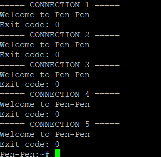

Hasil tersebut menunjukkan bahwa Pen-Pen dapat memberikan pesan respons secara konsisten pada koneksi berurutan dengan jeda pengujian yang ditentukan.

#### 8.3 - Konfigurasi Layanan Tokyo3-Core

##### 8.3.1 - Pembuatan Script tokyo3-core.sh

Tokyo3-Core dikonfigurasi untuk menjalankan dua TCP listener secara bersamaan dengan respons yang berbeda.

TCP port 80 memberikan pesan berdasarkan hostname perangkat, sedangkan TCP port 8080 memberikan pesan khusus `syifa imutz`.

Seluruh konfigurasi disimpan pada script `/root/tokyo3-core.sh`.

```bash
cat > /root/tokyo3-core.sh <<'EOF'
#!/bin/sh
set -e

export PATH=/usr/sbin:/usr/bin:/sbin:/bin

echo "===== INSTALLING PACKAGES ====="

if ! apk info -e iptables >/dev/null 2>&1 || \
   ! apk info -e netcat-openbsd >/dev/null 2>&1; then
    apk add --no-cache iptables netcat-openbsd
fi

mkdir -p /root/service-logs

start_listener() {
    PORT="$1"
    MESSAGE="$2"

    if ss -lntH "sport = :$PORT" | grep -q .; then
        echo "TCP port $PORT is already listening"
        return
    fi

    nohup /bin/sh -c '
        while true; do
            printf "%s\n" "$2" | /usr/bin/nc -4 -N -l "$1"
            sleep 0.1
        done
    ' listener "$PORT" "$MESSAGE" \
        >> "/root/service-logs/$PORT.log" 2>&1 </dev/null &
}

echo "===== STARTING TOKYO3-CORE SERVICES ====="

start_listener 80 "Welcome to $(hostname)"
start_listener 8080 "syifa imutz"

sleep 1

echo "===== VERIFYING LISTENERS ====="

for PORT in 80 8080; do
    if ! ss -lntH "sport = :$PORT" | grep -q .; then
        echo "ERROR: TCP port $PORT is not listening"
        exit 1
    fi
done

ss -lntp

echo "===== TOKYO3-CORE CONFIGURATION COMPLETE ====="
EOF

chmod +x /root/tokyo3-core.sh
/root/tokyo3-core.sh
```

Fungsi `start_listener()` digunakan untuk mengaktifkan listener berdasarkan parameter port dan pesan respons tanpa menduplikasi blok konfigurasi.

Pemanggilan fungsi dilakukan sebanyak dua kali:

```bash
start_listener 80 "Welcome to $(hostname)"
start_listener 8080 "syifa imutz"
```

Kedua layanan menggunakan background process yang berbeda sehingga dapat beroperasi secara bersamaan.

Script juga melakukan pemeriksaan terhadap kedua port sebelum menampilkan status `CONFIGURATION COMPLETE`. Apabila salah satu listener tidak aktif, script akan menampilkan pesan error.

##### 8.3.2 - Verifikasi Layanan Tokyo3-Core

Pemeriksaan listener dilakukan menggunakan:

```bash
ss -lntp | grep -E ':80 |:8080 '
```

Selanjutnya, dilakukan pengujian terhadap masing-masing layanan sebanyak tiga kali.

```bash
for PORT in 80 8080; do
    for i in 1 2 3; do
        echo "===== PORT $PORT - TEST $i ====="

        /usr/bin/nc -4 -N -w 3 127.0.0.1 "$PORT" </dev/null
        echo "Exit code: $?"

        sleep 1
    done
done
```

Pengujian terhadap port yang tidak memiliki listener dilakukan menggunakan:

```bash
time /usr/bin/nc -4 -zv -w 3 127.0.0.1 22
echo "Exit code: $?"
```

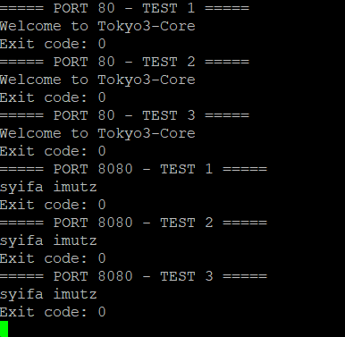

Seluruh enam koneksi menuju layanan aktif berhasil mendapatkan respons yang sesuai, sedangkan koneksi menuju port 22 langsung ditolak.

#### 8.4 - Mekanisme Kerja TCP Listener

Berbeda dengan listener pada soal 7 yang hanya menerima dan menyimpan pesan, listener pada soal 8 memberikan pesan respons kepada client.

Mekanisme yang digunakan pada kedua node adalah:

```bash
while true; do
    printf "%s\n" "$MESSAGE" | /usr/bin/nc -4 -N -l "$PORT"
    sleep 0.1
done
```

Perulangan digunakan agar pesan respons dapat dibentuk kembali untuk setiap koneksi baru.

Layanan tersebut merupakan simulasi layanan TCP berbasis teks menggunakan netcat, bukan implementasi web server HTTP yang lengkap, meskipun menggunakan port 80 dan 8080.

Mekanisme listener ini dirancang untuk menerima koneksi secara berurutan. Terdapat jeda singkat ketika listener diaktifkan kembali sehingga konfigurasi ini belum ditujukan untuk menangani banyak koneksi simultan.

#### 8.5 - Persistensi Layanan

Agar layanan dapat kembali aktif setelah node direstart, konfigurasi startup otomatis diterapkan menggunakan parameter `post-up` pada file `/etc/network/interfaces`.

Mekanisme ini mengikuti metode persistensi yang telah digunakan pada soal sebelumnya.

##### 8.5.1 - Persistensi Pen-Pen

Konfigurasi akhir `/etc/network/interfaces` pada Pen-Pen adalah sebagai berikut:

```text
auto lo
iface lo inet loopback

auto eth0
iface eth0 inet static
    address 192.214.3.194
    netmask 255.255.255.224
    gateway 192.214.3.193
    up printf 'nameserver 8.8.8.8\nnameserver 1.1.1.1\n' > /etc/resolv.conf
    post-up /bin/sh /root/penpen.sh > /root/penpen-startup.log 2>&1
```

Parameter `post-up` menjalankan script `/root/penpen.sh` setelah konfigurasi interface eth0 diterapkan.

Seluruh output startup disimpan pada file:

```text
/root/penpen-startup.log
```

##### 8.5.2 - Persistensi Tokyo3-Core

Konfigurasi akhir `/etc/network/interfaces` pada Tokyo3-Core adalah sebagai berikut:

```text
auto lo
iface lo inet loopback

auto eth0
iface eth0 inet static
    address 192.214.4.106
    netmask 255.255.255.252
    gateway 192.214.4.105
    up printf 'nameserver 8.8.8.8\nnameserver 1.1.1.1\n' > /etc/resolv.conf
    post-up /bin/sh /root/tokyo3-core.sh > /root/tokyo3-core-startup.log 2>&1
```

Parameter `post-up` menjalankan script konfigurasi Tokyo3-Core secara otomatis dan menyimpan hasil startup pada file:

```text
/root/tokyo3-core-startup.log
```

Dengan mekanisme tersebut, seluruh layanan akan diaktifkan kembali setelah konfigurasi IP statis diterapkan.

##### 8.5.3 - Verifikasi Persistensi Setelah Restart

Pengujian dilakukan dengan menghentikan dan menyalakan kembali Pen-Pen dan Tokyo3-Core melalui GNS3 tanpa menjalankan script layanan secara manual.

Verifikasi pada Pen-Pen dilakukan menggunakan:

```bash
tail -n 1 /root/penpen-startup.log
ip -4 -br addr
ss -lntp | grep ':80 '
```

Verifikasi pada Tokyo3-Core dilakukan menggunakan:

```bash
tail -n 1 /root/tokyo3-core-startup.log
ip -4 -br addr
ss -lntp | grep -E ':80 |:8080 '
```

Hasil aktual pengujian setelah restart adalah sebagai berikut:

| Parameter | Pen-Pen | Tokyo3-Core |
|---|---|---|
| Startup status | CONFIGURATION COMPLETE | CONFIGURATION COMPLETE |
| IP Address | 192.214.3.194/27 | 192.214.4.106/30 |
| TCP port 80 | LISTEN | LISTEN |
| TCP port 8080 | - | LISTEN |
| PID listener TCP 80 | 75 | 78 |
| PID listener TCP 8080 | - | 82 |
| Startup otomatis | Berhasil | Berhasil |

Hasil tersebut menunjukkan bahwa seluruh tiga listener berhasil diaktifkan kembali secara otomatis setelah restart.

#### 8.6 - Pengujian Akhir dari Lilith

Pengujian akhir dilakukan setelah Pen-Pen dan Tokyo3-Core direstart. Hal ini bertujuan membuktikan keberhasilan layanan sekaligus memastikan mekanisme persistensi dapat berfungsi.

Lilith menggunakan alamat IP 192.214.4.74/29 dengan Toji sebagai default gateway.

##### 8.6.1 - Pengujian Layanan Aktif dan Port Tertutup

Seluruh pengujian dilakukan menggunakan OpenBSD netcat dari Lilith.

```bash
echo "===== PEN-PEN TCP 80 ====="
/usr/bin/nc -4 -N -w 3 192.214.3.194 80 </dev/null
echo "Exit code: $?"

echo
echo "===== TOKYO3-CORE TCP 80 ====="
/usr/bin/nc -4 -N -w 3 192.214.4.106 80 </dev/null
echo "Exit code: $?"

echo
echo "===== TOKYO3-CORE TCP 8080 ====="
/usr/bin/nc -4 -N -w 3 192.214.4.106 8080 </dev/null
echo "Exit code: $?"

echo
echo "===== PEN-PEN CLOSED TCP 22 ====="
time /usr/bin/nc -4 -zv -w 3 192.214.3.194 22
echo "Exit code: $?"

echo
echo "===== TOKYO3-CORE CLOSED TCP 22 ====="
time /usr/bin/nc -4 -zv -w 3 192.214.4.106 22
echo "Exit code: $?"
```

##### 8.6.2 - Hasil Pengujian

Hasil aktual pengujian dari Lilith setelah kedua node direstart adalah sebagai berikut:

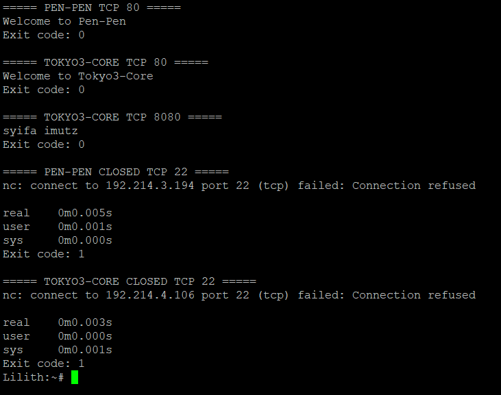

Seluruh layanan aktif memberikan respons sesuai ketentuan soal. Koneksi menuju port yang tidak dilayani juga langsung ditolak.

#### 8.7 - Analisis Perilaku Port Terbuka dan Port Tertutup

##### 8.7.1 - Port Terbuka

Ketika Lilith melakukan koneksi menuju port yang memiliki listener, TCP stack pada node tujuan menerima permintaan koneksi dan menjalankan proses TCP three-way handshake.

Alur komunikasi secara sederhana adalah sebagai berikut:

```text
Lilith                         Server
  |                               |
  |------------ SYN ------------->|
  |<--------- SYN-ACK ------------|
  |------------ ACK ------------->|
  |                               |
  |<-------- Response ------------|
  |                               |
  |------ Connection Close -------|
```

Setelah koneksi terbentuk, netcat pada server mengirimkan pesan respons yang telah ditentukan.

Ketiga layanan aktif menghasilkan exit code 0, menunjukkan bahwa koneksi dan pengujian netcat berhasil diselesaikan.

##### 8.7.2 - Port Tertutup

Pada TCP port 22, tidak terdapat proses yang mendengarkan koneksi. Dalam kondisi normal tanpa filtering yang membuang paket, TCP stack pada node tujuan memberikan respons RST untuk menolak permintaan koneksi.

Alur komunikasi secara sederhana adalah sebagai berikut:

```text
Lilith                         Server
  |                               |
  |------------ SYN ------------->|
  |<--------- RST-ACK ------------|
  |                               |
  | Connection refused            |
```

Hasil pengujian durasi penolakan port 22 adalah sebagai berikut:

| Node | Timeout Pengujian | Durasi Aktual | Respons |
|---|---:|---:|---|
| Pen-Pen | 3 detik | 0.005 detik | Connection refused |
| Tokyo3-Core | 3 detik | 0.003 detik | Connection refused |

Pen-Pen menolak koneksi dalam waktu 5 ms, sedangkan Tokyo3-Core menolak koneksi dalam waktu 3 ms berdasarkan durasi eksekusi netcat.

Kedua durasi tersebut jauh lebih singkat dibandingkan batas timeout tiga detik. Hal ini menunjukkan bahwa koneksi langsung ditolak dan tidak menggantung.

Perilaku RST tersebut merupakan mekanisme TCP yang sesuai dengan hasil Connection refused. Pada pengujian ini tidak dilakukan packet capture untuk mengamati flag TCP secara langsung.

##### 8.7.3 - Perbandingan Kondisi Port

| Kondisi | Perilaku TCP | Hasil pada Client |
|---|---|---|
| Port terbuka | Permintaan koneksi diterima melalui TCP handshake | Connection established |
| Port tertutup | Permintaan koneksi ditolak melalui TCP RST | Connection refused |
| Paket dibuang oleh firewall DROP | Tidak memperoleh respons dari paket yang dibuang | Connection timeout |
| Firewall REJECT dengan TCP reset | Permintaan koneksi ditolak secara eksplisit | Connection refused |

Kondisi normal yang diperoleh pada soal ini digunakan sebagai baseline sebelum kebijakan keamanan diterapkan.

Dengan adanya baseline tersebut, perubahan perilaku koneksi akibat penerapan firewall pada soal berikutnya dapat dibedakan dari kondisi ketika suatu port memang tidak memiliki layanan.

### 9 - Jalur Belakang Diutak-atik

> Tengah malam masuk laporan bahwa ada yang mengutak-atik jalur belakang di sekitar Shigeru. Lilith tidak mendapat jawaban dari Armisael, padahal Armisael masih bisa ping gateway-nya sendiri. Jalankan break_routing.sh di Shigeru. Buktikan Lilith bisa ping Armisael kembali setelah perbaikan.

Pada soal ini, terjadi gangguan routing pada Shigeru yang menyebabkan Lilith tidak dapat melakukan ping ke Armisael, meskipun Armisael masih dapat melakukan ping ke gateway-nya sendiri.

Kita diminta menjalankan script `break_routing.sh` pada Shigeru tanpa membaca isinya, kemudian mencari seluruh penyebab gangguan melalui pemeriksaan konfigurasi jaringan.

Setelah seluruh penyebab ditemukan, kita harus memperbaiki konfigurasi yang bermasalah, menjelaskan mengapa gangguan tersebut terjadi, dan membuktikan bahwa Lilith dapat kembali melakukan ping ke Armisael.

#### 9.1 - Analisis Topologi Jaringan

Lilith berada pada Switch-Dogma, sedangkan Armisael berada pada Switch-Monolith. Kedua perangkat berada pada subnet yang berbeda sehingga komunikasi di antara keduanya memerlukan proses routing melalui beberapa router.

Jalur komunikasi normal antara Lilith dan Armisael adalah sebagai berikut:

```text
Lilith (192.214.4.74)
        |
   Switch-Dogma
        |
       Toji
        |
    Fuyutsuki
        |
      Gendou
        |
      Shigeru
        |
  Switch-Monolith
        |
Armisael (192.214.4.83)
```

Shigeru memiliki peran sebagai router yang menghubungkan Switch-Monolith dan cabang Switch-Radar dengan jaringan utama Geofront melalui Gendou.

##### 9.1.1 - Pengalamatan Perangkat

| Perangkat | Interface | IP Address | Keterangan |
|---|---|---|---|
| Lilith | eth0 | 192.214.4.74/29 | Sumber pengujian |
| Toji | eth1 | 192.214.4.73/29 | Gateway Lilith |
| Gendou | eth3 | 192.214.4.129/30 | Next-hop utama Shigeru |
| Shigeru | eth0 | 192.214.4.130/30 | Link menuju Gendou |
| Shigeru | eth1 | 192.214.4.81/29 | Gateway Switch-Monolith |
| Shigeru | eth2 | 192.214.4.161/30 | Link menuju Makoto |
| Makoto | eth0 | 192.214.4.162/30 | Router cabang Switch-Radar |
| Armisael | eth0 | 192.214.4.83/29 | Tujuan pengujian |

##### 9.1.2 - Subnet yang Berkaitan

| Nama Jaringan | Network ID | Keterangan |
|---|---|---|
| Switch-Dogma | 192.214.4.72/29 | Subnet Lilith dan Adam |
| Switch-Monolith | 192.214.4.80/29 | Subnet Armisael dan Zeruel |
| Switch-Radar | 192.214.4.88/29 | Subnet Radar-Array |
| Gendou–Shigeru | 192.214.4.128/30 | Link menuju jaringan utama |
| Shigeru–Makoto | 192.214.4.160/30 | Link menuju router cabang |

Berdasarkan topologi tersebut, komunikasi antara Lilith dan Armisael bergantung pada ketepatan routing table Shigeru, kemampuan IP forwarding, serta jalur keluar menuju Gendou.

#### 9.2 - Penyimpanan Baseline Sebelum Sabotase

Sebelum menjalankan script sabotase, dilakukan penyimpanan konfigurasi normal Shigeru sebagai baseline.

Baseline merupakan kondisi referensi yang digunakan untuk mengidentifikasi perubahan konfigurasi setelah sabotase dan memvalidasi hasil perbaikan.

Penyimpanan baseline dilakukan menggunakan command berikut:

```bash
mkdir -p /root/soal9

{
    echo "===== IP ADDRESS ====="
    ip -4 -br addr

    echo "===== ROUTING TABLE ====="
    ip route show table all

    echo "===== POLICY ROUTING ====="
    ip rule show

    echo "===== IP FORWARDING ====="
    sysctl net.ipv4.ip_forward

    echo "===== FIREWALL ====="
    iptables -S

    echo "===== NFTABLES ====="
    nft list ruleset

    echo "===== SAVED NETWORK CONFIG ====="
    cat /etc/network/interfaces

} > /root/soal9/before.txt 2>&1
```

Hasil pemeriksaan disimpan pada:

```text
/root/soal9/before.txt
```

Penyimpanan baseline memungkinkan perubahan konfigurasi diidentifikasi secara sistematis tanpa harus membaca isi script sabotase.

##### 9.2.1 - Routing Table Normal

Routing table utama Shigeru sebelum sabotase adalah sebagai berikut:

```text
default via 192.214.4.129 dev eth0
192.214.4.80/29 dev eth1 proto kernel scope link src 192.214.4.81
192.214.4.88/29 via 192.214.4.162 dev eth2
192.214.4.128/30 dev eth0 proto kernel scope link src 192.214.4.130
192.214.4.160/30 dev eth2 proto kernel scope link src 192.214.4.161
```

| Destination | Next-hop | Interface | Jenis Rute |
|---|---|---|---|
| 0.0.0.0/0 | 192.214.4.129 | eth0 | Default route |
| 192.214.4.80/29 | Directly connected | eth1 | Connected route |
| 192.214.4.88/29 | 192.214.4.162 | eth2 | Static route |
| 192.214.4.128/30 | Directly connected | eth0 | Connected route |
| 192.214.4.160/30 | Directly connected | eth2 | Connected route |

Default route menuju Gendou digunakan untuk menjangkau jaringan yang berada di luar cabang Shigeru, termasuk Switch-Dogma dan jaringan eksternal.

##### 9.2.2 - Policy Routing Normal

Konfigurasi policy routing sebelum sabotase adalah:

```text
0:      from all lookup local
32766:  from all lookup main
32767:  from all lookup default
```

Shigeru hanya menggunakan routing policy bawaan Linux tanpa rule tambahan yang mengalihkan paket menuju routing table khusus.

##### 9.2.3 - IP Forwarding Normal

Konfigurasi IP forwarding sebelum sabotase adalah:

```text
net.ipv4.ip_forward = 1
```

Nilai tersebut memungkinkan Shigeru meneruskan paket IPv4 antar-interface sehingga dapat menjalankan fungsi sebagai router.

##### 9.2.4 - Kebijakan Firewall Normal

Kebijakan firewall sebelum sabotase adalah:

```text
-P INPUT ACCEPT
-P FORWARD ACCEPT
-P OUTPUT ACCEPT
```

Tidak terdapat rule filtering tambahan pada Shigeru dalam kondisi baseline.

#### 9.3 - Pelaksanaan Sabotase

Script `break_routing.sh` yang diberikan oleh asisten praktikum disimpan pada direktori `/root` di node Shigeru.

Script diberikan permission executable dan dijalankan menggunakan command berikut:

```bash
chmod +x /root/break_routing.sh
/root/break_routing.sh
```

Sesuai ketentuan soal, isi script sabotase tidak dibaca.

Seluruh proses identifikasi kerusakan dilakukan berdasarkan perubahan kondisi jaringan setelah script dijalankan.

Shigeru tidak direstart setelah sabotase agar konfigurasi runtime yang mengalami perubahan tetap tersedia sebagai bukti troubleshooting.

#### 9.4 - Identifikasi Gejala Sabotase

##### 9.4.1 - Pengujian Lilith Menuju Armisael

Pengujian pertama dilakukan pada Lilith menggunakan command:

```bash
ping -c 4 -W 1 192.214.4.83
```

Hasil aktual pengujian:

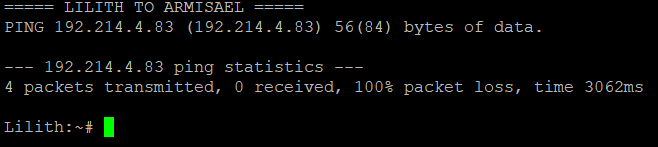

Seluruh paket ICMP Echo Request tidak memperoleh respons.

Hasil tersebut menunjukkan bahwa komunikasi antara Lilith dan Armisael terganggu setelah sabotase dilakukan.

##### 9.4.2 - Pengujian Armisael Menuju Gateway

Untuk mengetahui apakah gangguan juga memengaruhi konektivitas lokal, dilakukan pengujian dari Armisael menuju gateway-nya.

```bash
ping -c 4 -W 1 192.214.4.81
```

Hasil aktual pengujian:

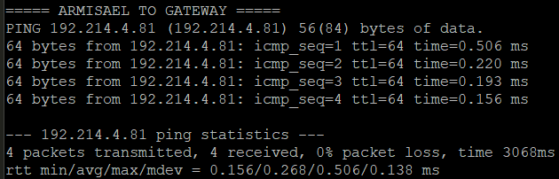

Armisael masih dapat berkomunikasi dengan interface eth1 Shigeru.

Hal tersebut menunjukkan bahwa konektivitas dalam subnet Switch-Monolith masih berfungsi.

##### 9.4.3 - Pengujian Armisael Menuju Lilith

Pengujian arah balik dilakukan untuk mengetahui apakah gangguan hanya terjadi pada satu arah komunikasi.

```bash
ping -c 4 -W 1 192.214.4.74
```

Hasil aktual pengujian:

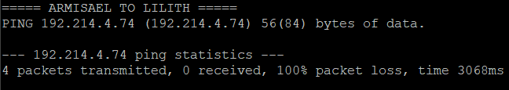

Armisael juga tidak dapat menjangkau Lilith.

##### 9.4.4 - Rekapitulasi Gejala

| Sumber | Tujuan | Paket Diterima | Packet Loss | Status |
|---|---|---:|---:|---|
| Lilith | Armisael | 0/4 | 100% | Gagal |
| Armisael | Shigeru | 4/4 | 0% | Berhasil |
| Armisael | Lilith | 0/4 | 100% | Gagal |

Berdasarkan hasil tersebut, hipotesis awal adalah terdapat gangguan pada mekanisme routing atau forwarding di Shigeru, bukan pada komunikasi lokal Switch-Monolith.

Namun, pengujian ping belum dapat menentukan konfigurasi spesifik yang menyebabkan gangguan sehingga diperlukan pemeriksaan lebih lanjut.

#### 9.5 - Reconnaissance Shigeru Setelah Sabotase

Pemeriksaan dilakukan secara read-only tanpa mengubah konfigurasi jaringan.

Komponen yang diperiksa mencakup alamat IP, status interface, routing table, policy routing, IP forwarding, reverse path filtering, firewall, neighbor table, serta konfigurasi jaringan permanen.

```bash
{
    echo "===== IP ADDRESS ====="
    ip -4 -br addr

    echo "===== INTERFACE STATUS ====="
    ip -br link

    echo "===== ROUTING TABLE ====="
    ip route show table all

    echo "===== POLICY ROUTING ====="
    ip rule show

    echo "===== IP FORWARDING ====="
    sysctl net.ipv4.ip_forward

    echo "===== REVERSE PATH FILTERING ====="
    sysctl -a 2>/dev/null | grep 'rp_filter'

    echo "===== ROUTE TO LILITH ====="
    ip route get 192.214.4.74

    echo "===== ROUTE TO ARMISAEL ====="
    ip route get 192.214.4.83

    echo "===== FIREWALL ====="
    iptables -S

    echo "===== FIREWALL COUNTERS ====="
    iptables -L -n -v

    echo "===== NFTABLES ====="
    nft list ruleset

    echo "===== NEIGHBOR TABLE ====="
    ip neigh

    echo "===== SAVED NETWORK CONFIG ====="
    cat /etc/network/interfaces

    echo "===== PING GENDOU ====="
    ping -c 3 -W 1 192.214.4.129

    echo "===== PING ARMISAEL ====="
    ping -c 3 -W 1 192.214.4.83

    echo "===== PING LILITH ====="
    ping -c 3 -W 1 192.214.4.74

} 2>&1 | tee /root/soal9/after.txt
```

Seluruh hasil reconnaissance disimpan pada:

```text
/root/soal9/after.txt
```

##### 9.5.1 - Perbandingan Konfigurasi

Konfigurasi setelah sabotase dibandingkan dengan baseline menggunakan:

```bash
diff -u /root/soal9/before.txt /root/soal9/after.txt
```

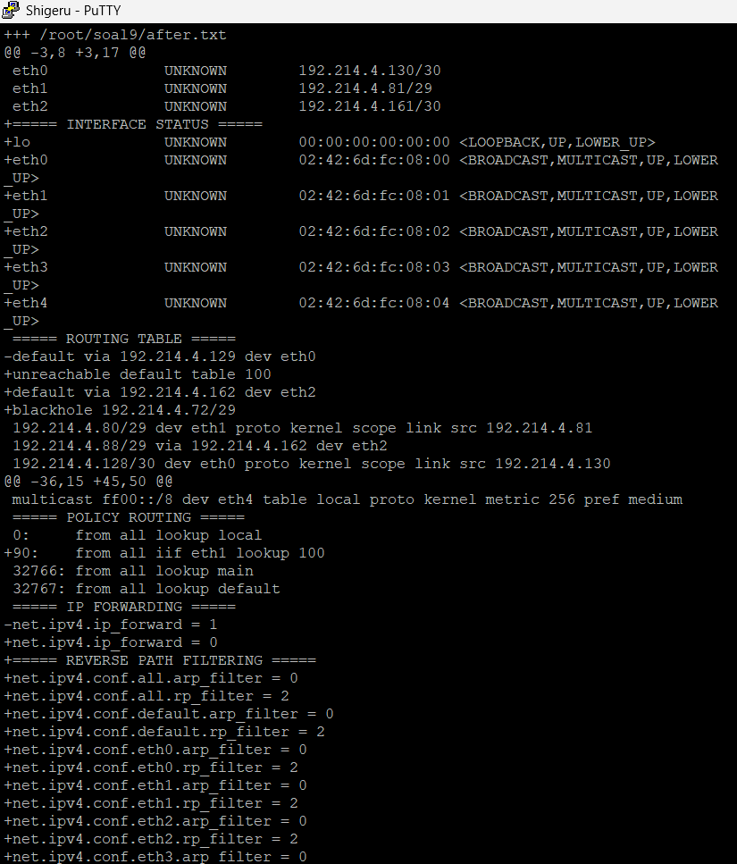

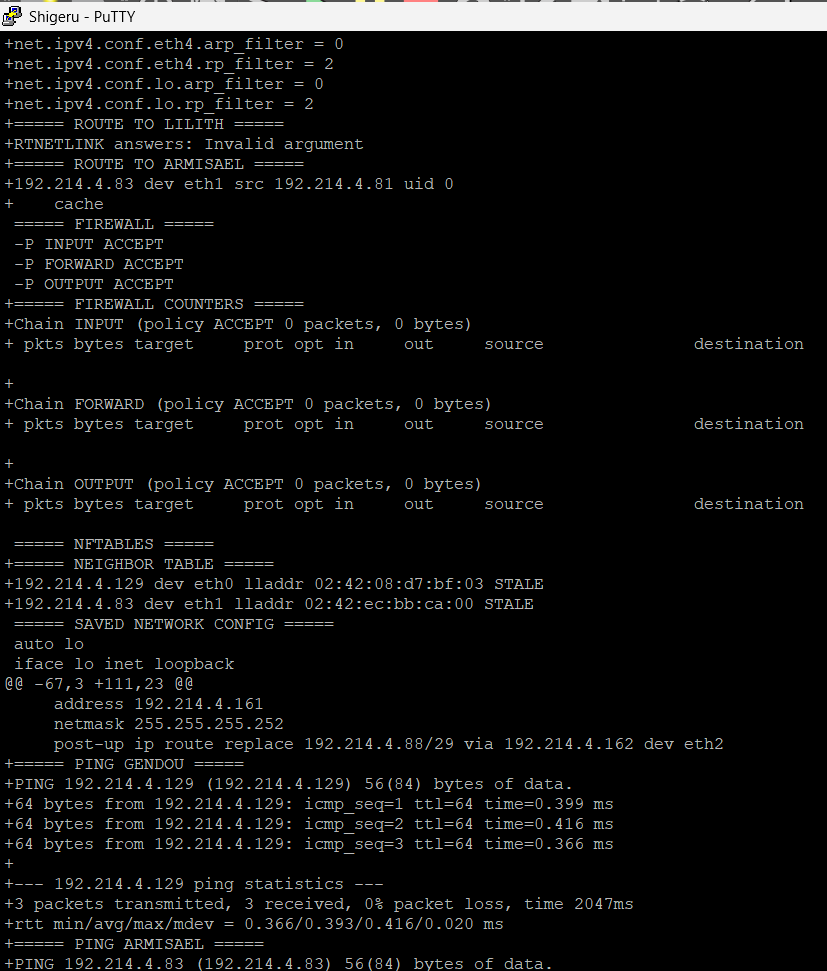

Berikut merupakan bagian perubahan konfigurasi yang relevan:

```diff
===== ROUTING TABLE =====
-default via 192.214.4.129 dev eth0
+unreachable default table 100
+default via 192.214.4.162 dev eth2
+blackhole 192.214.4.72/29

===== POLICY ROUTING =====
 0:     from all lookup local
+90:    from all iif eth1 lookup 100
 32766: from all lookup main
 32767: from all lookup default

===== IP FORWARDING =====
-net.ipv4.ip_forward = 1
+net.ipv4.ip_forward = 0
```

Berdasarkan hasil perbandingan tersebut, ditemukan empat mekanisme kerusakan utama yang terdiri atas lima perubahan konfigurasi.

#### 9.6 - Analisis Seluruh Penyebab Kerusakan

##### 9.6.1 - Penyebab Pertama — Default Route Mengarah ke Next-hop yang Salah

Konfigurasi sebelum sabotase:

```text
default via 192.214.4.129 dev eth0
```

Konfigurasi setelah sabotase:

```text
default via 192.214.4.162 dev eth2
```

| Parameter | Sebelum Sabotase | Setelah Sabotase |
|---|---|---|
| Destination | 0.0.0.0/0 | 0.0.0.0/0 |
| Next-hop | 192.214.4.129 | 192.214.4.162 |
| Interface | eth0 | eth2 |
| Router tujuan | Gendou | Makoto |

Default route digunakan ketika router tidak memiliki rute yang lebih spesifik menuju suatu alamat tujuan.

Dalam kondisi normal, Shigeru mengirimkan paket menuju jaringan lain melalui Gendou. Namun, setelah sabotase, paket yang menggunakan default route diarahkan menuju Makoto.

Makoto merupakan router cabang yang bertugas menghubungkan Switch-Radar dengan Shigeru, bukan jalur utama menuju jaringan Geofront lainnya.

Default route Makoto mengarah kembali menuju Shigeru.

```text
Kondisi normal:

Shigeru ----> Gendou ----> Jaringan lain

Kondisi setelah sabotase:

              Default route
Shigeru --------------------> Makoto
   ^                            |
   |                            |
   +----------------------------+
              Default route
```

Apabila IP forwarding aktif dan tidak terdapat mekanisme lain yang membuang paket, perubahan tersebut berpotensi menyebabkan routing loop antara Shigeru dan Makoto.

Paket dapat terus berpindah di antara kedua router hingga nilai TTL habis.

Routing loop tersebut merupakan potensi dampak berdasarkan konfigurasi yang ditemukan. Pada kondisi sabotase aktual, routing loop tidak diamati secara langsung karena terdapat beberapa kerusakan lain yang juga menghalangi penerusan paket.

##### 9.6.2 - Penyebab Kedua — Penambahan Blackhole Route

Ditemukan konfigurasi tambahan pada routing table utama:

```text
blackhole 192.214.4.72/29
```

Network ID tersebut merupakan subnet Switch-Dogma yang digunakan oleh Lilith dan Adam.

| Parameter | Nilai |
|---|---|
| Network ID | 192.214.4.72/29 |
| Subnet Mask | 255.255.255.248 |
| Host Range | 192.214.4.73–192.214.4.78 |
| Broadcast | 192.214.4.79 |
| Gateway | 192.214.4.73 |
| Lilith | 192.214.4.74 |
| Adam | 192.214.4.75 |

Blackhole route merupakan jenis rute yang menyebabkan paket dengan alamat tujuan tertentu dibuang tanpa diteruskan menuju next-hop.

Dalam pemilihan rute, Linux menggunakan prinsip Longest Prefix Match. Rute dengan prefix yang lebih spesifik akan diprioritaskan ketika routing table yang sama digunakan.

Karena alamat Lilith berada dalam subnet 192.214.4.72/29, paket menuju Lilith akan cocok dengan blackhole route tersebut.

```text
Destination: 192.214.4.74

Routing Table:

192.214.4.72/29 -> blackhole
0.0.0.0/0       -> default route

Longest Prefix Match:

192.214.4.72/29 lebih spesifik dibandingkan 0.0.0.0/0

Result:

Packet discarded
```

Keberadaan blackhole route juga dibuktikan melalui routing lookup pada Shigeru:

```bash
ip route get 192.214.4.74
```

Hasil aktual:

```text
RTNETLINK answers: Invalid argument
```

Ketika Shigeru melakukan ping menuju Lilith, diperoleh hasil:

```text
ping: connect: Invalid argument
```

Hasil tersebut sesuai dengan karakteristik blackhole route pada Linux. Pemilihan blackhole route untuk paket yang berasal dari proses lokal dapat menghasilkan error `EINVAL` atau Invalid argument.

Dengan demikian, memperbaiki default route saja tidak cukup untuk memulihkan konektivitas menuju Lilith selama blackhole route masih tersedia.

##### 9.6.3 - Penyebab Ketiga — Manipulasi Policy Routing dan Routing Table 100

Ditemukan policy routing tambahan:

```text
90: from all iif eth1 lookup 100
```

Selain itu, ditemukan rute berikut:

```text
unreachable default table 100
```

Policy routing merupakan mekanisme yang memungkinkan Linux memilih routing table berdasarkan kondisi tertentu, seperti alamat sumber, alamat tujuan, maupun interface tempat paket diterima.

Pada konfigurasi tersebut, paket yang masuk melalui interface eth1 diarahkan untuk menggunakan routing table 100.

Interface eth1 Shigeru terhubung langsung dengan Switch-Monolith. Oleh karena itu, paket yang berasal dari Armisael dan perangkat lain pada Switch-Monolith dapat terkena policy routing tersebut ketika menuju jaringan lain.

Urutan policy routing setelah sabotase adalah:

```text
0:      from all lookup local
90:     from all iif eth1 lookup 100
32766:  from all lookup main
32767:  from all lookup default
```

Routing policy diperiksa berdasarkan priority, dengan angka yang lebih kecil memiliki prioritas lebih tinggi.

Rule dengan priority 90 diperiksa sebelum rule routing table utama yang memiliki priority 32766.

Routing table 100 berisi:

```text
unreachable default
```

Rute tersebut menyebabkan paket yang menggunakan routing table 100 dinyatakan tidak dapat mencapai alamat tujuan.

Alur pengambilan keputusan routing dapat dijelaskan sebagai berikut:

```text
Armisael mengirim paket menuju Lilith
                  |
                  v
Paket masuk melalui interface eth1 Shigeru
                  |
                  v
Routing table local diperiksa
                  |
                  v
Tujuan bukan alamat lokal Shigeru
                  |
                  v
Policy routing priority 90 cocok
                  |
                  v
Routing table 100 digunakan
                  |
                  v
unreachable default
                  |
                  v
Paket tidak dapat diteruskan
```

Berbeda dengan blackhole route yang membuang paket secara diam-diam, unreachable route dapat menghasilkan pesan ICMP Destination Unreachable.

Pada pengujian aktual, Armisael mengalami packet loss tanpa menerima pesan ICMP tersebut. Kondisi ini dapat dipengaruhi oleh kombinasi beberapa kerusakan yang terjadi secara bersamaan.

Policy routing ini menyebabkan perbaikan routing table utama saja belum cukup untuk memulihkan komunikasi keluar dari Switch-Monolith.

##### 9.6.4 - Penyebab Keempat — IP Forwarding Dinonaktifkan

Konfigurasi sebelum sabotase:

```text
net.ipv4.ip_forward = 1
```

Konfigurasi setelah sabotase:

```text
net.ipv4.ip_forward = 0
```

IP forwarding merupakan mekanisme pada Linux yang memungkinkan paket IPv4 diteruskan dari satu interface jaringan menuju interface lainnya.

Ketika nilai `net.ipv4.ip_forward` menjadi 0, Shigeru tidak dapat menjalankan fungsi penerusan paket IPv4 secara normal.

Sebagai contoh, paket dari Lilith menuju Armisael harus diterima melalui interface eth0 dan diteruskan melalui interface eth1.

```text
Lilith
   |
   v
Gendou
   |
   v
Shigeru eth0
   |
   X  IP forwarding disabled
   |
Shigeru eth1
   |
   v
Armisael
```

Meskipun Shigeru memiliki connected route menuju subnet Armisael, paket yang membutuhkan forwarding tidak dapat diteruskan secara normal.

Namun, IP forwarding tidak diperlukan apabila alamat tujuan paket merupakan alamat IP milik Shigeru sendiri.

Ketika Armisael melakukan ping menuju 192.214.4.81, paket tersebut diproses sebagai traffic lokal dan tidak membutuhkan penerusan antar-interface.

Hal tersebut menjelaskan mengapa Armisael masih dapat melakukan ping menuju gateway meskipun komunikasi dengan Lilith gagal.

##### 9.6.5 - Rekapitulasi Penyebab Sabotase

| No. | Perubahan Konfigurasi | Dampak |
|---|---|---|
| 1 | Default route diarahkan menuju 192.214.4.162 melalui eth2 | Paket menggunakan jalur yang salah dan berpotensi mengalami routing loop |
| 2 | Blackhole route 192.214.4.72/29 | Paket menuju subnet Lilith dan Adam dibuang |
| 3 | Policy routing priority 90 dengan kondisi iif eth1 | Paket dari Switch-Monolith diarahkan menuju routing table 100 |
| 4 | Unreachable default pada routing table 100 | Paket yang menggunakan routing table tersebut tidak dapat diteruskan |
| 5 | IP forwarding diubah menjadi 0 | Shigeru tidak dapat melakukan penerusan paket antar-interface secara normal |

Terdapat lima perubahan konfigurasi yang membentuk empat mekanisme kerusakan utama karena policy routing dan unreachable route merupakan mekanisme yang saling berkaitan.

Seluruh perubahan tersebut harus diperbaiki agar konfigurasi Shigeru kembali sesuai dengan kondisi normal.

#### 9.7 - Pemeriksaan Komponen yang Tidak Mengalami Kerusakan

Selain mengidentifikasi konfigurasi yang mengalami perubahan, dilakukan pemeriksaan terhadap komponen jaringan lainnya.

Tujuannya adalah memastikan perbaikan hanya dilakukan pada bagian yang mengalami kerusakan tanpa mengubah konfigurasi yang masih berfungsi.

##### 9.7.1 - IP Address dan Status Interface

| Interface | IP Address | Kondisi |
|---|---|---|
| eth0 | 192.214.4.130/30 | UP |
| eth1 | 192.214.4.81/29 | UP |
| eth2 | 192.214.4.161/30 | UP |

Tidak ditemukan perubahan alamat IP maupun interface utama yang dinonaktifkan.

##### 9.7.2 - Connected Route dan Static Route

Connected route menuju jaringan yang terhubung langsung masih tersedia.

```text
192.214.4.80/29 dev eth1 proto kernel scope link src 192.214.4.81
192.214.4.128/30 dev eth0 proto kernel scope link src 192.214.4.130
192.214.4.160/30 dev eth2 proto kernel scope link src 192.214.4.161
```

Static route menuju Switch-Radar juga tidak mengalami perubahan.

```text
192.214.4.88/29 via 192.214.4.162 dev eth2
```

Oleh karena itu, konfigurasi tersebut tidak perlu diubah.

##### 9.7.3 - Firewall

Hasil pemeriksaan iptables adalah sebagai berikut:

```text
-P INPUT ACCEPT
-P FORWARD ACCEPT
-P OUTPUT ACCEPT
```

Tidak ditemukan rule filtering tambahan pada chain INPUT, FORWARD, maupun OUTPUT.

Pemeriksaan nftables juga tidak menunjukkan rule tambahan yang menyebabkan gangguan.

Dengan demikian, berdasarkan konfigurasi yang diperiksa, firewall Shigeru bukan penyebab sabotase.

##### 9.7.4 - Reverse Path Filtering

Hasil pemeriksaan menunjukkan bahwa parameter reverse path filtering memiliki nilai 2 atau loose mode.

```text
net.ipv4.conf.all.rp_filter = 2
net.ipv4.conf.default.rp_filter = 2
net.ipv4.conf.eth0.rp_filter = 2
net.ipv4.conf.eth1.rp_filter = 2
net.ipv4.conf.eth2.rp_filter = 2
```

Dalam loose mode, validasi alamat sumber tidak mengharuskan jalur balik menggunakan interface yang sama dengan interface tempat paket diterima.

Nilai tersebut tidak dicatat dalam baseline sebelum sabotase sehingga tidak dapat dipastikan apakah reverse path filtering mengalami perubahan.

Namun, tidak ditemukan bukti bahwa parameter tersebut merupakan penyebab tambahan kerusakan. Oleh karena itu, konfigurasi reverse path filtering tidak diubah.

##### 9.7.5 - Konektivitas Langsung Shigeru

Pengujian dari Shigeru menuju perangkat yang terhubung langsung memberikan hasil berikut:

| Tujuan | Paket Diterima | Packet Loss | RTT Rata-rata |
|---|---:|---:|---:|
| Gendou | 3/3 | 0% | 0.393 ms |
| Armisael | 3/3 | 0% | 0.498 ms |
| Lilith | Tidak terkirim | - | Invalid argument |

Keberhasilan komunikasi menuju Gendou dan Armisael menunjukkan bahwa link jaringan yang terhubung langsung dengan Shigeru masih berfungsi.

Kegagalan komunikasi menuju Lilith konsisten dengan keberadaan blackhole route pada routing table utama.

##### 9.7.6 - Konfigurasi Jaringan Permanen

Berdasarkan hasil perbandingan file `/etc/network/interfaces`, tidak ditemukan perubahan pada konfigurasi jaringan permanen Shigeru.

Hal tersebut menunjukkan bahwa perubahan konfigurasi yang teridentifikasi terjadi pada runtime.

Dengan demikian, tidak diperlukan perubahan terhadap konfigurasi jaringan permanen untuk memperbaiki penyebab sabotase yang ditemukan.

#### 9.8 - Perbaikan Konfigurasi Shigeru

Perbaikan dilakukan secara selektif terhadap setiap konfigurasi yang mengalami perubahan.

Tidak dilakukan reset seluruh routing table, flush firewall, maupun restart router karena tindakan tersebut dapat menghapus konfigurasi lain yang masih berfungsi.

##### 9.8.1 - Memperbaiki Default Route

Default route dikembalikan menuju Gendou melalui interface eth0.

```bash
ip route replace default via 192.214.4.129 dev eth0
```

Verifikasi:

```bash
ip route show default
```

Konfigurasi akhir:

```text
default via 192.214.4.129 dev eth0
```

Command `ip route replace` mengganti default route yang sebelumnya mengarah menuju Makoto dengan next-hop yang benar.

##### 9.8.2 - Menghapus Blackhole Route

Blackhole route menuju subnet Switch-Dogma dihapus menggunakan:

```bash
ip route del blackhole 192.214.4.72/29
```

Verifikasi dilakukan melalui routing lookup:

```bash
ip route get 192.214.4.74
```

Setelah blackhole route dihapus, routing table utama dapat kembali memilih default route menuju Gendou untuk paket yang ditujukan kepada Lilith.

##### 9.8.3 - Menghapus Policy Routing Sabotase

Policy routing dengan priority 90 dihapus menggunakan:

```bash
ip rule del pref 90 iif eth1 lookup 100
```

Rute unreachable pada routing table 100 juga dihapus:

```bash
ip route del unreachable default table 100
```

Verifikasi:

```bash
ip rule show
ip route show table 100
```

Konfigurasi policy routing akhir adalah:

```text
0:      from all lookup local
32766:  from all lookup main
32767:  from all lookup default
```

Penghapusan kedua konfigurasi tersebut memastikan tidak terdapat lagi mekanisme routing tambahan yang mengalihkan paket dari Switch-Monolith menuju routing table 100.

##### 9.8.4 - Mengaktifkan Kembali IP Forwarding

IP forwarding diaktifkan kembali menggunakan:

```bash
sysctl -w net.ipv4.ip_forward=1
```

Verifikasi:

```bash
sysctl net.ipv4.ip_forward
```

Hasil akhir:

```text
net.ipv4.ip_forward = 1
```

Setelah IP forwarding diaktifkan, Shigeru dapat kembali menjalankan fungsi penerusan paket IPv4 antar-interface.

##### 9.8.5 - Rekapitulasi Command Perbaikan

Seluruh command yang digunakan untuk memperbaiki konfigurasi Shigeru adalah sebagai berikut:

```bash
ip route replace default via 192.214.4.129 dev eth0

ip route del blackhole 192.214.4.72/29

ip rule del pref 90 iif eth1 lookup 100

ip route del unreachable default table 100

sysctl -w net.ipv4.ip_forward=1
```

| Command | Tujuan |
|---|---|
| `ip route replace default` | Mengembalikan default route menuju Gendou |
| `ip route del blackhole` | Menghapus rute yang membuang paket menuju Switch-Dogma |
| `ip rule del` | Menghapus policy routing sabotase |
| `ip route del unreachable` | Menghapus unreachable route pada table 100 |
| `sysctl -w` | Mengaktifkan kembali IP forwarding |

Seluruh perbaikan dilakukan tanpa mengubah alamat IP, connected route, static route Switch-Radar, maupun konfigurasi firewall.

#### 9.9 - Audit Konfigurasi Setelah Perbaikan

Setelah seluruh perubahan sabotase diperbaiki, dilakukan audit ulang terhadap konfigurasi Shigeru.

Format pemeriksaan dibuat sama dengan baseline agar hasilnya dapat dibandingkan secara langsung.

```bash
{
    echo "===== IP ADDRESS ====="
    ip -4 -br addr

    echo "===== ROUTING TABLE ====="
    ip route show table all

    echo "===== POLICY ROUTING ====="
    ip rule show

    echo "===== IP FORWARDING ====="
    sysctl net.ipv4.ip_forward

    echo "===== FIREWALL ====="
    iptables -S

    echo "===== NFTABLES ====="
    nft list ruleset

    echo "===== SAVED NETWORK CONFIG ====="
    cat /etc/network/interfaces

} > /root/soal9/repaired.txt 2>&1

echo "===== COMPARISON WITH BASELINE ====="
diff -u /root/soal9/before.txt /root/soal9/repaired.txt
```

Hasil aktual:

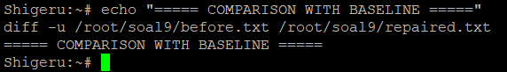

Command `diff` tidak menghasilkan output.

Hal tersebut menunjukkan bahwa seluruh parameter konfigurasi yang dicatat dalam baseline telah kembali identik dengan kondisi sebelum sabotase.

##### 9.9.1 - Verifikasi Routing Table dan Policy Routing

```bash
echo "===== MAIN ROUTING TABLE ====="
ip route

echo "===== POLICY ROUTING ====="
ip rule show

echo "===== IP FORWARDING ====="
sysctl net.ipv4.ip_forward
```

Hasil aktual:

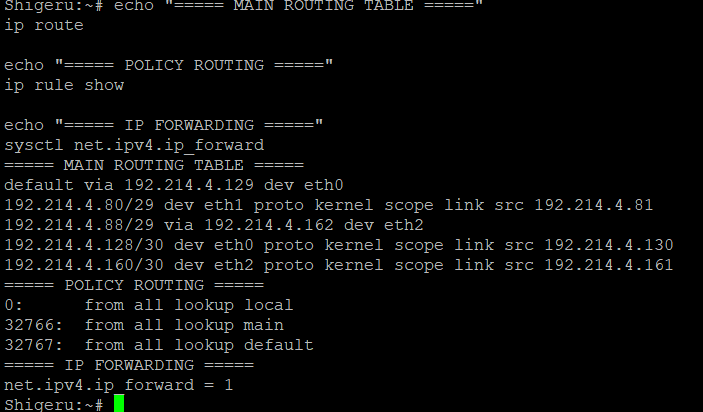

Hasil tersebut menunjukkan bahwa default route, routing policy, dan IP forwarding telah kembali sesuai dengan konfigurasi normal.

##### 9.9.2 - Verifikasi Routing Lookup Dua Arah

Routing lookup dilakukan dengan menyertakan alamat sumber dan incoming interface untuk mensimulasikan keputusan routing terhadap paket yang diteruskan oleh Shigeru.

```bash
echo "===== FORWARD ROUTE ARMISAEL TO LILITH ====="
ip route get 192.214.4.74 from 192.214.4.83 iif eth1

echo "===== FORWARD ROUTE LILITH TO ARMISAEL ====="
ip route get 192.214.4.83 from 192.214.4.74 iif eth0
```

Hasil aktual:

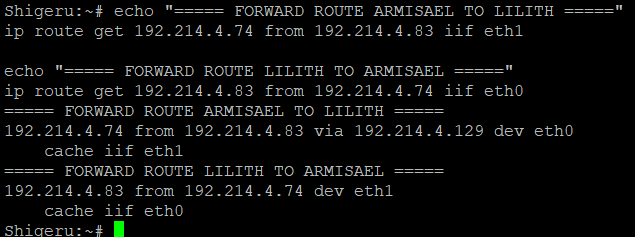

Hasil routing lookup dapat dirangkum sebagai berikut:

| Sumber | Tujuan | Incoming Interface | Outgoing Interface | Next-hop |
|---|---|---|---|---|
| Armisael | Lilith | eth1 | eth0 | 192.214.4.129 |
| Lilith | Armisael | eth0 | eth1 | Directly connected |

Paket dari Armisael menuju Lilith kembali diarahkan melalui Gendou, sedangkan paket dari Lilith menuju Armisael diarahkan langsung melalui interface eth1.

Dengan demikian, keputusan routing Shigeru pada kedua arah komunikasi telah kembali sesuai dengan topologi jaringan.

##### 9.9.3 - Perbandingan Konfigurasi

| Komponen | Sebelum Sabotase | Setelah Sabotase | Setelah Perbaikan |
|---|---|---|---|
| Default route | Via Gendou | Via Makoto | Via Gendou |
| Blackhole route | Tidak ada | 192.214.4.72/29 | Tidak ada |
| Policy routing priority 90 | Tidak ada | Aktif | Tidak ada |
| Unreachable default table 100 | Tidak ada | Aktif | Tidak ada |
| IP forwarding | 1 | 0 | 1 |
| IP address | Normal | Normal | Normal |
| Connected route | Normal | Normal | Normal |
| Static route Switch-Radar | Normal | Normal | Normal |
| Firewall | Normal | Normal | Normal |
| Konfigurasi permanen | Normal | Tidak berubah | Normal |

Seluruh lima perubahan konfigurasi yang teridentifikasi telah diperbaiki.

#### 9.10 - Pengujian Konektivitas Setelah Perbaikan

##### 9.10.1 - Pengujian Lilith Menuju Armisael

Pengujian utama dilakukan kembali dari Lilith menuju Armisael untuk membuktikan bahwa perbaikan routing berhasil memulihkan komunikasi antar-subnet.

```bash
echo "===== SOURCE NODE ====="
hostname
ip -4 -br addr

echo "===== ROUTE TO ARMISAEL ====="
ip route get 192.214.4.83

echo "===== LILITH TO ARMISAEL - AFTER REPAIR ====="
ping -c 4 -W 1 192.214.4.83
```

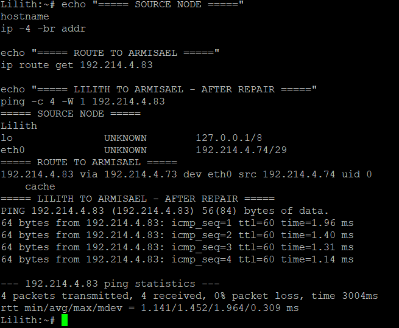

Indikator keberhasilan pengujian adalah:

- Hostname sumber merupakan Lilith.
- Alamat IP sumber adalah 192.214.4.74/29.
- Jalur menuju Armisael menggunakan gateway 192.214.4.73.
- Seluruh paket ICMP mendapatkan respons dari Armisael.
- Packet loss sebesar 0%.

Output ping awal setelah perbaikan telah memperlihatkan adanya respons dari 192.214.4.83. Namun, output tersebut belum mencantumkan identitas node sumber dan statistik akhir, serta memperlihatkan TTL dan RTT yang menyerupai komunikasi lokal.

Oleh karena itu, pengujian dengan identitas sumber perlu digunakan sebagai bukti akhir agar keberhasilan komunikasi benar-benar dapat dikaitkan dengan Lilith.

##### 9.10.2 - Pengujian Armisael Menuju Lilith

Pengujian arah balik dilakukan untuk memastikan komunikasi antar-subnet dapat berlangsung melalui jalur yang telah diperbaiki.

```bash
echo "===== ARMISAEL TO LILITH - AFTER REPAIR ====="
ping -c 4 -W 1 192.214.4.74
```

Hasil aktual:

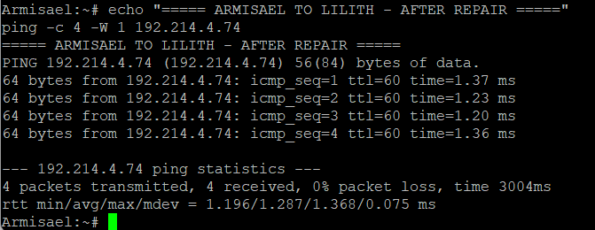

Seluruh empat paket berhasil diterima dengan packet loss sebesar 0%.

Nilai TTL sebesar 60 konsisten dengan paket yang melewati empat router apabila TTL awal paket adalah 64.

Hasil tersebut membuktikan bahwa komunikasi antara Armisael dan Lilith kembali dapat berlangsung melalui jaringan Geofront.

##### 9.10.3 - Pengujian Armisael Menuju Gateway

Pengujian tambahan dilakukan untuk memastikan perbaikan tidak mengganggu konektivitas lokal Switch-Monolith.

```bash
ping -c 3 -W 1 192.214.4.81
```

Hasil aktual:


Armisael masih dapat berkomunikasi dengan gateway lokal tanpa packet loss.

##### 9.10.4 - Pengujian Armisael Menuju SEELE

Untuk memastikan default route tidak hanya berfungsi dalam komunikasi internal, dilakukan pengujian menuju jaringan eksternal melalui SEELE.

```bash
ping -c 3 -W 1 8.8.8.8
```

Hasil aktual:


Keberhasilan pengujian tersebut menunjukkan bahwa jalur keluar dari Armisael melalui Shigeru dan Gendou menuju jaringan eksternal telah kembali berfungsi.

#### 9.11 - Analisis Hubungan Antara Gejala dan Penyebab Sabotase

##### 9.11.1 - Mengapa Armisael Masih Bisa Ping Gateway?

Armisael dan interface eth1 Shigeru berada pada subnet yang sama, yaitu 192.214.4.80/29.

Ketika Armisael melakukan ping menuju gateway 192.214.4.81, paket dikirim secara langsung melalui jaringan lokal.

Paket tersebut memiliki tujuan berupa alamat IP milik Shigeru sehingga diproses sebagai local traffic, bukan forwarded traffic.

```text
Armisael
   |
   | ICMP Echo Request
   v
Shigeru eth1 (192.214.4.81)
   |
   | Local processing
   v
ICMP Echo Reply
   |
   v
Armisael
```

Routing table local memiliki priority 0 sehingga diperiksa sebelum policy routing sabotase dengan priority 90.

Karena paket memiliki tujuan berupa alamat lokal Shigeru, paket dapat diproses tanpa menggunakan unreachable default pada routing table 100.

Selain itu, komunikasi tersebut tidak membutuhkan default route menuju Gendou, tidak memiliki tujuan pada subnet blackhole, dan tidak memerlukan IP forwarding antar-interface.

Oleh karena itu, komunikasi antara Armisael dan gateway tetap berhasil meskipun terdapat beberapa kerusakan routing pada Shigeru.

##### 9.11.2 - Mengapa Lilith Tidak Bisa Ping Armisael?

Berbeda dengan komunikasi menuju gateway lokal, paket dari Lilith menuju Armisael harus melewati beberapa router.

Ketika paket tiba pada Shigeru melalui eth0, paket harus diteruskan menuju interface eth1.

Namun, IP forwarding yang dinonaktifkan menghalangi proses penerusan paket tersebut.

Apabila IP forwarding diaktifkan kembali tanpa memperbaiki konfigurasi lainnya, komunikasi masih dapat mengalami gangguan karena paket balasan dari Armisael harus masuk melalui eth1 Shigeru.

Paket balasan tersebut dapat terkena policy routing priority 90 dan diarahkan menuju routing table 100 yang memiliki unreachable default.

Apabila policy routing tersebut dihapus tetapi blackhole route masih tersedia, paket menuju Lilith tetap dapat dibuang oleh routing table utama.

Apabila blackhole route juga dihapus tetapi default route masih mengarah menuju Makoto, paket menuju jaringan lain dapat diteruskan melalui next-hop yang salah.

Dengan demikian, terdapat beberapa mekanisme kerusakan yang saling menutupi. Perbaikan terhadap satu mekanisme saja belum tentu cukup untuk memulihkan konektivitas secara menyeluruh.

##### 9.11.3 - Mengapa Seluruh Penyebab Harus Diperbaiki?

Setiap perubahan konfigurasi memiliki ruang lingkup dampak yang berbeda.

| Kerusakan | Ruang Lingkup Dampak |
|---|---|
| IP forwarding dinonaktifkan | Penerusan paket IPv4 antar-interface pada Shigeru |
| Default route salah | Paket yang tidak memiliki rute lebih spesifik |
| Blackhole route | Paket menuju subnet Switch-Dogma ketika menggunakan routing table utama |
| Policy routing priority 90 | Paket yang masuk melalui eth1 dan tidak diselesaikan oleh routing table local |
| Unreachable default table 100 | Paket yang diarahkan menuju routing table 100 |

Keberhasilan pengujian terhadap satu jalur komunikasi tidak selalu menjamin bahwa jalur lainnya telah kembali berfungsi.

Oleh karena itu, validasi menggunakan perbandingan konfigurasi dengan baseline merupakan bagian penting dalam proses troubleshooting.

Hasil `diff` yang tidak menghasilkan output menunjukkan bahwa seluruh parameter yang dicatat pada baseline telah berhasil dipulihkan, bukan hanya konfigurasi yang secara langsung memengaruhi pengujian ping.

### 10 - Para Pilot Terkunci di Dalam

> paginya giliran para pilot mengeluh. Unit-01, Unit-02, dan Unit-00 di Cage tidak bisa ping 8.8.8.8. Padahal Spy di Intel baik-baik saja, dan ping dari Cage ke Lilith normal. Jalankan break_nat.sh di Misato dan di Gendo. Filenya sama, dijalankan di masing-masing node. Jelaskan kenapa Cage terdampak tapi Intel tidak. Buktikan Unit-01 bisa ping 8.8.8.8, dan sebutkan di router mana alamat sumber diterjemahkan.

Pada soal ini, ketiga pilot di Switch-Cage, yaitu Unit-01, Unit-02, dan Unit-00, mengalami gangguan akses internet. Namun, mereka masih dapat berkomunikasi dengan Lilith, sedangkan Spy di Switch-Intel tetap dapat mengakses internet seperti biasa.

Kita diminta menjalankan script `break_nat.sh` pada Misato dan Gendou tanpa membaca isinya, kemudian mencari seluruh penyebab gangguan pada kedua router tersebut.

Setelah konfigurasi yang bermasalah diperbaiki, kita harus menjelaskan mengapa hanya Switch-Cage yang terdampak, membuktikan bahwa Unit-01 dapat kembali melakukan ping ke 8.8.8.8, serta menunjukkan router yang melakukan translasi alamat IP sumber.

#### 10.1 - Analisis Topologi Jaringan

Switch-Cage dan Switch-Intel merupakan dua jaringan yang menggunakan router berbeda untuk terhubung dengan Gendou.

Switch-Cage menggunakan Misato sebagai gateway, sedangkan Switch-Intel menggunakan Kaji. Kedua router tersebut terhubung langsung dengan Gendou sebagai router utama yang menyediakan akses menuju jaringan eksternal melalui NAT1.

##### 10.1.1 - Jalur Komunikasi

Jalur komunikasi antara Switch-Cage, Switch-Intel, Switch-Dogma, dan jaringan eksternal adalah sebagai berikut:

```text
                         SEELE
                        8.8.8.8
                           |
                          NAT1
                           |
                         Gendou
                           |
          +----------------+----------------+
          |                |                |
        Misato          Fuyutsuki          Kaji
          |                |                |
     Switch-Cage          Toji         Switch-Intel
          |                |                |
       Unit-01        Switch-Dogma         Spy
       Unit-02             |
       Unit-00           Lilith
```

Dalam kondisi normal, Misato dan Kaji hanya melakukan routing, sedangkan translasi alamat sumber untuk koneksi menuju internet dilakukan pada Gendou.

##### 10.1.2 - Pengalamatan Perangkat

| Perangkat | Interface | IP Address | Keterangan |
|---|---|---|---|
| Unit-01 | eth0 | 192.214.4.66/29 | Pilot |
| Unit-02 | eth0 | 192.214.4.67/29 | Pilot |
| Unit-00 | eth0 | 192.214.4.68/29 | Pilot |
| Misato | eth1 | 192.214.4.65/29 | Gateway Switch-Cage |
| Misato | eth0 | 192.214.4.126/30 | Link menuju Gendou |
| Gendou | eth4 | 192.214.4.125/30 | Link menuju Misato |
| Gendou | eth5 | 192.214.4.121/30 | Link menuju Kaji |
| Gendou | eth0 | 192.168.122.60/24 | Interface WAN |
| Kaji | eth0 | 192.214.4.122/30 | Link menuju Gendou |
| Kaji | eth1 | 192.214.4.101/30 | Gateway Switch-Intel |
| Spy | eth0 | 192.214.4.102/30 | Node Switch-Intel |
| Lilith | eth0 | 192.214.4.74/29 | Node Switch-Dogma |

##### 10.1.3 - Subnet yang Berkaitan

| Jaringan | Network ID | Gateway |
|---|---|---|
| Switch-Cage | 192.214.4.64/29 | 192.214.4.65 |
| Switch-Dogma | 192.214.4.72/29 | 192.214.4.73 |
| Switch-Intel | 192.214.4.100/30 | 192.214.4.101 |
| Misato–Gendou | 192.214.4.124/30 | - |
| Kaji–Gendou | 192.214.4.120/30 | - |
| Jaringan internal Geofront | 192.214.0.0/21 | - |

#### 10.2 - Penyimpanan Baseline Konfigurasi

Karena sabotase dilakukan pada dua router, diperlukan penyimpanan konfigurasi awal pada Misato dan Gendou.

Untuk mempermudah pemeriksaan, dibuat script audit yang sama pada kedua router. Script tersebut digunakan untuk mengambil konfigurasi sebelum sabotase, setelah sabotase, dan setelah perbaikan.

##### 10.2.1 - Pembuatan Script Audit

Script berikut dibuat pada Misato dan Gendou.

```bash
mkdir -p /root/soal10

cat > /root/soal10/audit.sh <<'EOF'
#!/bin/sh

export PATH=/usr/sbin:/usr/bin:/sbin:/bin

echo "===== HOSTNAME ====="
hostname

echo "===== IP ADDRESS ====="
ip -4 -br addr

echo "===== ROUTING TABLE ====="
ip -4 route show table all

echo "===== POLICY ROUTING ====="
ip -4 rule show

echo "===== IP FORWARDING ====="
sysctl net.ipv4.ip_forward

echo "===== REVERSE PATH FILTERING ====="
sysctl -a 2>/dev/null | grep '\.rp_filter'

echo "===== IPTABLES FILTER ====="
iptables -t filter -S

echo "===== IPTABLES NAT ====="
iptables -t nat -S

echo "===== IPTABLES MANGLE ====="
iptables -t mangle -S

echo "===== IPTABLES RAW ====="
iptables -t raw -S

echo "===== IPTABLES SECURITY ====="
iptables -t security -S

echo "===== NFTABLES ====="
nft -s list ruleset

echo "===== SAVED NETWORK CONFIG ====="
cat /etc/network/interfaces
EOF

chmod +x /root/soal10/audit.sh
```

Script audit mencakup beberapa komponen yang berpotensi menyebabkan gangguan jaringan.

| Komponen | Tujuan Pemeriksaan |
|---|---|
| IP address | Mengetahui perubahan pengalamatan interface |
| Routing table | Mengetahui perubahan jalur routing |
| Policy routing | Mengetahui perubahan mekanisme pemilihan routing table |
| IP forwarding | Memastikan router dapat meneruskan paket |
| Reverse path filtering | Memeriksa validasi alamat sumber paket |
| iptables filter | Mengetahui perubahan kebijakan filtering |
| iptables nat | Mengetahui perubahan translasi alamat |
| iptables mangle | Mengetahui perubahan manipulasi atau penandaan paket |
| iptables raw | Mengetahui perubahan pemrosesan sebelum connection tracking |
| iptables security | Mengetahui perubahan rule keamanan tambahan |
| nftables | Memeriksa seluruh ruleset nftables |
| Network configuration | Mengetahui perubahan konfigurasi jaringan permanen |

Parameter `-s` pada command `nft -s list ruleset` digunakan untuk menampilkan ruleset tanpa informasi state seperti nilai packet counter. Dengan demikian, perubahan counter akibat aktivitas jaringan tidak mengganggu perbandingan konfigurasi.

##### 10.2.2 - Penyimpanan Konfigurasi Awal

Pada masing-masing router, script audit dijalankan menggunakan:

```bash
/root/soal10/audit.sh > /root/soal10/before.txt 2>&1
```

Konfigurasi baseline disimpan secara terpisah pada masing-masing router dengan lokasi file yang sama:

```bash
/root/soal10/before.txt
```

##### 10.2.3 - Konfigurasi Normal Misato

Routing table utama Misato sebelum sabotase adalah sebagai berikut:

```bash
default via 192.214.4.125 dev eth0
192.214.4.64/29 dev eth1 proto kernel scope link src 192.214.4.65
192.214.4.124/30 dev eth0 proto kernel scope link src 192.214.4.126
```

Misato memiliki dua interface utama, yaitu eth1 yang terhubung dengan Switch-Cage dan eth0 yang terhubung dengan Gendou.

Misato tidak memiliki rule NAT yang menerjemahkan alamat sumber perangkat Switch-Cage.

Dengan demikian, paket dari Unit-01 seharusnya diteruskan menuju Gendou dengan tetap menggunakan alamat sumber 192.214.4.66.

##### 10.2.4 - Konfigurasi Normal NAT Gendou

Gendou memiliki rule NAT yang telah dikonfigurasi pada soal sebelumnya.

```bash
table ip nat {
    chain postrouting {
        type nat hook postrouting priority srcnat; policy accept;
        ip saddr 192.214.0.0/21 oifname "eth0" counter masquerade
    }
}
```

Rule tersebut menerjemahkan alamat sumber paket yang berasal dari jaringan internal 192.214.0.0/21 ketika paket keluar melalui interface eth0.

Karena alamat WAN Gendou diperoleh melalui DHCP, digunakan MASQUERADE agar alamat sumber pengganti mengikuti alamat IP yang sedang digunakan oleh interface tersebut.

#### 10.3 - Pelaksanaan Sabotase

Script `break_nat.sh` yang diberikan oleh asisten praktikum disimpan pada direktori `/root` di Misato dan Gendou.

File yang sama digunakan pada kedua router sesuai ketentuan soal.

Script dijalankan pada Misato menggunakan command:

```bash
chmod +x /root/break_nat.sh
/root/break_nat.sh
```

Command yang sama kemudian dijalankan pada Gendou:

```bash
chmod +x /root/break_nat.sh
/root/break_nat.sh
```

Sesuai ketentuan soal sabotase, isi script tidak dibaca.

Seluruh penyebab gangguan diidentifikasi berdasarkan hasil pengujian konektivitas, perubahan konfigurasi, dan pemeriksaan counter NAT serta firewall.

Kedua router tidak direstart setelah sabotase agar konfigurasi runtime yang mengalami perubahan tetap dapat diperiksa.

#### 10.4 - Identifikasi Gejala Setelah Sabotase

##### 10.4.1 - Pengujian Unit-01

Pengujian dilakukan kembali terhadap tiga tujuan yang sama dengan pengujian baseline.

```bash
hostname

echo "===== PING GATEWAY ====="
ping -c 3 -W 1 192.214.4.65

echo "===== PING LILITH ====="
ping -c 3 -W 1 192.214.4.74

echo "===== PING SEELE ====="
ping -c 3 -W 1 8.8.8.8
```


Unit-01 masih dapat melakukan komunikasi lokal dan komunikasi antar-subnet, tetapi tidak dapat mengakses jaringan eksternal.

##### 10.4.2 - Pengujian Unit-02 dan Unit-00

Pengujian dilakukan pada masing-masing pilot lainnya menggunakan:

```bash
hostname
ping -c 3 -W 1 8.8.8.8
```

Hasil pengujian Unit-02:


Hasil pengujian Unit-00:


Kedua pilot mengalami gangguan yang sama dengan Unit-01.

##### 10.4.3 - Pengujian Spy

Untuk mengetahui apakah gangguan juga memengaruhi subnet lain, dilakukan pengujian dari Spy.

```bash
hostname
ping -c 3 -W 1 8.8.8.8
```

Hasil aktual pengujian:


Spy tetap dapat mengakses internet tanpa mengalami packet loss.

##### 10.4.4 - Rekapitulasi Gejala Sabotase

| Sumber | Tujuan | Paket Diterima | Packet Loss | Status |
|---|---|---:|---:|---|
| Unit-01 | Gateway Misato | 3/3 | 0% | Berhasil |
| Unit-01 | Lilith | 3/3 | 0% | Berhasil |
| Unit-01 | SEELE | 0/3 | 100% | Gagal |
| Unit-02 | SEELE | 0/3 | 100% | Gagal |
| Unit-00 | SEELE | 0/3 | 100% | Gagal |
| Spy | SEELE | 3/3 | 0% | Berhasil |

Berdasarkan hasil tersebut, gangguan tidak terjadi pada seluruh jaringan Geofront, melainkan secara khusus memengaruhi akses internet perangkat Switch-Cage.

Keberhasilan ping menuju Lilith menunjukkan bahwa routing internal masih berfungsi. Sementara itu, keberhasilan Spy mengakses internet menunjukkan bahwa koneksi WAN Gendou dan mekanisme NAT secara umum masih tersedia.

Oleh karena itu, pemeriksaan difokuskan pada konfigurasi yang membedakan traffic berdasarkan alamat sumber, alamat tujuan, dan interface yang digunakan.

#### 10.5 - Reconnaissance dan Identifikasi Perubahan Konfigurasi

Script audit yang telah dibuat sebelumnya digunakan kembali pada Misato dan Gendou.

```bash
/root/soal10/audit.sh > /root/soal10/after.txt 2>&1

hostname
diff -u /root/soal10/before.txt /root/soal10/after.txt
```

Penggunaan script audit yang sama memastikan konfigurasi sebelum dan sesudah sabotase diperiksa menggunakan parameter yang konsisten.

##### 10.5.1 - Hasil Pemeriksaan Misato


Hasil perbandingan konfigurasi Misato menunjukkan adanya penambahan rule pada tabel NAT.

```diff
===== IPTABLES NAT =====

 -P INPUT ACCEPT
 -P OUTPUT ACCEPT
 -P POSTROUTING ACCEPT
+-A POSTROUTING -s 192.214.4.64/29 ! -d 192.214.0.0/16 -o eth0 -j SNAT --to-source 172.31.99.1
```

Selain itu, ditemukan perubahan pada ruleset nftables:

```diff
===== NFTABLES =====
+# Warning: table ip nat is managed by iptables-nft, do not touch!
+table ip nat {
+    chain POSTROUTING {
+        type nat hook postrouting priority srcnat; policy accept;
+        ip saddr 192.214.4.64/29 ip daddr != 192.214.0.0/16 oifname "eth0" counter xt target "SNAT"
+    }
+}
```

Rule tersebut merupakan konfigurasi yang sebelumnya tidak tersedia pada Misato.

Penampilan rule pada iptables dan nftables bukan berarti terdapat dua mekanisme SNAT terpisah. Hal tersebut terjadi karena iptables-nft menggunakan infrastruktur nftables sebagai backend.

##### 10.5.2 - Hasil Pemeriksaan Gendou


Hasil perbandingan konfigurasi Gendou menunjukkan adanya penambahan rule RETURN pada tabel NAT.

```diff
===== IPTABLES NAT =====

 -P INPUT ACCEPT
 -P OUTPUT ACCEPT
 -P POSTROUTING ACCEPT
+-A POSTROUTING -s 192.214.4.64/29 -o eth0 -j RETURN
```

Ruleset nftables juga menunjukkan adanya chain tambahan.

```diff
table ip nat {
    chain postrouting {
        type nat hook postrouting priority srcnat; policy accept;
        ip saddr 192.214.0.0/21 oifname "eth0" counter masquerade
    }
+
+   chain POSTROUTING {
+       type nat hook postrouting priority srcnat; policy accept;
+       ip saddr 192.214.4.64/29 oifname "eth0" counter return
+   }
}
```

Rule MASQUERADE normal pada Gendou tidak dihapus atau diubah. Namun, terdapat chain POSTROUTING tambahan yang secara khusus menargetkan subnet Switch-Cage.

##### 10.5.3 - Rekapitulasi Perubahan

| Router | Komponen | Perubahan |
|---|---|---|
| Misato | NAT POSTROUTING | Penambahan SNAT menuju 172.31.99.1 |
| Gendou | NAT POSTROUTING | Penambahan RETURN untuk subnet Switch-Cage |

Tidak ditemukan perubahan lain pada IP address, routing table, policy routing, IP forwarding, reverse path filtering, maupun konfigurasi jaringan permanen berdasarkan hasil audit.

Dengan demikian, ditemukan dua perubahan konfigurasi utama yang berkaitan dengan sabotase.

#### 10.6 - Analisis Penyebab Pertama — SNAT pada Misato

##### 10.6.1 - Rule SNAT Sabotase

Rule yang ditemukan pada Misato adalah:

```bash
-A POSTROUTING -s 192.214.4.64/29 ! -d 192.214.0.0/16 -o eth0 -j SNAT --to-source 172.31.99.1
```

Penjelasan setiap parameter:

| Parameter | Fungsi |
|---|---|
| `-A POSTROUTING` | Menambahkan rule pada chain POSTROUTING |
| `-s 192.214.4.64/29` | Menargetkan alamat sumber dari Switch-Cage |
| `! -d 192.214.0.0/16` | Mengecualikan paket dengan tujuan dalam rentang 192.214.0.0/16 |
| `-o eth0` | Menargetkan paket yang keluar melalui interface eth0 |
| `-j SNAT` | Melakukan translasi alamat IP sumber |
| `--to-source 172.31.99.1` | Mengganti alamat IP sumber menjadi 172.31.99.1 |

Source Network Address Translation atau SNAT merupakan mekanisme yang digunakan untuk mengganti alamat IP sumber suatu paket ketika paket melewati router.

Pada konfigurasi normal Geofront, Misato tidak melakukan SNAT karena translasi alamat sumber untuk koneksi internet seharusnya dilakukan pada Gendou.

Namun, rule sabotase menyebabkan Misato menerjemahkan alamat sumber perangkat Switch-Cage menjadi 172.31.99.1 ketika paket ditujukan ke jaringan eksternal.

##### 10.6.2 - Dampak terhadap Paket Unit-01

Sebagai contoh, ketika Unit-01 melakukan ping menuju SEELE, paket awal memiliki informasi berikut:

```text
Source IP      : 192.214.4.66
Destination IP : 8.8.8.8
```

Ketika paket melewati Misato, rule SNAT sabotase mengubah alamat sumbernya.

```text
Source IP      : 172.31.99.1
Destination IP : 8.8.8.8
```

Perubahan tersebut dapat digambarkan sebagai berikut:

```text
Unit-01
SRC: 192.214.4.66
DST: 8.8.8.8
        |
        v
Misato
        |
        | POSTROUTING SNAT
        | 192.214.4.66 -> 172.31.99.1
        v
Gendou
SRC: 172.31.99.1
DST: 8.8.8.8
```

Alamat 172.31.99.1 tidak termasuk dalam jaringan internal Geofront, yaitu 192.214.0.0/21.

Akibatnya, paket yang telah mengalami translasi tersebut tidak sesuai dengan konfigurasi filtering dan NAT normal pada Gendou.

##### 10.6.3 - Dampak terhadap Firewall Gendou

Konfigurasi firewall Gendou menggunakan default policy DROP pada chain FORWARD.

Rule yang mengizinkan koneksi baru dari jaringan internal menuju internet adalah:

```bash
-A FORWARD ! -i eth0 -o eth0 -s 192.214.0.0/21 -j ACCEPT
```

Rule tersebut mengizinkan paket apabila memenuhi kondisi berikut:

- Paket berasal dari jaringan internal 192.214.0.0/21.
- Paket tidak masuk melalui interface WAN eth0.
- Paket keluar menuju internet melalui interface eth0.

Setelah paket mengalami SNAT pada Misato, alamat sumber berubah menjadi 172.31.99.1.

Alamat tersebut tidak memenuhi kondisi source address pada rule ACCEPT.

Untuk koneksi baru yang tidak cocok dengan rule lain, paket akan mencapai default policy DROP pada chain FORWARD.

Alur pemrosesan paket dapat dijelaskan sebagai berikut:

```text
Unit-01 mengirim ICMP Echo Request
                  |
                  v
Misato menerapkan SNAT
                  |
                  v
Source IP menjadi 172.31.99.1
                  |
                  v
Paket diterima Gendou
                  |
                  v
Chain FORWARD diperiksa
                  |
                  v
Source IP tidak termasuk 192.214.0.0/21
                  |
                  v
Tidak cocok dengan rule ACCEPT internal
                  |
                  v
Default policy DROP
                  |
                  v
Paket tidak diteruskan menuju SEELE
```

Hal tersebut merupakan penjelasan utama mengapa perangkat Switch-Cage mengalami kegagalan akses internet.

##### 10.6.4 - Dampak terhadap MASQUERADE Gendou

Selain tidak memenuhi rule filtering, alamat 172.31.99.1 juga tidak memenuhi kondisi MASQUERADE normal pada Gendou.

```text
ip saddr 192.214.0.0/21 oifname "eth0" counter masquerade
```

Meskipun paket tersebut dapat mencapai tahap POSTROUTING, alamat sumbernya tetap tidak cocok dengan jaringan yang ditentukan pada rule MASQUERADE.

Dengan demikian, SNAT yang salah pada Misato menyebabkan paket tidak sesuai dengan konfigurasi jaringan yang telah dirancang pada Gendou.

#### 10.7 - Analisis Penyebab Kedua — Rule RETURN pada Gendou

##### 10.7.1 - Rule RETURN Sabotase

Rule tambahan yang ditemukan pada Gendou adalah:

```bash
-A POSTROUTING -s 192.214.4.64/29 -o eth0 -j RETURN
```

Penjelasan parameter:

| Parameter | Fungsi |
|---|---|
| `-A POSTROUTING` | Menambahkan rule pada chain POSTROUTING |
| `-s 192.214.4.64/29` | Menargetkan sumber dari Switch-Cage |
| `-o eth0` | Menargetkan paket yang keluar menuju NAT1 |
| `-j RETURN` | Menghentikan pemrosesan rule pada chain tersebut |

Secara umum, target RETURN digunakan untuk mengembalikan pemrosesan ke chain pemanggil. Apabila RETURN digunakan pada built-in chain iptables, pemrosesan mengikuti policy chain tersebut.

Namun, implementasi NAT Gendou menggunakan kombinasi nftables dan iptables-nft sehingga diperlukan pemeriksaan lebih lanjut terhadap struktur chain yang digunakan.

##### 10.7.2 - Perbedaan Chain NAT

Berdasarkan hasil pemeriksaan nftables, terdapat dua base chain yang berbeda.

```bash
table ip nat {
    chain postrouting {
        type nat hook postrouting priority srcnat; policy accept;

        ip saddr 192.214.0.0/21 oifname "eth0" counter masquerade
    }

    chain POSTROUTING {
        type nat hook postrouting priority srcnat; policy accept;

        ip saddr 192.214.4.64/29 oifname "eth0" counter return
    }
}
```

| Chain | Implementasi | Isi |
|---|---|---|
| `postrouting` | nftables | Rule MASQUERADE normal |
| `POSTROUTING` | iptables-nft | Rule RETURN sabotase |

Nama chain bersifat case-sensitive. Oleh karena itu, `postrouting` dan `POSTROUTING` merupakan dua chain yang berbeda.

Kedua chain terdaftar pada hook postrouting dengan priority srcnat.

RETURN pada chain POSTROUTING tidak secara otomatis membatalkan pemrosesan base chain postrouting yang terpisah.

Urutan evaluasi antar-base chain dengan priority yang sama tidak boleh diasumsikan selalu tetap. Oleh karena itu, diperlukan pengujian aktual untuk mengetahui apakah rule RETURN menyebabkan gangguan secara independen pada konfigurasi ini.

##### 10.7.3 - Hipotesis Dampak Rule RETURN

Rule RETURN merupakan perubahan akibat sabotase yang secara khusus menargetkan Switch-Cage.

Namun, belum dapat disimpulkan bahwa rule tersebut secara mandiri menghentikan MASQUERADE normal pada Gendou.

Untuk membuktikannya, dilakukan perbaikan secara bertahap. Rule SNAT pada Misato dihapus terlebih dahulu, sedangkan rule RETURN pada Gendou dibiarkan aktif selama pengujian sementara.

Dengan pendekatan tersebut, dampak kedua perubahan konfigurasi dapat dibedakan berdasarkan hasil aktual.

#### 10.8 - Pemeriksaan Counter NAT dan Firewall

Setelah melakukan pengujian konektivitas dari ketiga pilot dan Spy, dilakukan pemeriksaan counter NAT dan firewall untuk mengetahui rule yang memproses paket.

##### 10.8.1 - Counter NAT Misato

Command yang digunakan:

```bash
iptables -t nat -L POSTROUTING -n -v --line-numbers
```

Hasil aktual:


Rule SNAT memiliki counter sebanyak tiga paket dengan total 252 bytes.

Hasil tersebut konsisten dengan tiga aliran ICMP baru yang dibuat oleh Unit-01, Unit-02, dan Unit-00 ketika masing-masing melakukan ping menuju SEELE.

Tabel NAT umumnya melakukan evaluasi rule untuk paket pertama dari koneksi yang dilacak oleh connection tracking. Paket berikutnya menggunakan translasi yang telah ditetapkan.

Oleh karena itu, meskipun setiap pilot mengirimkan tiga ICMP Echo Request, counter pada rule SNAT tidak harus menunjukkan sembilan paket.

##### 10.8.2 - Counter Firewall Gendou

Pemeriksaan chain FORWARD dilakukan menggunakan:

```bash
iptables -L FORWARD -n -v --line-numbers
```

Hasil aktual:


Default policy DROP menunjukkan counter sebanyak sembilan paket dengan total 756 bytes.

Jumlah tersebut konsisten dengan pengujian yang dilakukan oleh tiga pilot, masing-masing mengirimkan tiga ICMP Echo Request.

```text
3 pilot × 3 ICMP Echo Request = 9 paket
```

Namun, counter firewall bersifat kumulatif. Karena tidak dilakukan pengukuran counter sebelum dan sesudah masing-masing pengujian secara terpisah, jumlah tersebut tidak dapat digunakan sebagai bukti mutlak bahwa seluruh sembilan paket berasal dari pengujian ketiga pilot.

Meskipun demikian, hasil counter mendukung analisis bahwa paket dengan alamat sumber hasil SNAT yang tidak sesuai dibuang oleh firewall Gendou.

##### 10.8.3 - Counter Rule RETURN Gendou

Pemeriksaan dilakukan menggunakan:

```bash
iptables -t nat -L POSTROUTING -n -v --line-numbers

nft -a list table ip nat
```

Hasil aktual:


Rule RETURN memiliki counter nol paket.

Hasil tersebut konsisten dengan kondisi ketika paket dari Switch-Cage sudah mengalami SNAT pada Misato dan tidak lagi memiliki alamat sumber yang sesuai dengan kondisi rule RETURN.

Selain itu, paket yang dibuang pada chain FORWARD tidak akan mencapai tahap POSTROUTING.

##### 10.8.4 - Rekapitulasi Counter

| Router | Rule atau Policy | Paket | Bytes |
|---|---|---:|---:|
| Misato | SNAT sabotase | 3 | 252 |
| Gendou | FORWARD default DROP | 9 | 756 |
| Gendou | RETURN sabotase | 0 | 0 |
| Gendou | MASQUERADE normal | 22 | 1472 |

Berdasarkan pemeriksaan konfigurasi dan counter, SNAT yang salah pada Misato merupakan penyebab utama yang paling kuat didukung oleh bukti awal.

#### 10.9 - Analisis Perbedaan Dampak pada Switch-Cage dan Switch-Intel

##### 10.9.1 - Mengapa Switch-Cage Terdampak?

Subnet Switch-Cage adalah 192.214.4.64/29.

| Parameter | Nilai |
|---|---|
| Network ID | 192.214.4.64/29 |
| Subnet Mask | 255.255.255.248 |
| Host Range | 192.214.4.65–192.214.4.70 |
| Broadcast | 192.214.4.71 |
| Gateway | 192.214.4.65 |

Ketiga pilot menggunakan alamat IP dalam subnet tersebut.

| Node | IP Address | Cocok dengan Source Rule Sabotase |
|---|---|---|
| Unit-01 | 192.214.4.66 | Ya |
| Unit-02 | 192.214.4.67 | Ya |
| Unit-00 | 192.214.4.68 | Ya |

Rule SNAT pada Misato menggunakan kondisi:

```text
-s 192.214.4.64/29
```

Dengan demikian, seluruh pilot yang mengirim paket menuju jaringan eksternal melalui Misato akan terkena rule SNAT tersebut.

Alamat sumber paket mereka diterjemahkan menjadi 172.31.99.1 sehingga tidak lagi sesuai dengan jaringan internal yang diizinkan oleh firewall Gendou.

Akibatnya, akses internet ketiga pilot mengalami gangguan yang sama.

##### 10.9.2 - Mengapa Switch-Intel Tidak Terdampak?

Spy menggunakan alamat IP:

```text
192.214.4.102/30
```

Alamat tersebut berada dalam subnet Switch-Intel, yaitu 192.214.4.100/30.

Subnet tersebut berbeda dari subnet yang ditargetkan oleh kedua rule sabotase.

Selain itu, Spy menggunakan jalur komunikasi berikut:

```text
Spy
192.214.4.102
        |
   Switch-Intel
        |
       Kaji
        |
      Gendou
        |
       NAT1
        |
      SEELE
```

Paket dari Spy tidak melewati Misato sehingga tidak terkena rule SNAT yang salah.

Ketika paket mencapai Gendou, alamat sumbernya masih berupa 192.214.4.102.

Alamat tersebut:

- Termasuk dalam jaringan internal 192.214.0.0/21.
- Tidak termasuk dalam subnet sabotase 192.214.4.64/29.
- Memenuhi kondisi rule FORWARD menuju internet.
- Memenuhi kondisi MASQUERADE normal.

Oleh karena itu, Spy tetap dapat mengakses internet.

##### 10.9.3 - Mengapa Switch-Cage Masih Bisa Ping Lilith?

Rule SNAT pada Misato memiliki kondisi berikut:

```text
! -d 192.214.0.0/16
```

Tanda `!` merupakan operator negasi yang berarti rule hanya berlaku apabila alamat tujuan tidak berada dalam rentang 192.214.0.0/16.

Lilith menggunakan alamat:

```text
192.214.4.74
```

Alamat tersebut berada dalam rentang 192.214.0.0/16 sehingga tidak memenuhi kondisi SNAT sabotase.

Perbandingan pemrosesan paket:

| Sumber | Tujuan | Terkena SNAT Misato |
|---|---|---|
| Unit-01 | Lilith (192.214.4.74) | Tidak |
| Unit-01 | Spy (192.214.4.102) | Tidak |
| Unit-01 | Armisael (192.214.4.83) | Tidak |
| Unit-01 | SEELE (8.8.8.8) | Ya |

Ketika Unit-01 melakukan ping menuju Lilith, alamat sumber paket tetap 192.214.4.66.

Paket tersebut diteruskan melalui jalur routing internal tanpa perubahan alamat sumber.

```text
Unit-01
SRC: 192.214.4.66
DST: 192.214.4.74
        |
        v
Misato
Tidak memenuhi kondisi SNAT sabotase
        |
        v
Gendou
Traffic internal diizinkan
        |
        v
Fuyutsuki
        |
        v
Toji
        |
        v
Lilith
```

Hal tersebut menjelaskan mengapa Switch-Cage masih dapat berkomunikasi dengan Lilith meskipun akses internet mengalami gangguan.

#### 10.10 - Perbaikan Konfigurasi Secara Bertahap

Perbaikan dilakukan secara selektif terhadap rule yang mengalami perubahan.

Tidak dilakukan flush seluruh tabel NAT maupun seluruh ruleset firewall karena tindakan tersebut dapat menghapus konfigurasi MASQUERADE normal dan mengganggu akses internet seluruh jaringan Geofront.

##### 10.10.1 - Menghapus SNAT Sabotase pada Misato

Rule SNAT yang salah dihapus menggunakan:

```bash
iptables -t nat -D POSTROUTING \
    -s 192.214.4.64/29 \
    ! -d 192.214.0.0/16 \
    -o eth0 \
    -j SNAT --to-source 172.31.99.1
```

Parameter `-D` digunakan untuk menghapus rule yang memiliki kondisi dan target sesuai dengan konfigurasi yang ditemukan.

Verifikasi dilakukan menggunakan:

```bash
iptables -t nat -S

nft -s list ruleset
```

Setelah rule tersebut dihapus, Misato kembali meneruskan paket Switch-Cage tanpa mengubah alamat IP sumber.

##### 10.10.2 - Pengujian Setelah Perbaikan Misato

Sebelum menghapus rule RETURN pada Gendou, dilakukan pengujian dari Unit-01.

Tujuan pengujian ini adalah mengetahui apakah penghapusan SNAT pada Misato saja sudah cukup untuk memulihkan akses internet.

```bash
echo "===== SOURCE NODE ====="
hostname
ip -4 -br addr

echo "===== INTERNET AFTER MISATO REPAIR ====="
ping -c 4 -W 1 8.8.8.8
```

Hasil aktual:


Seluruh empat paket berhasil diterima meskipun rule RETURN pada Gendou masih tersedia.

Hasil tersebut membuktikan bahwa SNAT yang salah pada Misato merupakan penyebab utama kegagalan akses internet Unit-01.

Selain itu, hasil pengujian menunjukkan bahwa rule RETURN pada base chain POSTROUTING yang terpisah tidak mencegah MASQUERADE normal Gendou dalam pengujian ini.

Rule RETURN tetap merupakan perubahan konfigurasi akibat sabotase, tetapi tidak terbukti sebagai penyebab independen kegagalan konektivitas pada konfigurasi yang digunakan.

##### 10.10.3 - Menghapus Rule RETURN pada Gendou

Meskipun akses internet telah kembali berfungsi, rule RETURN tetap dihapus agar seluruh konfigurasi tambahan akibat sabotase tidak lagi tersedia.

Command yang digunakan:

```bash
iptables -t nat -D POSTROUTING \
    -s 192.214.4.64/29 \
    -o eth0 \
    -j RETURN
```

Verifikasi dilakukan menggunakan:

```bash
iptables -t nat -S

nft -s list table ip nat
```

Rule MASQUERADE normal dipertahankan:

```text
ip saddr 192.214.0.0/21 oifname "eth0" counter masquerade
```

Penghapusan rule dilakukan secara spesifik tanpa mengubah kebijakan firewall maupun rule NAT lainnya.

##### 10.10.4 - Rekapitulasi Command Perbaikan

| Router | Tindakan |
|---|---|
| Misato | Menghapus SNAT menuju 172.31.99.1 |
| Gendou | Menghapus RETURN untuk subnet 192.214.4.64/29 |
| Gendou | Mempertahankan MASQUERADE normal |

#### 10.11 - Pengujian Akhir Setelah Seluruh Perbaikan

Setelah rule sabotase pada Misato dan Gendou dihapus, dilakukan pengujian akhir dari Unit-01 menuju Lilith dan SEELE.

```bash
echo "===== SOURCE NODE ====="
hostname
ip -4 -br addr

echo "===== PING LILITH ====="
ping -c 3 -W 1 192.214.4.74

echo "===== PING SEELE AFTER FULL REPAIR ====="
ping -c 4 -W 1 8.8.8.8
```

Hasil aktual:


##### 10.11.1 - Perbandingan Hasil Pengujian

| Kondisi | Tujuan | Packet Loss | RTT Rata-rata |
|---|---|---:|---:|
| Sebelum sabotase | Lilith | 0% | 1.623 ms |
| Setelah sabotase | Lilith | 0% | 1.527 ms |
| Setelah perbaikan | Lilith | 0% | 1.247 ms |
| Sebelum sabotase | SEELE | 0% | 22.701 ms |
| Setelah sabotase | SEELE | 100% | - |
| Setelah perbaikan Misato saja | SEELE | 0% | 22.030 ms |
| Setelah seluruh perbaikan | SEELE | 0% | 22.761 ms |

Hasil pengujian menunjukkan bahwa komunikasi internal tetap berfungsi pada seluruh kondisi, sedangkan akses internet berhasil dipulihkan setelah rule SNAT pada Misato dihapus.

Penghapusan rule RETURN pada Gendou juga tidak mengganggu konektivitas yang telah berhasil dipulihkan.

### 11 - Casper Harus Jadi Hantu

> Casper adalah MAGI paling rahasia. Kalau SEELE tahu ia masih hidup, mereka tahu ke mana harus menyerang. Tidak ada perangkat lain yang boleh mem-ping Casper, termasuk yang satu switch. Casper sendiri tetap boleh mem-ping siapa saja. Layanan TCP 5000 Casper tetap hidup. Buktikan ping ke Casper dari Balthasar dan Lilith gagal, sedangkan ping dari Casper ke keduanya berhasil.

Pada soal ini, kita diminta membuat Magi-Casper tidak dapat di-ping oleh perangkat lain, termasuk perangkat yang berada dalam satu switch. Namun, Casper tetap harus dapat melakukan ping ke perangkat lain dan tetap menyediakan layanan TCP port 5000.

#### 11.1 - Analisis Topologi Jaringan

Magi-Casper, Magi-Balthasar, dan Magi-Melchior berada dalam satu subnet yang sama, yaitu Switch-Terminal dengan network ID 192.214.4.56/29.

Sementara itu, Lilith berada pada Switch-Dogma dengan network ID 192.214.4.72/29.

##### 11.1.1 - Pengalamatan Perangkat

| Perangkat | IP Address | Subnet | Gateway |
|---|---|---|---|
| Magi-Casper | 192.214.4.58/29 | Switch-Terminal | 192.214.4.57 |
| Magi-Balthasar | 192.214.4.59/29 | Switch-Terminal | 192.214.4.57 |
| Magi-Melchior | 192.214.4.60/29 | Switch-Terminal | 192.214.4.57 |
| Lilith | 192.214.4.74/29 | Switch-Dogma | 192.214.4.73 |

##### 11.1.2 - Jalur Komunikasi

```text
                   Fuyutsuki
                       |
          +------------+------------+
          |                         |
   Switch-Terminal                 Toji
          |                         |
    +-----+-----+              Switch-Dogma
    |     |     |                   |
 Casper   |  Melchior             Lilith
      Balthasar
```

Komunikasi antara Magi-Balthasar dan Magi-Casper terjadi secara langsung melalui Switch-Terminal tanpa melewati router Fuyutsuki karena kedua perangkat berada dalam subnet yang sama.

Sementara itu, komunikasi antara Lilith dan Magi-Casper melewati router Toji dan Fuyutsuki karena kedua perangkat berada dalam subnet yang berbeda.

##### 11.1.3 - Penentuan Lokasi Firewall

Firewall tidak dapat hanya diterapkan pada router Fuyutsuki karena traffic antara perangkat dalam Switch-Terminal tidak melewati router tersebut.

Apabila pemblokiran hanya dilakukan pada Fuyutsuki, Magi-Balthasar dan Magi-Melchior masih dapat melakukan ping langsung menuju Magi-Casper.

Oleh karena itu, firewall diterapkan langsung pada Magi-Casper menggunakan pendekatan host-based firewall.

Pendekatan ini memungkinkan seluruh paket ICMP Echo Request yang masuk ke Magi-Casper diblokir, tanpa memperhatikan subnet asal maupun jalur yang digunakan oleh paket tersebut.

#### 11.2 - Analisis Kebutuhan Firewall

Berdasarkan ketentuan soal, kebijakan firewall yang diperlukan adalah sebagai berikut:

| Sumber | Tujuan | Jenis Traffic | Kebijakan |
|---|---|---|---|
| Magi-Balthasar | Magi-Casper | ICMP Echo Request | DROP |
| Lilith | Magi-Casper | ICMP Echo Request | DROP |
| Perangkat lainnya | Magi-Casper | ICMP Echo Request | DROP |
| Magi-Casper | Magi-Balthasar | ICMP Echo Request | ACCEPT |
| Magi-Casper | Lilith | ICMP Echo Request | ACCEPT |
| Magi-Casper | Perangkat lainnya | ICMP Echo Request | ACCEPT |
| Perangkat lainnya | Magi-Casper | TCP 5000 | ACCEPT |

##### 11.2.1 - Mekanisme Ping

Ping menggunakan protokol Internet Control Message Protocol (ICMP) untuk menguji konektivitas antarperangkat.

Terdapat dua jenis pesan ICMP yang digunakan dalam proses ping.

| ICMP Type | Nama | Fungsi |
|---|---|---|
| 8 | Echo Request | Permintaan ping yang dikirimkan oleh perangkat sumber |
| 0 | Echo Reply | Respons terhadap permintaan ping |

Dalam kondisi normal, proses ping berlangsung sebagai berikut:

```text
Perangkat A                              Perangkat B
     |                                        |
     |-------- ICMP Echo Request (8) -------->|
     |                                        |
     |<-------- ICMP Echo Reply (0) ----------|
     |                                        |
```

Untuk memenuhi ketentuan soal, Magi-Casper hanya perlu memblokir ICMP Echo Request yang masuk.

ICMP Echo Reply tetap diizinkan agar Magi-Casper dapat menerima balasan dari perangkat yang di-ping.

##### 11.2.2 - Pemilihan Chain Firewall

Chain yang digunakan adalah INPUT karena paket yang ingin diblokir memiliki tujuan Magi-Casper itu sendiri.

| Chain | Fungsi |
|---|---|
| INPUT | Memproses paket yang ditujukan kepada perangkat itu sendiri |
| OUTPUT | Memproses paket yang berasal dari perangkat itu sendiri |
| FORWARD | Memproses paket yang diteruskan menuju perangkat lain |

Pemblokiran dilakukan pada chain INPUT tanpa mengubah kebijakan OUTPUT.

Dengan demikian, Magi-Casper tetap dapat mengirim ICMP Echo Request kepada perangkat lain.

#### 11.3 - Pemeriksaan Kondisi Awal

Sebelum menerapkan firewall, dilakukan pemeriksaan konfigurasi jaringan, firewall, layanan TCP 5000, dan konfigurasi startup Magi-Casper.

##### 11.3.1 - Penyimpanan Baseline

Command berikut dijalankan pada Magi-Casper.

```bash
mkdir -p /root/soal11

{
    echo "===== HOSTNAME ====="
    hostname

    echo "===== IP ADDRESS ====="
    ip -4 -br addr

    echo "===== ROUTING TABLE ====="
    ip route

    echo "===== FIREWALL ====="
    iptables -S

    echo "===== FIREWALL COUNTERS ====="
    iptables -L -n -v --line-numbers

    echo "===== NFTABLES ====="
    nft list ruleset

    echo "===== ICMP CONFIGURATION ====="
    sysctl net.ipv4.icmp_echo_ignore_all

    echo "===== ACTIVE LISTENER ====="
    ss -lntp | grep ':5000 '

    echo "===== SAVED NETWORK CONFIG ====="
    cat /etc/network/interfaces

    echo "===== CASPER SCRIPT ====="
    cat /root/casper.sh

} 2>&1 | tee /root/soal11/before.txt
```

Hasil pemeriksaan disimpan pada:

```text
/root/soal11/before.txt
```

#### 11.4 - Penerapan Firewall ICMP pada Magi-Casper

##### 11.4.1 - Penambahan Rule Firewall

Command berikut dijalankan pada Magi-Casper:

```bash
iptables -I INPUT 1 -p icmp --icmp-type echo-request -j DROP
```

Rule tersebut digunakan untuk memblokir seluruh paket IPv4 ICMP Echo Request yang ditujukan kepada Magi-Casper.

##### 11.4.2 - Penjelasan Parameter

| Parameter | Fungsi |
|---|---|
| `iptables` | Mengelola konfigurasi firewall Linux |
| `-I INPUT 1` | Menambahkan rule pada posisi pertama chain INPUT |
| `-p icmp` | Menentukan bahwa rule berlaku untuk protokol ICMP |
| `--icmp-type echo-request` | Menargetkan ICMP Echo Request atau ICMP Type 8 |
| `-j DROP` | Membuang paket tanpa memberikan respons |

Rule ditempatkan pada posisi pertama chain INPUT agar permintaan ping diperiksa sebelum rule lain yang mungkin ditambahkan pada chain tersebut.

Tidak terdapat kondisi source address pada rule tersebut. Oleh karena itu, pemblokiran berlaku terhadap seluruh alamat sumber.

Dengan demikian, perangkat dalam satu subnet maupun perangkat dari subnet berbeda tidak dapat melakukan ping menuju Magi-Casper.

##### 11.4.3 - Verifikasi Rule Firewall

Command verifikasi dijalankan pada Magi-Casper:

```bash
iptables -S

iptables -L INPUT -n -v --line-numbers
```


Rule firewall yang diterapkan:

```text
-P INPUT ACCEPT
-P FORWARD ACCEPT
-P OUTPUT ACCEPT
-A INPUT -p icmp -m icmp --icmp-type 8 -j DROP
```

Default policy seluruh chain tetap ACCEPT karena tidak terdapat kebutuhan untuk memblokir traffic lainnya.

#### 11.5 - Analisis Cara Kerja Firewall

##### 11.5.1 - Perangkat Lain Melakukan Ping ke Magi-Casper

Ketika Magi-Balthasar mengirimkan ping menuju Magi-Casper, paket memiliki karakteristik berikut:

```text
Source IP      : 192.214.4.59
Destination IP : 192.214.4.58
Protocol       : ICMP
ICMP Type      : 8 (Echo Request)
```

Ketika paket mencapai Magi-Casper, firewall memeriksa paket tersebut melalui chain INPUT.

Paket memenuhi kondisi rule karena menggunakan protokol ICMP dengan tipe Echo Request.

Akibatnya, paket dibuang menggunakan target DROP dan Magi-Casper tidak mengirimkan Echo Reply.

```text
Magi-Balthasar
192.214.4.59
        |
        | ICMP Echo Request
        v
  Switch-Terminal
        |
        v
Magi-Casper
192.214.4.58
        |
        v
Chain INPUT
        |
        v
ICMP Type 8 -> DROP
        |
        X
Tidak ada Echo Reply
```

Mekanisme yang sama berlaku terhadap Lilith dan perangkat lainnya.

##### 11.5.2 - Magi-Casper Melakukan Ping ke Perangkat Lain

Ketika Magi-Casper melakukan ping menuju Magi-Balthasar, ICMP Echo Request berasal dari Magi-Casper sendiri.

Paket tersebut diproses melalui chain OUTPUT yang menggunakan policy ACCEPT.

Setelah menerima permintaan ping, Magi-Balthasar mengirimkan ICMP Echo Reply kembali menuju Magi-Casper.

Paket balasan tersebut memiliki ICMP Type 0 sehingga tidak cocok dengan rule DROP yang hanya menargetkan ICMP Type 8.

```text
Magi-Casper                         Magi-Balthasar
     |                                    |
     |----- ICMP Echo Request (8) ------->|
     |        OUTPUT: ACCEPT              |
     |                                    |
     |<----- ICMP Echo Reply (0) ---------|
     |         INPUT: ACCEPT              |
     |                                    |
```

Dengan demikian, Magi-Casper tetap dapat melakukan ping kepada perangkat lain meskipun perangkat lain tidak dapat melakukan ping kepadanya.

##### 11.5.3 - Pengaruh Firewall terhadap TCP 5000

Rule firewall hanya memeriksa paket dengan kondisi:

```text
Protocol  : ICMP
ICMP Type : Echo Request
```

Traffic menuju TCP port 5000 menggunakan protokol TCP, bukan ICMP.

Oleh karena itu, paket TCP tidak cocok dengan rule DROP dan tetap diizinkan berdasarkan default policy ACCEPT pada chain INPUT.

Dengan demikian, layanan TCP 5000 tetap dapat diakses tanpa perlu menambahkan rule ACCEPT khusus.

#### 11.6 - Persistensi Konfigurasi Firewall

Rule iptables yang diterapkan melalui terminal merupakan konfigurasi runtime yang dapat hilang ketika container direstart.

Oleh karena itu, konfigurasi firewall ditambahkan ke dalam script `/root/casper.sh` yang sebelumnya telah digunakan untuk menjalankan layanan TCP 5000 pada soal 7.

##### 11.6.1 - Backup Script

Command berikut dijalankan pada Magi-Casper:

```bash
cp /root/casper.sh /root/soal11/casper.sh.bak
```

Backup dibuat agar konfigurasi sebelumnya tetap tersedia apabila diperlukan.

##### 11.6.2 - Pembaruan Script Magi-Casper

Script `/root/casper.sh` diperbarui menggunakan konfigurasi berikut:

```bash
cat > /root/casper.sh <<'EOF'
#!/bin/sh
set -e

export PATH=/usr/sbin:/usr/bin:/sbin:/bin

echo "===== INSTALLING PACKAGES ====="

if ! apk info -e iptables netcat-openbsd >/dev/null 2>&1; then
    apk update
    apk add iptables netcat-openbsd
fi

echo "===== CONFIGURING CASPER FIREWALL ====="

if ! iptables -C INPUT -p icmp --icmp-type echo-request -j DROP 2>/dev/null; then
    iptables -I INPUT 1 -p icmp --icmp-type echo-request -j DROP
    echo "Incoming ICMP Echo Request blocked"
else
    echo "ICMP firewall rule already exists"
fi

echo "===== STARTING CASPER SERVICE ====="

mkdir -p /root/magi-logs

PORT=5000
LOG="/root/magi-logs/5000.log"

if ss -lntH "sport = :$PORT" | grep -q .; then
    echo "TCP port $PORT is already listening"
else
    nohup /usr/bin/nc -4 -d -l -k "$PORT" >> "$LOG" 2>&1 </dev/null &
    echo "Listener started on TCP port $PORT"
fi

sleep 1

echo "===== INSTALLED PACKAGES ====="
apk info -e iptables
apk info -e netcat-openbsd

echo "===== FIREWALL ====="
iptables -S

echo "===== LISTENING PORTS ====="
ss -lntp

echo "===== CASPER CONFIGURATION COMPLETE ====="
EOF

chmod +x /root/casper.sh
```

Script tersebut tetap mempertahankan fungsi sebelumnya, yaitu instalasi paket yang diperlukan dan menjalankan listener TCP port 5000.

Perubahan utama adalah penambahan konfigurasi firewall untuk memblokir ICMP Echo Request.

##### 11.6.3 - Mekanisme Pencegahan Duplikasi Rule

Bagian script yang digunakan untuk menerapkan firewall adalah:

```bash
if ! iptables -C INPUT -p icmp --icmp-type echo-request -j DROP 2>/dev/null; then
    iptables -I INPUT 1 -p icmp --icmp-type echo-request -j DROP
    echo "Incoming ICMP Echo Request blocked"
else
    echo "ICMP firewall rule already exists"
fi
```

Command `iptables -C` digunakan untuk memeriksa apakah rule sudah tersedia.

Apabila rule belum tersedia, script akan menambahkan rule tersebut menggunakan `iptables -I`.

Apabila rule sudah tersedia, script tidak akan menambahkannya kembali.

Mekanisme tersebut membuat script bersifat idempotent, yaitu dapat dijalankan berulang kali tanpa menghasilkan duplikasi rule firewall.

##### 11.6.4 - Validasi Script

Script divalidasi dan dijalankan menggunakan:

```bash
sh -n /root/casper.sh && /root/casper.sh
```

Command `sh -n` digunakan untuk memeriksa sintaks shell script sebelum script dijalankan.

Operator `&&` memastikan script hanya dijalankan apabila pemeriksaan sintaks berhasil.

##### 11.6.5 - Konfigurasi Startup

Magi-Casper sebelumnya telah memiliki konfigurasi startup pada file `/etc/network/interfaces`.

```text
auto lo
iface lo inet loopback

auto eth0
iface eth0 inet static
    address 192.214.4.58
    netmask 255.255.255.248
    gateway 192.214.4.57
    up printf 'nameserver 8.8.8.8\nnameserver 1.1.1.1\n' > /etc/resolv.conf
    post-up /bin/sh /root/casper.sh > /root/casper-startup.log 2>&1
```

Konfigurasi tersebut tidak perlu diubah karena sudah terdapat command:

```bash
post-up /bin/sh /root/casper.sh > /root/casper-startup.log 2>&1
```

Command tersebut menjalankan script Casper setelah interface jaringan dikonfigurasi.

Dengan demikian, ketika Magi-Casper direstart, script secara otomatis akan menerapkan kembali rule firewall dan menjalankan layanan TCP 5000 apabila layanan belum tersedia.

#### 11.7 - Pengujian Pemblokiran Ping Menuju Magi-Casper

##### 11.7.1 - Pengujian dari Magi-Balthasar

Command berikut dijalankan pada Magi-Balthasar:

```bash
echo "===== SOURCE NODE ====="
hostname

echo "===== BALTHASAR TO CASPER ====="
ping -c 4 -W 1 192.214.4.58

echo "===== CASPER TCP 5000 ====="
/usr/bin/nc -4 -zv -w 3 192.214.4.58 5000
```


Hasil pengujian menunjukkan bahwa Magi-Balthasar tidak dapat melakukan ping menuju Magi-Casper, tetapi tetap dapat membuat koneksi TCP menuju port 5000.

| Pengujian | Hasil | Status |
|---|---|---|
| ICMP menuju Casper | 100% packet loss | Sesuai |
| TCP 5000 menuju Casper | Berhasil | Sesuai |

Pengujian tersebut membuktikan bahwa firewall tetap berfungsi terhadap perangkat yang berada dalam satu switch dengan Magi-Casper.

##### 11.7.2 - Pengujian dari Lilith

Command berikut dijalankan pada Lilith:

```bash
echo "===== SOURCE NODE ====="
hostname

echo "===== LILITH TO CASPER ====="
ping -c 4 -W 1 192.214.4.58

echo "===== CASPER TCP 5000 ====="
/usr/bin/nc -4 -zv -w 3 192.214.4.58 5000
```


Hasil pengujian menunjukkan bahwa Lilith tidak dapat melakukan ping menuju Magi-Casper, tetapi tetap dapat membuat koneksi TCP menuju port 5000.

| Pengujian | Hasil | Status |
|---|---|---|
| ICMP menuju Casper | 100% packet loss | Sesuai |
| TCP 5000 menuju Casper | Berhasil | Sesuai |

Pengujian tersebut membuktikan bahwa firewall juga berlaku terhadap perangkat yang berada pada subnet berbeda.

#### 11.8 - Pengujian Ping Keluar dari Magi-Casper

Untuk memastikan pemblokiran ICMP tidak mengganggu kemampuan Magi-Casper melakukan ping, dilakukan pengujian menuju Magi-Balthasar dan Lilith.

##### 11.8.1 - Pengujian Konektivitas

Command berikut dijalankan pada Magi-Casper:

```bash
echo "===== SOURCE NODE ====="
hostname

echo "===== CASPER TO BALTHASAR ====="
ping -c 4 -W 1 192.214.4.59

echo "===== CASPER TO LILITH ====="
ping -c 4 -W 1 192.214.4.74

echo "===== TCP 5000 LISTENER ====="
ss -lntp | grep ':5000 '

echo "===== FIREWALL COUNTERS ====="
iptables -L INPUT -n -v --line-numbers
```

##### 11.8.2 - Hasil Pengujian


| Sumber | Tujuan | Packet Loss | Status |
|---|---|---:|---|
| Magi-Casper | Magi-Balthasar | 0% | Berhasil |
| Magi-Casper | Lilith | 0% | Berhasil |

Hasil pengujian menunjukkan bahwa Magi-Casper tetap dapat melakukan ping kepada perangkat dalam subnet yang sama maupun perangkat dari subnet berbeda.

#### 11.9 - Pemeriksaan Counter Firewall

Pemeriksaan counter firewall dilakukan pada Magi-Casper menggunakan command:

```bash
iptables -L INPUT -n -v --line-numbers
```


Rule DROP memiliki packet counter yang dapat digunakan untuk mengetahui jumlah paket ICMP Echo Request yang cocok dengan rule tersebut.

Dengan pengujian empat paket ICMP Echo Request dari Magi-Balthasar dan empat paket dari Lilith, terdapat delapan paket pengujian yang seharusnya dibuang oleh firewall.

Counter dapat bernilai lebih besar apabila terdapat perangkat lain yang melakukan ping menuju Magi-Casper atau pengujian dilakukan berulang kali.

Pemeriksaan counter membantu membedakan kegagalan ping akibat firewall dengan kegagalan yang disebabkan oleh gangguan routing.

### 12 - Teknisi yang Kelewat Semangat

> Seorang teknisi menjalankan script hardening di Casper lalu pulang tanpa mengecek. Paginya Casper tidak bisa ping 8.8.8.8 dan tidak bisa apt-get update. Unit-00 juga tidak bisa menyambung ke TCP 5000 Casper. Ping ke Casper tetap ditolak, dan itu memang benar. Jalankan break_fw.sh di Magi-Casper, lalu perbaiki tanpa membatalkan tujuan hardening. Casper tetap menolak semua lalu lintas masuk yang tidak diizinkan, dan policy INPUT tetap DROP. Buktikan nc dari Unit-00 ke Casper port 5000 berhasil dan apt-get update di Casper berhasil.

Pada soal ini, Magi-Casper mengalami gangguan setelah seorang teknisi menjalankan script hardening firewall. Casper tidak dapat melakukan ping ke 8.8.8.8 maupun memperbarui indeks repository, sementara Unit-00 tidak dapat mengakses layanan TCP port 5000 Casper.

Kita diminta menjalankan script `break_fw.sh` pada Magi-Casper tanpa membaca isinya, kemudian mengidentifikasi dan memperbaiki konfigurasi yang bermasalah tanpa membatalkan tujuan hardening.

Setelah perbaikan, Casper harus tetap menolak lalu lintas masuk yang tidak diizinkan dengan default policy INPUT DROP. Ping menuju Casper harus tetap gagal, sedangkan koneksi TCP 5000 dari Unit-00 dan pembaruan indeks repository pada Casper harus berhasil.

#### 12.1 - Analisis Topologi dan Kebutuhan

##### 12.1.1 - Pengalamatan Perangkat

| Perangkat | IP Address | Keterangan |
|---|---|---|
| Magi-Casper | 192.214.4.58/29 | Perangkat yang mengalami gangguan |
| Magi-Balthasar | 192.214.4.59/29 | Perangkat satu subnet dengan Casper |
| Fuyutsuki | 192.214.4.57/29 | Default gateway Casper |
| Unit-00 | 192.214.4.68/29 | Perangkat penguji TCP 5000 |
| Lilith | 192.214.4.74/29 | Perangkat penguji ICMP |
| SEELE | 8.8.8.8 | Tujuan pengujian internet |

##### 12.1.2 - Jalur Komunikasi

```text
                         SEELE
                        8.8.8.8
                           |
                          NAT1
                           |
                         Gendou
                           |
               +-----------+-----------+
               |                       |
            Misato                 Fuyutsuki
               |                       |
          Switch-Cage           Switch-Terminal
               |                       |
            Unit-00               Magi-Casper
                                Magi-Balthasar
                                Magi-Melchior
```

Firewall yang mengalami gangguan berada pada Magi-Casper. Oleh karena itu, pemeriksaan difokuskan pada konfigurasi host-based firewall Casper tanpa mengubah konfigurasi router lainnya.

##### 12.1.3 - Kebijakan Firewall yang Diperlukan

| Sumber | Tujuan | Traffic | Kebijakan |
|---|---|---|---|
| Perangkat lain | Casper | ICMP Echo Request | DROP |
| Casper | Perangkat lain | ICMP Echo Request | ACCEPT |
| Perangkat lain | Casper | Balasan koneksi yang sah | ACCEPT |
| Unit-00 | Casper | TCP 5000 | ACCEPT |
| Perangkat lain | Casper | TCP 5000 | ACCEPT |
| Perangkat lain | Casper | Koneksi masuk yang tidak diizinkan | DROP |
| Casper | DNS Server | DNS Query | ACCEPT |
| Casper | Repository | HTTP/HTTPS | ACCEPT |

Berbeda dengan soal 11 yang menggunakan default policy INPUT ACCEPT, soal 12 mengharuskan default policy INPUT DROP.

Dengan demikian, setiap koneksi masuk harus memiliki izin yang sesuai agar dapat diterima oleh Casper.

##### 12.1.4 - Penyesuaian Package Manager

Pada deskripsi soal disebutkan bahwa Casper harus dapat menjalankan `apt-get update`.

Namun, sistem operasi yang digunakan pada praktikum adalah Alpine Linux melalui container AlpineT. Alpine Linux menggunakan APK sebagai package manager, bukan APT.

| Sistem Operasi | Package Manager | Command Update Indeks Repository |
|---|---|---|
| Debian/Ubuntu | APT | `apt-get update` |
| Alpine Linux | APK | `apk update` |

Oleh karena itu, pengujian dilakukan menggunakan:

```bash
apk update
```

Command tersebut memiliki tujuan yang setara dengan `apt-get update`, yaitu memperbarui indeks paket dari repository.

#### 12.2 - Pemeriksaan Kondisi Awal

Sebelum menjalankan script sabotase, dilakukan pemeriksaan konfigurasi firewall, jaringan, DNS, repository, serta layanan TCP 5000 pada Magi-Casper.

Pemeriksaan ini diperlukan agar perubahan akibat sabotase dapat dibedakan dari konfigurasi yang sebelumnya telah diterapkan.

##### 12.2.1 - Pembuatan Script Audit

Script berikut dibuat dan dijalankan pada Magi-Casper:

```bash
mkdir -p /root/soal12

cat > /root/soal12/audit.sh <<'EOF'
#!/bin/sh

export PATH=/usr/sbin:/usr/bin:/sbin:/bin

echo "===== HOSTNAME ====="
hostname

echo "===== OPERATING SYSTEM ====="
cat /etc/os-release

echo "===== IP ADDRESS ====="
ip -4 -br addr

echo "===== ROUTING TABLE ====="
ip -4 route show table all

echo "===== POLICY ROUTING ====="
ip -4 rule show

echo "===== IPTABLES FILTER ====="
iptables -t filter -S

echo "===== IPTABLES NAT ====="
iptables -t nat -S

echo "===== IPTABLES MANGLE ====="
iptables -t mangle -S

echo "===== IPTABLES RAW ====="
iptables -t raw -S

echo "===== IPTABLES SECURITY ====="
iptables -t security -S

echo "===== NFTABLES ====="
nft -s list ruleset

echo "===== ICMP CONFIGURATION ====="
sysctl net.ipv4.icmp_echo_ignore_all

echo "===== REVERSE PATH FILTERING ====="
sysctl -a 2>/dev/null | grep '\.rp_filter'

echo "===== DNS CONFIGURATION ====="
cat /etc/resolv.conf

echo "===== PACKAGE MANAGERS ====="
command -v apk
command -v apt-get

echo "===== REPOSITORIES ====="
cat /etc/apk/repositories

echo "===== TCP 5000 LISTENER ====="
ss -lntp | grep ':5000 '

echo "===== SAVED NETWORK CONFIG ====="
cat /etc/network/interfaces

echo "===== CASPER STARTUP SCRIPT ====="
cat /root/casper.sh

EOF

chmod +x /root/soal12/audit.sh
```

Komponen yang diperiksa melalui script audit:

| Komponen | Tujuan Pemeriksaan |
|---|---|
| Operating system | Menentukan sistem operasi dan package manager |
| IP address | Memeriksa pengalamatan perangkat |
| Routing table | Memeriksa jalur komunikasi |
| Policy routing | Mengetahui perubahan kebijakan routing |
| iptables filter | Memeriksa rule dan policy firewall |
| iptables NAT | Memeriksa konfigurasi translasi alamat |
| iptables mangle | Memeriksa manipulasi dan penandaan paket |
| iptables raw | Memeriksa pemrosesan sebelum connection tracking |
| iptables security | Memeriksa rule keamanan tambahan |
| nftables | Memeriksa ruleset firewall |
| DNS configuration | Memeriksa konfigurasi resolusi domain |
| Repository | Memeriksa sumber indeks paket |
| TCP listener | Memastikan layanan TCP 5000 tetap berjalan |
| Network configuration | Memeriksa konfigurasi jaringan permanen |
| Startup script | Memeriksa mekanisme persistensi konfigurasi |

##### 12.2.2 - Penyimpanan Baseline

Command berikut dijalankan pada Magi-Casper:

```bash
/root/soal12/audit.sh > /root/soal12/before.txt 2>&1

cat /root/soal12/before.txt
```

Hasil audit disimpan pada:

```text
/root/soal12/before.txt
```

File tersebut digunakan sebagai pembanding ketika melakukan pemeriksaan konfigurasi setelah sabotase.

##### 12.2.3 - Konfigurasi Firewall Sebelum Sabotase

Berdasarkan konfigurasi yang telah diterapkan pada soal 11, firewall Magi-Casper memiliki rule berikut:

```text
-P INPUT ACCEPT
-P FORWARD ACCEPT
-P OUTPUT ACCEPT
-A INPUT -p icmp -m icmp --icmp-type 8 -j DROP
```

Konfigurasi tersebut hanya memblokir ICMP Echo Request yang masuk.

Karena default policy INPUT masih ACCEPT, Casper dapat menerima balasan dari koneksi keluar maupun koneksi baru menuju TCP port 5000.

#### 12.3 - Pelaksanaan Sabotase Firewall

##### 12.3.1 - Pengunduhan Script Sabotase

Script `break_fw.sh` yang diberikan oleh asisten praktikum diunduh pada Magi-Casper menggunakan gdown.

```bash
/tmp/gdown-env/bin/gdown \
    1Yb5kX1NKafOGDTbAE7WMYHZkQgpWLTvZ \
    -O /root/break_fw.sh
```

File diperiksa tanpa membaca isinya menggunakan:

```bash
ls -lh /root/break_fw.sh

file /root/break_fw.sh

sha256sum /root/break_fw.sh
```

##### 12.3.2 - Menjalankan Script Sabotase

Sebelum menjalankan script, konfigurasi terakhir disimpan kembali sebagai baseline.

```bash
/root/soal12/audit.sh > /root/soal12/before.txt 2>&1
```

Script sabotase kemudian dijalankan pada Magi-Casper:

```bash
chmod +x /root/break_fw.sh

/root/break_fw.sh
```

Sesuai ketentuan soal, isi script sabotase tidak dibaca.

Magi-Casper tidak direstart setelah menjalankan script agar konfigurasi firewall yang mengalami perubahan dapat diperiksa secara langsung.

#### 12.4 - Identifikasi Gejala Setelah Sabotase

##### 12.4.1 - Pengujian Magi-Casper

Command berikut dijalankan pada Magi-Casper:

```bash
echo "===== SOURCE NODE ====="
hostname

echo "===== PING GATEWAY ====="
ping -c 3 -W 1 192.214.4.57

echo "===== PING SEELE ====="
ping -c 3 -W 1 8.8.8.8

echo "===== DNS RESOLUTION ====="
timeout 15 nslookup dl-cdn.alpinelinux.org

echo "===== PACKAGE UPDATE ====="
timeout 30 apk update

echo "===== TCP 5000 LISTENER ====="
ss -lntp | grep ':5000 '

echo "===== INPUT COUNTERS ====="
iptables -L INPUT -n -v --line-numbers

echo "===== OUTPUT COUNTERS ====="
iptables -L OUTPUT -n -v --line-numbers
```


Setelah sabotase, Casper mengalami gangguan ketika melakukan ping ke jaringan lain, melakukan resolusi DNS, dan memperbarui indeks repository.

Layanan TCP 5000 tetap berjalan, tetapi tidak dapat diakses dari perangkat lain.

##### 12.4.2 - Pengujian Unit-00

Command berikut dijalankan pada Unit-00:

```bash
hostname

echo "===== PING CASPER ====="
ping -c 3 -W 1 192.214.4.58

echo "===== TCP 5000 CASPER ====="
/usr/bin/nc -4 -zv -w 3 192.214.4.58 5000

echo "===== NC EXIT CODE ====="
echo $?
```


Hasil pengujian menunjukkan bahwa Unit-00 tidak dapat melakukan ping maupun membuat koneksi TCP menuju port 5000 Casper.

#### 12.5 - Reconnaissance dan Identifikasi Perubahan Firewall

##### 12.5.1 - Perbandingan Konfigurasi

Command berikut dijalankan pada Magi-Casper:

```bash
/root/soal12/audit.sh > /root/soal12/after.txt 2>&1

echo "===== SABOTAGE DIFFERENCES ====="
diff -u /root/soal12/before.txt /root/soal12/after.txt
```


Hasil aktual perbandingan konfigurasi iptables:

```diff
===== IPTABLES FILTER =====
--P INPUT ACCEPT
+-P INPUT DROP
 -P FORWARD ACCEPT
 -P OUTPUT ACCEPT
--A INPUT -p icmp -m icmp --icmp-type 8 -j DROP
+-A INPUT -i lo -j ACCEPT
+-A INPUT -p icmp -j DROP
+-A OUTPUT -p udp -m udp --dport 53 -j DROP
```

Hasil perbandingan konfigurasi nftables:

```diff
table ip filter {
    chain INPUT {
-       type filter hook input priority filter; policy accept;
-       ip protocol icmp xt match "icmp" counter drop
+       type filter hook input priority filter; policy drop;
+       iifname "lo" counter accept
+       ip protocol icmp counter drop
+   }
+
+   chain OUTPUT {
+       type filter hook output priority filter; policy accept;
+       udp dport 53 counter drop
    }
}
```

Tidak ditemukan perubahan terhadap pengalamatan IP, routing table, konfigurasi DNS, repository, maupun konfigurasi jaringan permanen dalam hasil perbandingan audit.

Perubahan yang ditemukan berfokus pada konfigurasi firewall.

##### 12.5.2 - Pemeriksaan Rule Firewall

Command berikut dijalankan pada Magi-Casper:

```bash
iptables -S
```


##### 12.5.3 - Pemeriksaan Counter Firewall

Command berikut dijalankan pada Magi-Casper:

```bash
echo "===== INPUT COUNTERS ====="
iptables -L INPUT -n -v --line-numbers

echo "===== OUTPUT COUNTERS ====="
iptables -L OUTPUT -n -v --line-numbers

echo "===== NFTABLES ====="
nft -a list ruleset
```


Hasil pemeriksaan menunjukkan bahwa rule DROP ICMP dan DROP UDP port 53 telah memproses paket.

#### 12.6 - Analisis Penyebab Gangguan

##### 12.6.1 - Penyebab Pertama — Pemblokiran Seluruh ICMP Masuk

Rule firewall yang diterapkan sebelum sabotase adalah:

```bash
-A INPUT -p icmp -m icmp --icmp-type 8 -j DROP
```

Setelah sabotase, rule tersebut berubah menjadi:

```bash
-A INPUT -p icmp -j DROP
```

Perbedaannya adalah rule sebelum sabotase hanya memblokir ICMP Echo Request, sedangkan rule setelah sabotase memblokir seluruh jenis ICMP yang mencapai rule tersebut.

| ICMP Type | Nama | Sebelum Sabotase | Setelah Sabotase |
|---|---|---|---|
| 8 | Echo Request | DROP | DROP |
| 0 | Echo Reply | ACCEPT | DROP |
| 3 | Destination Unreachable | ACCEPT | DROP |
| 11 | Time Exceeded | ACCEPT | DROP |

Ketika Casper melakukan ping menuju SEELE, Casper mengirimkan ICMP Echo Request melalui chain OUTPUT.

Karena default policy OUTPUT adalah ACCEPT, paket tersebut dapat dikirim menuju SEELE.

Namun, ketika SEELE memberikan ICMP Echo Reply, paket balasan masuk melalui chain INPUT dan cocok dengan rule DROP ICMP.

```text
Magi-Casper                             SEELE
     |                                 8.8.8.8
     |                                    |
     |------ ICMP Echo Request (8) ------>|
     |          OUTPUT: ACCEPT            |
     |                                    |
     |<------ ICMP Echo Reply (0) --------|
     |                                    |
     X  INPUT: DROP seluruh ICMP          |
     |                                    |
Ping mengalami timeout
```

Hal tersebut menyebabkan Casper tidak dapat menerima balasan ping meskipun paket permintaan berhasil dikirim.

Counter rule ICMP menunjukkan sembilan paket dengan total 756 bytes telah dibuang.

Untuk memperbaiki kondisi tersebut, pemblokiran harus dibatasi hanya pada ICMP Echo Request dan balasan koneksi yang sah harus diizinkan.

##### 12.6.2 - Penyebab Kedua — Pemblokiran Permintaan DNS

Rule berikut ditemukan pada chain OUTPUT:

```bash
-A OUTPUT -p udp -m udp --dport 53 -j DROP
```

Penjelasan parameter:

| Parameter | Fungsi |
|---|---|
| `-A OUTPUT` | Menambahkan rule pada chain OUTPUT |
| `-p udp` | Menargetkan protokol UDP |
| `--dport 53` | Menargetkan destination port 53 |
| `-j DROP` | Membuang paket |

DNS umumnya menggunakan UDP port 53 untuk melakukan resolusi nama domain.

Ketika Casper menjalankan `apk update`, sistem perlu mengetahui alamat IP dari domain repository, salah satunya:

```text
dl-cdn.alpinelinux.org
```

Untuk memperoleh alamat IP tersebut, Casper mengirimkan permintaan DNS menuju DNS server.

Namun, permintaan DNS menggunakan UDP destination port 53 sehingga cocok dengan rule DROP pada chain OUTPUT.

```text
Casper menjalankan apk update
             |
             v
Resolusi domain repository diperlukan
             |
             v
DNS Query menggunakan UDP port 53
             |
             v
Firewall OUTPUT
             |
             v
UDP destination port 53 -> DROP
             |
             v
Resolusi domain gagal
             |
             v
Repository tidak dapat diakses
```

Counter rule OUTPUT menunjukkan:

```text
19 packets, 1292 bytes, DROP udp dpt:53
```

Hasil tersebut membuktikan bahwa rule pemblokiran DNS telah memproses paket.

Rule tersebut harus dihapus agar Casper dapat mengirim permintaan DNS kembali.

Namun, penghapusan rule OUTPUT saja belum cukup karena balasan DNS juga harus diizinkan masuk melalui chain INPUT.

##### 12.6.3 - Penyebab Ketiga — Tidak Adanya Izin Koneksi TCP 5000

Konfigurasi chain INPUT setelah sabotase adalah:

```text
-P INPUT DROP
-A INPUT -i lo -j ACCEPT
-A INPUT -p icmp -j DROP
```

Tidak terdapat rule yang mengizinkan koneksi TCP menuju destination port 5000.

Ketika Unit-00 menjalankan command netcat menuju Casper, perangkat tersebut mengirimkan TCP SYN untuk memulai koneksi.

```text
Source IP        : 192.214.4.68
Destination IP   : 192.214.4.58
Protocol         : TCP
Destination Port : 5000
Connection State : NEW
```

Ketika paket mencapai Casper, chain INPUT diperiksa.

| Rule | Kondisi Paket TCP SYN |
|---|---|
| ACCEPT loopback | Tidak cocok |
| DROP ICMP | Tidak cocok |
| Default policy DROP | Paket dibuang |

Alur kegagalan koneksi:

```text
Unit-00
192.214.4.68
        |
        | TCP SYN menuju port 5000
        v
Magi-Casper
192.214.4.58
        |
        v
Chain INPUT
        |
        v
Tidak terdapat rule ACCEPT TCP 5000
        |
        v
Default policy DROP
        |
        X
TCP connection timeout
```

Meskipun aplikasi masih mendengarkan pada TCP port 5000, koneksi tidak dapat mencapai aplikasi karena paket dibuang oleh firewall.

Untuk memperbaiki kondisi tersebut, diperlukan rule ACCEPT khusus untuk koneksi baru menuju TCP port 5000.

##### 12.6.4 - Penyebab Keempat — Tidak Adanya Stateful Firewall

Setelah default policy INPUT diubah menjadi DROP, paket yang merupakan balasan terhadap koneksi keluar juga dapat dibuang apabila tidak terdapat rule yang mengizinkannya.

Contohnya adalah:

- ICMP Echo Reply dari perangkat yang di-ping oleh Casper.
- Balasan DNS dari DNS server.
- TCP SYN-ACK ketika Casper membuka koneksi menuju repository.
- Paket data dari koneksi HTTP atau HTTPS yang sedang berlangsung.

Untuk mengatasi permasalahan tersebut, digunakan connection tracking atau conntrack.

Connection tracking merupakan mekanisme yang digunakan firewall untuk melacak status suatu koneksi.

| Connection State | Penjelasan |
|---|---|
| NEW | Paket yang memulai koneksi baru atau bagian dari koneksi yang belum melihat traffic dua arah |
| ESTABLISHED | Paket yang merupakan bagian dari koneksi yang telah melihat traffic dua arah |
| RELATED | Paket atau koneksi yang berkaitan dengan koneksi yang telah dilacak |
| INVALID | Paket yang tidak dapat dikaitkan dengan status koneksi yang valid |

Rule yang diperlukan adalah:

```bash
-m conntrack --ctstate ESTABLISHED,RELATED -j ACCEPT
```

Rule tersebut memungkinkan Casper menerima balasan dari koneksi yang telah dimulainya sendiri tanpa harus membuka seluruh lalu lintas masuk.

Sebagai contoh:

```text
Magi-Casper                          Repository
     |                                    |
     |------------ TCP SYN -------------->|
     |         OUTPUT: ACCEPT             |
     |                                    |
     |<---------- TCP SYN-ACK ------------|
     |                                    |
     |      INPUT: ESTABLISHED ACCEPT     |
     |                                    |
     |------------ TCP ACK -------------->|
     |                                    |
     |<====== Pertukaran Data HTTPS =====>|
```

Koneksi baru dari perangkat lain tetap diblokir apabila tidak memiliki rule ACCEPT yang sesuai.

#### 12.7 - Perancangan Firewall Setelah Perbaikan

Perbaikan dilakukan dengan mempertahankan default policy INPUT DROP dan memberikan izin hanya kepada traffic yang diperlukan.

Konfigurasi firewall dirancang sebagai berikut:

| Urutan | Chain | Kondisi | Action |
|---:|---|---|---|
| 1 | INPUT | Interface loopback | ACCEPT |
| 2 | INPUT | Connection state INVALID | DROP |
| 3 | INPUT | ICMP Echo Request | DROP |
| 4 | INPUT | Connection state ESTABLISHED,RELATED | ACCEPT |
| 5 | INPUT | TCP destination port 5000, state NEW | ACCEPT |
| Default | INPUT | Traffic yang tidak cocok dengan rule sebelumnya | DROP |
| Default | OUTPUT | Traffic keluar | ACCEPT |
| Default | FORWARD | Traffic forwarding | ACCEPT |

Rule DROP ICMP Echo Request ditempatkan sebelum rule ESTABLISHED,RELATED agar pemblokiran permintaan ping tetap memiliki prioritas.

Rule ACCEPT TCP port 5000 digunakan untuk memberikan izin kepada koneksi baru menuju layanan Casper.

Tidak dilakukan pembatasan source IP khusus Unit-00 karena soal hanya mewajibkan Unit-00 berhasil mengakses layanan tersebut, bukan menyatakan bahwa layanan hanya boleh diakses oleh Unit-00.

#### 12.8 - Perbaikan Konfigurasi Firewall

Seluruh command perbaikan berikut dijalankan pada Magi-Casper.

##### 12.8.1 - Backup Konfigurasi Setelah Sabotase

```bash
iptables-save > /root/soal12/sabotaged-firewall.rules
```

File tersebut menyimpan konfigurasi firewall setelah sabotase sebagai dokumentasi dan cadangan.

##### 12.8.2 - Memperbaiki Rule ICMP

Rule kedua pada chain INPUT yang memblokir seluruh ICMP diganti menggunakan:

```bash
iptables -R INPUT 2 \
    -p icmp --icmp-type echo-request -j DROP
```

Parameter `-R INPUT 2` digunakan untuk mengganti rule kedua pada chain INPUT.

Rule yang sebelumnya memblokir seluruh ICMP diubah menjadi rule yang hanya memblokir ICMP Echo Request.

Dengan demikian, Echo Reply tidak lagi langsung dibuang oleh rule pemblokiran ICMP tersebut.

##### 12.8.3 - Memblokir Paket INVALID

```bash
iptables -I INPUT 2 \
    -m conntrack --ctstate INVALID -j DROP
```

Rule tersebut digunakan untuk membuang paket yang tidak memiliki status connection tracking yang valid.

Rule ditempatkan setelah izin loopback dan sebelum rule yang mengizinkan koneksi.

Penambahan ini mendukung tujuan hardening dengan memastikan paket INVALID tidak diterima.

##### 12.8.4 - Mengizinkan Balasan Koneksi

```bash
iptables -A INPUT \
    -m conntrack --ctstate ESTABLISHED,RELATED -j ACCEPT
```

Rule tersebut digunakan untuk mengizinkan paket yang merupakan bagian dari koneksi yang telah dilacak atau berkaitan dengan koneksi yang telah dilacak.

Dengan rule ini, Casper dapat menerima balasan ping, DNS, dan koneksi repository.

##### 12.8.5 - Mengizinkan Layanan TCP 5000

```bash
iptables -A INPUT \
    -p tcp --dport 5000 \
    -m conntrack --ctstate NEW -j ACCEPT
```

Rule tersebut mengizinkan koneksi TCP baru yang memiliki destination port 5000.

Paket lanjutan dari koneksi yang sudah terbentuk dapat diterima melalui rule ESTABLISHED.

##### 12.8.6 - Menghapus Pemblokiran DNS

```bash
iptables -D OUTPUT -p udp --dport 53 -j DROP
```

Parameter `-D` digunakan untuk menghapus rule yang memblokir permintaan DNS.

Karena default policy OUTPUT adalah ACCEPT, permintaan DNS dapat dikirim kembali setelah rule tersebut dihapus.

##### 12.8.7 - Mempertahankan Default Policy INPUT DROP

```bash
iptables -P INPUT DROP
```

Default policy INPUT dipastikan tetap DROP agar traffic masuk yang tidak memiliki izin eksplisit tetap dibuang.

Tidak dilakukan perubahan policy INPUT menjadi ACCEPT.

##### 12.8.8 - Verifikasi Konfigurasi Firewall

Command berikut dijalankan pada Magi-Casper:

```bash
echo "===== FINAL FIREWALL RULES ====="
iptables -S

echo "===== INPUT CHAIN ====="
iptables -L INPUT -n -v --line-numbers

echo "===== OUTPUT CHAIN ====="
iptables -L OUTPUT -n -v --line-numbers

echo "===== NFTABLES ====="
nft list ruleset
```


Hasil aktual:

```text
-P INPUT DROP
-P FORWARD ACCEPT
-P OUTPUT ACCEPT
-A INPUT -i lo -j ACCEPT
-A INPUT -m conntrack --ctstate INVALID -j DROP
-A INPUT -p icmp -m icmp --icmp-type 8 -j DROP
-A INPUT -m conntrack --ctstate RELATED,ESTABLISHED -j ACCEPT
-A INPUT -p tcp -m tcp --dport 5000 -m conntrack --ctstate NEW -j ACCEPT
```

Hasil tersebut menunjukkan bahwa seluruh rule yang diperlukan telah diterapkan.

Rule pemblokiran DNS tidak lagi tersedia pada chain OUTPUT, sedangkan default policy INPUT tetap DROP.

#### 12.9 - Pengujian Konektivitas Magi-Casper

##### 12.9.1 - Pengujian Ping Gateway dan SEELE

Command berikut dijalankan pada Magi-Casper:

```bash
echo "===== SOURCE NODE ====="
hostname

echo "===== PING GATEWAY ====="
ping -c 3 -W 1 192.214.4.57

echo "===== PING SEELE ====="
ping -c 4 -W 1 8.8.8.8
```

Hasil aktual:


Hasil tersebut membuktikan bahwa Casper dapat kembali melakukan ping menuju gateway maupun jaringan eksternal.

##### 12.9.2 - Pengujian DNS Resolution

Command berikut dijalankan pada Magi-Casper:

```bash
nslookup dl-cdn.alpinelinux.org
```

Hasil aktual:


DNS server 8.8.8.8 berhasil memberikan alamat IP dari domain repository Alpine Linux.

Hal tersebut membuktikan bahwa Casper dapat mengirimkan DNS Query dan menerima balasan DNS setelah konfigurasi firewall diperbaiki.

##### 12.9.3 - Pengujian Update Repository

Command berikut dijalankan pada Magi-Casper:

```bash
echo "===== PACKAGE UPDATE ====="
apk update

echo "APK exit code: $?"
```

Hasil aktual:


Hasil tersebut menunjukkan bahwa:

- Repository main berhasil diakses.
- Repository community berhasil diakses.
- Sebanyak 27.645 paket tersedia dalam indeks repository.
- Command `apk update` menghasilkan exit code 0.

Exit code 0 menunjukkan bahwa proses pembaruan indeks repository berhasil.

Dengan demikian, kebutuhan pembaruan indeks repository pada soal telah terpenuhi menggunakan package manager yang sesuai dengan Alpine Linux.

##### 12.9.4 - Pemeriksaan Layanan TCP 5000

Command berikut dijalankan pada Magi-Casper:

```bash
ss -lntp | grep ':5000 '
```


Hasil tersebut membuktikan bahwa layanan TCP 5000 masih berjalan.

#### 12.10 - Pengujian Akses dari Unit-00

##### 12.10.1 - Pengujian Ping dan TCP 5000

Command berikut dijalankan pada Unit-00:

```bash
echo "===== SOURCE NODE ====="
hostname
ip -4 -br addr

echo "===== PING CASPER ====="
ping -c 4 -W 1 192.214.4.58

echo "===== TCP 5000 CASPER ====="
nc -zv -w 3 192.214.4.58 5000

echo "NC exit code: $?"
```

Hasil aktual:


Hasil pengujian menunjukkan bahwa Unit-00 tetap tidak dapat melakukan ping menuju Casper, tetapi koneksi TCP port 5000 berhasil dengan exit code 0.

Dengan demikian, firewall mampu membedakan traffic yang dilarang dan traffic yang diizinkan.

##### 12.10.2 - Pengujian Port yang Tidak Diizinkan

Untuk memastikan bahwa default policy INPUT DROP tetap berfungsi, dilakukan pengujian menuju TCP port 5001 yang tidak memiliki rule ACCEPT.

Command berikut dijalankan pada Unit-00:

```bash
echo "===== UNAUTHORIZED TCP PORT 5001 ====="
nc -zv -w 3 192.214.4.58 5001

echo "NC exit code: $?"
```

Hasil aktual:


Koneksi menuju port 5001 mengalami timeout karena tidak terdapat rule yang mengizinkan koneksi tersebut.

Hasil tersebut mendukung keberhasilan penerapan default-deny firewall.

##### 12.10.3 - Perbandingan Akses TCP

| Destination Port | Kebijakan Firewall | Hasil Pengujian | Exit Code |
|---|---|---|---:|
| TCP 5000 | ACCEPT | Connection succeeded | 0 |
| TCP 5001 | Default DROP | Connection timeout | 1 |

Hasil pengujian menunjukkan bahwa pemulihan layanan TCP 5000 tidak menyebabkan seluruh port Casper menjadi terbuka.

#### 12.11 - Pengujian Pemblokiran ICMP dari Perangkat Lain

Untuk memastikan konfigurasi soal 11 tetap berfungsi, dilakukan pengujian ulang dari Magi-Balthasar dan Lilith.

##### 12.11.1 - Pengujian Magi-Balthasar

Command berikut dijalankan pada Magi-Balthasar:

```bash
hostname

ping -c 3 -W 1 192.214.4.58
```

Hasil aktual:


Magi-Balthasar tetap tidak dapat melakukan ping menuju Magi-Casper meskipun berada dalam satu subnet.

##### 12.11.2 - Pengujian Lilith

Command berikut dijalankan pada Lilith:

```bash
hostname

ping -c 3 -W 1 192.214.4.58
```

Hasil aktual:


Lilith tetap tidak dapat melakukan ping menuju Magi-Casper meskipun berada pada subnet yang berbeda.

#### 12.12 - Pemeriksaan Counter Firewall Setelah Perbaikan

Setelah seluruh pengujian selesai, dilakukan pemeriksaan counter firewall pada Magi-Casper.

Command yang digunakan:

```bash
echo "===== FINAL INPUT COUNTERS ====="
iptables -L INPUT -n -v --line-numbers

echo "===== FINAL OUTPUT COUNTERS ====="
iptables -L OUTPUT -n -v --line-numbers
```

Hasil aktual:


##### 12.12.1 - Analisis Counter DROP ICMP Echo Request

Counter rule DROP ICMP Echo Request menunjukkan:

```text
10 packets, 840 bytes
```

Jumlah tersebut sesuai dengan pengujian yang dilakukan:

| Sumber | Jumlah ICMP Echo Request |
|---|---:|
| Unit-00 | 4 |
| Magi-Balthasar | 3 |
| Lilith | 3 |
| Total | 10 |

Total sepuluh paket tersebut konsisten dengan jumlah paket yang dikirim oleh ketiga perangkat.

Hal ini mendukung kesimpulan bahwa kegagalan ping disebabkan oleh rule firewall yang telah diterapkan, bukan gangguan routing.

##### 12.12.2 - Analisis Counter ESTABLISHED,RELATED

Counter rule ESTABLISHED,RELATED menunjukkan:

```text
2053 packets, 3026K bytes
```

Rule tersebut menerima paket yang merupakan bagian dari koneksi yang telah dilacak.

Jumlah paket yang diterima mendukung keberhasilan konektivitas Casper, termasuk balasan ping, DNS, dan pertukaran data dengan repository ketika menjalankan `apk update`.

##### 12.12.3 - Analisis Counter TCP 5000

Counter rule ACCEPT TCP 5000 menunjukkan:

```text
1 packet, 60 bytes
```

Jumlah tersebut konsisten dengan paket TCP SYN yang digunakan Unit-00 untuk memulai koneksi menuju port 5000.

Paket berikutnya dari koneksi yang telah terbentuk dapat diproses oleh rule ESTABLISHED.

##### 12.12.4 - Analisis Counter Default INPUT DROP

Default policy INPUT DROP menunjukkan:

```text
3 packets, 180 bytes
```

Jumlah tersebut konsisten dengan paket TCP SYN dan retransmisi ketika Unit-00 mencoba mengakses port 5001.

Karena tidak terdapat rule ACCEPT untuk port tersebut, paket mencapai default policy DROP.

Meskipun demikian, counter firewall bersifat kumulatif sehingga tidak dapat mengidentifikasi sumber masing-masing paket secara langsung tanpa pengukuran tambahan.

##### 12.12.5 - Rekapitulasi Counter

| Rule atau Policy | Packets | Bytes |
|---|---:|---:|
| ACCEPT loopback | 0 | 0 |
| DROP INVALID | 0 | 0 |
| DROP ICMP Echo Request | 10 | 840 |
| ACCEPT ESTABLISHED,RELATED | 2053 | 3026K |
| ACCEPT TCP 5000 NEW | 1 | 60 |
| Default INPUT DROP | 3 | 180 |
| Default OUTPUT ACCEPT | 684 | 39202 |

Counter menunjukkan bahwa firewall telah memproses traffic sesuai dengan kebijakan yang diterapkan.

#### 12.13 - Persistensi Konfigurasi Firewall

Konfigurasi iptables yang diterapkan secara langsung melalui terminal merupakan konfigurasi runtime yang dapat hilang ketika Magi-Casper direstart.

Pada soal sebelumnya, script `/root/casper.sh` hanya digunakan untuk menambahkan rule DROP ICMP Echo Request dan menjalankan layanan TCP 5000.

Oleh karena itu, script tersebut perlu diperbarui agar seluruh konfigurasi firewall hasil hardening dapat dipulihkan secara otomatis.

##### 12.13.1 - Backup Startup Script

Command berikut dijalankan pada Magi-Casper:

```bash
cp /root/casper.sh /root/soal12/casper.sh.bak
```

##### 12.13.2 - Penyimpanan Konfigurasi Firewall

Konfigurasi firewall yang telah berhasil diuji disimpan menggunakan:

```bash
iptables-save > /root/casper-firewall.rules

chmod 600 /root/casper-firewall.rules

cat /root/casper-firewall.rules
```

Bagian tabel filter pada konfigurasi firewall yang disimpan memiliki struktur berikut:

```text
*filter
:INPUT DROP [0:0]
:FORWARD ACCEPT [0:0]
:OUTPUT ACCEPT [0:0]
-A INPUT -i lo -j ACCEPT
-A INPUT -m conntrack --ctstate INVALID -j DROP
-A INPUT -p icmp -m icmp --icmp-type 8 -j DROP
-A INPUT -m conntrack --ctstate RELATED,ESTABLISHED -j ACCEPT
-A INPUT -p tcp -m tcp --dport 5000 -m conntrack --ctstate NEW -j ACCEPT
COMMIT
```

File aktual juga dapat memuat komentar, tabel tambahan, dan nilai counter yang berbeda.

Command `chmod 600` digunakan agar file konfigurasi firewall hanya dapat dibaca dan ditulis oleh pemilik file.

##### 12.13.3 - Validasi Konfigurasi Firewall

```bash
iptables-restore --test < /root/casper-firewall.rules

echo "Validation exit code: $?"
```

Parameter `--test` digunakan untuk memeriksa apakah konfigurasi firewall yang tersimpan dapat diproses tanpa menerapkannya secara langsung.

Validasi dilakukan sebelum konfigurasi tersebut digunakan pada startup script.

##### 12.13.4 - Pembaruan Startup Script Magi-Casper

Command berikut dijalankan pada Magi-Casper:

```bash
cat > /root/casper.sh <<'EOF'
#!/bin/sh
set -e

export PATH=/usr/sbin:/usr/bin:/sbin:/bin

echo "===== INSTALLING PACKAGES ====="

if ! apk info -e iptables netcat-openbsd >/dev/null 2>&1; then
    apk update
    apk add iptables netcat-openbsd
fi

echo "===== RESTORING CASPER FIREWALL ====="

FIREWALL="/root/casper-firewall.rules"

if [ ! -s "$FIREWALL" ]; then
    echo "ERROR: Firewall configuration not found"
    exit 1
fi

iptables-restore --test < "$FIREWALL"
iptables-restore < "$FIREWALL"

echo "===== VERIFYING INPUT POLICY ====="

if ! iptables -S INPUT | grep -qx -- '-P INPUT DROP'; then
    echo "ERROR: INPUT policy is not DROP"
    exit 1
fi

echo "INPUT policy: DROP"

echo "===== STARTING CASPER SERVICE ====="

mkdir -p /root/magi-logs

PORT=5000
LOG="/root/magi-logs/5000.log"

if ss -lntH "sport = :$PORT" | grep -q .; then
    echo "TCP port $PORT is already listening"
else
    nohup /usr/bin/nc -4 -d -l -k "$PORT" >> "$LOG" 2>&1 </dev/null &
    echo "Listener started on TCP port $PORT"
fi

sleep 1

echo "===== VERIFYING TCP LISTENER ====="

if ! ss -lntH "sport = :$PORT" | grep -q .; then
    echo "ERROR: TCP port $PORT is not listening"
    exit 1
fi

echo "===== INSTALLED PACKAGES ====="
apk info -e iptables
apk info -e netcat-openbsd

echo "===== FIREWALL ====="
iptables -S

echo "===== LISTENING PORTS ====="
ss -lntp

echo "===== CASPER CONFIGURATION COMPLETE ====="
EOF

chmod +x /root/casper.sh
```

Script tersebut tetap mempertahankan fungsi sebelumnya, yaitu memastikan paket yang diperlukan tersedia dan menjalankan layanan TCP 5000.

Perubahan utamanya adalah penggunaan `iptables-restore` untuk memulihkan seluruh konfigurasi firewall yang telah disimpan.
