# Q13 - Firewall Magi-Balthasar

## 1. Tujuan

Mengonfigurasi firewall pada Magi-Balthasar untuk mengatur akses TCP port 5000 dan 5001.

Firewall harus mengizinkan koneksi dari Magi-Casper dan node Pilot yang ditentukan, serta menolak koneksi dari node lain.

## 2. Informasi Node

| Node | IP Address |
|---|---|
| Magi-Casper | 192.214.4.58 |
| Magi-Balthasar | 192.214.4.59 |
| Unit-01 | 192.214.4.66 |
| Unit-02 | 192.214.4.67 |
| Unit-00 | 192.214.4.68 |

### IP Address Magi-Balthasar

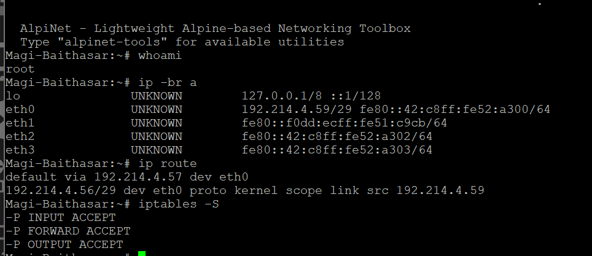

> Screenshot: output `ip -br a` pada Magi-Balthasar yang menunjukkan IP address 192.214.4.59.

## 3. Konfigurasi Firewall

Konfigurasi firewall dilakukan pada Magi-Balthasar menggunakan iptables.

### 3.1 Mengizinkan Magi-Casper

```bash
iptables -A INPUT -p tcp -s 192.214.4.58 --dport 5000:5001 -j ACCEPT
```

### 3.2 Mengizinkan Node Pilot

```bash
iptables -A INPUT -p tcp -s 192.214.4.66 --dport 5000:5001 -j ACCEPT
iptables -A INPUT -p tcp -s 192.214.4.67 --dport 5000:5001 -j ACCEPT
iptables -A INPUT -p tcp -s 192.214.4.68 --dport 5000:5001 -j ACCEPT
```

### 3.3 Menolak Koneksi dari Node Lain

```bash
iptables -A INPUT -p tcp --dport 5000:5001 \
  -j REJECT --reject-with icmp-port-unreachable
```

Rule ACCEPT ditempatkan sebelum rule REJECT agar node yang diizinkan dapat mengakses layanan.

### Hasil Konfigurasi Firewall

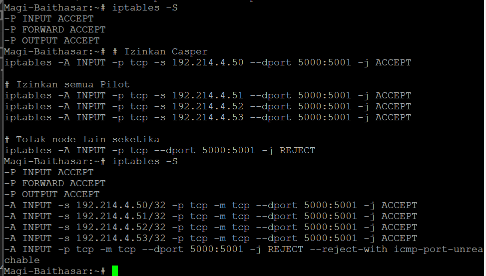

> Screenshot: output `iptables -S` atau `iptables -vnL INPUT` pada Magi-Balthasar yang menunjukkan rule whitelist dan REJECT.

## 4. Pengujian Koneksi

### 4.1 Pengujian dari Unit-01

Pengujian dilakukan untuk memastikan Unit-01 dapat mengakses TCP port 5000 dan 5001 pada Magi-Balthasar.

```bash
nc -zvw2 192.214.4.59 5000
nc -zvw2 192.214.4.59 5001
```

Hasil:
- Port 5000: Connection succeeded
- Port 5001: Connection succeeded

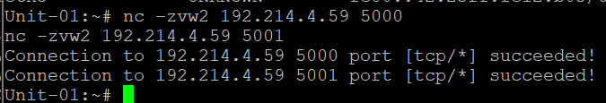

> Screenshot: output netcat dari Unit-01 yang menunjukkan koneksi berhasil pada kedua port.

### 4.2 Pengujian dari Lilith

Pengujian dilakukan untuk memastikan node yang tidak termasuk whitelist ditolak oleh firewall.

```bash
nc -zvw2 192.214.4.59 5000
nc -zvw2 192.214.4.59 5001
```

Hasil:
- Port 5000: Connection refused
- Port 5001: Connection refused

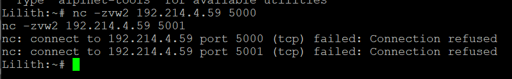

> Screenshot: output netcat dari Lilith yang menunjukkan koneksi ditolak pada kedua port.

### 4.3 Pengujian Koneksi Internet

Pada Magi-Balthasar, dilakukan pengujian konektivitas ke alamat IP publik menggunakan ping.

```bash
ping -c 4 8.8.8.8
```

Hasil:
- 4 packets transmitted
- 4 packets received
- 0% packet loss

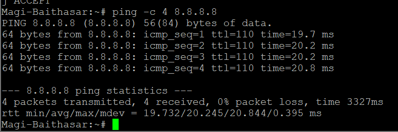

> Screenshot: output ping dari Magi-Balthasar ke 8.8.8.8.

## 5. Persistence

Untuk mempertahankan konfigurasi firewall setelah GNS3 ditutup, dibuat script persistence utama pada Magi-Balthasar.

Lokasi script:

```text
/root/Magi-Balthasar.sh
```

Script tersebut membangun ulang rule firewall Q13 dan menyimpan snapshot konfigurasi menggunakan iptables-save.

Untuk memulihkan konfigurasi setelah node dijalankan kembali:

```bash
sh /root/Magi-Balthasar.sh
```

### Pengujian Persistence

Pengujian persistence dilakukan dengan langkah berikut:

1. Node Magi-Balthasar dihentikan dan dijalankan kembali.
2. GNS3 ditutup sepenuhnya.
3. Project GNS3 dibuka kembali.
4. Script persistence dijalankan pada Magi-Balthasar.
5. Pengujian koneksi TCP dilakukan kembali dari Unit-01 dan Lilith.

Hasil pengujian setelah restore:
- Unit-01 berhasil mengakses port 5000 dan 5001.
- Lilith ditolak pada port 5000 dan 5001.

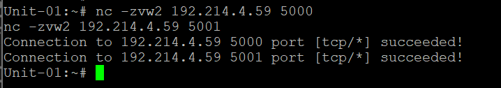

> Screenshot: hasil pengujian Unit-01 setelah GNS3 ditutup dan dibuka kembali, kemudian script persistence dijalankan.

## 6. Kesimpulan

Firewall pada Magi-Balthasar berhasil dikonfigurasi untuk mengizinkan akses TCP port 5000 dan 5001 dari Magi-Casper serta Unit-00, Unit-01, dan Unit-02.

Node yang tidak termasuk whitelist, seperti Lilith dan Magi-Melchior, mendapatkan respons Connection refused.

Pengujian konektivitas internet dari Magi-Balthasar juga berhasil dengan 0% packet loss.

Konfigurasi firewall berhasil dipulihkan menggunakan script persistence setelah GNS3 ditutup dan dibuka kembali.

# Q14 - Jam Kunjungan Sang Pinguin (Pen-Pen)

## Tujuan

Mengamankan Pen-Pen menggunakan firewall berbasis waktu dengan `iptables`. Pen-Pen hanya dapat diakses sesuai jadwal yang telah ditentukan untuk masing-masing kelompok.

Pembatasan akses berlaku untuk:
- ICMP (ping) ke Pen-Pen.
- TCP port 80 pada Pen-Pen.

Jadwal diterapkan menggunakan waktu UTC karena `iptables` membaca waktu sistem dalam UTC, yaitu 7 jam lebih lambat dari WIB.

Implementasi meliputi:
- Mengatur jadwal akses Pilot dan Staf Geofront.
- Menolak seluruh akses dari Terduga Dummy System.
- Mengizinkan akses dari host lainnya tanpa batasan waktu.
- Menyimpan konfigurasi firewall dalam script.
- Memastikan konfigurasi firewall diterapkan kembali setelah node restart.
- Melakukan pengujian konektivitas pada jadwal aktif dan tidak aktif.

## Konfigurasi Jadwal

Pen-Pen menggunakan alamat IP `192.214.3.194/27`.

Jadwal akses dikonversi dari WIB ke UTC sebagai berikut:

| Kelompok | Jadwal WIB | Jadwal UTC | Hari |
|---|---|---|---|
| Pilot | 08:00–16:00 | 01:00–09:00 | Senin–Jumat |
| Staf Geofront | 17:00–23:00 | 10:00–16:00 | Setiap hari |
| Terduga Dummy System | Tidak pernah | Tidak pernah | Selalu ditolak |
| Lainnya | Bebas | Bebas | Tanpa batasan |

Jadwal disimpan sebagai variabel pada awal script `/root/soal14.sh`:

```bash
PILOT_START="00:00"
PILOT_STOP="09:00"
PILOT_DAYS="Mon,Tue,Wed,Thu,Fri"

STAF_START="10:00"
STAF_STOP="16:00"
```

Variabel jadwal Pilot diubah sementara selama pengujian agar sesuai dengan waktu praktikum, kemudian dikembalikan ke jadwal final.

## Konfigurasi Firewall

Konfigurasi firewall diterapkan menggunakan script:

```bash
sh /root/soal14.sh
```

Script membuat chain `Q14_TIME` untuk mengatur akses berdasarkan waktu.

Aturan firewall mencakup:
- Mengizinkan ICMP Echo Request selama jadwal akses yang ditentukan.
- Mengizinkan koneksi TCP port 80 selama jadwal akses yang ditentukan.
- Menolak ICMP dan TCP port 80 di luar jadwal akses.
- Menolak seluruh akses dari Terduga Dummy System.
- Mempertahankan akses dari host lainnya sesuai ketentuan soal.

**Dokumentasi Konfigurasi Firewall**

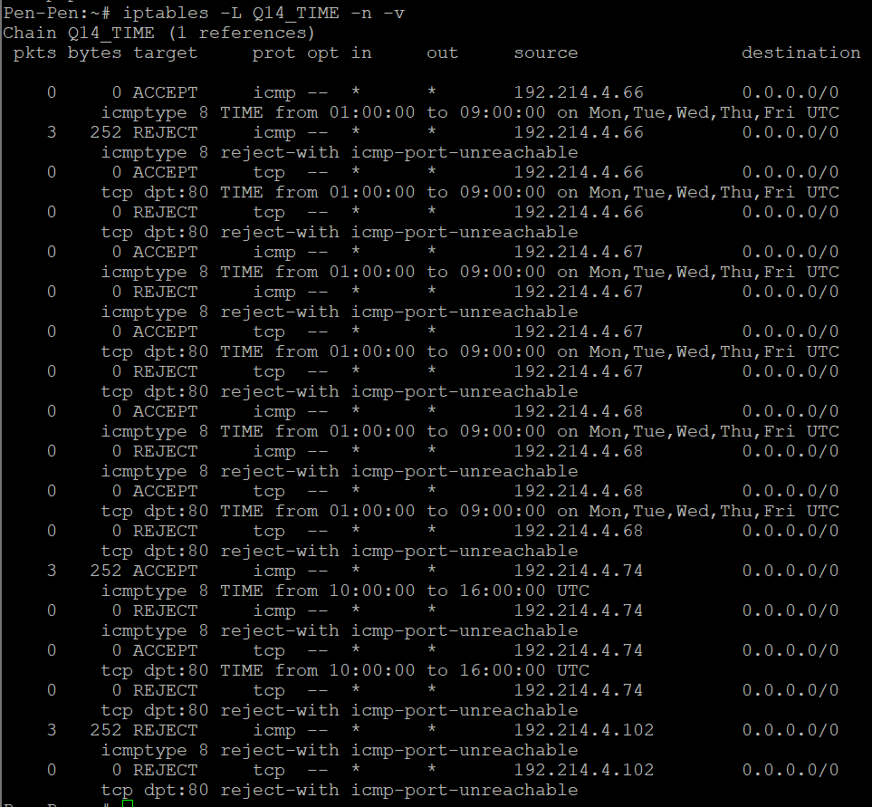

## Pengujian Konektivitas

Pengujian dilakukan dari Unit-01 menuju Pen-Pen dengan alamat IP `192.214.3.194`.

Pengujian menggunakan perintah:

```bash
nc -zvw2 192.214.3.194 80
```

### Pengujian Saat Jadwal Allow

Untuk menguji koneksi pada jadwal aktif, variabel PILOT sementara diubah menjadi:

```bash
PILOT_START="13:00"
PILOT_STOP="14:00"
```

Setelah script firewall dijalankan kembali, pengujian koneksi dari Unit-01 menunjukkan hasil:

```text
Connection to 192.214.3.194 80 port [tcp/http] succeeded!
```

Hasil tersebut menunjukkan bahwa koneksi TCP port 80 berhasil diterima ketika jadwal akses aktif.

**Dokumentasi Pengujian Jadwal Allow**

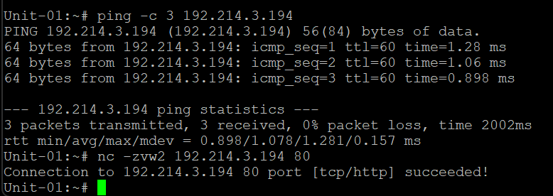

##### Pengujian Saat Jadwal Deny

Untuk menguji koneksi pada jadwal tidak aktif, variabel PILOT sementara diubah menjadi:

```bash
PILOT_START="14:00"
PILOT_STOP="15:00"
```

Setelah script firewall dijalankan kembali, pengujian koneksi dari Unit-01 menunjukkan hasil:

```text
nc: connect to 192.214.3.194 port 80 (tcp) failed: Connection refused
```

Hasil tersebut menunjukkan bahwa koneksi TCP port 80 ditolak ketika jadwal akses tidak aktif.

**Dokumentasi Pengujian Jadwal Deny**

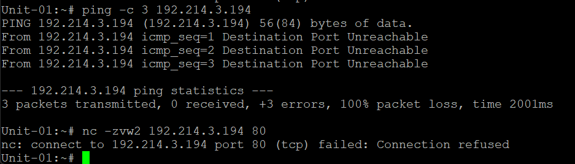

## Persistence Firewall

Konfigurasi firewall disimpan pada:

```text
/root/soal14.sh
```

Untuk memastikan konfigurasi tetap diterapkan setelah node restart, dilakukan pengujian persistence.

Setelah Pen-Pen direstart, script firewall dijalankan kembali secara otomatis melalui mekanisme startup node.

Hasil konfigurasi diperiksa menggunakan perintah:

```bash
iptables -L Q14_TIME -n -v --line-numbers
```

Chain `Q14_TIME` kembali terbentuk dan menampilkan aturan firewall sesuai jadwal yang telah dikonfigurasi.

**Dokumentasi Persistence Firewall**

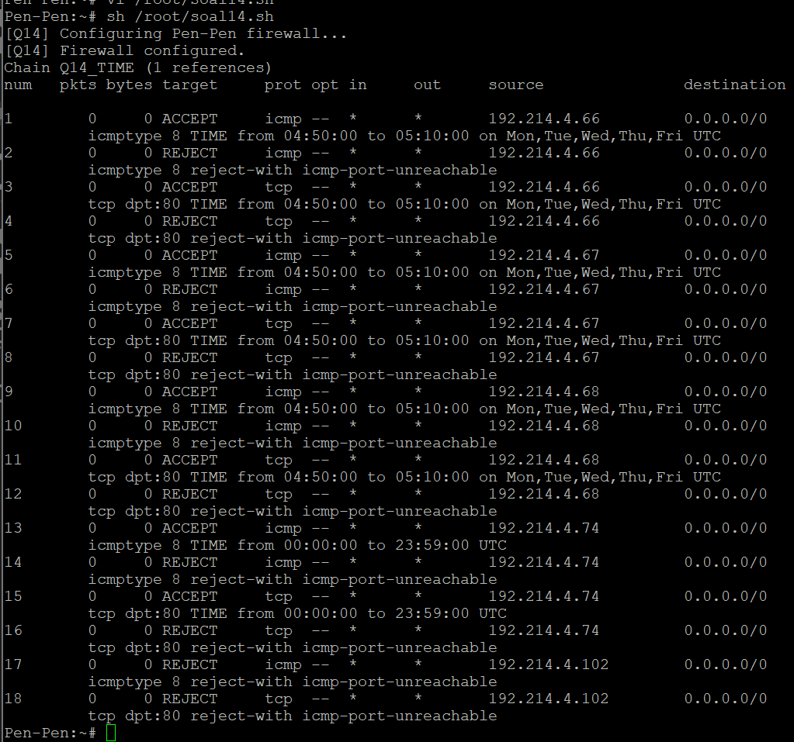

## Kesimpulan

Implementasi firewall berbasis waktu pada Pen-Pen berhasil dilakukan menggunakan `iptables`.

Pengujian menunjukkan bahwa:
- Koneksi TCP port 80 berhasil saat jadwal akses aktif.
- Koneksi TCP port 80 ditolak saat jadwal akses tidak aktif.
- Konfigurasi firewall berhasil diterapkan kembali setelah node restart.
- Jadwal final Pilot dikembalikan ke `00:00–09:00 UTC` pada hari Senin sampai Jumat.

Dengan demikian, konfigurasi firewall Q14 telah memenuhi pengujian pembatasan akses berdasarkan waktu dan persistence setelah restart.


# Q15 — ICMP Rate Limiting pada Tokyo3-Core

## 1. Tujuan

Membatasi jumlah paket ICMP Echo Request yang dapat diterima oleh Tokyo3-Core maksimal 5 paket per detik untuk mencegah serangan ping flood.

Konfigurasi firewall harus memenuhi ketentuan berikut:

- Membatasi ping masuk menuju Tokyo3-Core.
- Membuang paket ping yang melebihi batas.
- Tidak mengganggu ping normal di bawah batas.
- Tidak membatasi ping yang dikirim oleh Tokyo3-Core sendiri.
- Memastikan rule diterapkan pada jenis paket dan chain yang tepat.

## 2. Identifikasi Tokyo3-Core

Alamat IP Tokyo3-Core diperoleh melalui perintah:

```bash
ip a
```

Alamat IPv4 Tokyo3-Core:

```text
192.214.4.106/30
```

## 3. Konfigurasi Firewall

Konfigurasi dilakukan pada Tokyo3-Core menggunakan `iptables`.

### Rule 1 — Membatasi ICMP Echo Request

```bash
iptables -A INPUT -p icmp --icmp-type echo-request -m limit --limit 5/second --limit-burst 5 -j ACCEPT
```

Rule ini mengizinkan paket ICMP Echo Request dengan rata-rata maksimal 5 paket per detik dan burst awal sebanyak 5 paket.

### Rule 2 — Membuang Paket Berlebih

```bash
iptables -A INPUT -p icmp --icmp-type echo-request -j DROP
```

Paket ICMP Echo Request yang tidak memenuhi batas pada rule pertama akan dibuang.

### Verifikasi Rule

```bash
iptables -L INPUT -n -v --line-numbers
```

Urutan rule:

1. ACCEPT ICMP Echo Request dengan rate limit.
2. DROP ICMP Echo Request yang melebihi limit.

Rule ditempatkan pada chain `INPUT` sehingga hanya memengaruhi paket yang masuk ke Tokyo3-Core. Paket ping yang dikirim oleh Tokyo3-Core sendiri melewati chain `OUTPUT` dan tidak terkena pembatasan ini.

## 4. Pengujian Ping Flood

Pengujian dilakukan dari Lilith menuju Tokyo3-Core menggunakan perintah:

```bash
ping -i 0.1 -c 50 192.214.4.106
```

Perintah tersebut mengirimkan 50 paket ICMP dengan interval 0,1 detik.

### Hasil Pengujian

| Parameter | Hasil |
|---|---:|
| Paket dikirim | 50 |
| Paket diterima | 30 |
| Paket hilang | 20 |
| Packet loss | 40% |

Sebagian paket ping berhasil diterima, sedangkan paket yang melebihi batas rate limit dibuang oleh firewall.

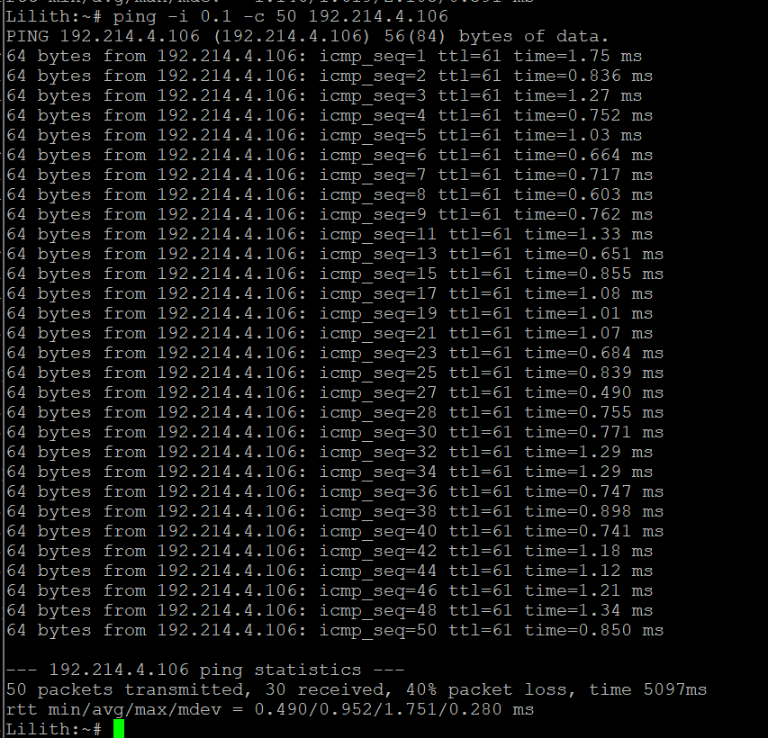

## 5. Verifikasi Counter Firewall

Counter firewall diperiksa menggunakan perintah:

```bash
iptables -L INPUT -n -v --line-numbers
```

Hasil counter setelah pengujian ping flood:

| Rule | Paket |
|---|---:|
| ACCEPT | 30 |
| DROP | 20 |

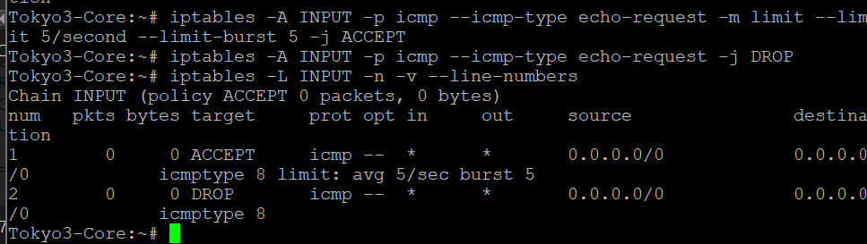

Counter pada rule DROP meningkat menjadi 20 paket. Hal ini membuktikan bahwa rule pembuangan benar-benar menangani paket ICMP Echo Request yang melebihi batas.

## 6. Pengujian Ping Normal

Pengujian ping normal dilakukan dari Lilith menggunakan perintah:

```bash
ping -c 5 -i 3 192.214.4.106
```

Perintah tersebut mengirimkan 5 paket ICMP dengan interval 3 detik.

### Hasil Pengujian

| Parameter | Hasil |
|---|---:|
| Paket dikirim | 5 |
| Paket diterima | 5 |
| Paket hilang | 0 |
| Packet loss | 0% |

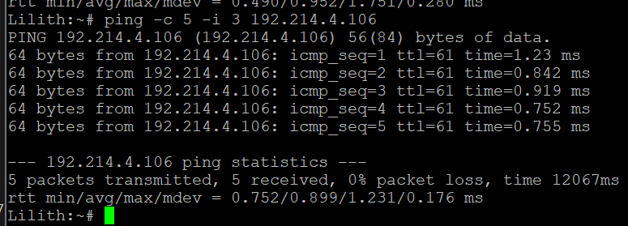

Seluruh paket ping normal berhasil diterima oleh Tokyo3-Core tanpa packet loss.

## 7. Kesimpulan

Konfigurasi ICMP rate limiting pada Tokyo3-Core berhasil diterapkan.

Berdasarkan hasil pengujian:

- Ping flood sebanyak 50 paket menghasilkan 40% packet loss.
- Counter rule DROP meningkat sebanyak 20 paket.
- Ping normal sebanyak 5 paket berhasil seluruhnya dengan 0% packet loss.
- Rule hanya membatasi ICMP Echo Request yang masuk melalui chain INPUT.
- Ping yang dikirim oleh Tokyo3-Core sendiri tidak dibatasi oleh rule tersebut.

Dengan demikian, konfigurasi firewall Q15 berhasil membatasi ping berlebihan tanpa mengganggu koneksi ping normal.

### 7. Persistence Firewall

Untuk memastikan konfigurasi firewall tetap aktif setelah Tokyo3-Core
mengalami restart, rule Q15 ditambahkan ke script startup:

`/root/tokyo3-core.sh`

Rule menggunakan pengecekan `iptables -C` sebelum ditambahkan,
sehingga konfigurasi tidak menghasilkan rule duplikat ketika
script dijalankan kembali.

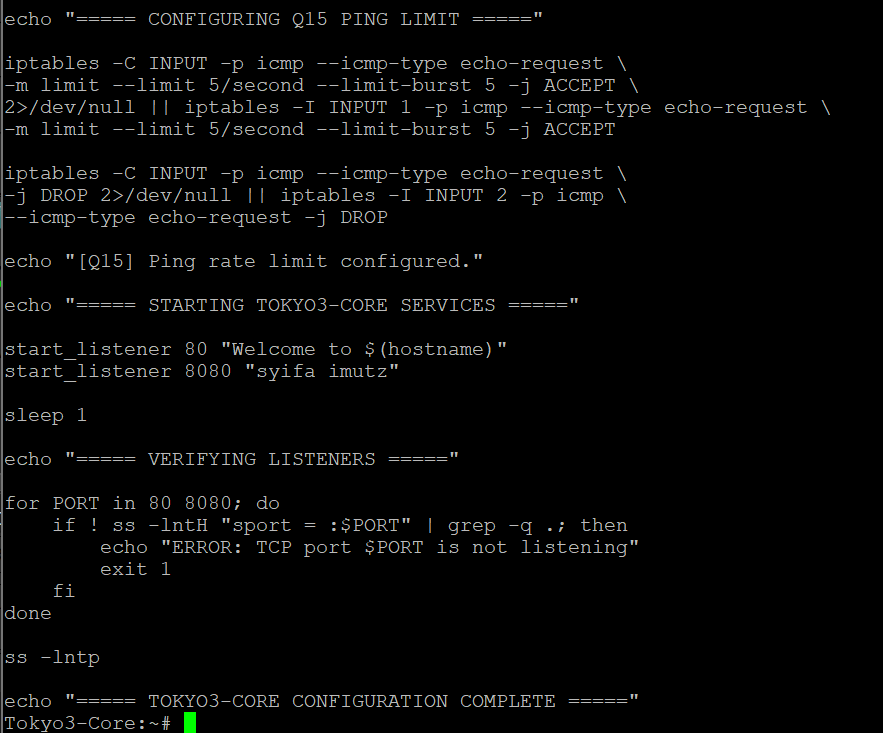

Setelah script diperbarui, dilakukan restart pada node Tokyo3-Core.
Pengecekan menggunakan:

```bash
iptables -L INPUT -n -v --line-numbers
```

Hasil menunjukkan bahwa rule ACCEPT dengan limit 5 ping per detik
dan rule DROP tetap muncul setelah restart.

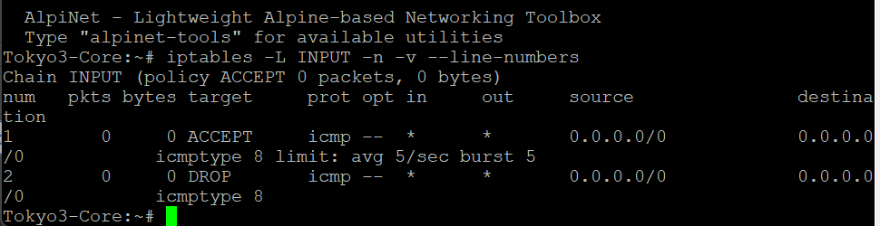

Hal ini membuktikan bahwa konfigurasi firewall Q15 berhasil
dipertahankan melalui mekanisme startup Tokyo3-Core.


# Q16 — Deteksi dan Pemblokiran Port Sensitif pada Tokyo3-Core

## 1. Tujuan

Mendeteksi dan memblokir percobaan koneksi TCP dari Dummy-Plug menuju port sensitif Tokyo3-Core.

Konfigurasi firewall harus memenuhi ketentuan berikut:

- Mencatat koneksi TCP dari Dummy-Plug menuju port 22, 23, dan 3306.
- Menggunakan prefix log `SCAN-NERV:`.
- Memblokir koneksi menuju port sensitif.
- Memastikan rule LOG berada sebelum rule DROP.
- Tidak mengganggu akses menuju port 80 dan 8080.
- Tidak memengaruhi koneksi dari klien lain.

## 2. Identifikasi Perangkat

Alamat IPv4 Tokyo3-Core diperoleh melalui perintah:

```bash
ip a
```

Alamat IPv4 Tokyo3-Core:

```text
192.214.4.106/30
```

Alamat IPv4 Dummy-Plug diperoleh melalui perintah:

```bash
ip -br a
```

Alamat IPv4 Dummy-Plug:

```text
192.214.4.51/29
```

## 3. Konfigurasi Firewall

Konfigurasi dilakukan pada Tokyo3-Core menggunakan `iptables`.

### Rule 1 — Pencatatan Percobaan Koneksi

```bash
iptables -I INPUT 1 -s 192.214.4.51 -p tcp -m multiport --dports 22,23,3306 -j LOG --log-prefix "SCAN-NERV: " --log-level 4
```

Rule ini mencatat paket TCP dari Dummy-Plug yang menuju port 22, 23, dan 3306 menggunakan prefix `SCAN-NERV:`.

### Rule 2 — Pemblokiran Port Sensitif

```bash
iptables -I INPUT 2 -s 192.214.4.51 -p tcp -m multiport --dports 22,23,3306 -j DROP
```

Rule ini membuang paket TCP dari Dummy-Plug yang menuju port sensitif setelah paket tersebut dicatat oleh rule LOG.

### Verifikasi Rule

```bash
iptables -L INPUT -n -v --line-numbers
```

Urutan rule:

1. LOG TCP dari Dummy-Plug menuju port 22, 23, dan 3306.
2. DROP TCP dari Dummy-Plug menuju port 22, 23, dan 3306.

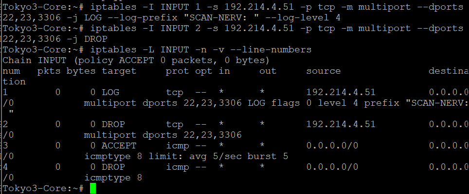

## 4. Pengujian Port Sensitif

Pengujian dilakukan dari Dummy-Plug menuju Tokyo3-Core menggunakan perintah:

```bash
nc -w 2 192.214.4.106 22
nc -w 2 192.214.4.106 23
nc -w 2 192.214.4.106 3306
```

### Hasil Pengujian

| Port | Layanan | Hasil |
|---|---|---|
| 22 | SSH | Ditolak |
| 23 | Telnet | Ditolak |
| 3306 | MySQL | Ditolak |

Ketiga percobaan koneksi tidak menghasilkan koneksi TCP yang berhasil.

## 5. Pengujian Port yang Tetap Diizinkan

Pengujian dilakukan dari Dummy-Plug untuk memastikan port 80 dan 8080 tetap dapat diakses.

```bash
nc -zvw2 192.214.4.106 80
nc -zvw2 192.214.4.106 8080
```

### Hasil Pengujian

```text
Connection to 192.214.4.106 80 port [tcp/http] succeeded!
Connection to 192.214.4.106 8080 port [tcp/http-alt] succeeded!
```

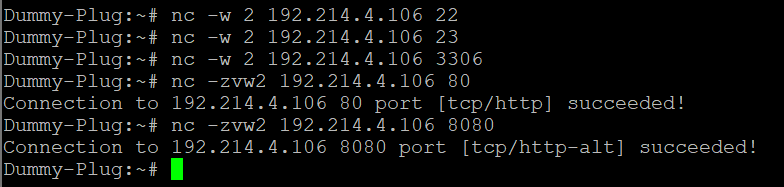

Kedua koneksi berhasil dilakukan. Hal ini menunjukkan bahwa rule pemblokiran tidak mengganggu akses menuju port 80 dan 8080.

## 6. Verifikasi Counter Firewall

Counter firewall diperiksa menggunakan perintah:

```bash
iptables -L INPUT -n -v --line-numbers
```

### Hasil Counter

| Rule | Paket | Bytes |
|---|---:|---:|
| LOG | 6 | 360 |
| DROP | 6 | 360 |

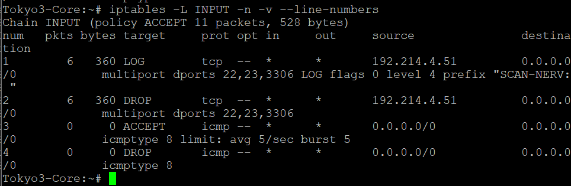

Counter pada rule LOG dan DROP meningkat menjadi 6 paket dengan total 360 bytes.

Hal ini membuktikan bahwa paket dari Dummy-Plug menuju port sensitif telah melewati rule pencatatan dan kemudian dibuang oleh firewall.

## 7. Persistence Firewall

Konfigurasi Q16 dimasukkan ke dalam script startup Tokyo3-Core agar rule firewall tetap diterapkan setelah script dipanggil ulang.

Bagian konfigurasi Q16 pada script:

```bash
echo "===== CONFIGURING Q16 SCAN DETECTION ====="

iptables -C INPUT -s 192.214.4.51 -p tcp -m multiport --dports 22,23,3306 -j LOG --log-prefix "SCAN-NERV: " --log-level 4 2>/dev/null || iptables -I INPUT 1 -s 192.214.4.51 -p tcp -m multiport --dports 22,23,3306 -j LOG --log-prefix "SCAN-NERV: " --log-level 4

iptables -C INPUT -s 192.214.4.51 -p tcp -m multiport --dports 22,23,3306 -j DROP 2>/dev/null || iptables -I INPUT 2 -s 192.214.4.51 -p tcp -m multiport --dports 22,23,3306 -j DROP

echo "[Q16] Scan detection configured."
```

Rule diperiksa terlebih dahulu menggunakan `iptables -C` agar tidak terjadi duplikasi ketika script dijalankan kembali.

### Pengujian Persistence

Pada Tokyo3-Core, script dipanggil ulang menggunakan perintah:

```bash
sh /root/tokyo3-core.sh
```

Pengecekan rule dilakukan menggunakan:

```bash
iptables -L INPUT -n -v --line-numbers
```

Hasil menunjukkan bahwa konfigurasi Q16 tetap diterapkan setelah script dipanggil ulang.

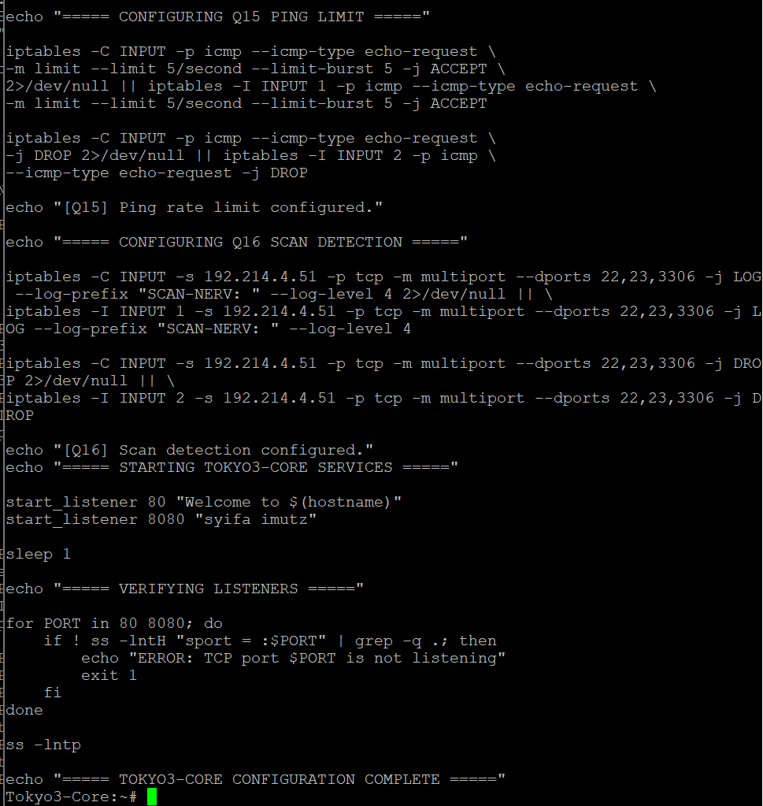

Hal ini membuktikan bahwa konfigurasi firewall Q16 berhasil dipertahankan melalui mekanisme startup Tokyo3-Core.

## 8. Kesimpulan

Konfigurasi deteksi dan pemblokiran port sensitif pada Tokyo3-Core berhasil diterapkan.

Berdasarkan hasil pengujian:

- Percobaan koneksi dari Dummy-Plug menuju port 22, 23, dan 3306 ditolak.
- Port 80 dan 8080 tetap dapat diakses.
- Counter rule LOG dan DROP meningkat sebanyak 6 paket.
- Rule pencatatan ditempatkan sebelum rule pemblokiran.
- Konfigurasi Q16 tetap terpasang setelah script startup dipanggil ulang.

Dengan demikian, konfigurasi firewall Q16 berhasil mendeteksi dan memblokir percobaan koneksi menuju port sensitif dari Dummy-Plug tanpa mengganggu layanan pada port yang tetap diizinkan.


# Q17 — Magic Black Route pada Fuyutsuki

## 1. Tujuan

Mengalihkan setiap koneksi TCP dari Magi-Casper menuju Zeruel agar koneksi tersebut diteruskan ke Pen-Pen melalui router Fuyutsuki.

Konfigurasi harus memenuhi ketentuan berikut:

- Mengalihkan koneksi TCP dari Magi-Casper menuju Zeruel.
- Mengalihkan koneksi TCP port 9000 menuju Pen-Pen.
- Memastikan Magi-Casper tetap menggunakan IP Zeruel sebagai alamat tujuan.
- Memastikan balasan dari Pen-Pen diteruskan kembali ke Magi-Casper seolah-olah berasal dari Zeruel.
- Tidak mengalihkan paket ICMP atau ping.
- Menyalakan listener port 9000 pada Pen-Pen dan Zeruel.
- Menampilkan tabel conntrack pada Fuyutsuki untuk membuktikan mekanisme NAT.

## 2. Identifikasi Alamat IP

Alamat IP masing-masing node diperiksa menggunakan perintah:

```bash
ip -br a
```

### Magi-Casper

Alamat IPv4 Magi-Casper:

```text
192.214.4.58/29
```

### Zeruel

Alamat IPv4 Zeruel:

```text
192.214.4.82/29
```

### Pen-Pen

Alamat IPv4 Pen-Pen:

```text
192.214.3.194/27
```

### Fuyutsuki

Alamat IPv4 pada interface Fuyutsuki:

```text
eth0: 192.214.4.134/30
eth1: 192.214.4.57/29
eth2: 192.214.4.165/30
eth3: 192.214.4.169/30
```

Alamat gateway yang digunakan untuk mengakses jaringan Pen-Pen dan Zeruel diperiksa menggunakan:

```bash
ip route
```

Hasil routing menunjukkan bahwa jaringan Pen-Pen berada pada:

```text
192.214.3.192/27 via 192.214.4.166 dev eth2
```

Sedangkan jaringan Zeruel berada pada:

```text
192.214.4.72/29 via 192.214.4.170 dev eth3
```

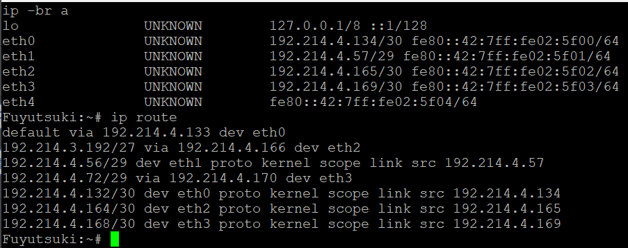

## 3. Mengaktifkan IP Forwarding

Konfigurasi dilakukan pada Fuyutsuki sebagai router yang meneruskan koneksi dari Magi-Casper menuju Pen-Pen.

IP forwarding diaktifkan menggunakan perintah:

```bash
echo 1 > /proc/sys/net/ipv4/ip_forward
```

Perintah tersebut mengaktifkan kemampuan Fuyutsuki untuk meneruskan paket IPv4 dari satu interface ke interface lainnya.

## 4. Konfigurasi NAT pada Fuyutsuki

Konfigurasi NAT dilakukan menggunakan `iptables`.

### Rule 1 — Destination NAT (DNAT)

Koneksi TCP dari Magi-Casper menuju Zeruel pada port 9000 dialihkan ke Pen-Pen.

```bash
iptables -t nat -A PREROUTING -s 192.214.4.58 -d 192.214.4.82 -p tcp --dport 9000 -j DNAT --to-destination 192.214.3.194:9000
```

Rule tersebut mengubah alamat tujuan paket dari Zeruel menjadi Pen-Pen.

Dengan demikian, Magi-Casper tetap mengirimkan paket menuju alamat IP Zeruel, tetapi Fuyutsuki meneruskan koneksi tersebut ke Pen-Pen.

### Rule 2 — Source NAT (SNAT)

Agar balasan dari Pen-Pen kembali melalui Fuyutsuki, konfigurasi SNAT diterapkan.

```bash
iptables -t nat -A POSTROUTING -s 192.214.4.58 -d 192.214.3.194 -p tcp --dport 9000 -j SNAT --to-source 192.214.4.57
```

Rule tersebut mengubah alamat sumber koneksi menjadi IP interface Fuyutsuki pada jaringan Magi-Casper.

Pen-Pen akan mengirimkan balasan menuju Fuyutsuki, kemudian Fuyutsuki meneruskan balasan tersebut kembali ke Magi-Casper.

### Verifikasi Rule NAT

Konfigurasi NAT diperiksa menggunakan:

```bash
iptables -t nat -L -n -v --line-numbers
```

Hasil konfigurasi menunjukkan adanya rule DNAT pada chain `PREROUTING` dan rule SNAT pada chain `POSTROUTING`.

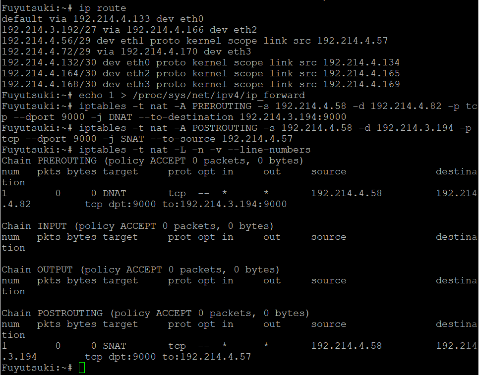

## 5. Menyalakan Listener Port 9000

Listener port 9000 harus dijalankan pada Pen-Pen dan Zeruel.

### Pen-Pen

Jalankan perintah:

```bash
nc -lv -p 9000
```

Output:

```text
Listening on 0.0.0.0 9000
```

Listener pada Pen-Pen digunakan untuk menerima koneksi yang dialihkan oleh Fuyutsuki.

### Zeruel

Jalankan perintah:

```bash
nc -lv -p 9000
```

Output:

```text
Listening on 0.0.0.0 9000
```

Listener pada Zeruel digunakan sebagai pembanding untuk memastikan bahwa koneksi dari Magi-Casper tidak benar-benar diterima oleh Zeruel.

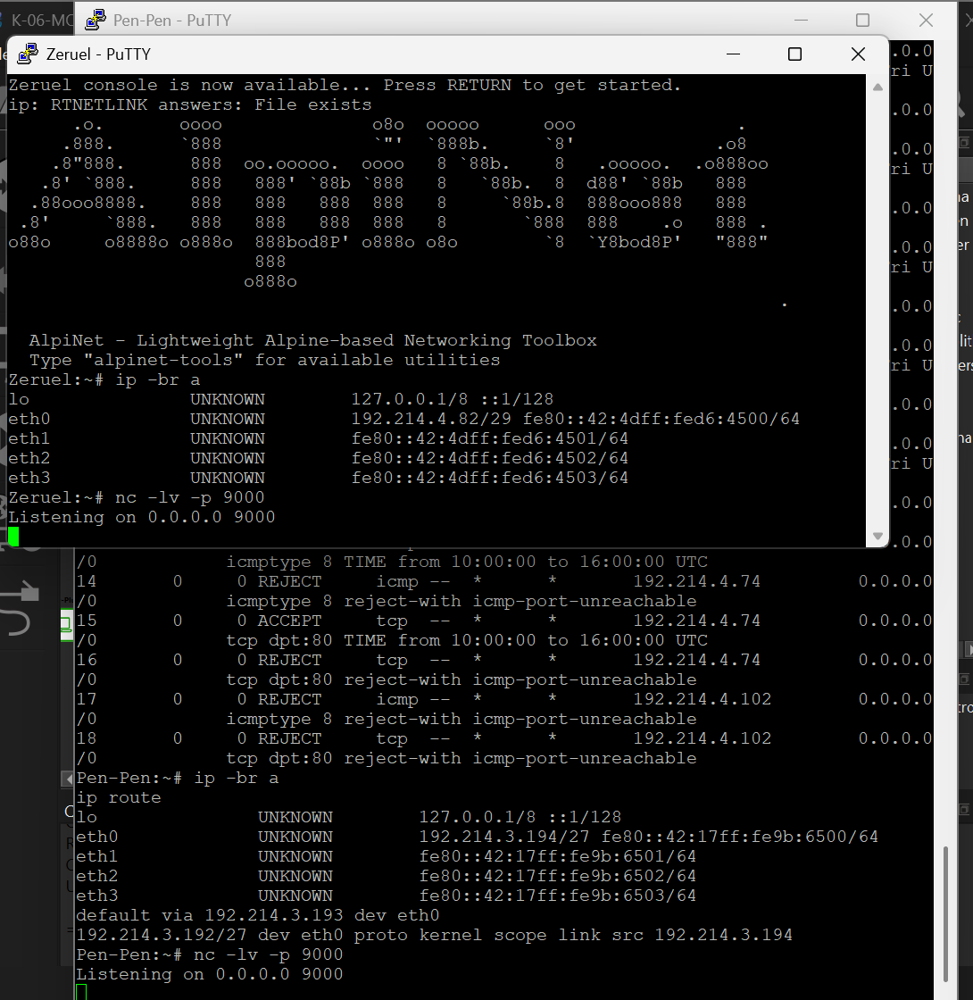

## 6. Pengujian Koneksi dari Magi-Casper

Pengujian dilakukan dari Magi-Casper menuju alamat IP Zeruel pada port 9000.

Perintah yang digunakan:

```bash
nc -v 192.214.4.82 9000
```

Output pada Magi-Casper:

```text
Connection to 192.214.4.82 9000 port [tcp/*] succeeded!
```

Koneksi berhasil dibuat menggunakan alamat IP Zeruel sebagai alamat tujuan.

Setelah koneksi terbentuk, pesan pengujian dikirimkan:

```text
Q17 - MAGIC BLACK ROUTE
AWOKAWOKAWOK
```

### Hasil pada Pen-Pen

Pesan yang dikirim dari Magi-Casper muncul pada listener Pen-Pen.

Output:

```text
Connection received on 192.214.4.57 39590
Q17 - MAGIC BLACK ROUTE
AWOKAWOKAWOK
```

Alamat sumber yang terlihat oleh Pen-Pen adalah `192.214.4.57`, yaitu alamat interface Fuyutsuki yang digunakan oleh SNAT.

### Hasil pada Zeruel

Listener pada Zeruel tidak menerima pesan pengujian dari Magi-Casper.

Hal ini membuktikan bahwa koneksi TCP port 9000 dialihkan oleh Fuyutsuki menuju Pen-Pen, bukan diteruskan ke listener Zeruel.

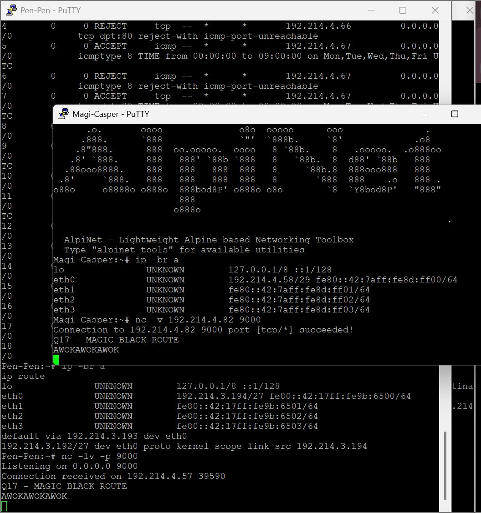

## 7. Verifikasi Connection Tracking

Untuk memeriksa koneksi yang telah dialihkan, conntrack tools dipasang pada Fuyutsuki.

```bash
apk add conntrack-tools
```

Setelah instalasi selesai, tabel connection tracking diperiksa menggunakan:

```bash
conntrack -L -p tcp
```

Untuk menampilkan koneksi TCP port 9000 secara khusus:

```bash
conntrack -L -p tcp | grep 9000
```

Hasil yang ditampilkan:

```text
tcp 6 431957 ESTABLISHED
src=192.214.4.58 dst=192.214.4.82 sport=39590 dport=9000
src=192.214.3.194 dst=192.214.4.57 sport=9000 dport=39590
[ASSURED] mark=0 use=1
```

Entry tersebut menunjukkan bahwa koneksi berasal dari Magi-Casper dengan alamat `192.214.4.58` menuju Zeruel dengan alamat `192.214.4.82`.

Pada bagian reply, alamat Pen-Pen `192.214.3.194` terlihat sebagai sumber balasan, sedangkan alamat Fuyutsuki `192.214.4.57` menjadi tujuan balasan.

Hal ini membuktikan bahwa koneksi mengalami translasi alamat melalui DNAT dan SNAT.

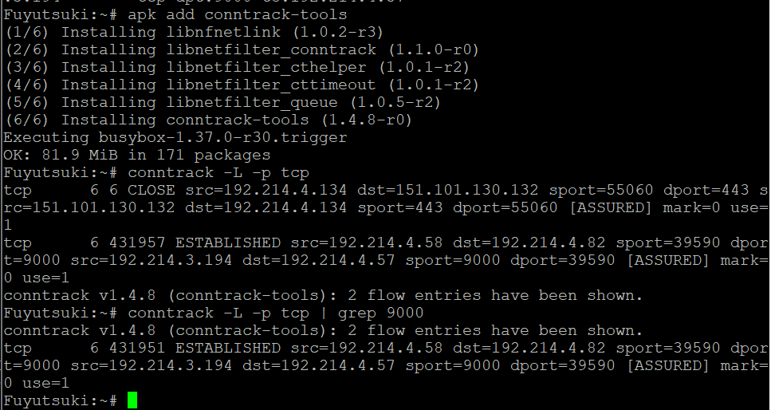

## 8. Kesimpulan

Konfigurasi Magic Black Route pada Fuyutsuki berhasil diterapkan.

Berdasarkan hasil pengujian:

- Magi-Casper berhasil membuat koneksi TCP menuju IP Zeruel port 9000.
- Koneksi tersebut diteruskan ke Pen-Pen melalui DNAT.
- Pen-Pen menerima pesan pengujian dari Magi-Casper.
- Listener Zeruel tidak menerima pesan tersebut.
- SNAT memastikan balasan dari Pen-Pen kembali melalui Fuyutsuki.
- Tabel conntrack menunjukkan koneksi TCP yang telah mengalami translasi alamat.

Dengan demikian, Fuyutsuki berhasil mengalihkan koneksi TCP port 9000 dari Magi-Casper menuju Pen-Pen tanpa mengubah alamat tujuan yang digunakan oleh Magi-Casper.

## 9. Persistensi Konfigurasi

Setelah konfigurasi NAT berhasil diterapkan dan diuji, dilakukan persistensi agar rule tetap tersedia setelah Fuyutsuki mengalami restart.

### 9.1 Pemeriksaan Mekanisme Startup

Pada Fuyutsuki, dilakukan pemeriksaan terhadap file startup:

```bash
cat /etc/alpinet-init.sh
```

Hasil pemeriksaan menunjukkan bahwa file tersebut menjalankan `/root/init.sh` apabila file tersebut tersedia dan memiliki permission executable.

Bagian yang relevan:

```bash
[ -f /root/init.sh ] && [ -x /root/init.sh ] && /root/init.sh
```

Dengan demikian, `/root/init.sh` dapat digunakan sebagai script untuk menerapkan kembali konfigurasi Q17 saat startup.

### 9.2 Pembuatan Script Persistensi

Script persistensi dibuat pada lokasi:

```bash
/root/init.sh
```

Isi script:

```bash
cat > /root/init.sh <<'EOF'
#!/bin/sh

echo 1 > /proc/sys/net/ipv4/ip_forward

iptables -t nat -C PREROUTING \
-s 192.214.4.58 -d 192.214.4.82 \
-p tcp --dport 9000 \
-j DNAT --to-destination 192.214.3.194:9000 2>/dev/null || \
iptables -t nat -A PREROUTING \
-s 192.214.4.58 -d 192.214.4.82 \
-p tcp --dport 9000 \
-j DNAT --to-destination 192.214.3.194:9000

iptables -t nat -C POSTROUTING \
-s 192.214.4.58 -d 192.214.3.194 \
-p tcp --dport 9000 \
-j SNAT --to-source 192.214.4.57 2>/dev/null || \
iptables -t nat -A POSTROUTING \
-s 192.214.4.58 -d 192.214.3.194 \
-p tcp --dport 9000 \
-j SNAT --to-source 192.214.4.57
EOF
```

Perintah `iptables -C` digunakan untuk memeriksa apakah rule telah tersedia. Apabila rule belum ditemukan, rule akan ditambahkan menggunakan `iptables -A`.

Mekanisme tersebut mencegah rule yang sama ditambahkan berulang kali ketika script startup dijalankan kembali.

### 9.3 Memberikan Permission Executable

Agar script dapat dijalankan oleh mekanisme startup, permission executable diberikan menggunakan:

```bash
chmod +x /root/init.sh
```

Kemudian keberadaan dan permission script diperiksa:

```bash
ls -l /root/init.sh
```

Hasil pemeriksaan menunjukkan bahwa file `/root/init.sh` telah tersedia dan memiliki permission executable.

### 9.4 Pengujian Script Persistensi

Script dijalankan secara manual untuk memastikan konfigurasi dapat diterapkan kembali:

```bash
/root/init.sh
```

Kemudian tabel NAT diperiksa menggunakan:

```bash
iptables -t nat -L -n -v
```

Hasil pemeriksaan menunjukkan bahwa rule DNAT dan SNAT Q17 telah terpasang pada Fuyutsuki.

## 10. Pengujian Persistensi Setelah Restart

Setelah script persistensi dibuat, Fuyutsuki direstart untuk menguji apakah konfigurasi dapat dipulihkan secara otomatis.

Setelah node kembali aktif, tabel NAT diperiksa menggunakan:

```bash
iptables -t nat -L -n -v
```

Hasil pemeriksaan menunjukkan bahwa rule DNAT dan SNAT tetap terpasang setelah restart.

Rule DNAT tetap mengalihkan koneksi TCP port 9000 dari alamat Magi-Casper menuju Pen-Pen.

Rule SNAT juga tetap tersedia untuk menjaga jalur balasan koneksi.

Counter paket kembali bernilai 0 setelah restart karena belum terdapat koneksi baru yang melewati rule tersebut setelah node dinyalakan kembali.

Hal ini menunjukkan bahwa konfigurasi NAT Q17 berhasil dipertahankan melalui mekanisme startup Fuyutsuki.

## 11. Kesimpulan

Persistensi konfigurasi Magic Black Route pada Fuyutsuki berhasil dilakukan.

Berdasarkan hasil pengujian:

- Script `/root/init.sh` berhasil dibuat.
- Script telah diberikan permission executable.
- Mekanisme startup `/etc/alpinet-init.sh` telah memanggil script persistensi.
- Konfigurasi DNAT dan SNAT berhasil diterapkan kembali setelah restart.
- Rule NAT Q17 tetap tersedia setelah Fuyutsuki dinyalakan kembali.

Dengan demikian, konfigurasi Magic Black Route pada Q17 berhasil dipertahankan melalui mekanisme startup Fuyutsuki.


# Q18 – Gerbang Monolith dan Radar

## 1. Tujuan

Pada praktikum ini dilakukan konfigurasi firewall pada router Shigeru untuk mengatur akses jaringan antara zona Terminal, Monolith, dan Radar.

Konfigurasi firewall bertujuan untuk:

1. Mengizinkan koneksi yang sudah terbentuk dan koneksi balasan.
2. Mengizinkan ping dari subnet Terminal menuju zona Monolith dan Radar.
3. Mengizinkan node pada zona Monolith dan Radar memulai koneksi keluar.
4. Memblokir koneksi baru dari arah Gendo menuju zona Monolith dan Radar.
5. Memastikan konfigurasi firewall tetap aktif setelah router Shigeru direstart.

## 2. Identifikasi Interface dan Routing Shigeru

Sebelum konfigurasi firewall dilakukan, pemeriksaan interface dan routing pada Shigeru dilakukan menggunakan perintah berikut:

```bash
ip -br a
ip route
```

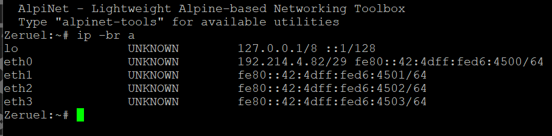

Berdasarkan hasil pemeriksaan, Shigeru memiliki beberapa interface yang terhubung dengan jaringan berbeda.

Interface `eth0` merupakan interface yang menghadap Gendo, sedangkan jaringan Monolith dan Radar berada pada sisi jaringan yang dilindungi oleh firewall.

Informasi routing digunakan untuk mengetahui jalur komunikasi antarjaringan serta menentukan interface dan subnet yang digunakan dalam konfigurasi firewall.

## 3. Konfigurasi Firewall

### 3.1 Pemeriksaan Rule Firewall

Sebelum konfigurasi diterapkan, dilakukan pemeriksaan terhadap rule pada chain `FORWARD` menggunakan perintah:

```bash
iptables -L FORWARD -n -v --line-numbers
```

Pemeriksaan ini dilakukan untuk mengetahui rule firewall yang sudah terpasang dan memastikan konfigurasi dapat diterapkan dengan urutan yang sesuai.

### 3.2 Penerapan Rule Firewall pada Chain FORWARD

Konfigurasi firewall diterapkan pada router Shigeru menggunakan chain `FORWARD`.

Rule yang diterapkan meliputi:

- Mengizinkan koneksi dengan status `ESTABLISHED` dan `RELATED`.
- Mengizinkan ping dari subnet Terminal menuju zona Monolith.
- Mengizinkan ping dari subnet Terminal menuju zona Radar.
- Mengizinkan node pada subnet Monolith memulai koneksi keluar.
- Mengizinkan node pada subnet Radar memulai koneksi keluar.
- Memblokir koneksi baru dari arah Gendo menuju subnet Monolith.
- Memblokir koneksi baru dari arah Gendo menuju subnet Radar.

Setelah konfigurasi diterapkan, dilakukan pemeriksaan kembali menggunakan perintah:

```bash
iptables -L FORWARD -n -v --line-numbers
```

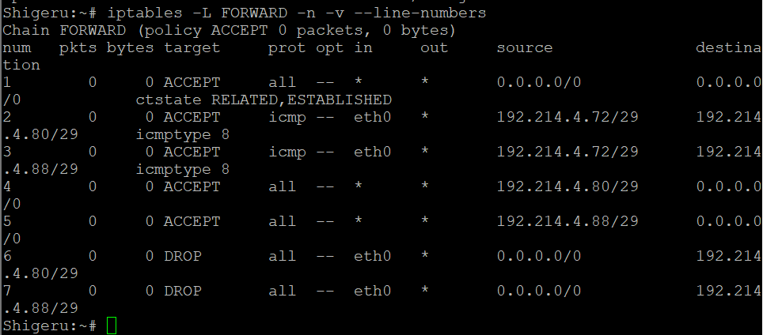

Hasil pemeriksaan menunjukkan bahwa rule firewall telah terpasang pada chain `FORWARD`.

Rule tersebut mencakup izin koneksi balasan, pengecualian ping dari subnet Terminal, izin koneksi keluar dari zona, serta pemblokiran koneksi baru dari arah Gendo menuju zona Monolith dan Radar.

## 4. Persistensi Konfigurasi Firewall

### 4.1 Pembuatan Script Persistensi

Agar konfigurasi firewall dapat diterapkan kembali ketika router Shigeru dijalankan, konfigurasi disimpan dalam script:

```bash
/root/init.sh
```

Script tersebut berisi konfigurasi firewall untuk Q18, termasuk pembersihan rule sebelumnya dan pemasangan rule firewall yang diperlukan.

Script dibuat menggunakan perintah:

```bash
cat > /root/init.sh <<'EOF'
#!/bin/sh

# Q18 - Gerbang Monolith dan Radar
# Persistensi firewall Shigeru

# Bersihkan rule FORWARD agar tidak duplikat
iptables -F FORWARD

# Izinkan koneksi yang sudah terbentuk dan paket balasan
iptables -A FORWARD -m conntrack --ctstate ESTABLISHED,RELATED -j ACCEPT

# Izinkan ping dari subnet Terminal menuju zona Monolith
iptables -A FORWARD -i eth0 -s 192.214.4.56/29 -d 192.214.4.80/29 -p icmp --icmp-type echo-request -j ACCEPT

# Izinkan ping dari subnet Terminal menuju zona Radar
iptables -A FORWARD -i eth0 -s 192.214.4.56/29 -d 192.214.4.88/29 -p icmp --icmp-type echo-request -j ACCEPT

# Izinkan node pada zona Monolith memulai koneksi keluar
iptables -A FORWARD -s 192.214.4.80/29 -j ACCEPT

# Izinkan node pada zona Radar memulai koneksi keluar
iptables -A FORWARD -s 192.214.4.88/29 -j ACCEPT

# Blokir koneksi baru dari arah Gendo menuju zona Monolith
iptables -A FORWARD -i eth0 -d 192.214.4.80/29 -j DROP

# Blokir koneksi baru dari arah Gendo menuju zona Radar
iptables -A FORWARD -i eth0 -d 192.214.4.88/29 -j DROP
EOF

chmod +x /root/init.sh
```

### 4.2 Integrasi dengan Startup Router

Pada sistem Alpine Linux yang digunakan, file `/etc/alpinet-init.sh` memiliki mekanisme untuk menjalankan script `/root/init.sh` apabila file tersebut tersedia dan memiliki izin eksekusi.

Bagian yang digunakan adalah:

```bash
[ -f /root/init.sh ] && [ -x /root/init.sh ] && /root/init.sh
```

Dengan mekanisme tersebut, script firewall dapat dipanggil kembali ketika proses startup router dijalankan.

Untuk menjalankan script secara manual, digunakan perintah:

```bash
sh /root/init.sh
```

Setelah script dijalankan, rule firewall diperiksa kembali menggunakan:

```bash
iptables -L FORWARD -n -v --line-numbers
```

### 4.3 Verifikasi Persistensi

Setelah konfigurasi firewall diterapkan, router Shigeru direstart untuk menguji apakah rule firewall tetap aktif.

Setelah router kembali berjalan, pemeriksaan dilakukan menggunakan:

```bash
iptables -L FORWARD -n -v --line-numbers
```

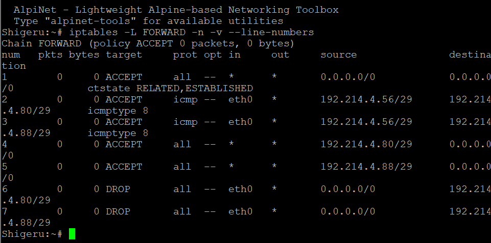

Hasil pemeriksaan menunjukkan bahwa rule firewall kembali tersedia setelah restart.

Hal ini menunjukkan bahwa konfigurasi firewall berhasil diterapkan kembali pada router Shigeru setelah proses restart.

## 5. Pengujian Konektivitas

### 5.1 Pengujian Magi-Casper ke Zeruel

Pengujian dilakukan dari Magi-Casper menuju Zeruel menggunakan perintah:

```bash
ping -c 4 192.214.4.82
```

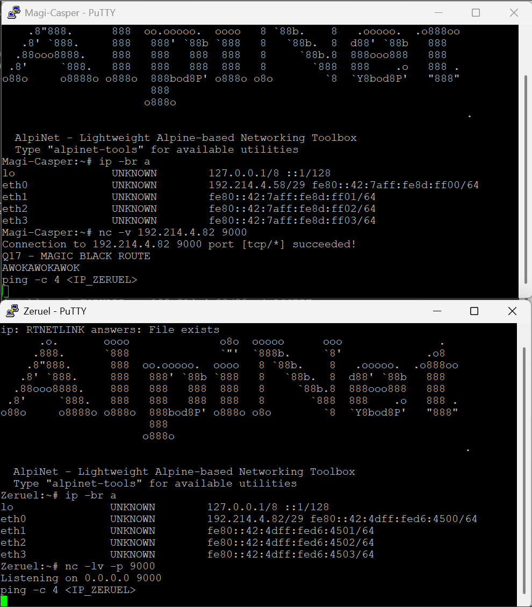

Hasil pengujian menunjukkan:

- 4 paket dikirim.
- 4 paket diterima.
- Packet loss sebesar 0%.

Dengan demikian, ping dari subnet Terminal menuju Zeruel berhasil dilakukan.

Hasil ini menunjukkan bahwa rule pengecualian ICMP dari subnet Terminal menuju zona Monolith bekerja sesuai konfigurasi.

### 5.2 Pengujian Lilith ke Zeruel

Pengujian berikutnya dilakukan dari Lilith menuju Zeruel menggunakan perintah:

```bash
ping -c 4 192.214.4.82
```

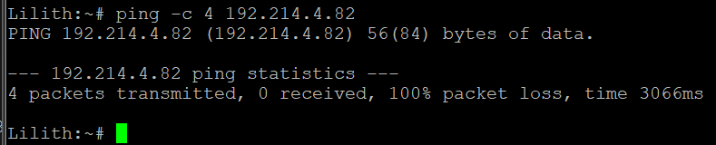

Hasil pengujian menunjukkan:

- 4 paket dikirim.
- 0 paket diterima.
- Packet loss sebesar 100%.

Dengan demikian, ping dari Lilith menuju Zeruel tidak berhasil.

Hasil ini sesuai dengan konfigurasi firewall yang membatasi koneksi dari luar zona yang tidak termasuk dalam pengecualian.

## 6. Pengujian Persistensi Setelah Restart

Setelah Shigeru direstart, dilakukan kembali pengujian konektivitas untuk memastikan bahwa konfigurasi firewall tetap berlaku.

### 6.1 Magi-Casper ke Zeruel Setelah Restart

Pengujian dilakukan menggunakan perintah:

```bash
ping -c 4 192.214.4.82
```

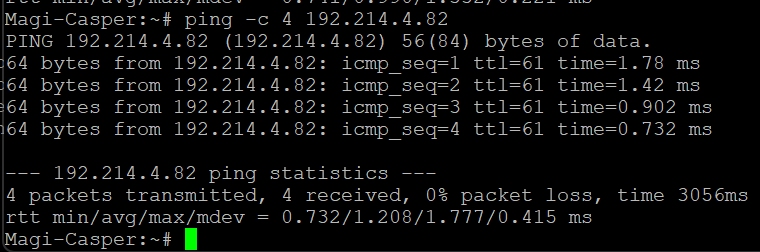

Hasil pengujian menunjukkan bahwa Magi-Casper tetap dapat melakukan ping menuju Zeruel dengan 0% packet loss.

### 6.2 Lilith ke Zeruel Setelah Restart

Pengujian dilakukan menggunakan perintah:

```bash
ping -c 4 192.214.4.82
```

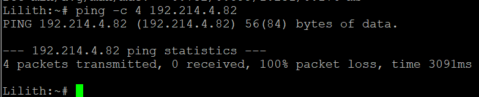

Hasil pengujian menunjukkan bahwa Lilith tetap tidak dapat melakukan ping menuju Zeruel dengan 100% packet loss.

### 6.3 Kesimpulan Persistensi

Berdasarkan hasil pemeriksaan rule firewall dan pengujian konektivitas setelah restart, konfigurasi firewall Shigeru berhasil diterapkan kembali.

Magi-Casper tetap dapat mengakses Zeruel melalui ping, sedangkan Lilith tetap diblokir.

Dengan demikian, konfigurasi firewall Q18 berhasil dipersistensikan dan kebijakan akses jaringan tetap berjalan sesuai dengan ketentuan yang diterapkan.

# Q19 - Hukuman untuk Sang Pengkhianat — Isolasi Armisael

## 19.1 Tujuan

Pada soal ini, Armisael harus diisolasi dari seluruh jaringan, termasuk gateway dan perangkat lain yang berada pada switch yang sama. Zeruel yang terhubung pada switch yang sama tidak boleh ikut terisolasi.

Isolasi dilakukan dari luar Armisael karena konfigurasi isolasi tidak boleh dikerjakan di dalam node tersebut.

Pengujian dilakukan menggunakan:
- Ping untuk menguji konektivitas ICMP.
- Netcat (`nc`) untuk menguji koneksi TCP.
- TCP port 9000 untuk komunikasi antar-node.
- TCP port 53 untuk pengujian koneksi ke Seele (`8.8.8.8`).

## 19.2 Identifikasi Node dan Alamat IP

Berdasarkan hasil identifikasi interface dan routing, alamat IP yang digunakan pada pengujian adalah sebagai berikut.

| Node | Alamat IP | Keterangan |
|---|---|---|
| Armisael | `192.214.4.83/29` | Node yang diisolasi |
| Gateway Armisael | `192.214.4.81` | Gateway Armisael |
| Zeruel | `192.214.4.82/29` | Node yang tetap dapat berkomunikasi |
| Lilith | `192.214.4.74/29` | Node pengujian |
| Seele | `8.8.8.8` | Representasi internet simulasi |

Armisael dan Zeruel berada pada subnet `192.214.4.80/29` dan terhubung ke Switch-Monolith.

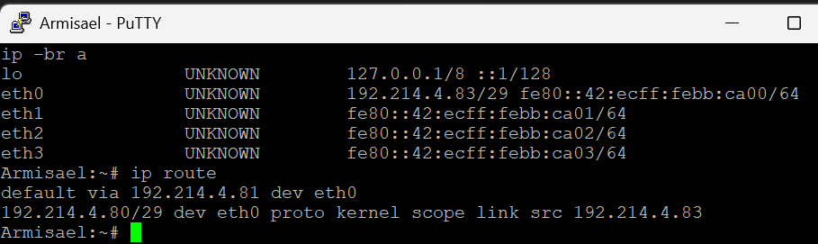

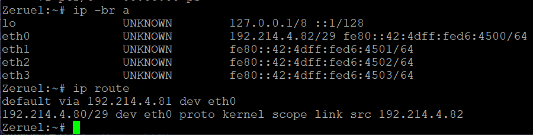

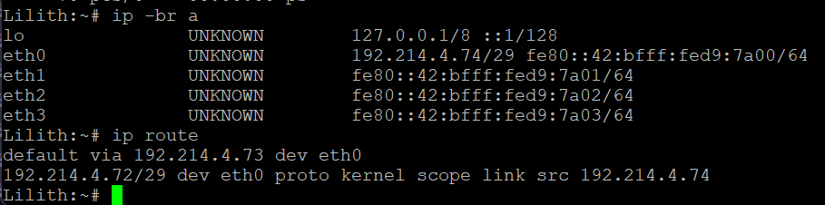

## 19.3 Isolasi Armisael

Isolasi dilakukan dengan menonaktifkan link Armisael yang terhubung ke Switch-Monolith melalui GNS3. Link Zeruel tetap aktif sehingga Zeruel tidak ikut terisolasi.

Metode ini dilakukan dari luar node Armisael dan tidak menggunakan konfigurasi firewall di dalam Armisael.

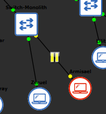

### 19.4 Persiapan Listener TCP 9000

Listener TCP port 9000 dijalankan pada Armisael, Zeruel, dan Lilith untuk pengujian koneksi menggunakan netcat.

Perintah yang digunakan pada masing-masing node:

```bash
nc -l -p 9000 >/tmp/nc9000.log 2>&1 &
```

Perintah dijalankan di background agar terminal tetap dapat digunakan untuk menjalankan perintah pengujian.

Untuk memastikan listener berjalan, dilakukan pemeriksaan proses menggunakan:

```bash
ps
```

Hasil pemeriksaan menunjukkan proses `nc` berjalan pada masing-masing node.

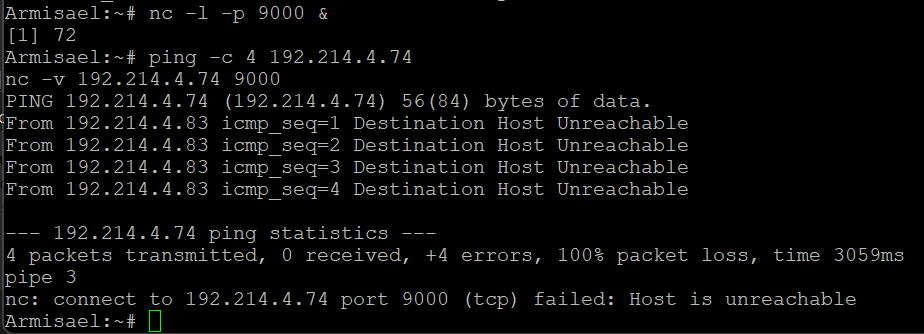

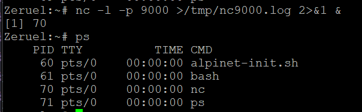

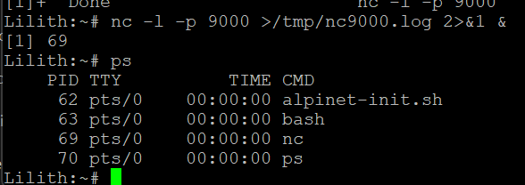

## 19.5 Pengujian Armisael

Pengujian dilakukan dari Armisael menuju Seele, Zeruel, dan Lilith.

### Armisael menuju Seele

Seele direpresentasikan oleh alamat `8.8.8.8`. Pengujian ping dilakukan menggunakan:

```bash
ping -c 4 8.8.8.8
```

Pengujian koneksi TCP port 53 dilakukan menggunakan:

```bash
nc -v 8.8.8.8 53
```

Hasil pengujian menunjukkan bahwa ping mengalami 100% packet loss dan koneksi TCP port 53 gagal karena host tidak dapat dijangkau.

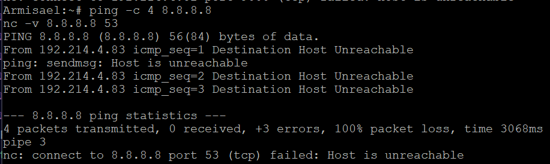

### Armisael menuju Zeruel

Pengujian ping dan koneksi TCP port 9000 dilakukan menggunakan:

```bash
ping -c 4 192.214.4.82
nc -v 192.214.4.82 9000
```

Hasil pengujian menunjukkan bahwa Armisael tidak dapat menjangkau Zeruel. Ping mengalami 100% packet loss dan koneksi TCP port 9000 gagal dengan pesan `Host is unreachable`.

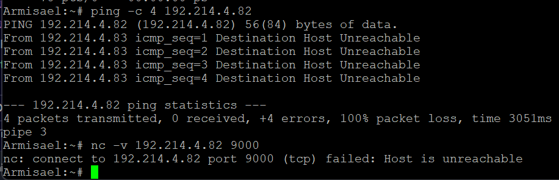

### Armisael menuju Lilith

Pengujian ping dan koneksi TCP port 9000 dilakukan menggunakan:

```bash
ping -c 4 192.214.4.74
nc -v 192.214.4.74 9000
```

Hasil pengujian menunjukkan bahwa ping mengalami 100% packet loss dan koneksi TCP port 9000 gagal karena host tidak dapat dijangkau.

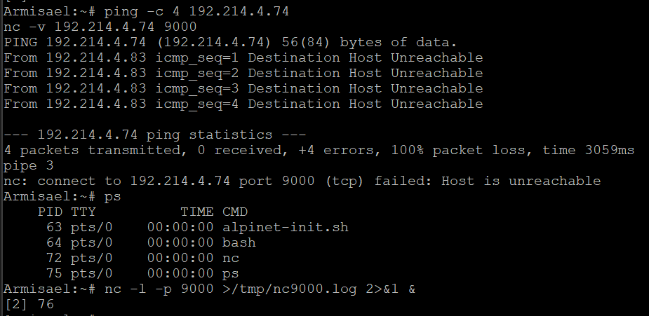

## 19.6 Pengujian Zeruel

Pengujian dilakukan dari Zeruel untuk memastikan bahwa isolasi Armisael tidak memengaruhi konektivitas Zeruel.

### Zeruel menuju Seele

Pengujian ping:

```bash
ping -c 4 8.8.8.8
```

Pengujian koneksi TCP port 53:

```bash
nc -v 8.8.8.8 53
```

Hasil pengujian menunjukkan bahwa ping berhasil dengan 4 paket diterima dan 0% packet loss. Koneksi TCP port 53 juga berhasil.

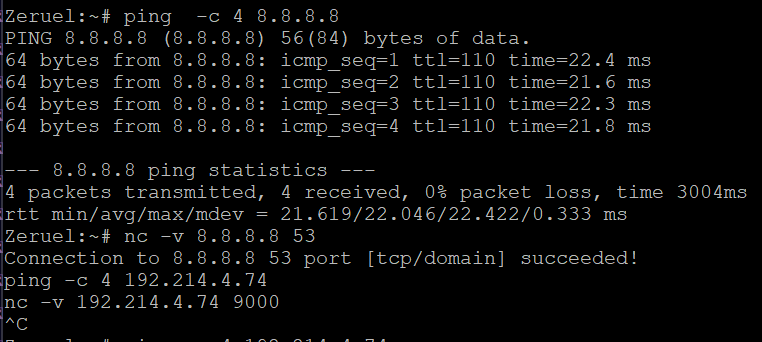

### Zeruel menuju Lilith

Pengujian ping:

```bash
ping -c 4 192.214.4.74
```

Pengujian koneksi TCP port 9000:

```bash
nc -v 192.214.4.74 9000
```

Hasil pengujian menunjukkan bahwa ping berhasil dengan 4 paket diterima dan 0% packet loss. Koneksi TCP port 9000 juga berhasil.

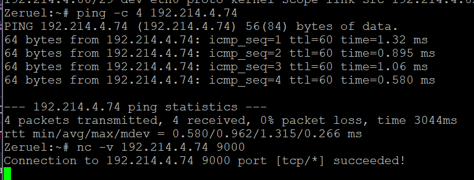

## 19.7 Persistence

Status isolasi Armisael dipertahankan melalui perubahan topologi GNS3, yaitu dengan menonaktifkan link Armisael menuju Switch-Monolith.

Project GNS3 disimpan menggunakan `Ctrl + S` setelah link Armisael berada dalam status suspended. Link Zeruel tetap aktif sehingga konektivitas Zeruel tidak terganggu.

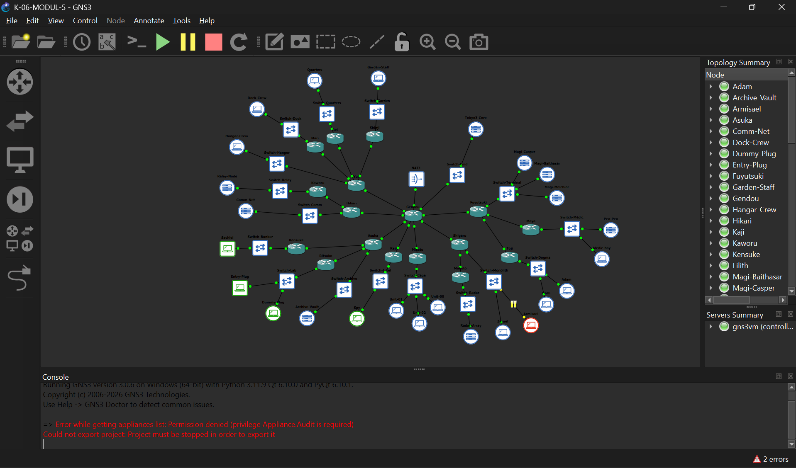

## 19.8 Kesimpulan

Berdasarkan hasil pengujian, isolasi Armisael berhasil dilakukan sesuai dengan ketentuan soal.

Armisael tidak dapat melakukan komunikasi melalui ping maupun netcat menuju Seele, Zeruel, dan Lilith. Sementara itu, Zeruel tetap dapat melakukan ping dan koneksi TCP menuju Seele serta Lilith.

Dengan demikian, isolasi Armisael berhasil diterapkan tanpa mengganggu konektivitas Zeruel.
